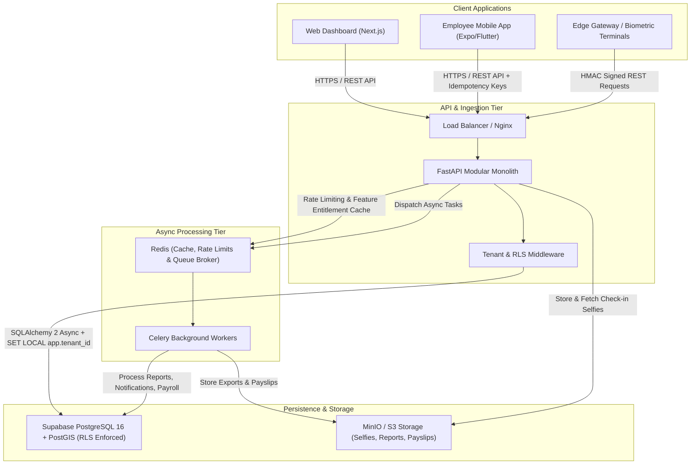
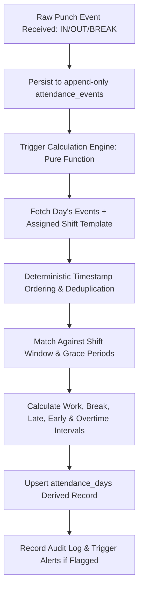

# ARCHITECTURE.md — System Architecture & Data Model

This document outlines the system architecture, component boundaries, data models, and communication flows for the Attendance SaaS platform.

---

## 1. Monorepo Directory Structure

The repository is organized as a unified monorepo to maintain strict contract synchronization and rapid development:

```text
/Users/apple/Upostit/
├── apps/
│   ├── web/                # Next.js 14+ TypeScript dashboard (Admin, HR, Manager, Billing)
│   └── mobile/             # React Native (Expo) / Flutter employee app (Punch, GPS, Selfie)
├── services/
│   ├── api/                # FastAPI modular monolith application
│   ├── workers/            # Celery asynchronous background tasks
│   └── edge/               # On-premise CCTV / Biometric hardware edge gateway (Phase 16)
├── packages/
│   └── contracts/          # Shared Pydantic / OpenAPI schema definitions and client SDKs
├── database/
│   └── migrations/         # Alembic database migration scripts
├── infra/                  # Docker Compose configurations, PgBouncer, Nginx, CI/CD
├── tests/                  # Cross-cutting integration, security, and load tests
├── docs/                   # Engineering documentation, phase specs, and architecture records
├── PROJECT_CONTEXT.md      # Single source of truth for project state and phase tracking
├── Makefile                # Standardized developer commands (make up, make test)
└── .env.example            # Environment variable template with safe placeholders
```

---

## 2. High-Level System Architecture



---

## 3. Communication & Connection Protocols

### 3.1 Web & Mobile Clients to FastAPI
- **Protocol**: HTTPS / RESTful JSON API.
- **Authentication**: Bearer JWT tokens in the `Authorization: Bearer <token>` header containing claims: `sub` (user_id), `tenant_id` (organization_id), `role` (`owner`, `admin`, `hr`, `manager`, `employee`).
- **Idempotency**: All state-mutating requests (such as `POST /punches`) include a client-generated UUID header `X-Client-Event-Id` ensuring deterministic, duplicate-free execution during network retries.

### 3.2 FastAPI to Supabase PostgreSQL
- **Connection Method**: Asynchronous connection pool using SQLAlchemy 2 with `asyncpg`.
- **Tenant Context Injection**: Every request operates inside a database transaction that sets the session-level tenant variable:
  ```sql
  SET LOCAL app.tenant_id = '<tenant_uuid_from_token>';
  ```
- **Security Boundary**: The connection connects using an application database role that lacks `BYPASSRLS`. Row-Level Security policies filter and validate every SQL read/write operation automatically.
- **PostGIS Support**: Spatial queries for geofenced workplaces utilize PostGIS `geography(Point, 4326)` columns and `ST_DWithin()` calculations.

### 3.3 Redis, Celery, and MinIO Responsibilities
- **Redis 7+**:
  - In-memory rate limiting per tenant and per IP address.
  - Caching plan entitlements (`tenant:{tenant_id}:entitlements`) with sub-second invalidation.
  - Message broker for asynchronous task delivery.
- **Celery Workers**:
  - Asynchronous CSV/Excel bulk employee imports with line-by-line validation reports.
  - Multi-channel notification delivery (Expo Push, transactional emails, WhatsApp/SMS).
  - Nightly and on-demand attendance session re-computations.
  - Heavy monthly payroll batch runs and PDF generation.
- **MinIO / S3 Object Storage**:
  - Encrypted storage for punch selfie images (`/{tenant_id}/selfies/{employee_id}/{date}/{file_id}.jpg`).
  - Pre-signed expiring download URLs for CSV/XLSX export downloads and payroll payslip PDFs.

---

## 4. Database Schema Roadmap by Phase

| Phase | Table Names | Functional Purpose |
| :--- | :--- | :--- |
| **Phase 2** | `tenants`, `users`, `memberships`, `refresh_tokens` | Multi-tenant accounts, RBAC memberships, authentication session tokens. |
| **Phase 3** | `audit_log`, `tenant_settings`, `feature_flags` | Comprehensive write audit trails, localization settings, feature toggles. |
| **Phase 4** | `employees`, `departments`, `locations`, `employee_locations`, `import_jobs` | Organizational structure, PostGIS geofenced workplaces, batch import tracking. |
| **Phase 5** | `shift_templates`, `shift_assignments`, `attendance_events`, `attendance_days` | Work shifts, immutable append-only event ledger, calculated daily attendance records. |
| **Phase 7** | `devices`, `fraud_rules`, `fraud_flags`, `selfies` | Device hardware binding, mock GPS detection, anomaly risk scores, review queue. |
| **Phase 8** | `correction_requests`, `approvals`, `attendance_daily_summary`, `export_jobs` | Shift correction requests, approval hierarchy, aggregated dashboard reporting. |
| **Phase 9** | `leave_types`, `leave_balances`, `leave_requests`, `holiday_calendars`, `overtime_rules` | Time-off entitlement balances, holiday schedules, overtime multiplier rules. |
| **Phase 10** | `notification_templates`, `notification_preferences`, `notifications` | Multi-channel alert dispatching, quiet hours, audit delivery log. |
| **Phase 11** | `plans`, `plan_features`, `subscriptions`, `usage_counters`, `invoices`, `payment_events` | Stripe/Razorpay billing, subscription state machine, automated entitlement gating. |
| **Phase 12** | `api_keys`, `webhooks`, `webhook_deliveries`, `support_sessions`, `data_requests` | Developer API credentials, signed webhooks, customer support impersonation. |
| **Phase 14** | `salary_structures`, `pay_components`, `pay_periods`, `payroll_runs`, `payroll_items`, `payslips` | Configurable payroll rules, locked pay runs, PDF payslips. |
| **Phase 15** | `terminal_devices`, `device_credentials`, `biometric_enrolments`, `consent_records` | On-premise biometric hardware registry, HMAC authentication, face template consent. |
| **Phase 16** | Edge gateway durable queue tables (SQLite on edge) | Local buffering of camera attendance events during site network outages. |

---

## 5. Attendance Session Calculation Engine



---

## 6. Layered Anti-Fraud Framework

1. **Device Binding**: Only 1 registered mobile device permitted per employee. Device replacement requires administrative approval.
2. **Geofence & Mock GPS Detection**: Server calculates spatial proximity to assigned workplace using PostGIS `ST_DWithin`. Detects emulator flags, Android mock-location APIs, and iOS jailbreaks.
3. **Selfie & Liveness Verification**: Front-camera selfie captured upon punch, analyzed for liveness, and matched against enrolled profile.
4. **Impossible Travel & Velocity Analysis**: Identifies geographically impossible transit times between successive punch events.
5. **Server Clock Authority**: Discrepancies between client device clock and authoritative UTC server clock exceeding 120 seconds are automatically flagged.
6. **Random In-Shift Presence Challenges**: Configurable mid-shift verification challenges sent to mobile app to prevent "phone left at desk" fraud.
