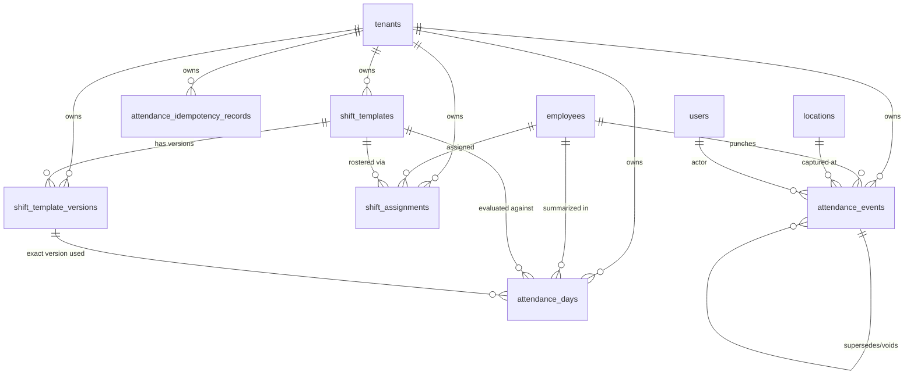
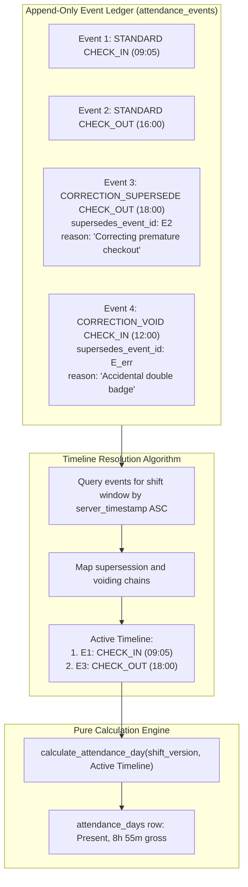
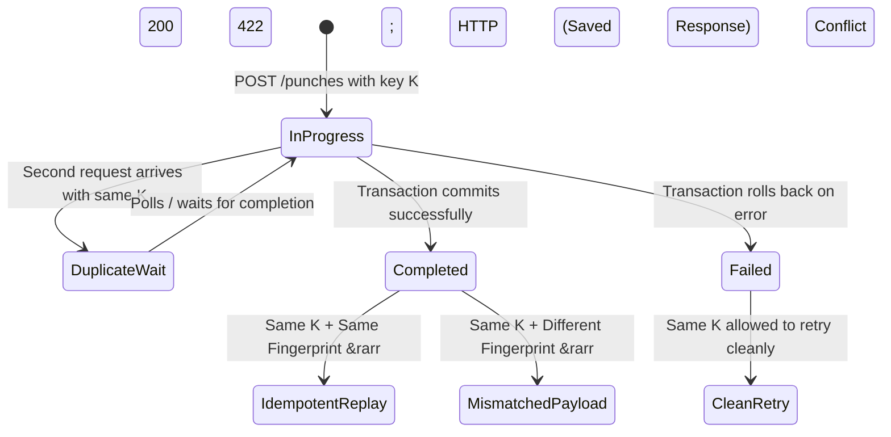

# ATTENDANCE ENGINE & EVENT LEDGER ARCHITECTURE

**System Component**: Attendance Core (Stage B)
**Document Revision**: 2.0 (Architecture Revision 2.0 — Post-Audit Hardened Design)
**Status**: IMPLEMENTED & FULLY VERIFIED SPECIFICATION (Branch: phase-05, Live Revision: a2b3c4d5e6f7)
**Target Milestone**: Phase 5 — Shifts and Punch Engine (Completed & Verified)

---

## 1. Executive Summary & Core Design Philosophy

The Attendance Engine is the core operational heart of the multi-tenant SaaS platform. Its primary mission is to provide an **uncompromising, tamper-resistant, audit-compliant, and mathematically deterministic record of workforce presence**.

Unlike traditional HR software that mutates records in place (e.g., updating a `check_out_time` column on a single mutable row), this platform implements an **append-only event sourcing pattern** coupled with a **pure functional projection engine**:

1. **Immutable Event Ledger (`attendance_events`)**:
   Every presence action (`CHECK_IN`, `CHECK_OUT`, `BREAK_START`, `BREAK_END`) and administrative adjustment (`CORRECTION_INSERT`, `CORRECTION_SUPERSEDE`, `CORRECTION_VOID`) is recorded as a discreet, immutable event. Historical events are never updated or deleted.
2. **Explicit Correction & Audit Model**:
   Corrections are not treated as opaque administrative overrides. The ledger supports three explicit correction actions:
   - **Adding a missing punch** (`CORRECTION_INSERT`)
   - **Superseding an erroneous punch** (`CORRECTION_SUPERSEDE`), with a foreign key referencing the original event
   - **Voiding an invalid punch** (`CORRECTION_VOID`), with a foreign key referencing the original event
   Every correction mandates an audit reason, records the correcting user, and triggers a deterministic recalculation without altering raw historical punches.
3. **Historical Shift Integrity via Immutable Shift Versions (`shift_template_versions`)**:
   Shift templates are separated from immutable shift versions. Changing shift rules (start time, grace periods, thresholds) creates a new version with an effective calendar date. Attendance dates are evaluated strictly against the version in force on that day. Historical attendance never changes when a template is edited.
4. **Pure Functional Calculation Engine**:
   The calculation engine is implemented as a pure function:
   $$\text{calculate\_attendance\_day}(\text{shift\_version}, [\text{resolved\_events}], \text{timezone}, \text{target\_date}) \rightarrow \text{AttendanceDayProjection}$$
   This guarantees 100% deterministic results, makes edge-case testing trivial without database mocking, and allows instantaneous recomputation when corrections arrive.
5. **Request Fingerprinting & Resilient Concurrency**:
   Every punch submission requires a client-generated UUID `idempotency_key` and a SHA-256 request payload fingerprint. Retries with the same payload return the original response; mismatched payloads with the same key are rejected; concurrent racing punches are serialized via pessimistic row locks.
6. **Future Offline-Readiness Data Model**:
   Events record server receipt timestamps, device-reported timestamps, clock-drift metrics, source tags, hardware identifiers, and verification statuses natively.

---

## 2. Roadmap Boundaries & Scope Isolation

To maintain architectural integrity across the 22-phase roadmap, the boundaries for Phase 5 are strictly enforced:

| Feature / Domain | Phase Assignment | Phase 5 Responsibility |
| :--- | :---: | :--- |
| **Shift Templates & Versions** | **Phase 5** | Model immutable shift versions, fixed/flexible/overnight shifts, and employee rostering with date ranges. |
| **Append-Only Punch Ledger** | **Phase 5** | Record `CHECK_IN`, `CHECK_OUT`, `BREAK_START`, `BREAK_END` via idempotent web/API punches. |
| **Correction Event Model** | **Phase 5** | Explicit `CORRECTION_INSERT`, `CORRECTION_SUPERSEDE`, `CORRECTION_VOID` with audit reasons and event linkage. |
| **Attendance Calculation Engine** | **Phase 5** | Pure functional derivation of daily attendance days, durations, overtime, and statuses. |
| **Web Attendance Console** | **Phase 5** | Next.js Employee Today widget & timer, My Attendance history, HR Daily Attendance Console. |
| **Mobile Punch App (Flutter)** | *Phase 6* | Flutter mobile app check-in, offline SQLite event queue, randomized exponential backoff. |
| **Fraud Shield & Biometrics** | *Phase 7* | Hardware device binding, check-in selfies, mock-GPS detection, velocity checks, risk scoring. |
| **Multi-Tier Approval Workflows** | *Phase 8* | Employee-submitted correction requests, multi-tier manager approval chains, data warehouse export. |
| **Leave Policies & Calendars** | *Phase 9* | Paid leave balances, accrual calculations, official public holiday calendars. |
| **Payroll Processing** | *Phase 14* | Statutory deductions, salary components, payroll lock runs, payslip generation. |

---

## 3. Database Schema & Persistence Architecture

The attendance domain requires five relational tables in PostgreSQL 16:
1. `shift_templates`: Master container and identity for shift definitions.
2. `shift_template_versions`: Immutable historical versions of shift timing, grace rules, and allowances.
3. `shift_assignments`: Maps employees to shift templates across calendar date ranges.
4. `attendance_events`: Immutable append-only ledger of all raw punches and corrections.
5. `attendance_days`: Materialized daily attendance summary projections.
6. `attendance_idempotency_records`: Request fingerprinting, locking, and cached response payloads.



---

### 3.1 `shift_templates` & `shift_template_versions` (Historical Shift Integrity)

To ensure that changing a shift's configuration in the future never mutates past attendance:
- `shift_templates` defines the stable business entity (name, code).
- `shift_template_versions` defines the immutable operational parameters with a `version_effective_from` calendar date.

```sql
-- 1. Shift Templates (Master Container)
CREATE TABLE shift_templates (
    id UUID PRIMARY KEY DEFAULT gen_random_uuid(),
    tenant_id UUID NOT NULL REFERENCES tenants(id) ON DELETE RESTRICT,
    name VARCHAR(100) NOT NULL,
    code VARCHAR(50) NOT NULL,
    description TEXT NULL,
    is_active BOOLEAN NOT NULL DEFAULT TRUE,
    created_at TIMESTAMPTZ NOT NULL DEFAULT timezone('utc'::text, now()),
    updated_at TIMESTAMPTZ NOT NULL DEFAULT timezone('utc'::text, now()),

    CONSTRAINT uq_shift_templates_tenant_code UNIQUE (tenant_id, code),
    CONSTRAINT uq_shift_templates_tenant_id UNIQUE (tenant_id, id)
);

CREATE INDEX ix_shift_templates_tenant_active ON shift_templates (tenant_id, is_active);

ALTER TABLE shift_templates ENABLE ROW LEVEL SECURITY;
ALTER TABLE shift_templates FORCE ROW LEVEL SECURITY;

CREATE POLICY tenant_isolation ON shift_templates
    USING (tenant_id = current_setting('app.tenant_id', true)::uuid)
    WITH CHECK (tenant_id = current_setting('app.tenant_id', true)::uuid);


-- 2. Shift Template Versions (Immutable Operational Parameters)
CREATE TABLE shift_template_versions (
    id UUID PRIMARY KEY DEFAULT gen_random_uuid(),
    tenant_id UUID NOT NULL REFERENCES tenants(id) ON DELETE RESTRICT,
    shift_template_id UUID NOT NULL,
    version_number INTEGER NOT NULL,
    version_effective_from DATE NOT NULL,
    start_time TIME WITHOUT TIME ZONE NOT NULL,
    end_time TIME WITHOUT TIME ZONE NOT NULL,
    grace_period_minutes INTEGER NOT NULL DEFAULT 15,
    early_exit_grace_minutes INTEGER NOT NULL DEFAULT 15,
    early_arrival_allowance_minutes INTEGER NOT NULL DEFAULT 120, -- Window start buffer
    late_departure_allowance_minutes INTEGER NOT NULL DEFAULT 180, -- Window end buffer
    half_day_threshold_minutes INTEGER NOT NULL DEFAULT 240, -- 4 hours
    full_day_threshold_minutes INTEGER NOT NULL DEFAULT 480, -- 8 hours
    break_duration_minutes INTEGER NOT NULL DEFAULT 60,
    is_overnight BOOLEAN NOT NULL DEFAULT FALSE,
    is_flexible BOOLEAN NOT NULL DEFAULT FALSE,
    weekly_off_days JSONB NOT NULL DEFAULT '[6, 0]'::jsonb, -- 0=Sunday, 6=Saturday
    created_by_user_id UUID NULL,
    created_at TIMESTAMPTZ NOT NULL DEFAULT timezone('utc'::text, now()),

    CONSTRAINT fk_shift_versions_template
        FOREIGN KEY (tenant_id, shift_template_id)
        REFERENCES shift_templates (tenant_id, id)
        ON DELETE RESTRICT,

    CONSTRAINT fk_shift_versions_user
        FOREIGN KEY (tenant_id, created_by_user_id)
        REFERENCES users (tenant_id, id)
        ON DELETE SET NULL (created_by_user_id),

    CONSTRAINT uq_shift_versions_tenant_id UNIQUE (tenant_id, id),
    CONSTRAINT uq_shift_versions_tenant_template_vnum UNIQUE (tenant_id, shift_template_id, version_number),
    CONSTRAINT uq_shift_versions_tenant_template_date UNIQUE (tenant_id, shift_template_id, version_effective_from),

    CONSTRAINT chk_shift_versions_thresholds CHECK (
        half_day_threshold_minutes > 0 AND
        full_day_threshold_minutes >= half_day_threshold_minutes
    ),
    CONSTRAINT chk_shift_versions_graces CHECK (
        grace_period_minutes >= 0 AND
        early_exit_grace_minutes >= 0 AND
        early_arrival_allowance_minutes >= 0 AND
        late_departure_allowance_minutes >= 0
    )
);

CREATE INDEX ix_shift_versions_tenant_tmpl_date
    ON shift_template_versions (tenant_id, shift_template_id, version_effective_from DESC);

ALTER TABLE shift_template_versions ENABLE ROW LEVEL SECURITY;
ALTER TABLE shift_template_versions FORCE ROW LEVEL SECURITY;

CREATE POLICY tenant_isolation ON shift_template_versions
    USING (tenant_id = current_setting('app.tenant_id', true)::uuid)
    WITH CHECK (tenant_id = current_setting('app.tenant_id', true)::uuid);
```

---

### 3.2 `shift_assignments` (Employee Rostering)

```sql
CREATE TABLE shift_assignments (
    id UUID PRIMARY KEY DEFAULT gen_random_uuid(),
    tenant_id UUID NOT NULL REFERENCES tenants(id) ON DELETE RESTRICT,
    employee_id UUID NOT NULL,
    shift_template_id UUID NOT NULL,
    effective_from DATE NOT NULL DEFAULT CURRENT_DATE,
    effective_to DATE NULL,
    created_at TIMESTAMPTZ NOT NULL DEFAULT timezone('utc'::text, now()),
    updated_at TIMESTAMPTZ NOT NULL DEFAULT timezone('utc'::text, now()),

    CONSTRAINT fk_shift_assignments_employee
        FOREIGN KEY (tenant_id, employee_id)
        REFERENCES employees (tenant_id, id)
        ON DELETE CASCADE,

    CONSTRAINT fk_shift_assignments_template
        FOREIGN KEY (tenant_id, shift_template_id)
        REFERENCES shift_templates (tenant_id, id)
        ON DELETE RESTRICT,

    CONSTRAINT uq_shift_assignments_tenant_id UNIQUE (tenant_id, id),
    CONSTRAINT chk_shift_assignments_dates CHECK (
        effective_to IS NULL OR effective_to >= effective_from
    ),

    CONSTRAINT excl_shift_assignments_overlap
        EXCLUDE USING gist (
            tenant_id WITH =,
            employee_id WITH =,
            daterange(effective_from, COALESCE(effective_to, 'infinity'::date), '[]') WITH &&
        )
);

CREATE INDEX ix_shift_assignments_tenant_emp ON shift_assignments (tenant_id, employee_id);

ALTER TABLE shift_assignments ENABLE ROW LEVEL SECURITY;
ALTER TABLE shift_assignments FORCE ROW LEVEL SECURITY;

CREATE POLICY tenant_isolation ON shift_assignments
    USING (tenant_id = current_setting('app.tenant_id', true)::uuid)
    WITH CHECK (tenant_id = current_setting('app.tenant_id', true)::uuid);
```

---

### 3.3 `attendance_events` (Append-Only Ledger & Correction Model)

```sql
CREATE TABLE attendance_events (
    id UUID PRIMARY KEY DEFAULT gen_random_uuid(),
    tenant_id UUID NOT NULL REFERENCES tenants(id) ON DELETE RESTRICT,
    employee_id UUID NOT NULL,
    event_type VARCHAR(30) NOT NULL, -- 'CHECK_IN', 'CHECK_OUT', 'BREAK_START', 'BREAK_END'
    event_category VARCHAR(30) NOT NULL DEFAULT 'STANDARD', -- 'STANDARD', 'CORRECTION_INSERT', 'CORRECTION_SUPERSEDE', 'CORRECTION_VOID'
    supersedes_event_id UUID NULL,
    correction_reason TEXT NULL,
    server_timestamp TIMESTAMPTZ NOT NULL DEFAULT timezone('utc'::text, now()),
    device_reported_timestamp TIMESTAMPTZ NOT NULL,
    effective_timestamp TIMESTAMPTZ NOT NULL,
    clock_drift_seconds NUMERIC(10, 3) NOT NULL DEFAULT 0.000,
    source VARCHAR(20) NOT NULL DEFAULT 'WEB', -- 'WEB', 'MOBILE', 'ADMIN', 'DEVICE', 'API'
    device_identifier VARCHAR(128) NULL,
    timestamp_verification_status VARCHAR(30) NOT NULL DEFAULT 'SERVER_AUTHORITATIVE', -- 'SERVER_AUTHORITATIVE', 'DEVICE_VERIFIED_NTP', 'SUSPICIOUS_CLOCK_DRIFT', 'UNVERIFIED_OFFLINE'
    review_status VARCHAR(30) NOT NULL DEFAULT 'NOT_REQUIRED', -- 'NOT_REQUIRED', 'PENDING_REVIEW', 'FLAGGED', 'APPROVED', 'REJECTED'
    idempotency_key VARCHAR(64) NOT NULL,
    location_id UUID NULL,
    latitude NUMERIC(10, 7) NULL,
    longitude NUMERIC(10, 7) NULL,
    accuracy_meters NUMERIC(8, 2) NULL,
    actor_user_id UUID NULL,
    metadata_json JSONB NOT NULL DEFAULT '{}'::jsonb,
    created_at TIMESTAMPTZ NOT NULL DEFAULT timezone('utc'::text, now()),

    CONSTRAINT fk_attendance_events_employee
        FOREIGN KEY (tenant_id, employee_id)
        REFERENCES employees (tenant_id, id)
        ON DELETE RESTRICT,

    CONSTRAINT fk_attendance_events_location
        FOREIGN KEY (tenant_id, location_id)
        REFERENCES locations (tenant_id, id)
        ON DELETE SET NULL (location_id),

    CONSTRAINT fk_attendance_events_actor
        FOREIGN KEY (tenant_id, actor_user_id)
        REFERENCES users (tenant_id, id)
        ON DELETE SET NULL (actor_user_id),

    CONSTRAINT fk_attendance_events_supersedes
        FOREIGN KEY (tenant_id, supersedes_event_id)
        REFERENCES attendance_events (tenant_id, id)
        ON DELETE RESTRICT,

    CONSTRAINT uq_attendance_events_tenant_id UNIQUE (tenant_id, id),
    CONSTRAINT uq_attendance_events_tenant_idempotency UNIQUE (tenant_id, idempotency_key),

    CONSTRAINT chk_attendance_events_type CHECK (
        event_type IN ('CHECK_IN', 'CHECK_OUT', 'BREAK_START', 'BREAK_END')
    ),

    CONSTRAINT chk_attendance_events_category CHECK (
        event_category IN ('STANDARD', 'CORRECTION_INSERT', 'CORRECTION_SUPERSEDE', 'CORRECTION_VOID')
    ),

    CONSTRAINT chk_attendance_events_correction_reason CHECK (
        event_category = 'STANDARD' OR (correction_reason IS NOT NULL AND length(trim(correction_reason)) >= 5)
    ),

    CONSTRAINT chk_attendance_events_supersedes_link CHECK (
        (event_category IN ('CORRECTION_SUPERSEDE', 'CORRECTION_VOID') AND supersedes_event_id IS NOT NULL) OR
        (event_category IN ('STANDARD', 'CORRECTION_INSERT') AND supersedes_event_id IS NULL)
    ),

    CONSTRAINT chk_attendance_events_source CHECK (
        source IN ('WEB', 'MOBILE', 'ADMIN', 'DEVICE', 'API')
    ),

    CONSTRAINT chk_attendance_events_verification CHECK (
        timestamp_verification_status IN ('SERVER_AUTHORITATIVE', 'DEVICE_VERIFIED_NTP', 'SUSPICIOUS_CLOCK_DRIFT', 'UNVERIFIED_OFFLINE')
    ),

    CONSTRAINT chk_attendance_events_review CHECK (
        review_status IN ('NOT_REQUIRED', 'PENDING_REVIEW', 'FLAGGED', 'APPROVED', 'REJECTED')
    )
);

CREATE INDEX ix_attendance_events_tenant_emp_eff
    ON attendance_events (tenant_id, employee_id, effective_timestamp ASC);

CREATE INDEX ix_attendance_events_tenant_superseded
    ON attendance_events (tenant_id, supersedes_event_id)
    WHERE supersedes_event_id IS NOT NULL;

ALTER TABLE attendance_events ENABLE ROW LEVEL SECURITY;
ALTER TABLE attendance_events FORCE ROW LEVEL SECURITY;

CREATE POLICY tenant_isolation ON attendance_events
    USING (tenant_id = current_setting('app.tenant_id', true)::uuid)
    WITH CHECK (tenant_id = current_setting('app.tenant_id', true)::uuid);

-- Immutability Trigger
CREATE OR REPLACE FUNCTION trg_attendance_events_immutability()
RETURNS TRIGGER AS $$
BEGIN
    RAISE EXCEPTION 'attendance_events is an append-only ledger. UPDATE and DELETE operations are strictly prohibited.'
        USING ERRCODE = 'integrity_constraint_violation';
END;
$$ LANGUAGE plpgsql;

CREATE TRIGGER trg_prevent_attendance_events_mutation
    BEFORE UPDATE OR DELETE ON attendance_events
    FOR EACH ROW
    EXECUTE FUNCTION trg_attendance_events_immutability();
```

---

### 3.4 `attendance_days` (Derived Projection Table)

```sql
CREATE TABLE attendance_days (
    id UUID PRIMARY KEY DEFAULT gen_random_uuid(),
    tenant_id UUID NOT NULL REFERENCES tenants(id) ON DELETE RESTRICT,
    employee_id UUID NOT NULL,
    attendance_date DATE NOT NULL,
    shift_template_id UUID NULL,
    shift_version_id UUID NULL,
    first_check_in TIMESTAMPTZ NULL,
    last_check_out TIMESTAMPTZ NULL,
    total_working_minutes INTEGER NOT NULL DEFAULT 0,
    total_break_minutes INTEGER NOT NULL DEFAULT 0,
    net_working_minutes INTEGER NOT NULL DEFAULT 0,
    actual_late_minutes INTEGER NOT NULL DEFAULT 0,
    late_arrival_minutes INTEGER NOT NULL DEFAULT 0,
    actual_early_minutes INTEGER NOT NULL DEFAULT 0,
    early_departure_minutes INTEGER NOT NULL DEFAULT 0,
    overtime_minutes INTEGER NOT NULL DEFAULT 0,
    status VARCHAR(30) NOT NULL DEFAULT 'ABSENT', -- 'PRESENT', 'LATE', 'HALF_DAY', 'ABSENT', 'INCOMPLETE', 'WEEK_OFF', 'ON_LEAVE', 'HOLIDAY'
    is_incomplete BOOLEAN NOT NULL DEFAULT FALSE,
    missing_punch BOOLEAN NOT NULL DEFAULT FALSE,
    last_calculated_at TIMESTAMPTZ NOT NULL DEFAULT timezone('utc'::text, now()),
    created_at TIMESTAMPTZ NOT NULL DEFAULT timezone('utc'::text, now()),
    updated_at TIMESTAMPTZ NOT NULL DEFAULT timezone('utc'::text, now()),

    CONSTRAINT fk_attendance_days_employee
        FOREIGN KEY (tenant_id, employee_id)
        REFERENCES employees (tenant_id, id)
        ON DELETE CASCADE,

    CONSTRAINT fk_attendance_days_shift
        FOREIGN KEY (tenant_id, shift_template_id)
        REFERENCES shift_templates (tenant_id, id)
        ON DELETE SET NULL (shift_template_id),

    CONSTRAINT fk_attendance_days_shift_version
        FOREIGN KEY (tenant_id, shift_version_id)
        REFERENCES shift_template_versions (tenant_id, id)
        ON DELETE SET NULL (shift_version_id),

    CONSTRAINT uq_attendance_days_tenant_emp_date
        UNIQUE (tenant_id, employee_id, attendance_date),

    CONSTRAINT uq_attendance_days_tenant_id UNIQUE (tenant_id, id),

    CONSTRAINT chk_attendance_days_status CHECK (
        status IN ('PRESENT', 'LATE', 'HALF_DAY', 'ABSENT', 'INCOMPLETE', 'WEEK_OFF', 'ON_LEAVE', 'HOLIDAY')
    )
);

CREATE INDEX ix_attendance_days_tenant_date ON attendance_days (tenant_id, attendance_date);
CREATE INDEX ix_attendance_days_tenant_status ON attendance_days (tenant_id, status);
CREATE INDEX ix_attendance_days_tenant_emp_date ON attendance_days (tenant_id, employee_id, attendance_date DESC);

ALTER TABLE attendance_days ENABLE ROW LEVEL SECURITY;
ALTER TABLE attendance_days FORCE ROW LEVEL SECURITY;

CREATE POLICY tenant_isolation ON attendance_days
    USING (tenant_id = current_setting('app.tenant_id', true)::uuid)
    WITH CHECK (tenant_id = current_setting('app.tenant_id', true)::uuid);
```

---

### 3.5 `attendance_idempotency_records` (Request Fingerprinting & Concurrency)

```sql
CREATE TABLE attendance_idempotency_records (
    id UUID PRIMARY KEY DEFAULT gen_random_uuid(),
    tenant_id UUID NOT NULL REFERENCES tenants(id) ON DELETE RESTRICT,
    employee_id UUID NOT NULL,
    idempotency_key VARCHAR(64) NOT NULL,
    request_fingerprint VARCHAR(64) NOT NULL, -- SHA-256 of request payload
    status VARCHAR(20) NOT NULL DEFAULT 'IN_PROGRESS', -- 'IN_PROGRESS', 'COMPLETED', 'FAILED'
    response_code INTEGER NULL,
    response_payload JSONB NULL,
    event_id UUID NULL,
    created_at TIMESTAMPTZ NOT NULL DEFAULT timezone('utc'::text, now()),
    expires_at TIMESTAMPTZ NULL, -- NULL for COMPLETED (permanently retained), 15-minute lease for IN_PROGRESS

    CONSTRAINT fk_idempotency_employee
        FOREIGN KEY (tenant_id, employee_id)
        REFERENCES employees (tenant_id, id)
        ON DELETE CASCADE,

    CONSTRAINT fk_idempotency_event
        FOREIGN KEY (tenant_id, event_id)
        REFERENCES attendance_events (tenant_id, id)
        ON DELETE SET NULL (event_id),

    CONSTRAINT uq_idempotency_tenant_id UNIQUE (tenant_id, id),
    CONSTRAINT uq_idempotency_tenant_key UNIQUE (tenant_id, idempotency_key),
    CONSTRAINT uq_idempotency_tenant_emp_key UNIQUE (tenant_id, employee_id, idempotency_key),
    CONSTRAINT chk_idempotency_status CHECK (status IN ('IN_PROGRESS', 'COMPLETED', 'FAILED'))
);

CREATE INDEX ix_idempotency_tenant_expires
    ON attendance_idempotency_records (tenant_id, expires_at)
    WHERE expires_at IS NOT NULL;

CREATE INDEX ix_idempotency_tenant_emp
    ON attendance_idempotency_records (tenant_id, employee_id);

ALTER TABLE attendance_idempotency_records ENABLE ROW LEVEL SECURITY;
ALTER TABLE attendance_idempotency_records FORCE ROW LEVEL SECURITY;

CREATE POLICY tenant_isolation ON attendance_idempotency_records
    USING (tenant_id = current_setting('app.tenant_id', true)::uuid)
    WITH CHECK (tenant_id = current_setting('app.tenant_id', true)::uuid);
```

> **Idempotency Retention & Replay Safety (Milestone 2 Audit Resolution)**:
> An attendance punch represents an indelible physical event. Expiring an idempotency record must never allow duplicate event creation or break replay fidelity. Under our audited design:
> 1. `attendance_events` enforces permanent uniqueness on `(tenant_id, idempotency_key)` at the database engine level. Duplicate inserts are physically rejected regardless of key age.
> 2. `attendance_idempotency_records` permanently retains all `COMPLETED` punch records (`expires_at = NULL`). Retries after 24 hours, 30 days, or 1 year seamlessly return the original cached response with `idempotent_replay: true`.
> 3. `expires_at` is only populated for in-flight requests (`IN_PROGRESS`, 15-minute lease) or `FAILED` requests, allowing abandoned lock leases to be recovered.
> 4. Partial index `ix_idempotency_tenant_expires` only indexes active non-null leases, keeping index maintenance overhead near zero.


#### 3.5.1 Deterministic SHA-256 Canonicalization & Concurrency Semantics

To ensure foolproof duplicate prevention across network retries and distributed clients:

1. **Behavior-Altering Canonical Parameters**:
   Every punch request is normalized into a sorted JSON structure containing:
   - `event_type`: Normalized punch type (`CHECK_IN`, `CHECK_OUT`, `BREAK_START`, `BREAK_END`).
   - `employee_id`: Target employee UUID string.
   - `device_reported_at`: ISO-8601 UTC string if supplied, else `null`.
   - `location_id`: Workplace location UUID string if supplied, else `null`.
   - `latitude` & `longitude`: High-precision coordinate strings if supplied, else `null`.
   - `accuracy_meters`: String representation of radius accuracy if supplied, else `null`.
   - `device_id`: Trimmed hardware/browser identifier if supplied, else `null`.
   - `metadata`: Key-sorted dictionary of client metadata.

2. **Canonical JSON Serialization & Hashing**:
   $$\text{canonical\_json} = \text{json.dumps}(\text{params}, \text{sort\_keys}=\text{True}, \text{separators}=(',', ':'))$$
   $$\text{request\_fingerprint} = \text{sha256}(\text{canonical\_json.encode}('utf-8')).\text{hexdigest}()$$

3. **Concurrency & Execution States**:
   - **Pessimistic Row Lock**: Before inspecting or mutating state, the employee row is locked via `SELECT id FROM employees WHERE tenant_id = :tenant_id AND id = :employee_id FOR UPDATE`, serializing punches per employee.
   - **Same Key + Same Fingerprint**: Returns cached response payload immediately (HTTP 200/201 with `idempotent_replay: true`) without creating duplicate records.
   - **Same Key + Different Fingerprint**: Rejects request with `HTTP 422 Unprocessable Content`.
   - **In-Progress Concurrency Collision**: Concurrently racing requests with the same key receive `HTTP 409 Conflict`.
   - **Atomic Multi-Event Creation**: If an employee issues `CHECK_OUT` while in state `ON_BREAK`, the service atomically inserts `BREAK_END` followed immediately by `CHECK_OUT` within the same database transaction.

---

## 4. Correction Event Lifecycle & Resolution Algorithm

Instead of overwriting punches, corrections create new events referencing existing ones.



### 4.1 Correction Types & System Behavior

1. **Adding a Missing Punch (`CORRECTION_INSERT`)**:
   - Used when an employee completely forgot to punch (e.g., missing check-out).
   - `event_category = 'CORRECTION_INSERT'`
   - `supersedes_event_id = NULL`
   - `effective_timestamp`: The intended punch time.
   - `correction_reason`: Mandatory (minimum 5 characters).
   - In the resolved timeline: Injected as an active punch at `effective_timestamp`.
2. **Superseding an Incorrect Punch (`CORRECTION_SUPERSEDE`)**:
   - Used when a punch was recorded at the wrong time or with wrong type.
   - `event_category = 'CORRECTION_SUPERSEDE'`
   - `supersedes_event_id`: UUID of the erroneous punch.
   - `effective_timestamp`: The corrected punch time.
   - `correction_reason`: Mandatory.
   - In the resolved timeline: The target event is marked `SUPERSEDED` and omitted from duration calculations; the new superseding event takes its place.
3. **Voiding an Invalid Punch (`CORRECTION_VOID`)**:
   - Used when a punch was entered in error and should not exist (e.g., duplicate accidental punch, punch on wrong employee).
   - `event_category = 'CORRECTION_VOID'`
   - `supersedes_event_id`: UUID of the punch being invalidated.
   - `correction_reason`: Mandatory.
   - In the resolved timeline: The target event is marked `VOIDED` and completely omitted from duration pairing. The voiding event itself does not contribute a punch.

### 4.2 Timeline Resolution Algorithm
```python
def resolve_active_timeline(events: list[AttendanceEvent]) -> list[AttendanceEvent]:
    """Resolves an append-only event stream into active effective punches."""
    # 1. Identify all superseded and voided event IDs
    voided_ids = set()
    superseded_ids = set()
    active_events = []

    # Sort by server_timestamp ascending so later corrections take precedence
    chronological_events = sorted(events, key=lambda e: e.server_timestamp)

    for event in chronological_events:
        if event.event_category == "CORRECTION_VOID" and event.supersedes_event_id:
            voided_ids.add(event.supersedes_event_id)
        elif event.event_category == "CORRECTION_SUPERSEDE" and event.supersedes_event_id:
            superseded_ids.add(event.supersedes_event_id)

    # 2. Filter out voided, superseded, and pure voiding actions
    for event in chronological_events:
        if event.id in voided_ids or event.id in superseded_ids:
            continue
        if event.event_category == "CORRECTION_VOID":
            continue # Pure tombstone
        active_events.append(event)

    # 3. Sort active timeline by effective_timestamp for duration calculation
    return sorted(active_events, key=lambda e: e.effective_timestamp)
```

---

## 5. Historical Shift Integrity & Versioning Strategy

### 5.1 Shift Versioning Rules
1. **Immutable Versions**: Once a `shift_template_versions` record is created, it is never modified.
2. **Effective Date Versioning**: Each version has a `version_effective_from` calendar date.
3. **Editing a Shift Template**:
   - Modifying a shift template inserts a new version with:
     - `version_number = previous_version + 1`
     - `version_effective_from = chosen_effective_date` (defaults to tomorrow or current date).
4. **Shift Version Resolution for Date $D$**:
   ```sql
   SELECT v.*
   FROM shift_assignments sa
   JOIN shift_template_versions v
     ON v.tenant_id = sa.tenant_id
    AND v.shift_template_id = sa.shift_template_id
   WHERE sa.tenant_id = :tenant_id
     AND sa.employee_id = :employee_id
     AND sa.effective_from <= :target_date
     AND (sa.effective_to IS NULL OR sa.effective_to >= :target_date)
     AND v.version_effective_from <= :target_date
   ORDER BY v.version_effective_from DESC, v.version_number DESC
   LIMIT 1;
   ```
5. **Historical Recalculation Guarantee**:
   - If a shift's start time changes from 09:00 to 08:30 starting November 1:
   - Recalculating October 15 loads Version 1 (09:00 start).
   - Recalculating November 5 loads Version 2 (08:30 start).
   - **Zero historical corruption**.

---

## 6. Late Arrival, Early Departure & Calculation Formulas

### 6.1 Definitions & Variables
- $T_{\text{sched\_start}}$: Scheduled shift start UTC datetime for `target_date`.
- $T_{\text{sched\_end}}$: Scheduled shift end UTC datetime for `target_date` (or `target_date + 1` for overnight).
- $T_{\text{first\_in}}$: Earliest `CHECK_IN` in the resolved active timeline.
- $T_{\text{last\_out}}$: Latest `CHECK_OUT` in the resolved active timeline.
- $G_{\text{start}}$: `grace_period_minutes` from shift version.
- $G_{\text{end}}$: `early_exit_grace_minutes` from shift version.
- $T_{\text{full}}$: `full_day_threshold_minutes`.
- $T_{\text{half}}$: `half_day_threshold_minutes`.

### 6.2 Exact Formulas

1. **Actual Late Minutes**:
   $$\text{actual\_late\_minutes} = \max\left(0, \lfloor (T_{\text{first\_in}} - T_{\text{sched\_start}})_{\text{minutes}} \rfloor\right)$$

2. **Grace-Adjusted Late Minutes (`late_arrival_minutes`)**:
   - If $\text{actual\_late\_minutes} \le G_{\text{start}}$:
     $$\text{late\_arrival\_minutes} = 0$$
     *(Arrival is within grace period; no tardiness penalty applied).*
   - If $\text{actual\_late\_minutes} > G_{\text{start}}$:
     Under enterprise strict policy:
     $$\text{late\_arrival\_minutes} = \text{actual\_late\_minutes}$$
     *(Once grace is breached, late duration is charged from scheduled start).*

3. **Actual Early Exit Minutes**:
   $$\text{actual\_early\_minutes} = \max\left(0, \lfloor (T_{\text{sched\_end}} - T_{\text{last\_out}})_{\text{minutes}} \rfloor\right)$$

4. **Grace-Adjusted Early Exit Minutes (`early_departure_minutes`)**:
   - If $\text{actual\_early\_minutes} \le G_{\text{end}}$:
     $$\text{early\_departure\_minutes} = 0$$
   - If $\text{actual\_early\_minutes} > G_{\text{end}}$:
     $$\text{early\_departure\_minutes} = \text{actual\_early\_minutes}$$

5. **Work & Break Durations**:
   $$\text{total\_working\_minutes} = \sum (\text{check\_out} - \text{check\_in})$$
   $$\text{total\_break\_minutes} = \sum (\text{break\_end} - \text{break\_start})$$
   $$\text{net\_working\_minutes} = \text{total\_working\_minutes} - \text{total\_break\_minutes}$$

6. **Overtime Minutes**:
   $$\text{scheduled\_working\_minutes} = (T_{\text{sched\_end}} - T_{\text{sched\_start}})_{\text{minutes}} - \text{break\_duration\_minutes}$$
   $$\text{overtime\_minutes} = \max\left(0, \text{net\_working\_minutes} - \text{scheduled\_working\_minutes}\right)$$

7. **Status Evaluation Matrix**:
   - If $T_{\text{first\_in}} \text{ is null}$ or $T_{\text{last\_out}} \text{ is null}$:
     $\text{status} = \text{'INCOMPLETE'}, \text{missing\_punch} = \text{TRUE}, \text{is\_incomplete} = \text{TRUE}$.
   - Else if $\text{net\_working\_minutes} \ge T_{\text{full}}$:
     - If $\text{late\_arrival\_minutes} > 0 \implies \text{status} = \text{'LATE'}$.
     - Else $\implies \text{status} = \text{'PRESENT'}$.
   - Else if $T_{\text{half}} \le \text{net\_working\_minutes} < T_{\text{full}}$:
     $\text{status} = \text{'HALF\_DAY'}$.
   - Else if $\text{net\_working\_minutes} < T_{\text{half}}$:
     - If target day is in `weekly_off_days` $\implies \text{status} = \text{'WEEK\_OFF'}$.
     - Else $\implies \text{status} = \text{'ABSENT'}$.

---

### 6.3 Worked Calculation Examples

#### Example 1: Standard On-Time Day
- Scheduled: 09:00 to 18:00 (Break: 60 min). Scheduled work: 480 min. Grace: 15 min. Full: 480 min.
- Punches: Check-in 08:52, Break 13:00–14:00 (60 min), Check-out 18:05.
- $\text{actual\_late\_minutes} = 0$, $\text{late\_arrival\_minutes} = 0$.
- $\text{actual\_early\_minutes} = 0$, $\text{early\_departure\_minutes} = 0$.
- $\text{total\_working\_minutes} = 18:05 - 08:52 = 553$ min.
- $\text{net\_working\_minutes} = 553 - 60 = 493$ min.
- $\text{overtime\_minutes} = 493 - 480 = 13$ min.
- **Status: `PRESENT`**.

#### Example 2: Arrival Within Grace Period
- Punches: Check-in 09:12 (12 min after 09:00), Check-out 18:15. Break: 60 min.
- $\text{actual\_late\_minutes} = 12$ min.
- Since $12 \le 15$ (grace limit), $\text{late\_arrival\_minutes} = 0$.
- $\text{net\_working\_minutes} = (18:15 - 09:12) - 60 = 543 - 60 = 483$ min.
- **Status: `PRESENT`** (Grace period successfully forgives tardiness).

#### Example 3: Grace Period Breached
- Punches: Check-in 09:22 (22 min after 09:00), Check-out 18:30. Break: 60 min.
- $\text{actual\_late\_minutes} = 22$ min.
- Since $22 > 15$ (grace breached), $\text{late\_arrival\_minutes} = 22$ min.
- $\text{net\_working\_minutes} = (18:30 - 09:22) - 60 = 548 - 60 = 488$ min ($\ge 480$ min).
- **Status: `LATE`** (Full work hours satisfied, but late arrival flag set).

#### Example 4: Missing Punch (Unclosed Session)
- Punches: Check-in 09:00, No check-out.
- $T_{\text{last\_out}} = \text{null}$.
- $\text{total\_working\_minutes} = 0$, $\text{net\_working\_minutes} = 0$.
- **Status: `INCOMPLETE`**, $\text{missing\_punch} = \text{TRUE}$, $\text{is\_incomplete} = \text{TRUE}$.

---

## 7. Overnight Shift Boundaries & Configurable Allowances

### 7.1 Configurable Shift Allowances
Fixed buffers (e.g. arbitrary $-2$h or $+4$h) are completely eliminated. Every shift version defines explicit:
- `early_arrival_allowance_minutes`: Default 120 min (2 hours).
- `late_departure_allowance_minutes`: Default 180 min (3 hours).

### 7.2 Window Formulation for Date $D$
Let shift scheduled start be $T_{\text{start}}$ on date $D$.
- If `is_overnight = FALSE`:
  - $T_{\text{sched\_end}} = \text{combine}(D, \text{end\_time})$.
- If `is_overnight = TRUE`:
  - $T_{\text{sched\_end}} = \text{combine}(D + 1\text{ day}, \text{end\_time})$.

**Attendance Matching Window**:
$$W_{\text{start}}(D) = T_{\text{sched\_start}}(D) - \text{early\_arrival\_allowance\_minutes}$$
$$W_{\text{end}}(D) = T_{\text{sched\_end}}(D) + \text{late\_departure\_allowance\_minutes}$$

### 7.3 Overnight Shift Attribution
- Any punch occurring inside $[W_{\text{start}}(D), W_{\text{end}}(D)]$ is attributed to **Shift Date $D$** (the calendar date the shift started).
- For a night shift running from 22:00 (Nov 3) to 06:00 (Nov 4):
  - Window: 20:00 (Nov 3) to 09:00 (Nov 4).
  - All punches in this window belong to `attendance_date = 2026-11-03`.
  - The single `attendance_days` record for Nov 3 contains the complete overnight session.

### 7.4 Overlapping Shift Windows Disambiguation
When an employee works consecutive shifts where $W_{\text{end}}(D)$ overlaps with $W_{\text{start}}(D+1)$:
1. **State-Aware Disambiguation**:
   - If an employee is currently `CHECKED_IN` in Shift $D$, an incoming `CHECK_OUT` punch is assigned to Shift $D$.
   - An incoming `CHECK_IN` punch while `NOT_CHECKED_IN` belongs to Shift $D+1$.
2. **Midpoint Partitioning Rule**:
   If an event is unassigned, the boundary between adjacent shifts $D$ and $D+1$ is partitioned at the exact midpoint:
   $$T_{\text{partition}} = T_{\text{sched\_end}}(D) + \frac{T_{\text{sched\_start}}(D+1) - T_{\text{sched\_end}}(D)}{2}$$
   Punches before $T_{\text{partition}}$ belong to Shift $D$; punches on or after $T_{\text{partition}}$ belong to Shift $D+1$.

---

## 8. Idempotency, Request Fingerprinting & Concurrency

### 8.1 Request Fingerprint Definition
$$\text{request\_fingerprint} = \text{SHA-256}(\text{tenant\_id} + \text{employee\_id} + \text{event\_type} + \text{client\_timestamp} + \text{location\_id})$$

### 8.2 Idempotency State Machine



1. **Same Key + Same Fingerprint**:
   - If record status is `COMPLETED`: Returns cached `response_payload` with HTTP 200 OK.
   - If record status is `IN_PROGRESS`: Concurrent duplicate request in-flight. The second thread waits (up to 3 seconds with exponential backoff) for the first transaction to complete, then returns the completed response.
2. **Same Key + Different Fingerprint**:
   - Rejects immediately with HTTP 422 Unprocessable Entity: `"Idempotency key collision with mismatched payload."`
3. **Transaction Rollback Protection**:
   - If an exception occurs, the idempotency record status is set to `FAILED` or deleted, allowing the client to retry without being permanently locked out.
4. **Retry After Network Timeout**:
   - If client times out after server commit, the retry hits `COMPLETED` and receives the cached response instantly.
5. **Atomic Multi-Event Creation**:
   - When an employee punches `CHECK_OUT` while in state `ON_BREAK`:
     Inside a single database transaction:
     1. Insert `BREAK_END` event with `effective_timestamp = server_timestamp`.
     2. Insert `CHECK_OUT` event with `effective_timestamp = server_timestamp`.
     3. Recalculate `attendance_days`.
     4. Complete idempotency record with both event summaries in payload.

---

## 9. Future Offline-Readiness Data Model

While Phase 6 implements the mobile offline queue, the Phase 5 schema natively supports offline attributes:

| Field Name | Type | Purpose & Verification Logic |
| :--- | :--- | :--- |
| `server_timestamp` | `TIMESTAMPTZ` | Authoritative UTC timestamp generated by PostgreSQL `now()`. |
| `device_reported_timestamp` | `TIMESTAMPTZ` | Raw timestamp from mobile/device clock. |
| `effective_timestamp` | `TIMESTAMPTZ` | Resolved timestamp used in timeline calculations (equals device time for validated offline punches, server time for web punches). |
| `clock_drift_seconds` | `NUMERIC(10,3)` | $|T_{\text{server}} - T_{\text{device}}|$. If $> 300$s (5 min), flags suspicious drift. |
| `source` | `VARCHAR(20)` | `WEB`, `MOBILE`, `ADMIN`, `DEVICE`, `API`. |
| `device_identifier` | `VARCHAR(128)` | Unique hardware identifier (prepared for Phase 7 binding). |
| `timestamp_verification_status` | `VARCHAR(30)` | `SERVER_AUTHORITATIVE`, `DEVICE_VERIFIED_NTP`, `SUSPICIOUS_CLOCK_DRIFT`, `UNVERIFIED_OFFLINE`. |
| `review_status` | `VARCHAR(30)` | `NOT_REQUIRED`, `PENDING_REVIEW`, `FLAGGED`, `APPROVED`, `REJECTED`. |

---

## 10. Database Integrity & Foreign Key Safety Review

### 10.1 Safe Column-Specific Nullification
To prevent PostgreSQL from accidentally nulling `tenant_id` on composite foreign keys when referenced entities are deleted:
- `attendance_events`:
  `FOREIGN KEY (tenant_id, location_id) REFERENCES locations(tenant_id, id) ON DELETE SET NULL (location_id)`
  `FOREIGN KEY (tenant_id, actor_user_id) REFERENCES users(tenant_id, id) ON DELETE SET NULL (actor_user_id)`
- `shift_template_versions`:
  `FOREIGN KEY (tenant_id, created_by_user_id) REFERENCES users(tenant_id, id) ON DELETE SET NULL (created_by_user_id)`
- `attendance_days`:
  `FOREIGN KEY (tenant_id, shift_template_id) REFERENCES shift_templates(tenant_id, id) ON DELETE SET NULL (shift_template_id)`
  `FOREIGN KEY (tenant_id, shift_version_id) REFERENCES shift_template_versions(tenant_id, id) ON DELETE SET NULL (shift_version_id)`
- `attendance_idempotency_records`:
  `FOREIGN KEY (tenant_id, event_id) REFERENCES attendance_events(tenant_id, id) ON DELETE SET NULL (event_id)`

### 10.2 Strict Integrity Enforcement
- `attendance_events`:
  `FOREIGN KEY (tenant_id, employee_id) REFERENCES employees(tenant_id, id) ON DELETE RESTRICT`
  (Employees with presence history cannot be dropped).
  `FOREIGN KEY (tenant_id, supersedes_event_id) REFERENCES attendance_events(tenant_id, id) ON DELETE RESTRICT`
  (Historical events referenced in correction chains cannot be deleted).
- `shift_template_versions`:
  `FOREIGN KEY (tenant_id, shift_template_id) REFERENCES shift_templates(tenant_id, id) ON DELETE RESTRICT`
  (Shift templates with version history cannot be deleted; must use soft deactivation).

---

## 11. Derived Projection Table (`attendance_days`) & Calculation Engine Invariants

### 11.1 Projection Model Specifications
- **Table Name**: `attendance_days`
- **Revision**: `a2b3c4d5e6f7` (Chained from `f1b94c8e7a23`)
- **Primary Key**: `id UUID PRIMARY KEY DEFAULT gen_random_uuid()`
- **Multi-Tenant Isolation**: PostgreSQL `FORCE ROW LEVEL SECURITY` with `tenant_isolation` policy:
  `USING (tenant_id = current_setting('app.tenant_id', true)::uuid) WITH CHECK (tenant_id = current_setting('app.tenant_id', true)::uuid)`
- **Uniqueness Constraint**: `uq_attendance_days_tenant_emp_date` on `(tenant_id, employee_id, attendance_date)`
- **Tenant Surrogate Constraint**: `uq_attendance_days_tenant_id` on `(tenant_id, id)`
- **Status Domain**:
  `status IN ('PRESENT', 'LATE', 'HALF_DAY', 'ABSENT', 'INCOMPLETE', 'WEEK_OFF', 'ON_LEAVE', 'HOLIDAY', 'PENDING_REVIEW')`
- **Calculation Status Domain**:
  `calculation_status IN ('CALCULATED', 'INCOMPLETE', 'FLAGGED')`

### 11.2 Core Calculation Invariants
1. **Event Resolution Invariants**:
   - Pure functional evaluation in `services/api/attendance/engine.py`.
   - Events flagged `CORRECTION_VOID` or superseded by `CORRECTION_SUPERSEDE` are completely purged from the active timeline.
   - Events with `review_status == "REJECTED"` are strictly filtered out and never count towards work sessions or working minutes.
   - Events with clock drift $>300$s or `review_status == "PENDING_REVIEW"` set `has_suspicious_events = True`, driving `status = 'PENDING_REVIEW'` and `calculation_status = 'FLAGGED'`.
2. **Session and Break Pairing**:
   - `CHECK_IN` paired with subsequent `CHECK_OUT` forms a completed `WorkSession`.
   - Multiple `BREAK_START` / `BREAK_END` intervals within a session are deducted from gross minutes.
   - Checking out while on break automatically inserts an atomic `BREAK_END` before `CHECK_OUT`.
   - Unclosed sessions (`missing CHECK_OUT`) or unclosed breaks (`missing BREAK_END`) set `is_incomplete = True`, `missing_punch = True`, and are strictly omitted from completed working minutes.
3. **Enterprise Tardiness & Early Exit**:
   - If $\text{actual\_late} \le \text{grace\_period\_minutes}$, $\text{late\_arrival\_minutes} = 0$.
   - If $\text{actual\_late} > \text{grace\_period\_minutes}$, $\text{late\_arrival\_minutes} = \text{actual\_late}$ measured from scheduled start (no excess subtraction).
   - If $\text{actual\_early} > \text{early\_exit\_grace\_minutes}$, $\text{early\_departure\_minutes} = \text{actual\_early}$.
4. **Absence & Weekly Off Boundaries**:
   - Scheduled weekly offs (`is_weekly_off == True`) with 0 punches evaluate to `WEEK_OFF` throughout the day.
   - Scheduled workdays with 0 punches are marked `INCOMPLETE` while $\text{now} \le T_{\text{sched\_end}} + \text{late\_departure\_allowance}$; only after the shift completion window has fully expired are they marked `ABSENT`.
5. **Atomic Recalculation & Concurrency Locking**:
   - `record_punch` executes punch insertion and `attendance_days` recalculation in the exact same database transaction; real database exceptions abort and roll back both.
   - `recalculate_attendance_day` acquires a pessimistic row lock on `Employee` (`FOR UPDATE`) to serialize all recalculations per employee, preventing concurrent insert races on `uq_attendance_days_tenant_emp_date`.

---

## 12. Attendance Correction Engine, Audit History & Nightly Reconciliation (Milestone 4)

### 12.1 Correction Operations
The attendance correction system operates on the immutable, append-only `attendance_events` ledger:
1. **`CORRECTION_INSERT`**: Injects a missing punch event without modifying or deleting existing events.
2. **`CORRECTION_SUPERSEDE`**: Replaces an erroneous punch by appending a corrected punch linked via `supersedes_event_id`. The original event remains in the ledger with its full history, but is excluded from active calculations.
3. **`CORRECTION_VOID`**: Appends a tombstone correction event linked via `supersedes_event_id` to exclude an invalid punch from calculations without deleting the original record.

### 12.2 Authorization & Reporting Scope
- **Owner, Admin, HR**: Authorized to perform corrections across all employees in their tenant (`CORRECT_ATTENDANCE`).
- **Manager**: Strictly constrained to employees who directly report to them (`Employee.reporting_manager_id == mgr_emp_id`). Managers cannot correct their own attendance records.
- **Employee**: Forbidden from submitting direct administrative corrections (HTTP 403).

### 12.3 Business Rules & Concurrency Invariants
- **Mandatory Correction Reason**: Required for every correction operation ($\ge 5$ characters).
- **Target Event Verification**: Target punch must exist in the caller's tenant and belong to the specified employee.
- **Cycle & Chain Prevention**:
  - Cannot supersede an already superseded or voided event (HTTP 400).
  - Cannot void an already voided or superseded event (HTTP 400).
  - Cannot supersede or void a voiding tombstone (HTTP 400).
- **Idempotency & Concurrency**:
  - Request fingerprinting via SHA-256 prevents duplicate execution.
  - Reusing an idempotency key with different payload is rejected with HTTP 409 Conflict.
  - Concurrent requests on the same employee are serialized using pessimistic row locking (`SELECT id FROM employees ... FOR UPDATE`).
- **Atomic Recalculation**:
  - Automatically identifies all calendar shift dates affected by the correction and any superseded/voided punch, including overnight shift windows crossing calendar dates.
  - Recalculates `attendance_days` projections atomically within the correction transaction. If calculation fails, the entire transaction rolls back cleanly.

### 12.4 API Surface
- `POST /api/v1/attendance/corrections`: Create administrative correction (`CORRECT_ATTENDANCE`).
- `GET /api/v1/attendance/corrections`: List correction audit records (`VIEW_ATTENDANCE`).
- `GET /api/v1/attendance/records/{record_id}/events` (and alias `/days/{record_id}/events`): Comprehensive contributing event audit trail for an attendance day projection (`VIEW_ATTENDANCE`).
- `POST /api/v1/attendance/reconcile`: Trigger administrative batch reconciliation (`MANAGE_ATTENDANCE`).

### 12.5 Nightly Reconciliation Engine & Celery Task
- **Reconciliation Engine (`services/api/attendance/reconciliation.py`)**:
  - Scans shift assignments, existing attendance days, and punch ledger to discover unclosed or missing days.
  - Processes candidates in bounded batches with nested savepoints per employee to isolate failures.
  - Enforces PII sanitization in error logs (only UUIDs and Exception class names recorded).
- **Celery Worker Task (`services/workers/tasks.py`)**:
  - `@celery_app.task(name="attendance.nightly_reconciliation", bind=True, max_retries=3)`: Automated nightly reconciliation task. Safe for scheduled triggers or administrative retries.

---

## 13. Frontend Architecture, Components & Verification (Milestone 5)

### 13.1 Web Attendance Architecture & Screens
The Next.js 14+ frontend application (`apps/web`) interfaces with the backend modular monolith using an authenticated, strictly scoped architecture:

1. **Attendance Console Page (`apps/web/src/app/attendance/page.tsx`)**:
   - Single-page responsive interface delivering role-specific views for Owner, Admin, HR, Manager, and Employee.
   - Built using curated glassmorphic styling, dark mode tokens (`globals.css`), and zero external CSS libraries.
   - **Step 2 — KPI Metrics Dashboard**:
     - Live KPI cards: **Present**, **Absent**, **Late**, **Incomplete**, **Pending Verification**, **Currently Working**, and **Unresolved Sessions**.
     - Real-time reactive re-computation across loaded daily projections.
     - Date picker (default today), Department filter, Status filter, Search input, and Batch Reconcile trigger.
   - **Step 3 — Attendance Records Table**:
     - Employee Name & Code, Attendance Date, Shift Name, Scheduled Start/End, Actual Check-In and Check-Out, Gross Work Duration, Break Duration, Net Working Duration, Late Arrival Minutes, Early Departure Minutes, Overtime Minutes, and Status Badges.
     - Row actions: Inspect Timeline drawer, Open Correction modal, Trigger single employee projection recalculation.
   - **Step 4 — Corrections Audit Log**:
     - Dedicated audit tab listing immutable correction events (`CORRECTION_INSERT`, `CORRECTION_SUPERSEDE`, `CORRECTION_VOID`).
     - Tracks Creation timestamp, Employee, Event Category, Reason justification, Effective timestamp, Superseded Event ID, and Actor User ID.
     - Action to open the underlying day's timeline drawer.

2. **Today's Punch Widget (`apps/web/src/components/TodayPunchWidget.tsx`)**:
   - Live interactive component for employee self-service and management attendance capture.
   - Live session timer tracking active work duration or break duration.
   - Dynamic action state machine:
     - `NOT_CHECKED_IN` &rarr; "Check In"
     - `WORKING` &rarr; "Take Break", "Check Out"
     - `ON_BREAK` &rarr; "Resume Work (End Break)", "Check Out" (with atomic auto-closing break)
     - `CHECKED_OUT` &rarr; "Check In Again"
   - Cryptographic UUID idempotency key generated per punch action (`crypto.randomUUID()`).
   - Recent punch ledger stream displaying chronological event pills with color-coded status badges.

3. **Personal Attendance Records (`apps/web/src/components/MyAttendanceTab.tsx`)**:
   - Employee self-service view displaying personal attendance days.
   - Month and custom date-range selectors, status filter, and aggregate KPI summary cards (Days Present, Late Arrivals, Early Departures, Total Working Hours, Incomplete Days).
   - Detailed records table with timeline inspection trigger.
   - Strictly conceals administrative correction and recalculation actions.

4. **Attendance Correction Modal (`apps/web/src/components/AttendanceCorrectionModal.tsx`)**:
   - Administrative dialog supporting `CORRECTION_INSERT`, `CORRECTION_SUPERSEDE`, and `CORRECTION_VOID`.
   - Dynamic form validation:
     - Mandatory employee selection.
     - Mandatory correction reason ($\ge 5$ characters).
     - Target punch selector for supersede/void operations, dynamically fetching candidate raw events for the day.
     - ISO-8601 UTC timestamp conversion.
     - Per-submission UUID idempotency key preventing duplicate submissions on network jitter.

5. **Attendance Audit Drawer (`apps/web/src/components/AttendanceAuditDrawer.tsx`)**:
   - Slide-over drawer displaying the complete append-only event stream for an attendance record via `GET /api/v1/attendance/records/{record_id}/events`.
   - Badges for Active, Superseded, and Voided events with visual strike-through styling.
   - Displays event category, type, effective timestamp, server receipt timestamp, drift, source, review status, actor user ID, and recorded justification reasons.

### 13.2 Role-Based Access Control & Scope Enforcement
- **Employee (`user.role === "employee"`)**:
  - Automatically routed to Employee Self-Service view.
  - Queries filtered to employee's own record via `organizationApi.getMyProfile(token)` and `attendanceApi.getDays({ employee_id: profile.id })`.
  - Administrative correction buttons, batch reconciliation, and department filters are completely concealed.
- **Manager (`user.role === "manager"`)**:
  - Automatically constrained to direct reports where `Employee.reporting_manager_id == manager_id`.
  - Manager scope badge displayed in UI banner.
  - Self-correction blocked on both client UI and backend service (`400 Bad Request`).
- **Owner, Admin, HR (`user.role in ("owner", "admin", "hr")`)**:
  - Full tenant-wide visibility across all departments and employees.
  - Full authority to execute corrections, single recalculations, and batch reconciliation.

### 13.3 API Client & Security Standards
- Centralized in `apps/web/src/lib/api.ts`:
  - `shiftApi`: `getShifts`, `getShiftById`, `getAssignments`.
  - `attendanceApi`: `getDays`, `getDay`, `recalculate`, `punch`, `getEvents`, `getEventById`, `createCorrection`, `getCorrections`, `getDayEvents`, `reconcile`.
- **Token Storage & Cookie Security**:
  - Access tokens held in React state / memory only. Zero `localStorage` token storage.
  - Refresh tokens transported via HttpOnly cookies (`credentials: "include"`).
  - 401 interception triggers automatic refresh rotation and request retry.

### 13.4 Verification & Quality Gates
- **Frontend Unit & Logic Tests**:
  - 52 passing tests in `apps/web/src/lib/api.test.ts` (16 dedicated to Phase 5).
  - Verifies shift API, punch submissions, corrections, audit history, KPI derivation, manager direct report scoping, and form validation.
- **Backend Test Suite**:
  - 280/280 tests passing in `tests/` across all Phase 1–5 suites.
- **Static Analysis & Builds**:
  - TypeScript: 0 errors (`npx tsc --noEmit`).
  - ESLint: 0 warnings/errors (`npm run lint`).
  - Next.js Production Build: Successful static optimization with `/attendance` route.
  - Python: Ruff clean, Mypy clean.
