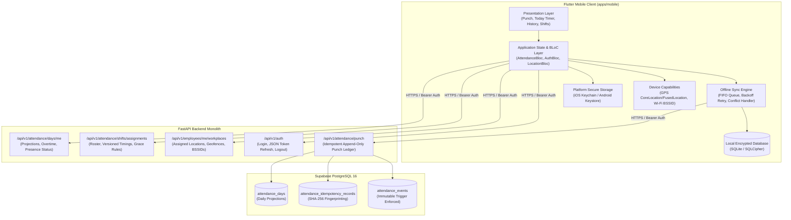
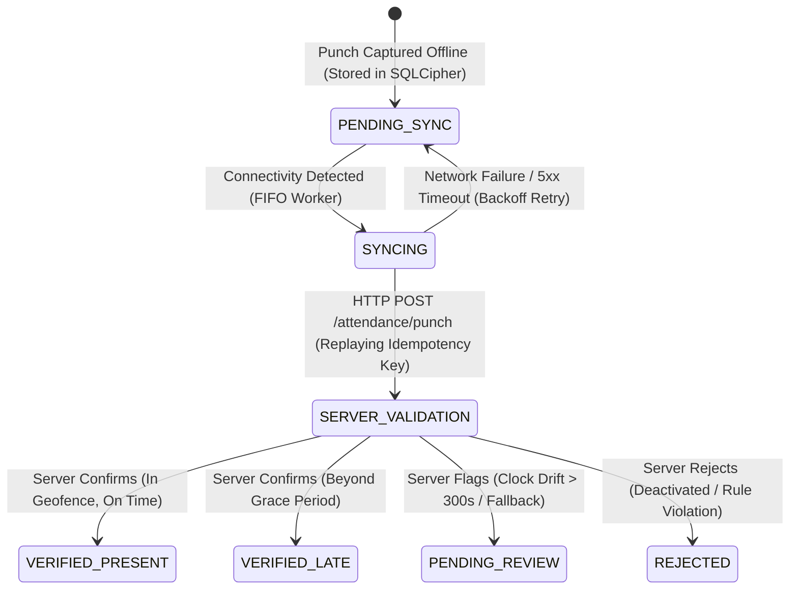

# MOBILE ATTENDANCE ARCHITECTURE & OPERATIONAL SPECIFICATION
## Phase 6: Native Flutter Mobile Application (Android & iOS)

**Stage**: Stage B — Attendance Core  
**Document Version**: 2.5 (Milestone 6.5 Offline Attendance Queue & Sync Engine Specified)  
**Status**: IN PROGRESS (Milestones 6.1, 6.2, 6.3.A, 6.3.B, 6.4.A, 6.4.B Complete; Milestone 6.5 Architecture Complete)  
**Target Phase**: Phase 6 — Mobile Attendance Application  
**Target Repository Directory**: `apps/mobile/`  
**Baseline Git Commit**: `a4dad73` (`phase-05-complete`)  

---

## 1. Executive Summary & Architectural Mission

The **Attendance SaaS Mobile Application** provides a secure, intuitive, and mathematically deterministic presence-logging interface for enterprise employees on Android and iOS devices.

While the Next.js administrative web console (Phase 5) serves desk workers, HR administrators, and supervisors, the mobile application caters directly to on-site, shift-based, hybrid, and field workforces who require:
1. **Frictionless, 2-Second Punching**: Instant `CHECK_IN`, `CHECK_OUT`, `BREAK_START`, and `BREAK_END` with a live elapsed session timer.
2. **Company-Configurable Verification**: Provable workplace presence verified via **GPS Geofencing (Mode A)**, **Connected Workplace Wi-Fi (Mode B)**, or **Combined GPS + Wi-Fi with Admin-Controlled Fallbacks (Mode C)**.
3. **Resilient Offline-First Reliability**: High-durability local SQLite storage (SQLCipher) allowing employees to record attendance in basements, rural job sites, or during transit without data loss or duplicate punch hazards.
4. **Zero-Trust Offline Model**: Offline punches are labeled strictly as **Pending Synchronization** until processed; the client never decides its own final attendance verification status.
5. **Dedicated Mobile Token Security**: Platform-secure storage (Keychain/Keystore) for refresh tokens, in-memory access tokens, and concurrency-safe mutex rotation—completely decoupled from browser cookies.
6. **Server-Authoritative Calculation Integrity**: Full compatibility with the Phase 5 immutable event ledger (`attendance_events`), server-side idempotency (`attendance_idempotency_records`), and pure calculation engine (`calculate_attendance_day`).



---

## 2. System Component Architecture

The Flutter application adheres to **Clean Architecture** organized by **feature slices**, ensuring modularity, clear separation of concerns, and 100% testability across platforms.

### 2.1 Layer Boundaries & Dependency Rule

```text
apps/mobile/lib/
├── app.dart                   # Root MaterialApp with theme & router integration
├── main.dart                  # Dependency injection setup & platform initializers
├── core/                      # Cross-cutting foundational modules
│   ├── config/                # Environment variables, API base URLs, build flavors
│   ├── constants/             # App typography, color tokens, layout spacing
│   ├── errors/                # Structured failure & exception hierarchies
│   ├── network/               # Dio HTTP client, auth interceptors, retry interceptors
│   ├── security/              # Secure token storage wrapper (Keychain / Keystore)
│   ├── storage/               # Encrypted SQLite database initialization & migrations
│   └── utils/                 # Date/time formatters, platform detectors, loggers
├── features/                  # Domain-specific feature modules
│   ├── auth/                  # Login, session refresh, token mutex, safe logout
│   ├── attendance/            # Punch buttons, live timer, break manager, sync status
│   ├── location/              # GPS capture, geofence evaluator, distance calculations
│   ├── wifi/                  # NetworkInfo wrapper, BSSID/SSID matcher, platform fallback
│   ├── shifts/                # Today's shift card, upcoming roster schedule
│   ├── history/               # Monthly attendance calendar, daily punch details
│   └── profile/               # Employee details, assigned workplaces, logout controls
└── shared/                    # Reusable atomic UI components (Buttons, Badges, Modals)
```

### 2.2 Core Architectural Principles

1. **Unidirectional Data Flow (BLoC Pattern)**: UI emits `Events` $\rightarrow$ `BLoC` processes logic $\rightarrow$ emits immutable `States` to UI. Zero direct database queries or API calls from widgets.
2. **Offline-First Event Queue**: Attendance actions write to local durable storage *first*, then synchronize with the server. If online, sync happens instantaneously; if offline, sync occurs as soon as connectivity resumes.
3. **Repository Abstraction**: UI and BLoC consume abstract Repository interfaces (`AttendanceRepository`, `AuthRepository`, `LocationRepository`), enabling seamless mocking during unit and widget tests.
4. **Idempotent Network Communication**: Every punch or correction payload generated by the client is assigned a UUID v4 `idempotency_key` upon creation. Retries never generate new keys.

---

## 3. Central Company Attendance Policy Engine & Verification Modes

### 3.1 Architecture Principle: Server-Enforced, Configurable Verification
A foundational requirement of the UPOSTIT platform is administrator control over verification rigor. **GPS is not mandatory for every company.** The system decouples verification evidence from presence logging:
- The **append-only attendance ledger (`attendance_events`)** and the **calculation engine (`calculate_attendance_day`)** remain universal and immutable across all verification modes.
- Each tenant defines an active **Company Attendance Policy** (`tenant_attendance_policies`).
- The **backend, not the mobile client**, authoritatively evaluates and enforces the active policy during punch ingestion.
- The mobile app dynamically queries the tenant's active policy on session restore and renders only the verification controls mandated by that policy.

```text
                  ┌────────────────────────────────────────────────────────┐
                  │       Central Company Attendance Policy Engine         │
                  │             (tenant_attendance_policies)               │
                  └───────────────────────────┬────────────────────────────┘
                                              │
         ┌───────────────────┬────────────────┼───────────────────┬───────────────────┐
         ▼                   ▼                ▼                   ▼                   ▼
   [ Mode 1: MANUAL ]  [ Mode 2: GPS ]  [ Mode 3: WIFI ]   [ Mode 4: BIOMETRIC ] [ Mode 5: FACE ]
   ┌─────────────────┐ ┌──────────────┐ ┌──────────────┐   ┌─────────────────┐   ┌────────────────┐
   │ - One-tap punch │ │ - Lat / Lng  │ │ - Conn BSSID │   │ - Hardware HMAC │   │ - Liveness API │
   │ - Zero geofence │ │ - Acc < 100m │ │ - Match APs  │   │ - Edge Terminal │   │ - Selfie Check │
   │ - Web / Mobile  │ │ - ST_DWithin │ │ - Fail-Closed│   │ - Phase 15      │   │ - Phase 7      │
   └─────────────────┘ └──────────────┘ └──────────────┘   └─────────────────┘   └────────────────┘
         │                   │                │                   │                   │
         └───────────────────┴────────────────┼───────────────────┴───────────────────┘
                                              ▼
                             ┌───────────────────────────────────┐
                             │    Mode 6: Combined (AND / OR)    │
                             │  - Strict Dual Verification (AND) │
                             │  - Configured Fallback Engine(OR) │
                             └───────────────────────────────────┘
```

---

### 3.2 Supported Verification Modes
1. **Mode 1: MANUAL (Default for Standard & Web Workspaces)**:
   - Employees punch without location or network restrictions.
   - Ideal for remote workforces, distributed desk staff, and standard office environments.
   - If coordinates or network info are provided by the client, they are recorded as passive telemetry in `metadata_json` without geofence enforcement or punch rejection.
2. **Mode 2: GPS Geofence Verification (Mode A)**:
   - For field workers, construction sites, and standalone branches.
   - Enforces PostGIS `ST_DWithin` spatial proximity against the employee's assigned workplace perimeter.
   - Filters horizontal accuracy ($>100\text{m}$ rejected) and stale fixes ($>30\text{s}$).
3. **Mode 3: Connected Workplace Wi-Fi Verification (Mode B — Phase 6.4)**:
   - For high-rise corporate suites, basements, and indoor retail where GPS is obstructed.
   - Matches the currently connected access point BSSID against normalized authorized identifiers in `workplace_wifi_access_points`.
   - Distinguishes positive evidence (`MATCHED`), negative evidence (`MISMATCHED`), and missing evidence (`UNAVAILABLE`, `UNSUPPORTED`).
   - Admin-Configurable Fallback Policy: When Wi-Fi is legitimately unavailable, the tenant routes to an administrator-chosen fallback action (`REJECT`, `GPS_FALLBACK`, `SUPERVISOR_REVIEW`, `MANUAL_FALLBACK`).
   - Detailed specification in `docs/PHASE_06_MILESTONE_04A_DESIGN.md`.
4. **Mode 4: Biometric Terminal Verification (Phase 15)**:
   - On-premise hardware clocks dispatching HMAC-signed punch payloads directly to the backend.
5. **Mode 5: Face Recognition & Liveness Verification (Phase 7)**:
   - Front camera selfie with facial liveness to eliminate buddy punching.
6. **Mode 6: Combined Multi-Signal Modes (AND / OR)**:
   - **Strict Dual Verification (AND)**: Both GPS within perimeter AND connected workplace Wi-Fi required.
   - **Flexible Fallback (OR)**: Primary method evaluated; if platform restricts primary (e.g. iOS Wi-Fi entitlement missing), secondary is accepted **only if explicitly authorized by tenant policy**.

---

### 3.3 Backend GPS Compatibility & Remediation Architecture

To reconcile Phase 4 workplace infrastructure with mobile attendance requirements, three targeted backend capabilities are established:

#### Remediation A: Employee-Scoped Workplace Response (`GET /api/v1/employees/me/workplaces`)
- **Problem**: `EmployeeWorkplaceResponse` previously returned only location names and codes, omitting `latitude`, `longitude`, and `radius_meters`.
- **Solution**: The employee's own assignment endpoint returns the assigned workplace's coordinates and geofence radius.
- **Privacy Boundary**: Employees receive coordinates *only* for workplaces to which they are actively assigned (`effective_from <= today <= effective_to`). The global organization location directory remains strictly guarded under `Permission.VIEW_LOCATIONS`.

#### Remediation B: Employee-Authorized Geofence Probe (`POST /api/v1/employees/me/workplaces/verify-coordinates`)
- **Problem**: The existing `POST /api/v1/locations/verify-coordinates` route requires `Permission.VIEW_LOCATIONS`, which standard employees (`UserRole.EMPLOYEE`) do not have (resulting in HTTP 403 Forbidden).
- **Solution**: A dedicated, employee-scoped probe endpoint guarded by `Permission.RECORD_PUNCH`:
  - **Inputs**: `location_id`, `latitude`, `longitude`, `accuracy_meters`.
  - **Server Checks**:
    1. Caller possesses an active linked employee profile.
    2. Employee is actively assigned to `location_id` for the current calendar date.
    3. Workplace is active (`is_active = true`).
    4. Reported accuracy meets policy ($\le 100\text{m}$).
    5. Calculates spherical distance and geofence containment via PostGIS `ST_Distance` and `ST_DWithin`.
  - **Outputs**: `within_geofence: bool`, `distance_meters: float`, `radius_meters: int`, `accuracy_acceptable: bool`.

#### Remediation C: Server-Authoritative Punch Ingestion (`POST /api/v1/attendance/punch`)
- **Problem**: `record_punch` previously persisted coordinates in `AttendanceEvent` but did not execute spatial PostGIS geofence evaluation on ingest.
- **Solution**: When the tenant's active policy requires GPS:
  1. Server inspects `payload.location_id`, `payload.latitude`, `payload.longitude`, `payload.accuracy_meters`.
  2. Rejects request if required location evidence is missing.
  3. Executes PostGIS spatial query:
     ```sql
     SELECT
         ST_Distance(coordinates, ST_SetSRID(ST_MakePoint(:lon, :lat), 4326)::geography) AS distance_meters,
         ST_DWithin(coordinates, ST_SetSRID(ST_MakePoint(:lon, :lat), 4326)::geography, radius_meters) AS within_geofence
     FROM locations
     WHERE tenant_id = :tenant_id AND id = :location_id AND is_active = true;
     ```
  4. If `within_geofence is False`:
     - If policy `out_of_geofence_action == "REJECT"`: Returns `HTTP 400 Bad Request` ("Punch rejected: Reported location is outside workplace geofence perimeter").
     - If policy `out_of_geofence_action == "FLAG_PENDING_REVIEW"`: Accepts punch into append-only ledger, sets `review_status = "PENDING_REVIEW"`, and flags `OUT_OF_GEOFENCE`.
  5. The result (`geofence_verified: true/false`, `distance_meters`) is recorded in `AttendanceEvent.metadata_json`.
  6. Idempotency is 100% preserved; retries with the same `idempotency_key` return the cached response without duplicate ledger entries.

#### 3.4 Client-Side Location Architecture (`apps/mobile/lib/features/attendance`)
- **`LocationService` Interface**: Pure abstract interface abstracting hardware APIs, enabling 100% test isolation with Mocktail.
- **`GeolocatorLocationService`**: Production implementation backed by Flutter's `geolocator: ^14.0.2` package.
- **Staleness & Accuracy Filtering**:
  - `LocationReading.isStale()` evaluates against policy threshold (default 30 seconds).
  - `LocationReading.isAccurate()` evaluates against policy threshold (default 100 meters).
  - Stale fixes or poor accuracy raise typed exceptions (`LocationStaleException`, `LocationAccuracyException`), prompting the employee to re-acquire.
- **Advisory Proximity**: Great-circle Haversine calculation provides instant UI feedback ("Within geofence ~25m away") while delegating authoritative verification exclusively to backend PostGIS.
- **Mock-Location Risk Signaling**:
  - Android: `position.isMocked` is inspected; if detected, `MockLocationDetectedException` halts punch submission with an actionable security warning.
  - iOS: CoreLocation sandbox does not expose a public mock provider flag; PostGIS geofencing and backend velocity checks serve as the primary fraud shield.
- **Foreground Lifecycle & Settings Recovery**:
  - Zero background location permissions are requested (`ACCESS_FINE_LOCATION` on Android, `NSLocationWhenInUseUsageDescription` on iOS).
  - `AttendanceHomeScreen` implements `WidgetsBindingObserver` to re-check location permissions automatically upon returning from system settings.

---

## 4. Cross-Platform Feasibility & iOS Wi-Fi Compatibility Policy

Operating system privacy controls on Android and iOS treat Wi-Fi and location information as sensitive data. The architecture accounts for real-world operating system capabilities and platform limitations.

### 4.1 Platform Comparison Matrix

| Verification Capability | Android 10–12 | Android 13–15+ | iOS 14–16 | iOS 17–18+ |
| :--- | :---: | :---: | :---: | :---: |
| **Foreground GPS (Lat/Lng)** | Fully Supported (`ACCESS_FINE_LOCATION`) | Fully Supported (`ACCESS_FINE_LOCATION`) | Fully Supported (CoreLocation `WhenInUse`) | Fully Supported (CoreLocation `WhenInUse`) |
| **GPS Accuracy Filtering** | Supported (`Location.getAccuracy()`) | Supported (`Location.getAccuracy()`) | Supported (`CLLocation.horizontalAccuracy`) | Supported (`CLLocation.horizontalAccuracy`) |
| **Precise vs Approximate Location** | Full precision available | User can select "Approximate" (requires re-prompt) | User can select "Approximate" (requires re-prompt) | User can select "Approximate" (requires re-prompt) |
| **Read Connected Wi-Fi SSID** | Supported with `ACCESS_FINE_LOCATION` | Supported with `NEARBY_WIFI_DEVICES` | Requires `Access WiFi Information` entitlement | Requires `Access WiFi Information` entitlement |
| **Read Connected Wi-Fi BSSID** | Supported with `ACCESS_FINE_LOCATION` | Supported with `ACCESS_FINE_LOCATION` + GPS on | Requires entitlement & precise location | Requires entitlement & precise location |
| **Scan Nearby Wi-Fi APs** | Throttled (4 scans / 2 mins) | Throttled (4 scans / 2 mins) | **Strictly Blocked by Apple** (No Public API) | **Strictly Blocked by Apple** (No Public API) |
| **Background Sync Execution** | Supported (WorkManager / JobScheduler) | Supported (WorkManager with battery limits) | Inconsistent (`BGTaskScheduler` OS-throttled) | Inconsistent (`BGTaskScheduler` OS-throttled) |

### 4.2 iOS Wi-Fi Compatibility Policy

Apple enforces strict privacy restrictions regarding access to local network identifiers. On iOS, accessing connected Wi-Fi information (`SSID` and `BSSID`) is not an open API and requires explicit entitlements and permissions:

1. **Apple Developer Entitlement Requirement**:
   - The app binary must be compiled with the `com.apple.developer.networking.wifi-info` entitlement (`Access Wi-Fi Information`).
   - This entitlement must be explicitly enabled in the Apple Developer Portal App ID configuration and included in the iOS provisioning profile.
2. **Device Permission & Precision Requirements**:
   - The user must grant Location permission (`NSLocationWhenInUseUsageDescription`).
   - The user must grant **Precise Location** (iOS 14+). If the user toggles "Precise: Off" in iOS Settings, Apple intentionally redacts the BSSID and returns `null` or `00:00:00:00:00:00`.
3. **BSSID Unavailability Scenarios**:
   Even when the app is installed and running on iOS, the connected BSSID may be completely unavailable under the following real-world conditions:
   - App running in the iOS Simulator (Apple does not simulate Wi-Fi network interfaces).
   - Provisioning profile mismatch or missing `Access Wi-Fi Information` entitlement.
   - User selected "Approximate Location" instead of "Precise Location".
   - Device connected to a cellular personal hotspot or VPN masking local network info.
   - iOS Private Wi-Fi Address feature or enterprise MDM configuration restricting network discovery.
4. **Dynamic Capability Detection (`isWifiVerificationAvailable()`)**:
   The app must actively probe whether Wi-Fi verification is functionally operational:
   - Check if Wi-Fi interface is connected.
   - Check if Location permission is granted with full accuracy (`AccuracyAuthorization.fullAccuracy`).
   - Probe `NEHotspotNetwork.fetchCurrent()` / `NetworkInfo().getWifiBSSID()`.
   - If BSSID returns `null` or redacted, the app flags `WIFI_VERIFICATION_UNAVAILABLE`.
5. **No Silent Success (Fail-Closed Policy)**:
   - **Under no circumstances may a Wi-Fi-only punch silently succeed when Wi-Fi verification is unavailable.**
   - Silent fallback or auto-approval is strictly forbidden.
   - If Wi-Fi verification is unavailable and no admin-configured fallback is enabled, the punch is blocked.
6. **Administrator-Controlled GPS Fallback Rule**:
   - Fallback from Wi-Fi to GPS is permitted **only when the company administrator explicitly configured that fallback** (`allow_gps_fallback_if_wifi_unsupported: true`).
   - If enabled by admin, the app captures GPS coordinates instead, records `verification_mode_requested: "WIFI"`, `fallback_invoked: true`, `fallback_reason: "IOS_WIFI_VERIFICATION_UNAVAILABLE"`, and submits the punch for server-side evaluation.
7. **User-Facing Error Messages**:
   The app must provide clear, actionable feedback rather than generic error codes:

   | Failure Scenario | Displayed User-Facing Message |
   | :--- | :--- |
   | **Entitlement / Capability Missing** | *"Wi-Fi verification is unavailable on this device. Please contact your company administrator or switch to an authorized attendance method."* |
   | **Precise Location Missing** | *"iOS requires Precise Location to verify your workplace Wi-Fi. Please go to Settings > Privacy > Location Services > UPOSTIT and enable 'Precise Location'."* |
   | **Wi-Fi Disconnected** | *"You are not connected to Wi-Fi. Please connect to your assigned workplace Wi-Fi network before checking in."* |
   | **BSSID Unreadable (Fallback Disabled)** | *"Unable to verify your workplace Wi-Fi network hardware address. Verification cannot be bypassed. Please connect to the designated office network or contact your manager."* |
   | **BSSID Unreadable (Admin Fallback Enabled)** | *"Workplace Wi-Fi cannot be verified on this device. Falling back to GPS Geofence verification per company policy."* |
   | **BSSID Mismatch** | *"Connected Wi-Fi ('{SSID}') does not match registered workplace access points. Please connect to your official workplace network."* |

8. **Mandatory Real-Device iOS Testing Requirement**:
   - Simulator testing is strictly insufficient for Wi-Fi verification.
   - Release sign-off requires physical iPhone testing with an active provisioning profile containing `com.apple.developer.networking.wifi-info` connected to an authorized access point.

---

## 5. Offline Attendance Trust & Security Policy

To guarantee reliability in basements, construction sites, and remote areas, Phase 6 incorporates an offline-first durable queue. However, offline devices operate outside the immediate control of the server. The architecture enforces strict zero-trust operational security:

### 5.1 Local SQLite Schema (`mobile_offline_ledger.db`)

The complete architectural schema and quarantine protocol are specified in [`docs/PHASE_06_MILESTONE_05_DESIGN.md`](file:///Users/apple/Upostit/docs/PHASE_06_MILESTONE_05_DESIGN.md). The local queue schema enforces strict FIFO sequencing, multi-tenant/multi-user isolation, and hardware evidence provenance:

```sql
CREATE TABLE IF NOT EXISTS local_attendance_queue (
    local_id TEXT PRIMARY KEY,                          -- Local client UUID v4
    idempotency_key TEXT NOT NULL UNIQUE,               -- Server idempotency UUID v4 (generated ONCE at punch time)
    tenant_id TEXT NOT NULL,                            -- Originating tenant UUID
    employee_id TEXT NOT NULL,                          -- Originating employee profile UUID
    user_id TEXT NOT NULL,                              -- Originating auth user UUID
    event_type TEXT NOT NULL,                           -- CHECK_IN, CHECK_OUT, BREAK_START, BREAK_END
    device_reported_at TEXT NOT NULL,                   -- ISO 8601 UTC timestamp of punch tap
    timezone_offset_minutes INTEGER NOT NULL,           -- Device UTC offset in minutes
    monotonic_boot_time_ms INTEGER NOT NULL,            -- Monotonic uptime milliseconds (clock manipulation check)
    boot_session_id TEXT NOT NULL,                      -- Boot session UUID or kernel boot timestamp
    is_reboot_detected INTEGER NOT NULL DEFAULT 0,      -- 1 if reboot occurred between session punches
    location_id TEXT,                                   -- Assigned workplace location UUID
    latitude REAL,                                      -- GPS latitude
    longitude REAL,                                     -- GPS longitude
    accuracy_meters REAL,                               -- GPS horizontal accuracy
    wifi_bssid TEXT,                                    -- Normalized Wi-Fi BSSID (XX:XX:XX:XX:XX:XX)
    wifi_ssid TEXT,                                     -- Connected SSID (diagnostic/display only)
    wifi_signal_status TEXT NOT NULL,                   -- AVAILABLE, UNAVAILABLE, UNSUPPORTED, PERMISSION_DENIED
    encrypted_payload_blob TEXT,                        -- Authenticated ciphertext (used only in Envelope mode)
    applied_policy_version INTEGER NOT NULL,            -- Tenant policy version active at time of punch
    applied_policy_mode TEXT NOT NULL,                  -- MANUAL, GPS_ONLY, WIFI_ONLY, COMBINED
    device_id TEXT,                                     -- Hardware/OS installation identifier
    metadata_json TEXT NOT NULL DEFAULT '{}',           -- Arbitrary client diagnostics
    sequence_number INTEGER NOT NULL,                   -- Monotonic sequence per (tenant, user)
    sync_status TEXT NOT NULL,                          -- PENDING_SYNC, SYNCING, SYNCED, REJECTED_PERMANENT, QUARANTINED_DEPENDENT_FAILURE, FLAGGED_PENDING_REVIEW
    conflict_bundle_id TEXT,                            -- UUID v4 grouping quarantined session items
    retry_count INTEGER NOT NULL DEFAULT 0,             -- Exponential backoff retry counter
    last_attempted_at TEXT,                             -- Timestamp of most recent sync attempt
    last_error_message TEXT,                            -- Server or network error explanation
    last_error_status_code INTEGER,                     -- HTTP status code on failure
    server_event_id TEXT,                               -- Server attendance_events.id returned on success
    created_at TEXT NOT NULL,                           -- Local record creation timestamp
    updated_at TEXT NOT NULL                            -- Local record modification timestamp
);

CREATE UNIQUE INDEX IF NOT EXISTS uq_queue_idempotency_key ON local_attendance_queue (idempotency_key);
CREATE INDEX IF NOT EXISTS ix_queue_fifo ON local_attendance_queue (tenant_id, user_id, sync_status, sequence_number ASC, device_reported_at ASC);
CREATE INDEX IF NOT EXISTS ix_queue_status ON local_attendance_queue (sync_status);
CREATE INDEX IF NOT EXISTS ix_queue_history ON local_attendance_queue (tenant_id, user_id, device_reported_at DESC);
```

### 5.2 Offline Trust & Invariant Rules

1. **UUID Idempotency Key Generated Once**:
   - Every punch generates an RFC4122 UUID v4 `idempotency_key` at the exact millisecond the user taps the action button.
   - This key is written atomically to SQLite inside a local transaction.
   - All network retries, reconnection attempts, and sync worker sweeps **replay the exact same idempotency key**.
2. **Preservation of Device Timestamp & Timezone Offset**:
   - The device captures both the UTC timestamp (`device_reported_at`) and the local timezone offset (`timezone_offset_minutes`).
   - These values are immutable once written; they are never adjusted or recalculated on retry.
3. **Encrypted Local Storage (SQLCipher)**:
   - The local database `mobile_offline_ledger.db` is encrypted at rest using SQLCipher (AES-256).
   - The encryption key is generated on first launch and stored in the platform's hardware-backed keystore (iOS Keychain / Android Keystore).
4. **UI Labeling: "Pending Synchronization" (Never "Verified")**:
   - Punches recorded offline are visually demarcated with a distinct sky-blue badge: **"Pending Synchronization"** with a sync clock icon.
   - The app **never** displays "Verified Attendance" or "Attendance Confirmed" for an offline punch until the server confirms synchronization.
   - The live elapsed session timer indicates "Session Pending Server Confirmation".
5. **Server-Authoritative Status Determination**:
   - **The mobile client NEVER decides its own final attendance verification status.**
   - The client merely captures intent and environmental evidence.
   - Upon synchronization, the server-side calculation engine (`calculate_attendance_day`) independently validates:
     - Workplace geofence proximity via PostGIS `ST_DWithin`.
     - Connected BSSID match against database-stored authorized access points.
     - Shift schedule timing, grace windows, and lateness penalties.
     - Event sequence validity (e.g. no double check-ins).
   - The server response returns the final authoritative presence status (`PRESENT`, `LATE`, `FLAGGED`, `PENDING_REVIEW`, `REJECTED`). The client updates its local record with `server_presence_status`.
6. **Suspicious Timestamps, Clock Drift & Threat Modeling Trust Boundaries (DDR-6.5-01 & DDR-6.5-02)**:
   - **Explicit Trust Boundary**: All client-provided telemetry (`device_reported_at`, `monotonic_uptime_ms`, `boot_session_id`, GPS coordinates, Wi-Fi BSSID) is **untrusted client-reported evidence**. The backend cannot independently prove authenticity. They are risk indicators for anomaly detection, not cryptographic proof or trusted server time.
   - **Threat Modeling Limitations**: Rooted Android devices (Magisk, Xposed) and jailbroken iOS devices (Frida, Substrate) can hook uptime APIs and spoof kernel boot IDs. Client evidence can **never** override server-side attendance rules, geofence validations, workplace assignments, or user deactivations.
   - **Dual Timestamp Invariant**: `device_reported_at` is immutable; `server_received_at` is generated independently upon API arrival and is the sole authoritative time anchor.
   - **Offline Sync Window**: Punches synced within 24 hours of creation are processed with standard automated validation (flagged with `FLAG_DELAYED_OFFLINE_SYNC` for auditability if latency $> 300\text{s}$).
   - **Window Exceeded ($24\text{h} < \Delta T \le 72\text{h}$)**: Accepted into the append-only ledger but automatically marked `review_status: PENDING_REVIEW` with `FLAG_OFFLINE_WINDOW_EXCEEDED`. Punches $> 72\text{ hours}$ old are rejected with HTTP 422.
   - **Future Timestamps**: Timestamps $60\text{s} < \Delta T \le 300\text{s}$ into the future are flagged `FLAG_FUTURE_TIMESTAMP_DETECTED` and held for review; timestamps $> 300\text{s}$ into the future are rejected.
   - **Monotonic Clock Corroboration**: Native channel captures `boot_session_id` and monotonic uptime. If intra-boot drift $|\Delta T_{\text{wall}} - \Delta T_{\text{mono}}| > 60\text{s}$, the event is flagged `FLAG_CLOCK_MANIPULATION_SUSPECTED`.
7. **Offline Sequence Conflict Resolution Protocol (DDR-6.5-03)**:
   - **Existing API Inspection**: `POST /api/v1/attendance/corrections` is strictly an administrative endpoint (requires `OWNER`, `ADMIN`, `HR`, or `MANAGER` for direct reports; `EMPLOYEE` is rejected with HTTP 403 Forbidden). It operates on single events targeting existing ledger records (`supersedes_event_id`). It cannot ingest multi-event unauthenticated employee offline bundles.
   - **Cascading Sequence Quarantine**: If an offline `CHECK_IN` permanently fails with HTTP 400/422, it transitions to `REJECTED_PERMANENT`. Subsequent dependent events in that session (e.g. `BREAK`, `CHECK_OUT`) are marked `QUARANTINED_DEPENDENT_FAILURE` and bundled (`conflict_bundle_id`) for supervisor resolution rather than dispatched as orphaned punches.
   - **Queue Unblocking**: Fresh sessions/shifts are unblocked immediately.
   - **Supervisor Resolution**: In Phase 8, the bundled incident is submitted for manager review. When approved, the supervisor injects the authorized events into the ledger (`source: CORRECTION`), preserving full auditability. Duplicate submissions are prevented by unique `bundle_id` and row-level locking.
8. **Storage Encryption Strategy & Fail-Closed Initialization (DDR-6.5-04)**:
   - **Strategy Choice**: SQLCipher full page encryption (`sqflite_sqlcipher: ^3.4.1`) is the preferred production strategy. Application-level envelope encryption (AES-256-GCM via `cryptography` on standard `sqflite`) is an **approved production alternative** if native C compilation or CocoaPods linking encounters build blockers.
   - **Build Verification Status**: Android compilation with Gradle 9.3.1 / SDK 36 and iOS CocoaPods linking are open verification tasks for Milestone 6.5.A.
   - **Fail-Closed Rule**: If database encryption initialization fails for any reason (key missing, SQLCipher error, Keystore invalidation), **the application MUST NEVER silently create, open, or fall back to an unencrypted plaintext database.** A fatal `DatabaseEncryptionException` halts offline operations with a blocking user error.



---

## 6. Mobile Authentication & Session Lifecycle

Web browsers rely on cross-origin `HttpOnly` cookies. Mobile applications execute outside the browser sandbox and require a dedicated, platform-secure mobile token strategy.

### 6.1 Dedicated Mobile Token Strategy vs Web Cookies

1. **Why Mobile Does Not Use Browser Cookies**:
   - Flutter executes in a native process, not a web browser sandbox.
   - Cookie jars on mobile devices store cookies in cleartext filesystem files unless custom-encrypted, introducing risk.
   - Cookie handling across native-to-Dart platform channels is prone to platform-specific edge cases.
   - Industry standard for mobile REST clients is explicit `Authorization: Bearer <token>` header management.
2. **Dedicated Mobile Token Storage**:
   - **Access Token**: Kept in **volatile memory** (in-memory Dart singleton / BLoC state) wherever practical. Never written to unencrypted disk.
   - **Refresh Token**: Stored exclusively in **platform-secure storage** via `flutter_secure_storage`:
     - *iOS*: iOS Keychain with accessibility attribute `kSecAttrAccessibleAfterFirstUnlockThisDeviceOnly`.
     - *Android*: Android Keystore with `EncryptedSharedPreferences` (AES-256 GCM).
3. **Backend Refresh Endpoint Integration**:
   - Mobile uses the existing Phase 2 backend refresh endpoint: `POST /api/v1/auth/refresh`.
   - Passes `{ "refresh_token": "..." }` in the JSON request body.
   - Reuses backend refresh token rotation and reuse detection.
4. **Concurrency-Safe Refresh Mutex**:
   - When multiple concurrent API calls (e.g. today attendance, workplace list, shift roster) encounter an expired access token (`HTTP 401`) simultaneously:
   - A concurrency mutex in the Dio `AuthInterceptor` intercepts the requests.
   - Exactly **one** refresh request is sent to `POST /api/v1/auth/refresh`.
   - All other pending requests are queued in memory awaiting the refresh promise.
   - Once the refresh call succeeds, the new access token is stored in memory, the new refresh token is stored in Keychain/Keystore, and all queued requests are replayed with the new Bearer token.
   - This strictly prevents simultaneous refresh requests, which would trigger backend token reuse detection and revoke the user's session.
5. **Online Logout Session Revocation**:
   - Tapping "Log Out" while online immediately dispatches `POST /api/v1/auth/logout` with `{ "refresh_token": "..." }` to revoke the token family in the database.
   - Secure storage tokens and in-memory session states are cleared.

```mermaid
sequenceDiagram
    autonumber
    actor Employee as Employee
    participant App as Flutter Mobile App
    participant Interceptor as Dio AuthInterceptor (Mutex)
    participant Storage as Platform Secure Storage (Keychain / Keystore)
    participant Backend as FastAPI Auth API (/api/v1/auth)

    Note over App,Backend: Concurrent 401 Handling via Mutex Lock
    App->>Backend: Request A (Expired Token)
    App->>Backend: Request B (Expired Token)
    Backend-->>Interceptor: 401 Unauthorized (Request A)
    Backend-->>Interceptor: 401 Unauthorized (Request B)
    Interceptor->>Interceptor: Acquire Mutex Lock (Request A proceeds; Request B queues)
    Interceptor->>Storage: Read refresh_token
    Interceptor->>Backend: POST /auth/refresh {refresh_token: "..."}
    Backend-->>Interceptor: 200 OK {access_token: "new", refresh_token: "rotated"}
    Interceptor->>Storage: Store rotated refresh_token
    Interceptor->>Interceptor: Update in-memory access_token & Release Mutex Lock
    Interceptor->>Backend: Retry Request A (Header: Bearer new)
    Interceptor->>Backend: Retry Request B (Header: Bearer new)
    Backend-->>App: 200 OK (Request A Response)
    Backend-->>App: 200 OK (Request B Response)
```

### 6.2 Pending Offline Punches During Logout

Logging out while offline punches are pending presents significant data loss and security risks if not handled with precision:

1. **Warning Dialog on Logout**:
   - When the user taps "Log Out", the app queries local SQLite:
     ```sql
     SELECT COUNT(*) FROM local_attendance_queue 
     WHERE sync_status = 'PENDING' AND tenant_id = :current_tenant_id AND user_id = :current_user_id;
     ```
   - If pending count $> 0$, the app displays a modal warning dialog:
     > **Unsynced Offline Punches Detected**  
     > *"You have {N} attendance punch(es) saved offline that have not yet synced with the company server. If you log out now, these punches will remain safely encrypted on this device, but they will NOT appear on your company timesheet until you log back in on this device with this account."*  
     > - **[Stay Signed In & Try Sync]** (Primary Action)  
     > - **[Log Out Anyway]** (Destructive Action)
2. **Never Silently Delete Pending Punches**:
   - Logging out **never** deletes or prunes pending offline punches from SQLite.
   - The local encrypted database persists the queue across user logout.
3. **Account & Tenant Isolation on Shared Devices**:
   - Every queue item is strictly bound to `(tenant_id, employee_id, user_id)`.
   - If User B logs into the app on the same physical device:
     - The sync worker filters queries strictly by `WHERE tenant_id = :b_tenant AND user_id = :b_user`.
     - User A's pending punches are completely invisible to User B and are **never synchronized to User B's account or tenant**.
4. **Sync Resumption Upon Re-Login**:
   - When User A logs back in on the device with their original credentials:
     - The app matches User A's `tenant_id` and `user_id`.
     - The sync worker automatically resumes FIFO synchronization for the pending queue.
5. **Safe Recovery Process for Deactivated Accounts or Device Loss**:
   - **Account Deactivated**: If the employee was deactivated while offline, the sync worker receives HTTP 403 Forbidden upon reconnecting. The app marks the items `REJECTED_ACCOUNT_DEACTIVATED`, preserves the records in SQLite, and provides an encrypted diagnostic export for HR dispute resolution.
   - **Device Lost or Replaced**: Punches stored in local hardware storage cannot transfer to a new device. The employee or supervisor submits a Missed Punch Correction Request via the Phase 5/Phase 8 administrative web console with supervisor attestation.

---

## 7. UI/UX Design System & Screen Flows

The mobile interface is designed for high contrast, rapid touch targets, and clarity under direct sunlight.

### 7.1 Design Tokens & Aesthetics
- **Color Palette**:
  - Primary Brand: Deep Navy (`#0F172A`) & Electric Indigo (`#4F46E5`)
  - Attendance Status Colors:
    - Present / Punched In: Vibrant Emerald (`#10B981`)
    - On Break: Warm Amber (`#F59E0B`)
    - Punched Out: Slate Gray (`#64748B`)
    - Pending Synchronization: Sky Blue (`#0EA5E9`)
    - Warning / Out of Bounds: Rose Red (`#F43F5E`)
- **Typography**: Inter (Google Fonts), with clear tabular figures for the live elapsed work session timer.
- **Minimum Touch Targets**: 48x48 dp standard; primary Punch button is 120x120 dp circular action hero.

### 7.2 Primary Screen Hierarchy

```text
[Main App Shell] (Bottom Navigation Bar)
├── Tab 1: Today (Hero Punch Screen)
│   ├── Assigned Workplace & Geofence Status Card
│   ├── Scheduled Shift Card (Start, End, Grace Window)
│   ├── Live Elapsed Work Timer (HH:MM:SS)
│   ├── Hero Action Button (Check In / Check Out)
│   ├── Secondary Break Controls (Start Break / Resume Work)
│   └── Pending Synchronization Alert Badge (if offline punches exist)
├── Tab 2: Schedule & Shifts
│   ├── Weekly Shift Roster
│   └── Shift Timing Rules (Grace, Breaks, Allowance details)
├── Tab 3: History & Timesheet
│   ├── Monthly Presence Calendar (Color-coded indicators)
│   ├── Daily Breakdown Cards (Gross, Breaks, Net, Lateness)
│   └── Punch Audit Stream Drawer (Shows Sync Status per punch)
├── Tab 4: Sync & Offline Status
│   ├── Pending Events Queue Counter
│   ├── Manual "Sync Now" Trigger
│   └── Sync History & Error Logs
└── Tab 5: Profile & Settings
    ├── Employee Profile & Organization Details
    ├── Assigned Workplaces List with Map previews
    └── App Version & Secure Logout (with Pending Punch Guard)
```

---

## 8. Security, Privacy & Local Data Governance

1. **Location Data Minimization**:
   - Location is queried **only upon pressing a punch action button** or opening the geofence radar view.
   - Zero continuous background location tracking or battery-draining GPS monitoring.
2. **Wi-Fi Identifier Privacy**:
   - BSSID and SSID data are only sent to the authenticated tenant endpoint over TLS 1.3.
   - Local logs truncate MAC addresses (`00:14:22:**:**:**`) to protect network privacy.
3. **Local Database Retention Policy**:
   - Successfully synced records (`sync_status = 'SYNCED'`) are retained locally for 30 days to power offline history views, then automatically pruned.
   - Database is encrypted using SQLCipher with a key derived from the platform keystore.

---

## 9. Architectural Decision Records (ADRs)

### ADR-01: Choice of Flutter State Management
- **Decision**: Adopt **flutter_bloc** (`BlocProvider`, `BlocBuilder`).
- **Rationale**: BLoC enforces deterministic event-driven transitions, provides built-in stream subscription management, and decouples business logic from the UI lifecycle, which is essential for complex punch and sync state machines.

### ADR-02: Local Persistence Engine
- **Decision**: Adopt **sqflite** with **SQLCipher** encryption.
- **Rationale**: Relational query capabilities are required to manage FIFO queues, multi-event filtering, and atomic status updates. SQLCipher provides hardware-keystore-backed AES-256 encryption at rest.

### ADR-03: Dual-Mode Authentication Transport
- **Decision**: Support JSON-body refresh tokens in Flutter while preserving HttpOnly cookies in web.
- **Rationale**: The Phase 2 auth architecture already accepts `RefreshTokenRequest(refresh_token="...")` in the request body when cookies are absent. Flutter can store the refresh token in Keychain/Keystore without altering backend web cookie security.

### ADR-04: In-Memory Access Tokens & Platform-Secure Refresh Tokens
- **Decision**: Keep access tokens in volatile memory; store refresh tokens in platform-secure storage (Keychain/Keystore).
- **Rationale**: Avoids writing short-lived access credentials to disk; eliminates vulnerabilities associated with storing session tokens in cleartext `SharedPreferences`.

### ADR-05: Server-Authoritative Verification Status
- **Decision**: The mobile client never marks attendance verified locally; punches are marked `PENDING_SYNC` until the server calculation engine processes them.
- **Rationale**: Prevents client-side spoofing, clock manipulation fraud, or incorrect self-evaluation of complex shift rules.

### ADR-06: Queue Isolation on Shared Devices During Logout
- **Decision**: Pending offline punches are preserved across logout but bound to `(tenant_id, employee_id, user_id)`.
- **Rationale**: Prevents data loss for the logged-out worker while guaranteeing that another employee logging into the same device cannot view or sync those records.

---

## 10. Summary of Architectural Integrity

| Dimension | Architectural Approach |
| :--- | :--- |
| **Framework** | Flutter 3.19+ (Dart 3.3+) Native Mobile App for Android & iOS |
| **Backend Integration** | 100% compliant with existing FastAPI backend and Phase 5 append-only ledger |
| **Verification Rigor** | Company-configurable Modes A (GPS), B (Wi-Fi), and C (GPS+Wi-Fi with Fallbacks) |
| **iOS Wi-Fi Policy** | Requires `Access Wi-Fi Information` entitlement; fail-closed; admin-configured fallback only; real-device testing gate |
| **Offline Trust** | Zero-trust; stable UUID idempotency key; SQLCipher encrypted storage; "Pending Sync" UI; server-authoritative status |
| **Authentication** | In-memory access token, Keychain/Keystore refresh token, concurrency mutex, online logout revocation |
| **Logout Safety** | Pending punch warning modal, zero silent deletion, `(tenant, employee, user)` row binding |
| **Phase Boundaries** | Strictly focused on attendance, location, and Wi-Fi; anti-fraud biometrics reserved for Phase 7 |
