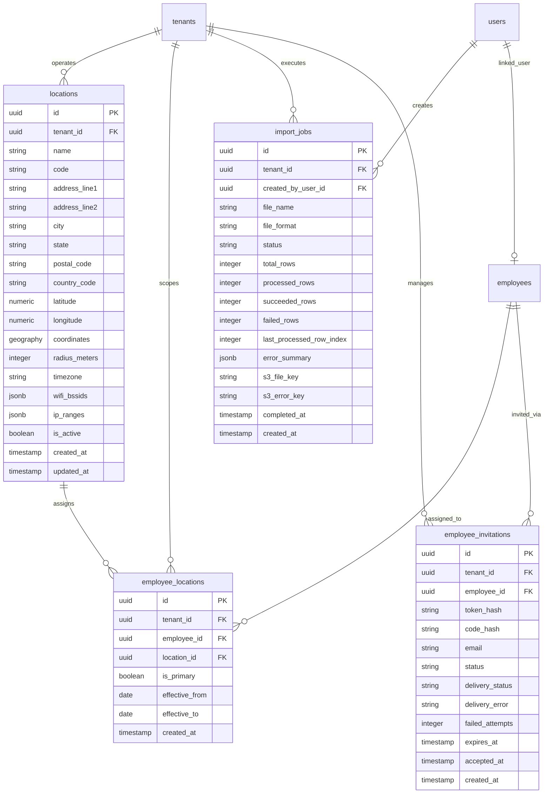

# PHASE 04 IMPLEMENTATION PLAN — Employees & Workplaces

**Stage**: Stage B — Attendance Core  
**Phase Name**: Phase 4 — Employees & Workplaces (Locations, Geofencing, Batch Import & Invites)  
**Status**: COMPLETE (All Milestones 1–5 Fully Implemented, Integrated & Verified) — Awaiting Phase 5 Approval  
**Target Branch**: `phase-04` (Active)  
**Document Revision**: 2.1 (Phase 4 Completed & Verified)  

---

## 1. Executive Summary & Scope Boundaries

Phase 4 transitions the Attendance SaaS platform from foundational identity and multi-tenant setup (**Stage A**) into operational workforce presence (**Stage B: Attendance Core**).

While Phase 3 established organizational taxonomy (`departments`, `designations`), individual employee profile models (`employees`), composite foreign keys, and HttpOnly cookie authentication (Phase 3.3), Phase 4 establishes the operational anchors required before attendance punching can occur:
1. **Workplace Locations & Geofencing**: Model physical job sites, regional branches, and campuses using PostGIS spatial coordinates (`geography(Point, 4326)`), configurable geofence radii in meters, Wi-Fi BSSID whitelists, and allowed IP CIDR blocks.
2. **Employee Workplace Assignments (`employee_locations`)**: Map employees to primary and roaming authorized workplaces with database-enforced integrity and temporal date validity.
3. **High-Throughput Batch Onboarding (`import_jobs`)**: Asynchronous Celery CSV and Excel import pipeline ingesting 500+ employee records in under 60 seconds with line-by-line error reports, backed by shared object storage (MinIO/S3).
4. **Employee Mobile Onboarding & Invitations (`employee_invitations`)**: Secure, single-use onboarding tokens and hashed activation codes enabling employees to register their user credentials and link their login account to their workforce record atomically.

### Roadmap Integrity & Exclusions
In accordance with `PROJECT_CONTEXT.md` and the 22-phase specification (`spec_dump.txt`), the following items are **strictly excluded from Phase 4**:
- **Punch In/Out Ledger & Engine** &rarr; Phase 5 (`attendance_events`, `attendance_days`, `POST /punches`).
- **Mobile Application Punch UI & Offline Queue** &rarr; Phase 6 (Flutter mobile app).
- **Fraud Shield, Mock GPS Detection & Selfie Liveness** &rarr; Phase 7.
- **Shift Templates & Rostering** &rarr; Phase 5.
- **Biometric Terminals & Edge Gateways** &rarr; Phases 15 & 16.
- **BLE Beacons & NFC Touchpoints** &rarr; Phase 18.
- **Subscription Entitlement Gating** &rarr; Phase 11.

---

## 2. Business Objectives

1. **Mathematically Verifiable Geofence Boundaries**:
   - Establish geographic workplace perimeters using spherical distance calculations (`ST_DWithin` over the WGS 84 ellipsoid in meters).
   - Lay the spatial groundwork for mobile check-in verification in Phase 6 and fraud detection in Phase 7.
2. **Support Complex Enterprise Multi-Location Topology**:
   - Enable companies with multiple branches (e.g., retail chains, construction sites, regional hospitals, remote field sites) to manage discrete workplace locations with individual time zones and geofences.
   - Support flexible workforce assignment: an employee may have one primary home location or roaming permissions across multiple approved company sites.
3. **High-Throughput Onboarding without Data Loss**:
   - Eliminate manual one-by-one data entry for large workforces. Companies switching from legacy biometric systems or spreadsheets can onboard hundreds or thousands of workers within seconds.
   - Provide atomic, resilient import processing: malformed rows are isolated with actionable row-numbered diagnostics while valid rows are successfully imported.
4. **Seamless Employee Account Activation**:
   - Provide a zero-friction bridge between an HR-created employee record and a mobile-capable user login.
   - Avoid requiring HR managers to set temporary passwords or handle employee secrets.

---

## 3. Architecture & Data Integrity Corrections

### 3.1 Employee Primary Workplace Integrity (`employee_locations`)

To prevent ambiguous attendance derivation and conflicting reporting hierarchies, an employee must have **at most one currently effective primary workplace**:

1. **Database-Level Temporal Exclusion Constraint & Partial Unique Index**:
   A PostgreSQL GiST exclusion constraint (`excl_emp_primary_workplace_overlap`) using `btree_gist` and `daterange` enforces that an employee can have at most one primary workplace on any given calendar date. This strictly prevents both bounded overlaps (e.g. Jan 1–31 and Jan 15–Feb 15) and open-ended overlaps concurrently at the database engine level, while allowing non-primary roaming assignments to overlap freely:
   ```sql
   CREATE EXTENSION IF NOT EXISTS btree_gist;

   ALTER TABLE employee_locations
   ADD CONSTRAINT excl_emp_primary_workplace_overlap
   EXCLUDE USING gist (
       tenant_id WITH =,
       employee_id WITH =,
       daterange(effective_from, COALESCE(effective_to, 'infinity'::date), '[]') WITH &&
   )
   WHERE (is_primary = TRUE);
   ```
   In addition, a partial unique index on `(tenant_id, employee_id) WHERE is_primary = TRUE AND effective_to IS NULL` provides high-speed btree lookups for active open-ended primary workplaces:
   ```sql
   CREATE UNIQUE INDEX uq_emp_active_primary_location
   ON employee_locations (tenant_id, employee_id)
   WHERE is_primary = TRUE AND effective_to IS NULL;
   ```
2. **Temporal Date Validity**:
   - `effective_from DATE NOT NULL DEFAULT CURRENT_DATE`
   - `effective_to DATE NULL`
   - Check constraint enforcing date sanity:
     ```sql
     CONSTRAINT chk_emp_loc_dates CHECK (effective_to IS NULL OR effective_to >= effective_from)
     ```
   - Duplicate prevention: UNIQUE constraint on `(tenant_id, employee_id, location_id, effective_from)`.
3. **Primary Assignment State Transitions**:
   - When a new primary assignment is designated with `effective_from = D` and `effective_to IS NULL`:
     The service layer executes an atomic transaction that sets `effective_to = D - 1 day` on the existing open-ended primary assignment before inserting the new primary record.
4. **Workplace Deactivation Safety**:
   - When a workplace is deactivated (`locations.is_active = FALSE`):
     - Existing assignment records in `employee_locations` are **preserved** (never deleted) to maintain complete auditability and historical attendance verification.
     - The service layer and API block *new* assignments to deactivated locations: `if not location.is_active: raise HTTPException(400, "Cannot assign employees to a deactivated location.")`.
     - For attendance punching (Phase 5/6), if an assigned location is marked inactive, it is excluded from active geofence matching, prompting the employee/HR to assign an active site.

---

### 3.2 Import Job Tenant Integrity

To uphold strict multi-tenant boundary isolation and prevent cross-tenant user references:
1. **Composite Foreign Key on `import_jobs`**:
   The direct `created_by_user_id` foreign key is replaced with a composite tenant-aware foreign key:
   ```sql
   CONSTRAINT fk_import_jobs_tenant_user
   FOREIGN KEY (tenant_id, created_by_user_id)
   REFERENCES users (tenant_id, id)
   ON DELETE RESTRICT
   ```
2. **Tenant Scoping on All Relationships**:
   Following Phase 3 conventions, every tenant-owned table in Phase 4 includes composite foreign keys:
   - `employee_locations`:
     - `(tenant_id, employee_id) REFERENCES employees(tenant_id, id) ON DELETE CASCADE`
     - `(tenant_id, location_id) REFERENCES locations(tenant_id, id) ON DELETE CASCADE`
   - `employee_invitations`:
     - `(tenant_id, employee_id) REFERENCES employees(tenant_id, id) ON DELETE CASCADE`
   - `import_jobs`:
     - `(tenant_id, created_by_user_id) REFERENCES users(tenant_id, id) ON DELETE RESTRICT`
   Cross-tenant foreign key injection is strictly rejected at the PostgreSQL database engine level.

---

### 3.3 Invitation Security & Public Endpoint Hardening

1. **Cryptographic Token & Code Storage**:
   - **Web Link Token**: 32-byte cryptographic random hex (256-bit entropy). Stored in the database solely as `token_hash = sha256(raw_token)`. The raw token is never persisted.
   - **Mobile Activation Code**: 6-character alphanumeric code using unambiguous characters (e.g., excluding O, 0, I, 1). Stored in the database solely as `code_hash = sha256(raw_code + salt)`. The plaintext code is displayed once to the admin upon creation and never stored.
2. **Anti-Brute-Force & Rate Limiting**:
   - `failed_attempts INTEGER NOT NULL DEFAULT 0`
   - Max attempt limit: `max_attempts CONSTANT = 5`. If 5 consecutive failed code verifications occur, the invitation automatically transitions to `locked` / `revoked`.
   - Public verification endpoints (`POST /api/v1/auth/invite/verify`) are rate-limited via Redis token buckets (e.g., 5 requests per minute per IP address).
3. **Single-Use, Expiration & Concurrency Protection**:
   - State machine: `status` starts in `pending`.
   - Atomic acceptance uses row-level locking:
     ```sql
     SELECT * FROM employee_invitations WHERE token_hash = :hash FOR UPDATE;
     ```
   - Checks `status == 'pending'` and `expires_at > now()`.
   - Transitions `status = 'accepted'`, sets `accepted_at = now()`.
   - Concurrent acceptance attempts or replays see `status != 'pending'` and fail immediately with HTTP 400 ("Invitation is invalid or has already been used").
4. **Strict Email & Identity Binding**:
   - The invitation stores `email VARCHAR(255) NOT NULL`, copied directly from `employees.work_email`.
   - During acceptance, the user account is created with `users.email = invitation.email` and `users.tenant_id = invitation.tenant_id`.
5. **Atomic Account Creation & Linking**:
   - Within a single database transaction:
     1. Verify `employees.user_id IS NULL` (pessimistic check). If already linked, abort with HTTP 409 Conflict ("Employee profile is already linked to an active user account").
     2. Create `users` record (hashed password via Argon2id, role = `employee`, `status = 'active'`, `email_verified_at = now()`).
     3. Update `employees.user_id = new_user.id`.
     4. Update `employee_invitations.status = 'accepted'`, `accepted_at = now()`.
     5. Write audit log entries.
6. **Re-invitation & Revocation Semantics**:
   - Generating a new invitation for an employee automatically marks any prior `pending` invitations for that employee as `status = 'revoked'`.
   - Dedicated endpoint `POST /api/v1/employees/{id}/invite/revoke` allows manual revocation.
7. **Information Leakage Protection**:
   - `POST /api/v1/auth/invite/verify` returns ONLY sanitized confirmation:
     - `is_valid: bool`
     - `company_name: str` (e.g., "Acme Corp")
     - `masked_email: str` (e.g., `j***n@acme.com`)
     - `first_name: str` (e.g., "John")
   - It **never** returns phone numbers, employee codes, internal IDs, or organizational directory data.

---

### 3.4 Import Storage & Worker Reliability

1. **Shared Object Storage (MinIO / S3)**:
   - Uploaded import files stream directly to tenant-isolated S3 object storage:
     `s3://{STORAGE_BUCKET}/{tenant_id}/imports/{job_id}/original_{filename}`
   - Celery workers stream directly from this shared storage bucket, ensuring full decoupling between web API instances and asynchronous worker nodes.
2. **Upload Safeguards & Limits**:
   - Maximum upload file size: **10 MB**.
   - Allowed MIME types / extensions: `.csv` (`text/csv`, `application/csv`), `.xlsx` (`application/vnd.openxmlformats-officedocument.spreadsheetml.sheet`).
   - Maximum row limit: **2,000 rows** per file. Files exceeding 2,000 rows are rejected synchronously before queuing to protect worker memory.
   - Worker task timeout: **120 seconds** hard time limit.
3. **Idempotence & Crash Recovery**:
   - `import_jobs` tracks: `status`, `total_rows`, `processed_rows`, `succeeded_rows`, `failed_rows`, `last_processed_row_index`, and `error_summary`.
   - If a Celery worker restarts or retries, it resumes processing from `last_processed_row_index + 1`.
   - Duplicate prevention on retries:
     - Check `(tenant_id, employee_id)` and `(tenant_id, work_email)` against existing records.
4. **Transaction Boundaries & Partial-Success Resilience**:
   - Batch size: **100 rows per database transaction**.
   - If row 42 fails validation, row 42 is appended to the error summary, while valid rows in that 100-row chunk continue to commit.
5. **Annotated Error Report Generation**:
   - If `failed_rows > 0`, the worker generates an annotated CSV:
     `s3://{STORAGE_BUCKET}/{tenant_id}/imports/{job_id}/error_report.csv`
     containing all failed input rows with an added `__error_details__` column.
   - Users download the report via authenticated endpoint `GET /api/v1/employees/import/{job_id}/errors` or expiring pre-signed URL.
6. **Temporary File & Storage Cleanup**:
   - Local worker temporary buffers are deleted in a `finally` block.
   - S3 import files are retained for 7 days for auditability before scheduled lifecycle expiration.

---

### 3.5 Geofencing Accuracy & Threat Boundary Clarification

1. **Threat Boundary Clarification**:
   - `ST_DWithin` calculates whether reported coordinates fall within $R$ meters of the workplace center over the WGS 84 ellipsoid.
   - **`ST_DWithin` does NOT prevent or detect GPS spoofing.** It verifies the spatial geometry of the reported payload, but cannot determine whether the device hardware was physically present or if coordinates were injected via a mock-location provider.
   - **Anti-spoofing controls** (Android `isFromMockProvider`, iOS `isSimulatedBySoftware`, Play Integrity / App Attest, impossible travel velocity checks, and selfie liveness) are strictly allocated to **Phase 7 (Fraud Shield v1)**.
2. **Coordinate Validation & Units**:
   - Latitude: NUMERIC(10, 7), validated `-90.0000000` to `+90.0000000`.
   - Longitude: NUMERIC(10, 7), validated `-180.0000000` to `+180.0000000`.
   - Distance units: **Meters** (PostGIS `geography` type uses spherical meters by default).
   - Radius constraints: Min 10 meters, Max 50,000 meters.
3. **PostgreSQL Generated Column for Spatial Synchronization**:
   To prevent coordinate drift between numeric coordinates and spatial geometry, `coordinates` is implemented as a stored generated column:
   ```sql
   coordinates geography(Point, 4326) GENERATED ALWAYS AS (
       ST_SetSRID(ST_MakePoint(longitude, latitude), 4326)::geography
   ) STORED
   ```
   This guarantees mathematical synchronization at the database engine level.

---

### 3.6 Internationalization (i18n) & Timezone Architecture

1. **Elimination of Hardcoded US / UTC Defaults**:
   - Hardcoded `'US'` and `'UTC'` defaults are removed as universal assumptions.
   - `country_code` is required and validated against ISO 3166-1 alpha-2 (e.g., `IN`, `US`, `AE`, `GB`, `SG`, `DE`).
   - `timezone` is required and validated against the IANA timezone database via Python standard library `zoneinfo.available_timezones()` (e.g., `Asia/Kolkata`, `America/New_York`, `Asia/Dubai`, `Europe/London`).
2. **Tenant Settings Inheritance**:
   - If not explicitly provided during location creation, `country_code` and `timezone` default to the parent tenant's configured defaults in `tenant_settings` (e.g., an Indian company defaults to `IN` and `Asia/Kolkata`).
3. **Multi-Timezone Shift Execution**:
   - Locations retain their discrete local timezones, enabling Phase 5 shift schedules to evaluate shift windows according to the workplace's local solar time while storing all attendance timestamps strictly in UTC.

---

### 3.7 Granular Invitation Delivery Status

To prevent misleading delivery feedback when notification providers are stubbed or unconfigured, `employee_invitations` separates delivery status from lifecycle status:

1. **Lifecycle Status (`status`)**:
   `pending`, `accepted`, `expired`, `revoked`
2. **Delivery Status (`delivery_status`)**:
   - `generated`: Invitation token/code created, awaiting dispatch.
   - `delivery_stubbed`: Environment has no live SMTP/SMS gateway configured (development, testing, or manual link sharing). Marked clearly as stubbed; never reported as delivered.
   - `queued_for_delivery`: Message payload handed off to the Celery notification worker.
   - `delivered`: External provider confirmed message delivery to the recipient.
   - `delivery_failed`: External provider returned a bounce, delivery failure, or invalid destination error (records `delivery_error`).

---

## 4. User Roles, Permissions & Audit Logging

### 4.1 Granular Permissions (`services/api/auth/permissions.py`)

In conformance with existing enum conventions:
```python
class Permission(StrEnum):
    # Existing Phase 2 & 3 permissions...
    
    # Phase 4 Workplace & Onboarding Permissions
    MANAGE_LOCATIONS = "manage_locations"
    VIEW_LOCATIONS = "view_locations"
    IMPORT_EMPLOYEES = "import_employees"
    INVITE_EMPLOYEES = "invite_employees"
```

### 4.2 Role-to-Permission Mapping Matrix

| Permission | Owner | Admin | HR | Manager | Employee |
| :--- | :---: | :---: | :---: | :---: | :---: |
| `manage_locations` | Yes | Yes | No | No | No |
| `view_locations` | Yes | Yes | Yes | Yes | Self Only (`/me/locations`) |
| `import_employees` | Yes | Yes | Yes | No | No |
| `invite_employees` | Yes | Yes | Yes | No | No |

### 4.3 Comprehensive Audit Logging

All Phase 4 state mutations record structured audit log entries:

| Action Event | Entity Type | Audited Metadata |
| :--- | :--- | :--- |
| `location.created` | `location` | Location ID, name, code, coordinates, radius, timezone, actor ID |
| `location.updated` | `location` | Location ID, changed fields (before & after), actor ID |
| `location.deactivated`| `location` | Location ID, active status (`false`), actor ID |
| `employee_location.assigned` | `employee_location` | Employee ID, Location ID, primary flag, effective dates, actor ID |
| `employee_location.removed` | `employee_location` | Assignment ID, Employee ID, Location ID, actor ID |
| `employee_import.started` | `import_job` | Job ID, file name, total rows, actor ID |
| `employee_import.completed`| `import_job` | Job ID, succeeded rows, failed rows, actor ID |
| `employee_invitation.created`| `employee_invitation` | Invitation ID, Employee ID, delivery status, actor ID |
| `employee_invitation.revoked`| `employee_invitation` | Invitation ID, Employee ID, reason, actor ID |
| `employee_invitation.accepted`| `employee_invitation` | Invitation ID, Employee ID, created User ID, IP address |

---

## 5. Frontend Screens & User Interface (`apps/web`)

### 5.1 Workplaces Screen (`/organization` &rarr; Workplaces Tab or `/locations`)
- **Location Grid & List View**:
  - Cards showing workplace name, unique code, formatted address, geofence radius badge (e.g., `50m Radius`), local timezone, active employee count, and status toggle.
  - Search bar and status filter (`All`, `Active`, `Inactive`).
- **Location Creation & Edit Modal**:
  - Name, code, address inputs (line 1, line 2, city, state, postal code).
  - Country selector (ISO 3166-1) and IANA Timezone dropdown.
  - Coordinates: Numeric Latitude & Longitude inputs with validation.
  - Visual Geofence Radar/Map preview: Interactive preview showing workplace center and circular geofence boundary.
  - Secondary verification: Tag/chip inputs for Wi-Fi BSSIDs and IP CIDR blocks.

### 5.2 Workplace Assignment Drawer
- Accessible from Location cards and Employee directory profiles.
- Multi-select employee picker with asynchronous search filtering to handle large workforces.
- "Primary Workplace" radio toggle.
- Date inputs for `effective_from` and `effective_to`.

### 5.3 3-Step Employee Import Wizard Modal
- **Step 1: Download & Format Guide**:
  - Download `employee_import_template.csv` pre-filled with tenant department and designation codes.
- **Step 2: File Upload & Configuration**:
  - Drag-and-drop zone supporting `.csv` and `.xlsx` (max 10MB, max 2,000 rows).
  - Checkbox: *"Automatically generate onboarding invitations for employees with valid email addresses."*
- **Step 3: Progress & Diagnostics Summary**:
  - Real-time progress bar (`Processing 342 of 500 rows...`).
  - Succeeded vs Failed summary cards.
  - Row-by-row error table listing line numbers, bad fields, input values, and specific remediation advice.
  - Button to download an annotated failure CSV.

### 5.4 Employee Invitation Modal & Directory Actions
- Directory actions column updated with "Invite" / "Re-invite" buttons.
- Status badges: `Active Login` (green), `Invited` (amber), `Uninvited` (gray).
- Invitation Modal showing:
  - Copyable onboarding web link.
  - 6-character mobile activation code with expiration countdown.
  - Delivery status indicator (`Generated (Manual Link)`, `Queued`, `Delivered`, `Failed`).

---

## 6. Backend APIs & OpenAPI Contracts

All endpoints are prefixed with `/api/v1` and enforce multi-tenant RLS and RBAC.

### 6.1 Workplace Locations API (`/api/v1/locations`)

| Method | Endpoint | Auth / Permission | Description |
| :--- | :--- | :--- | :--- |
| `GET` | `/locations` | `view_locations` | List workplace locations with search, active filter, and cursor pagination. |
| `POST` | `/locations` | `manage_locations` | Create a new workplace location with coordinates and geofence radius. |
| `GET` | `/locations/{id}` | `view_locations` | Retrieve detailed workplace record, radius, network rules, and employee counts. |
| `PUT` | `/locations/{id}` | `manage_locations` | Update workplace attributes, geofence radius, coordinates, or network rules. |
| `DELETE` | `/locations/{id}` | `manage_locations` | Soft-deactivate a workplace location (sets `is_active = false`). |
| `POST` | `/locations/verify-coordinates` | `view_locations` | Spatial probe testing if a test lat/lng pair falls within a location's geofence using `ST_DWithin`. |

### 6.2 Workplace Assignment API

| Method | Endpoint | Auth / Permission | Description |
| :--- | :--- | :--- | :--- |
| `GET` | `/locations/{id}/employees` | `view_locations` | List all employees assigned to a specific workplace location. |
| `POST` | `/locations/{id}/employees` | `manage_locations` | Assign one or more employees to a workplace location. |
| `DELETE` | `/locations/{id}/employees/{emp_id}` | `manage_locations` | Remove an employee's assignment to a workplace location. |
| `GET` | `/employees/{id}/locations` | `view_employees` | List all workplace locations assigned to a specific employee. |
| `GET` | `/employees/me/locations` | `view_own_profile` | Self-access: Authenticated employee retrieves their own permitted punch locations. |

### 6.3 Batch Import API (`/api/v1/employees/import`)

| Method | Endpoint | Auth / Permission | Description |
| :--- | :--- | :--- | :--- |
| `GET` | `/employees/import/template` | `import_employees` | Stream standardized CSV import template with tenant-specific lookup headers. |
| `POST` | `/employees/import` | `import_employees` | Upload CSV/Excel file multipart payload; saves to S3 and queues Celery import job. |
| `GET` | `/employees/import/{job_id}` | `import_employees` | Poll import job execution status, progress counters, and error diagnostics. |
| `GET` | `/employees/import/{job_id}/errors`| `import_employees` | Stream CSV of failed import rows annotated with error reasons from S3. |

### 6.4 Employee Invitation API (`/api/v1/employees/.../invite` & `/api/v1/auth/invite`)

| Method | Endpoint | Auth / Permission | Description |
| :--- | :--- | :--- | :--- |
| `POST` | `/employees/{id}/invite` | `invite_employees` | Generate or renew an invitation token and 6-digit code for an employee. |
| `POST` | `/employees/{id}/invite/revoke`| `invite_employees` | Revoke any pending invitations for an employee. |
| `POST` | `/employees/bulk-invite` | `invite_employees` | Bulk generate invitations for all uninvited active employees in a department or company. |
| `POST` | `/auth/invite/verify` | Public (Rate Limited)| Verify an invitation token or mobile code; returns masked company and employee name. |
| `POST` | `/auth/invite/accept` | Public (Single Use)  | Complete onboarding: set password, create user account, link employee, return auth tokens. |

---

## 7. Database Tables, Composite Foreign Keys & RLS Architecture



### Table DDL Specifications & Constraints

#### 1. `locations` Table
```sql
CREATE TABLE locations (
    id UUID PRIMARY KEY DEFAULT gen_random_uuid(),
    tenant_id UUID NOT NULL REFERENCES tenants(id) ON DELETE RESTRICT,
    name VARCHAR(255) NOT NULL,
    code VARCHAR(50) NOT NULL,
    address_line1 VARCHAR(255) NOT NULL,
    address_line2 VARCHAR(255) NULL,
    city VARCHAR(100) NOT NULL,
    state VARCHAR(100) NULL,
    postal_code VARCHAR(20) NULL,
    country_code VARCHAR(2) NOT NULL,
    latitude NUMERIC(10, 7) NOT NULL CHECK (latitude >= -90.0000000 AND latitude <= 90.0000000),
    longitude NUMERIC(10, 7) NOT NULL CHECK (longitude >= -180.0000000 AND longitude <= 180.0000000),
    coordinates geography(Point, 4326) GENERATED ALWAYS AS (
        ST_SetSRID(ST_MakePoint(longitude, latitude), 4326)::geography
    ) STORED,
    radius_meters INTEGER NOT NULL DEFAULT 100 CHECK (radius_meters >= 10 AND radius_meters <= 50000),
    timezone VARCHAR(50) NOT NULL,
    wifi_bssids JSONB NOT NULL DEFAULT '[]'::jsonb,
    ip_ranges JSONB NOT NULL DEFAULT '[]'::jsonb,
    is_active BOOLEAN NOT NULL DEFAULT TRUE,
    created_at TIMESTAMPTZ NOT NULL DEFAULT now(),
    updated_at TIMESTAMPTZ NOT NULL DEFAULT now(),
    CONSTRAINT uq_locations_tenant_code UNIQUE (tenant_id, code),
    CONSTRAINT uq_locations_tenant_id UNIQUE (tenant_id, id)
);

CREATE INDEX ix_locations_tenant_active ON locations (tenant_id, is_active);
CREATE INDEX ix_locations_spatial ON locations USING GIST (coordinates);
```

#### 2. `employee_locations` Table
```sql
CREATE TABLE employee_locations (
    id UUID PRIMARY KEY DEFAULT gen_random_uuid(),
    tenant_id UUID NOT NULL REFERENCES tenants(id) ON DELETE RESTRICT,
    employee_id UUID NOT NULL,
    location_id UUID NOT NULL,
    is_primary BOOLEAN NOT NULL DEFAULT FALSE,
    effective_from DATE NOT NULL DEFAULT CURRENT_DATE,
    effective_to DATE NULL,
    created_at TIMESTAMPTZ NOT NULL DEFAULT now(),
    CONSTRAINT chk_emp_loc_dates CHECK (effective_to IS NULL OR effective_to >= effective_from),
    CONSTRAINT uq_emp_loc_assignment UNIQUE (tenant_id, employee_id, location_id, effective_from),
    CONSTRAINT fk_emp_loc_employee FOREIGN KEY (tenant_id, employee_id)
        REFERENCES employees (tenant_id, id) ON DELETE CASCADE,
    CONSTRAINT fk_emp_loc_location FOREIGN KEY (tenant_id, location_id)
        REFERENCES locations (tenant_id, id) ON DELETE CASCADE
);

-- Partial Unique Index enforcing at most one open-ended primary location per employee
CREATE UNIQUE INDEX uq_emp_active_primary_location
ON employee_locations (tenant_id, employee_id)
WHERE is_primary = TRUE AND effective_to IS NULL;

CREATE INDEX ix_emp_loc_tenant_emp ON employee_locations (tenant_id, employee_id);
CREATE INDEX ix_emp_loc_tenant_loc ON employee_locations (tenant_id, location_id);
```

#### 3. `import_jobs` Table
```sql
CREATE TABLE import_jobs (
    id UUID PRIMARY KEY DEFAULT gen_random_uuid(),
    tenant_id UUID NOT NULL REFERENCES tenants(id) ON DELETE RESTRICT,
    created_by_user_id UUID NOT NULL,
    file_name VARCHAR(255) NOT NULL,
    file_format VARCHAR(10) NOT NULL CHECK (file_format IN ('csv', 'xlsx')),
    status VARCHAR(20) NOT NULL DEFAULT 'pending' CHECK (status IN ('pending', 'processing', 'completed', 'failed')),
    total_rows INTEGER NOT NULL DEFAULT 0,
    processed_rows INTEGER NOT NULL DEFAULT 0,
    succeeded_rows INTEGER NOT NULL DEFAULT 0,
    failed_rows INTEGER NOT NULL DEFAULT 0,
    last_processed_row_index INTEGER NOT NULL DEFAULT 0,
    error_summary JSONB NOT NULL DEFAULT '[]'::jsonb,
    s3_file_key VARCHAR(512) NOT NULL,
    s3_error_key VARCHAR(512) NULL,
    completed_at TIMESTAMPTZ NULL,
    created_at TIMESTAMPTZ NOT NULL DEFAULT now(),
    CONSTRAINT uq_import_jobs_tenant_id UNIQUE (tenant_id, id),
    CONSTRAINT fk_import_jobs_tenant_user FOREIGN KEY (tenant_id, created_by_user_id)
        REFERENCES users (tenant_id, id) ON DELETE RESTRICT
);

CREATE INDEX ix_import_jobs_tenant_status ON import_jobs (tenant_id, status);
```

#### 4. `employee_invitations` Table
```sql
CREATE TABLE employee_invitations (
    id UUID PRIMARY KEY DEFAULT gen_random_uuid(),
    tenant_id UUID NOT NULL REFERENCES tenants(id) ON DELETE RESTRICT,
    employee_id UUID NOT NULL,
    token_hash VARCHAR(128) NOT NULL UNIQUE,
    code_hash VARCHAR(128) NOT NULL,
    email VARCHAR(255) NOT NULL,
    status VARCHAR(20) NOT NULL DEFAULT 'pending' CHECK (status IN ('pending', 'accepted', 'expired', 'revoked')),
    delivery_status VARCHAR(30) NOT NULL DEFAULT 'generated' CHECK (delivery_status IN ('generated', 'delivery_stubbed', 'queued_for_delivery', 'delivered', 'delivery_failed')),
    delivery_error TEXT NULL,
    failed_attempts INTEGER NOT NULL DEFAULT 0,
    expires_at TIMESTAMPTZ NOT NULL,
    accepted_at TIMESTAMPTZ NULL,
    created_at TIMESTAMPTZ NOT NULL DEFAULT now(),
    CONSTRAINT uq_employee_invitations_tenant_id UNIQUE (tenant_id, id),
    CONSTRAINT fk_invitations_tenant_employee FOREIGN KEY (tenant_id, employee_id)
        REFERENCES employees (tenant_id, id) ON DELETE CASCADE
);

CREATE INDEX ix_invitations_tenant_status ON employee_invitations (tenant_id, status);
CREATE INDEX ix_invitations_tenant_emp ON employee_invitations (tenant_id, employee_id);
```

### Row-Level Security (RLS) Declarations
```sql
-- Enable and Force RLS
ALTER TABLE locations ENABLE ROW LEVEL SECURITY;
ALTER TABLE locations FORCE ROW LEVEL SECURITY;

ALTER TABLE employee_locations ENABLE ROW LEVEL SECURITY;
ALTER TABLE employee_locations FORCE ROW LEVEL SECURITY;

ALTER TABLE import_jobs ENABLE ROW LEVEL SECURITY;
ALTER TABLE import_jobs FORCE ROW LEVEL SECURITY;

ALTER TABLE employee_invitations ENABLE ROW LEVEL SECURITY;
ALTER TABLE employee_invitations FORCE ROW LEVEL SECURITY;

-- Tenant Isolation Policies
CREATE POLICY tenant_isolation_locations ON locations
    USING (tenant_id = current_setting('app.tenant_id', true)::uuid)
    WITH CHECK (tenant_id = current_setting('app.tenant_id', true)::uuid);

CREATE POLICY tenant_isolation_employee_locations ON employee_locations
    USING (tenant_id = current_setting('app.tenant_id', true)::uuid)
    WITH CHECK (tenant_id = current_setting('app.tenant_id', true)::uuid);

CREATE POLICY tenant_isolation_import_jobs ON import_jobs
    USING (tenant_id = current_setting('app.tenant_id', true)::uuid)
    WITH CHECK (tenant_id = current_setting('app.tenant_id', true)::uuid);

CREATE POLICY tenant_isolation_employee_invitations ON employee_invitations
    USING (tenant_id = current_setting('app.tenant_id', true)::uuid)
    WITH CHECK (tenant_id = current_setting('app.tenant_id', true)::uuid);

-- Grants to Application Roles
GRANT SELECT, INSERT, UPDATE, DELETE ON locations, employee_locations, import_jobs, employee_invitations TO authenticated, service_role;
```

---

## 8. Existing Technical Debt & Architectural Constraints

1. **Spatial Geometry Implementation in SQLAlchemy 2**:
   - `GeoAlchemy2` is not currently in `requirements.txt`.
   - *Architecture Decision*: Because PostGIS coordinates are stored via a PostgreSQL generated column `coordinates geography(Point, 4326) GENERATED ALWAYS AS (...) STORED`, standard SQLAlchemy models only need to insert/update numeric `latitude` and `longitude`. Spatial query verification (`ST_DWithin`) is executed cleanly using standard SQLAlchemy functional expressions:
     ```python
     select(func.ST_DWithin(Location.coordinates, func.ST_SetSRID(func.ST_MakePoint(lng, lat), 4326)::geography, Location.radius_meters))
     ```
     This completely avoids C-library dependency compilation issues in developer environments while utilizing 100% native PostGIS acceleration in Supabase.
2. **Missing Dependencies for Uploads & Spreadsheets**:
   - `python-multipart` must be added to `services/api/requirements.txt` for streaming `UploadFile`.
   - `openpyxl` must be added to `services/api/requirements.txt` for `.xlsx` workbook parsing.
   - `boto3` or `minio` Python SDK must be verified for S3 streaming operations.
3. **Celery Worker Execution Fallback**:
   - Celery is configured in `services/workers/celery_app.py`, but local Docker daemon is not active on the macOS development host.
   - `CELERY_TASK_ALWAYS_EAGER = True` must be supported during development and automated tests so background import jobs execute synchronously in-process when Redis is absent.
4. **Dropdown Scalability**:
   - As documented in Phase 3.2 audit, `departments` and `designations` lack client-side pagination. Location assignment pickers will implement client search or asynchronous filtering to support tenants with $>100$ records.

---

## 9. Comprehensive Testing Strategy

### 9.1 Database & Integrity Tests
- `test_primary_location_unique_constraint`: Assert attempting to insert two open-ended primary locations for the same employee trips `uq_emp_active_primary_location`.
- `test_location_effective_dates_check`: Assert `effective_to < effective_from` is rejected by check constraint.
- `test_composite_fk_cross_tenant_injection`:
  - Attempt to insert `import_jobs` referencing a user from another tenant &rarr; blocked by `fk_import_jobs_tenant_user`.
  - Attempt to assign Tenant A employee to Tenant B location &rarr; blocked by composite FK.
  - Attempt to issue invitation for another tenant's employee &rarr; blocked by composite FK.

### 9.2 Geofencing Spatial Tests
- `test_geofence_spatial_distance`:
  - Points within radius return `within_geofence = True`.
  - Points outside radius return `within_geofence = False`.
  - Edge points (exactly on radius) evaluated correctly.
- `test_coordinate_bounds_validation`: Latitudes outside `[-90, 90]` and longitudes outside `[-180, 180]` rejected with HTTP 422.

### 9.3 Asynchronous Batch Import Tests
- `test_import_500_employees_benchmark`: Generate synthetic 500-employee CSV and verify processing completes in $<60$ seconds.
- `test_import_partial_success_resilience`: Input containing 10 valid rows and 2 bad rows commits 10 rows and records 2 failure diagnostics.
- `test_import_s3_storage_isolation`: Uploaded files stored under `/{tenant_id}/imports/...`.
- `test_import_idempotent_retry`: Simulate worker crash and verify retrying does not create duplicate employees.

### 9.4 Invitation Security Tests
- `test_invitation_code_not_stored_plaintext`: Verify database contains only SHA-256 hashes of token and activation code.
- `test_invitation_rate_limiting`: Exceeding 5 failed verification attempts locks invitation.
- `test_invitation_single_use_concurrency`: Concurrent acceptance requests result in exactly one successful account creation and one HTTP 400 rejection.
- `test_invitation_links_employee_atomically`: Successful acceptance creates `User`, links `Employee.user_id`, and marks invitation `accepted`.
- `test_invitation_reinvite_revocation`: Issuing a new invitation revokes prior pending invitation.
- `test_public_verify_no_data_leakage`: Verify endpoint does not return phone number, employee code, or internal metadata.

### 9.5 Multi-Tenant RLS & Regression Tests
- Verify all 4 new tables have active RLS policies (`ENABLE` and `FORCE`).
- Execute cross-tenant read/write tests across all new endpoints.
- Regression suite: Assert all 65 existing Phase 2 and Phase 3 tests continue to pass.

---

## 10. Acceptance Criteria & "Done When" Checklist

Phase 4 will be considered **DONE** when:
- [x] `locations` table created with PostGIS generated `coordinates`, GiST spatial index, and forced RLS. (Milestone 1 Complete)
- [x] Workplace CRUD API fully operational with strict RBAC (`manage_locations`, `view_locations`). (Milestone 1 Complete)
- [x] `employee_locations` table created with temporal exclusion constraint (`excl_emp_primary_workplace_overlap`) and partial unique index enforcing at most one primary workplace across any dates. (Milestone 1 Complete)
- [x] `import_jobs` created with composite foreign key to `users(tenant_id, id)`. (Milestone 3 Complete)
- [x] Batch import Celery worker processes records in chunks of 100 with line-by-line error reports. (Milestone 3 Complete)
- [x] Shared S3/MinIO object storage utilized for import files and error reports with tenant-isolated paths. (Milestone 3 Complete)
- [x] `employee_invitations` table created with hashed tokens/codes, attempt limits, and single-use concurrency safety. (Milestone 4 Complete; migration `d7a42e88b301` ready)
- [x] Acceptance endpoint atomically creates user login, hashes password via Argon2id, and links employee profile. (Milestone 4 Complete)
- [x] Public invitation endpoints leak zero sensitive employee or organizational data. (Milestone 4 Complete)
- [x] Country (ISO 3166-1) and IANA timezone validation implemented without hardcoded US/UTC assumptions. (Milestone 1 Complete)
- [x] Zero database schema drift from completed phases; Alembic revision cleanly chained from `c8e52a91f034` (`d7a42e88b301` applied and verified live on Supabase). (Milestone 4 Complete & Live Verified)
- [x] 100% of existing 151 backend tests and 19 web tests pass, plus 21 Milestone 4 tests (172 total backend tests); clean Ruff, Mypy, and Next.js builds. (Milestone 4 Complete)
- [x] Complete Next.js frontend integration for all Phase 4 features: Leaflet geofencing maps, workplace assignments, 7-step bulk import wizard, employee invitations console, and public account activation page. (Milestone 5 Complete)
- [x] 36 frontend tests passing with 0 failures, 172 backend tests passing (100%), ESLint clean (0 errors, 0 warnings), Next.js production build succeeding with 7/7 static routes. (Milestone 5 Complete)

---

## 11. Implementation Progress & Milestone Tracking

| Milestone | Description | Status | Verification & Deliverables |
|:---|:---|:---|:---|
| **Milestone 1** | **Database foundation & workplace locations** | **COMPLETE & LIVE MIGRATION VERIFIED** | `Location`, `EmployeeLocation` models, PostGIS generated `coordinates`, GiST index, composite FKs, partial unique index `uq_emp_active_primary_location`, exclusion constraint `excl_emp_primary_workplace_overlap` (`btree_gist`), forced RLS, CRUD APIs, `POST /locations/verify-coordinates` probe with threat boundary disclaimer, ISO country/IANA timezone validators, 31 new tests (96 total backend, 19 frontend), clean Ruff and Mypy. Applied & verified on live Supabase (`b7d41a89c204`). |
| **Milestone 2** | **Employee workplace assignments** | **COMPLETE** | Assignment CRUD (`POST /employees/{id}/workplaces`, `GET /employees/{id}/workplaces`, `PUT /employees/{id}/workplaces/{assign_id}`, `DELETE /employees/{id}/workplaces/{assign_id}`), employee self-access endpoint (`GET /employees/me/workplaces`), workplace roster (`GET /locations/{id}/employees`). Single primary workplace constraint enforced at application & DB levels; historical records preserved on assignment end; 26 new tests (122 total backend, 19 frontend); clean Ruff and Mypy. |
| **Milestone 3** | **Bulk employee import (CSV/XLSX & Celery)** | **COMPLETE & LIVE MIGRATION VERIFIED** | `ImportJob` model, composite FK `(tenant_id, created_by_user_id) -> users(tenant_id, id)` with column-specific `ON DELETE SET NULL (created_by_user_id)` (PostgreSQL 17 compliant), forced RLS, Alembic migration `c8e52a91f034` applied and verified live on Supabase. `StorageService` with tenant-isolated S3/MinIO paths and strict production durability (`STORAGE_ALLOW_MEMORY_FALLBACK=False`); CSV & XLSX parser; Celery background task `attendance.process_bulk_employee_import`; chunk rollback protection; checkpoint bookmarking; concurrency locking; failure CSV reports; RBAC (`IMPORT_EMPLOYEES`). 29 new tests (151 total backend, 19 frontend); clean Ruff and Mypy. |
| **Milestone 4** | **Employee invitations & account activation** | **COMPLETE & LIVE MIGRATION VERIFIED** | `EmployeeInvitation` model, composite FKs `(tenant_id, employee_id) -> employees(tenant_id, id)` with `CASCADE` and `(tenant_id, invited_by_user_id) -> users(tenant_id, id)` with `SET NULL (invited_by_user_id)`; partial unique index `uq_invitations_active_employee` (`WHERE status = 'pending'`); forced RLS and tenant isolation policy; Alembic migration `d7a42e88b301` applied and verified live on Supabase (`down_revision = 'c8e52a91f034'`). Pluggable `EmailDeliveryService` abstraction supporting SMTP, dev preview, and memory test queue with PII-safe masking (`mask_email`); administrative invitation API (`POST /employees/{id}/invite`, `GET /invitations`, `GET /invitations/{id}`, `POST /invitations/{id}/resend`, `POST /invitations/{id}/revoke`); public activation API (`GET /auth/invitations/validate`, `POST /auth/invitations/activate`) with row-level locking (`with_for_update()`), max 5-attempt lockout (HTTP 429), single-use SHA-256 token hashing, enterprise Argon2id password hashing, and atomic employee-user account linkage. Live database verification confirmed 15 columns, indexes, partial unique constraint, composite foreign keys with user deletion preservation, and RLS tenant isolation under authenticated role. 21 new tests (172 total backend, 19 frontend); clean Ruff and Mypy. |
| **Milestone 5** | **Frontend integration & final verification** | **COMPLETE** | Next.js App Router, TypeScript, and custom CSS design system integration for all Phase 4 features. Interactive Leaflet map with dynamic circle radius overlay and PostGIS distance verification probe (`/locations` and `<GeofenceMap>`); Workplace Assignment interface with active/history toggles, primary designate, effective dates, and non-destructive end assignment (`<WorkplaceAssignmentModal>`, `<MyWorkplacesCard>`); Location Employee Roster modal (`<LocationRosterModal>`); 7-step Bulk Employee Import Wizard modal (`<ImportWizardModal>`) with template download, drag-and-drop, preview, pre-validation, Celery polling, progress bar, counters, and failure CSV error report download; Employee Invitations Console (`<InvitationsTab>`, `<InviteEmployeeModal>`) with status pills, resend, revoke, and delivery error popover; Public Account Activation page (`/activate?token=...`) with cryptographic token validation, Argon2id activation, safe company display, and password strength meter; 36 frontend tests passing with 0 failures; clean ESLint (0 errors, 0 warnings); clean TypeScript (`npx tsc --noEmit`); Next.js production build succeeding with 7/7 static routes; 172 backend tests passing (100%); Ruff & Mypy clean. |

- **Current Git Branch**: `phase-04`
- **Alembic Revisions**:
  - Live Supabase: `d7a42e88b301 (head)` (Milestone 4, verified live).
  - Local Head: `d7a42e88b301 (head)` (Milestone 4).
- **Regression Suite**: 172 backend tests passed (100%), Ruff clean (0 errors), Mypy clean (41 source files, 0 issues), 36 frontend tests passed (100%), frontend lint clean (0 errors, 0 warnings), Next.js production build successful.
- **Next Step**: Phase 4 Complete. STOP and wait for owner explicit approval before starting Phase 5 (Attendance Engine & Ledger).
