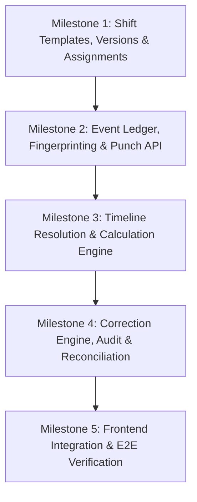

# PHASE 05 IMPLEMENTATION PLAN — Shifts & Punch Engine

**Stage**: Stage B — Attendance Core
**Phase Name**: Phase 5 — Shifts and Punch Engine (Attendance Engine & Ledger)
**Status**: IMPLEMENTATION & FINAL VERIFICATION COMPLETE — Revision 2.0 (Ready for Acceptance)
**Target Branch**: `phase-05` (Active)
**Baseline Commit**: `f7d2644` (`phase-04-complete`)
**Live Supabase Revision**: `a2b3c4d5e6f7 (head)`
**Document Revision**: 2.0 (Post-Audit Hardened Design & Live Verified)

---

## 1. Executive Summary & Scope Boundaries

Phase 5 builds the foundational operational engine of the platform: a reliable, append-only, tamper-resistant attendance ledger, immutable shift versioning, explicit correction mechanisms, and a deterministic calculation engine.

### 1.1 Core Deliverables
1. **Shift Templates & Immutable Versions (`shift_templates`, `shift_template_versions`)**:
   Master templates paired with immutable operational versions (`version_number`, `version_effective_from`) ensuring changing future shift rules never alters past attendance calculations.
2. **Shift Assignments (`shift_assignments`)**:
   Temporal employee shift assignments protected by PostgreSQL `btree_gist` exclusion constraints.
3. **Immutable Append-Only Event Ledger (`attendance_events`)**:
   A dedicated database ledger recording every presence action (`CHECK_IN`, `CHECK_OUT`, `BREAK_START`, `BREAK_END`) with PostgreSQL-enforced immutability triggers preventing `UPDATE` and `DELETE`.
4. **Explicit Correction & Audit Model**:
   Structured adjustments supporting `CORRECTION_INSERT`, `CORRECTION_SUPERSEDE`, and `CORRECTION_VOID` with foreign keys to prior events, mandatory audit reasons, and actor identification.
5. **Request Fingerprinting & Idempotency (`attendance_idempotency_records`)**:
   Server-side time authority with SHA-256 payload fingerprinting and UUID idempotency keys preventing duplicate records upon network retry, protected by pessimistic row locking (`SELECT FOR UPDATE`).
6. **Pure Functional Attendance Calculation Engine (`attendance_days`)**:
   Deterministic timeline resolution and pure rule evaluation: first check-in, last check-out, gross/net work hours, break totals, actual and grace-adjusted late arrival, early departure, overtime, and daily presence statuses (`PRESENT`, `LATE`, `HALF_DAY`, `ABSENT`, `INCOMPLETE`, `WEEK_OFF`).
7. **Future Offline-Readiness Data Model**:
   Native storage of server receipt timestamps, device timestamps, clock drift, device IDs, verification statuses, and review flags.
8. **Next.js Web Attendance Dashboard**:
   Employee Today punch widget with live timer and break controls; personal attendance history; HR Daily Attendance Management Console with missing punch identification, correction workflows, and audit drawers.

### 1.2 Strict Scope Exclusions (Roadmap Preservation)
In accordance with `PROJECT_CONTEXT.md` and the 22-phase specification:
- **Mobile Punch App & Offline Queue** &rarr; *Phase 6* (Flutter mobile app).
- **Fraud Shield, Device Binding & Selfie Liveness** &rarr; *Phase 7*.
- **Employee-Initiated Correction Requests & Multi-Tier Approval Workflows** &rarr; *Phase 8*.
- **Leave Accruals & Public Holiday Calendars** &rarr; *Phase 9*.
- **Biometric Hardware Terminals & Edge Gateways** &rarr; *Phases 15 & 16*.

---

## 2. Milestone Breakdown (Revision 2.0)

Phase 5 is divided into five small, reviewable, and testable milestones:

---

### Milestone 1: Shift Templates, Versions & Shift Assignments

**Goal**: Implement master shift templates, immutable historical shift versions, and employee rostering with exclusion constraints.

#### 1. Scope
- Model `shift_templates` (master entity with code and name).
- Model `shift_template_versions` (immutable parameters: start/end times, grace periods, early arrival/late departure allowances, thresholds, break duration, overnight flags, weekly off days).
- Model `shift_assignments` mapping employees to shift templates with temporal validity and non-overlapping exclusion constraints.
- Implement RBAC permissions: `MANAGE_SHIFTS`, `VIEW_SHIFTS`.
- Provide REST APIs for templates, versioning, and employee assignments.

#### 2. Database Changes
- Migration: Create table `shift_templates` with forced RLS and tenant isolation.
- Migration: Create table `shift_template_versions` with composite FKs:
  - `(tenant_id, shift_template_id) REFERENCES shift_templates(tenant_id, id) ON DELETE RESTRICT`
  - `(tenant_id, created_by_user_id) REFERENCES users(tenant_id, id) ON DELETE SET NULL (created_by_user_id)`
  - Unique constraints: `(tenant_id, shift_template_id, version_number)` and `(tenant_id, shift_template_id, version_effective_from)`.
- Migration: Create table `shift_assignments` with composite FKs, forced RLS, and `btree_gist` exclusion constraint.

#### 3. Backend Changes
- Package: `services/api/attendance/`
- Models: `services/api/attendance/shift_models.py` (`ShiftTemplate`, `ShiftTemplateVersion`, `ShiftAssignment`)
- Schemas: `services/api/attendance/shift_schemas.py` (Pydantic v2 validation for time formats, threshold sanity, allowance limits)
- Service: `services/api/attendance/shift_service.py` (Shift creation, version incrementing, assignment queries)
- Routes: `services/api/attendance/shift_routes.py` (`POST/GET/PUT /api/v1/shifts`, `POST/GET /api/v1/shifts/assignments`)
- Permissions: Update `services/api/auth/permissions.py` with `MANAGE_SHIFTS` and `VIEW_SHIFTS`.

#### 4. Frontend Changes
- None (Backend and schema foundation milestone).

#### 5. Tests
- Unit & API tests in `tests/test_phase5_shifts.py`:
  - CRUD operations on shift templates and automatic version creation.
  - Adding a new version preserves older version records unchanged.
  - Querying shift version effective on historical date $D$ returns the correct version.
  - Shift assignment creation and date overlap rejection via PostgreSQL exclusion constraint.
  - Cross-tenant isolation verification.

#### 6. Dependencies
- Live Supabase revision `d7a42e88b301`.
- `btree_gist` PostgreSQL extension (active in Supabase from Phase 4).

#### 7. Acceptance Criteria
- 100% test pass rate in `test_phase5_shifts.py`.
- Clean Alembic offline migration SQL script.
- Clean Ruff and Mypy checks.

#### 8. Milestone 1 Implementation Status: COMPLETE
- **Branch**: `phase-05`
- **Migration**: `e9f63b02a145_phase_05_shift_templates_and_assignments.py` (parent: `d7a42e88b301`)
- **Models**:
  - `ShiftTemplate`: Master shift identity (`code`, `name`, `description`, `is_active`).
  - `ShiftTemplateVersion`: Immutable parameters (`version_number`, `version_effective_from`, `start_time`, `end_time`, `grace_period_minutes`, `early_exit_grace_minutes`, `early_arrival_allowance_minutes`, `late_departure_allowance_minutes`, `half_day_threshold_minutes`, `full_day_threshold_minutes`, `break_duration_minutes`, `is_overnight`, `is_flexible`, `weekly_off_days`).
  - `ShiftAssignment`: Temporal employee rostering (`effective_from`, `effective_to`) protected by `btree_gist` exclusion constraint `excl_shift_assignments_overlap`.
- **Security & RLS**: Composite tenant-safe foreign keys, PostgreSQL 17 `ON DELETE SET NULL (created_by_user_id)` syntax, forced RLS on all three tables.
- **RBAC**: `MANAGE_SHIFTS` granted to Owner, Admin, HR. `VIEW_SHIFTS` granted to Manager and Employee.
- **REST APIs Delivered**:
  - `POST /api/v1/shifts`: Atomically creates master template + version 1.
  - `GET /api/v1/shifts`: Paginated shift templates listing.
  - `GET /api/v1/shifts/{id}`: Template details with currently active version.
  - `PUT /api/v1/shifts/{id}`: Metadata updates.
  - `DELETE /api/v1/shifts/{id}`: Soft deactivation.
  - `POST /api/v1/shifts/{id}/versions`: Appends a new immutable version without mutating history.
  - `GET /api/v1/shifts/{id}/versions`: Version history chronologically ordered.
  - `POST /api/v1/shifts/assignments`: Assigns an employee to a shift template with overlap validation.
  - `GET /api/v1/shifts/assignments`: Lists shift assignments filtered by employee or effectiveness.
  - `PUT /api/v1/shifts/assignments/{id}`: Modifies assignment dates.
  - `POST /api/v1/shifts/assignments/{id}/end`: Non-destructively ends an assignment by setting `effective_to`.
- **Test Verification**:
  - `tests/test_phase5_shifts.py`: 21 passed (100%).
  - Full suite: 193 passed (100%), 0 failures.
  - Linting: Ruff clean, Mypy clean across 46 source files.

---

### Milestone 2: Attendance Event Ledger, Fingerprinting & Idempotent Punch API

**Goal**: Implement the append-only presence event ledger, request fingerprinting, and safe punch endpoint with concurrency locking.

#### 1. Scope
- Model `attendance_events` table for recording raw punch actions with offline-readiness attributes.
- Implement database trigger preventing `UPDATE` and `DELETE` on `attendance_events`.
- Model `attendance_idempotency_records` table with request fingerprinting.
- Implement `POST /api/v1/punches` supporting `CHECK_IN`, `CHECK_OUT`, `BREAK_START`, `BREAK_END`.
- Concurrency locking using `SELECT ... FOR UPDATE` on employee profile.
- Idempotency handling:
  - Same key + same fingerprint &rarr; return cached response (HTTP 200).
  - Same key + different fingerprint &rarr; reject with HTTP 422.
  - Concurrent duplicate &rarr; wait for completion or return 409.
- Atomic multi-event creation: Auto-closing open break upon checkout in a single transaction.

#### 2. Database Changes
- Migration: Create table `attendance_events` with composite foreign keys:
  - `(tenant_id, employee_id) REFERENCES employees(tenant_id, id) ON DELETE RESTRICT`
  - `(tenant_id, location_id) REFERENCES locations(tenant_id, id) ON DELETE SET NULL (location_id)`
  - `(tenant_id, actor_user_id) REFERENCES users(tenant_id, id) ON DELETE SET NULL (actor_user_id)`
  - `(tenant_id, supersedes_event_id) REFERENCES attendance_events(tenant_id, id) ON DELETE RESTRICT`
- Migration: Unique constraint on `(tenant_id, idempotency_key)`.
- Migration: PostgreSQL trigger `trg_prevent_attendance_events_mutation` blocking all updates and deletes.
- Migration: Create table `attendance_idempotency_records` with composite FK `ON DELETE SET NULL (event_id)`.
- Migration: `FORCE ROW LEVEL SECURITY` on both tables with tenant isolation policies.

#### 3. Backend Changes
- Models: `services/api/attendance/event_models.py` (`AttendanceEvent`, `AttendanceIdempotencyRecord`)
- Schemas: `services/api/attendance/punch_schemas.py`
- Service: `services/api/attendance/punch_service.py`:
  - Request fingerprint calculation (SHA-256).
  - Pessimistic locking: `SELECT id FROM employees WHERE id = :id FOR UPDATE`.
  - State machine validation.
  - Atomic break auto-close when checking out while `ON_BREAK`.
  - Clock-drift calculation: `clock_drift_seconds = abs(server_time - device_time)`.
- Routes: `services/api/attendance/punch_routes.py` (`POST /api/v1/punches`, `GET /api/v1/attendance/status`).

#### 4. Frontend Changes
- None.

#### 5. Tests
- Unit & API tests in `tests/test_phase5_punch_ledger.py`:
  - Immutability test: SQL `UPDATE` or `DELETE` on `attendance_events` raises exception.
  - Idempotency test: Same key + same payload returns HTTP 200 with cached response.
  - Mismatched fingerprint test: Same key + different payload returns HTTP 422.
  - Concurrency serialization test: Concurrent punches on same employee are serialized safely.
  - Atomic break closure test: Checkout while on break creates both `BREAK_END` and `CHECK_OUT` atomically.

#### 6. Dependencies
- Milestone 1 completed.

#### 7. Acceptance Criteria
- 100% test pass rate in `test_phase5_punch_ledger.py`.
- Safe column-specific composite FK syntax validated offline.

#### 8. Milestone 2 Implementation Status: COMPLETE & APPLIED TO LIVE SUPABASE
- **Branch**: `phase-05`
- **Migration**: `f1b94c8e7a23_phase_05_attendance_events_and_idempotency.py` (parent: `e9f63b02a145`)
  - Status: **Applied and Verified on Live Supabase (PostgreSQL 17.11)**. Live revision: `f1b94c8e7a23 (head)`.
- **Models**:
  - `AttendanceEvent`: Append-only presence ledger (`event_type`, `event_category`, `source`, `server_received_at`, `device_reported_at`, `effective_at`, `clock_drift_seconds`, `timestamp_verification_status`, `review_status`, `device_id`, `location_id`, `latitude`, `longitude`, `accuracy_meters`, `actor_user_id`, `idempotency_key`, `metadata_json`, `supersedes_event_id`).
  - `AttendanceIdempotencyRecord`: Tenant- and employee-scoped idempotency tracker (`idempotency_key`, `request_fingerprint`, `status`, `response_code`, `response_payload`, `event_id`, `expires_at`).
- **Database Immutability**:
  - PostgreSQL trigger `trg_prevent_attendance_events_mutation` executing `trg_attendance_events_immutability()` function raising `integrity_constraint_violation` on any `UPDATE` or `DELETE`.
  - Normal application roles granted `SELECT, INSERT` only (no `UPDATE` or `DELETE`).
- **Idempotency & Duplicate Protection (Audit Resolution)**:
  - Permanent unique constraint on `attendance_events`: `uq_attendance_events_tenant_idempotency` physically prevents duplicate events at the DB engine level.
  - Permanent retention for completed punches: `expires_at` is set to `NULL` on `status = 'COMPLETED'`, so completed idempotency records are never expired or purged.
  - In-flight lease timeout: `expires_at` defaults to 15 minutes for `IN_PROGRESS` locks, allowing recovery if a worker terminates midway.
  - Partial index `ix_idempotency_tenant_expires` on `(tenant_id, expires_at) WHERE expires_at IS NOT NULL`.
  - Deterministic SHA-256 canonical request fingerprinting over all behavior-altering fields.
  - Same key + same fingerprint &rarr; returns cached response (HTTP 200/201 with `idempotent_replay: true`), whether retried immediately or after 24+ hours.
  - Same key + different fingerprint &rarr; returns HTTP 422 Unprocessable Content.
  - Concurrency serialization via pessimistic row locking: `SELECT id FROM employees ... FOR UPDATE`.
  - In-progress concurrent duplicate &rarr; returns HTTP 409 Conflict.
- **Timestamp Semantics**:
  - Authoritative receipt timestamp `server_received_at` set by the server in UTC.
  - Plausibility validation: future timestamps > 24 hours or past timestamps > 7 days rejected with HTTP 422.
  - Clock drift calculation: $|T_{\text{server}} - T_{\text{device}}|$. Clock drift $> 300$s flagged as `SUSPICIOUS_CLOCK_DRIFT` with review status `PENDING_REVIEW`.
- **Atomic Multi-Event Creation**:
  - Checking out while `ON_BREAK` automatically creates `BREAK_END` event followed by `CHECK_OUT` in a single atomic database transaction.
- **REST APIs Delivered**:
  - `POST /api/v1/attendance/punch`: Records punch action (`CHECK_IN`, `CHECK_OUT`, `BREAK_START`, `BREAK_END`).
  - `GET /api/v1/attendance/events`: Lists events with pagination (`cursor`), type filtering, and date range filters.
  - `GET /api/v1/attendance/events/{event_id}`: Retrieves event details with tenant and employee RBAC isolation.
- **Security & Authorization**:
  - Forced RLS on `attendance_events` and `attendance_idempotency_records`.
  - Employees restricted to punching and viewing events exclusively for themselves (403 on mismatch).
  - Managers can punch for self, cannot punch for other employees (403).
  - Owner, Admin, HR with `MANAGE_ATTENDANCE` authorized to punch on behalf of employees.
- **Live Database Verification**:
  - Executed `scratch/verify_milestone2_live.py` against live Supabase: verified tables, forced RLS, tenant isolation policies, all 6 composite FKs, unique constraints, partial index, immutability trigger blocking UPDATE/DELETE, unique constraint blocking duplicate inserts, and zero synthetic records left behind.
- **Test Verification**:
  - `tests/test_phase5_punch_ledger.py`: 30 passed (100%).
  - Full suite: 223 passed (100%), 0 failures.
  - Linting: Ruff clean, Mypy clean across 46 source files.

---

### Milestone 3: Timeline Resolution, Pure Calculation Engine & Derived Attendance Days

**Goal**: Implement the event resolution algorithm, the pure functional attendance calculation engine, and derived `attendance_days` projections.

#### 1. Scope
- Build pure timeline resolution module (`resolve_active_timeline` resolving supersessions and voids).
- Build pure calculation engine:
  `calculate_attendance_day(shift_version, resolved_events, timezone, target_date) -> AttendanceDayProjection`.
- Calculate gross working minutes, break minutes, net working minutes, actual late arrival, grace-adjusted late arrival, actual early exit, grace-adjusted early exit, overtime, and daily presence status.
- Implement configurable overnight shift window matching:
  $W_{\text{start}} = T_{\text{start}} - \text{early\_arrival\_allowance}$
  $W_{\text{end}} = T_{\text{end}} + \text{late\_departure\_allowance}$
- Model `attendance_days` table with unique constraint on `(tenant_id, employee_id, attendance_date)`.
- Projection upsert service triggered on every punch and correction.

#### 2. Database Changes
- Migration: Create table `attendance_days` with composite foreign keys:
  - `(tenant_id, employee_id) REFERENCES employees(tenant_id, id) ON DELETE CASCADE`
  - `(tenant_id, shift_template_id) REFERENCES shift_templates(tenant_id, id) ON DELETE SET NULL (shift_template_id)`
  - `(tenant_id, shift_version_id) REFERENCES shift_template_versions(tenant_id, id) ON DELETE SET NULL (shift_version_id)`
- Migration: Unique constraint on `(tenant_id, employee_id, attendance_date)`.
- Migration: `FORCE ROW LEVEL SECURITY` with tenant isolation policy.

#### 3. Backend Changes
- Engine: `services/api/attendance/engine.py` (Pure functional module with 0 database dependencies).
- Resolution: `services/api/attendance/timeline_resolver.py`.
- Models: `services/api/attendance/day_models.py` (`AttendanceDay`).
- Service: `services/api/attendance/day_projection_service.py` (Upsert logic onto `attendance_days`).
- Routes: `GET /api/v1/attendance/my-records` and `GET /api/v1/attendance/records` (with filters for date, status, department, missing punch).

#### 4. Frontend Changes
- None.

#### 5. Tests
- Comprehensive unit tests in `tests/test_phase5_calculation_engine.py`:
  - On-time arrival and departure.
  - Arrival within grace period: `actual_late > 0`, but `late_arrival_minutes = 0`, status `PRESENT`.
  - Arrival after grace period: `late_arrival_minutes = actual_late`, status `LATE`.
  - Early departure before scheduled end.
  - Overtime calculation exceeding scheduled hours.
  - Split shifts: two separate check-in/check-out sessions in one day.
  - Overnight shifts: `22:00` to `06:00` (+1 day) correctly attributed to shift start date using configurable allowances.
  - Missing punch: unclosed sessions resulting in `is_incomplete = True, missing_punch = True`.
  - Daylight Saving Time (DST) spring forward (23h) and fall back (25h) test using `zoneinfo`.

#### 6. Dependencies
- Milestone 2 completed.

#### 7. Acceptance Criteria
- 100% test pass rate across all edge cases.
- Engine execution < 5ms per employee-day.

#### 8. Implementation Summary & Deliverables (Completed & Live)
- **Database Model & Migration**:
  - Added `AttendanceDay` projection table model to `services/api/attendance/models.py`.
  - Created chained Alembic migration `a2b3c4d5e6f7_phase_05_attendance_days_projection.py` (down_revision: `f1b94c8e7a23`).
  - Applied and verified migration `a2b3c4d5e6f7` on live Supabase (PostgreSQL 17.11). Current live revision is `a2b3c4d5e6f7 (head)`.
  - Verified RLS enabled and forced, `tenant_isolation` policy active, all 4 foreign keys active, unique constraints and indexes active, and 0 synthetic records remaining in production.
- **Safety Audit & Engine Enhancements**:
  - *Rejection Filter*: `resolve_active_timeline` strictly filters out events with `review_status == "REJECTED"` so they never count towards active sessions or working minutes.
  - *Weekly Off Daytime Precedence*: In `calculate_attendance_day`, scheduled weekly offs with 0 punches are evaluated before premature absence checking so they evaluate to `WEEK_OFF` throughout the day instead of falsely becoming `INCOMPLETE`.
  - *Atomic Punch Recalculation*: `record_punch` executes daily recalculation inside the same transaction without swallowing real database exceptions. Any database failure rolls back both the punch event and projection atomically.
  - *Pessimistic Concurrency Locking*: `recalculate_attendance_day` acquires a pessimistic row lock on `Employee` (`FOR UPDATE`) to serialize all recalculations per employee, eliminating concurrent insert races on `uq_attendance_days_tenant_emp_date`.
- **Pure Functional Calculation Engine (`services/api/attendance/engine.py`)**:
  - Zero database calls; fully deterministic.
  - Implemented `resolve_active_timeline` mapping supersessions, voids, and rejections, pairing sessions, and identifying unclosed sessions/breaks and clock-drift anomalies.
  - Implemented `calculate_attendance_day` computing gross, break, and net working minutes, actual and grace-adjusted lateness, actual and grace-adjusted early departure, and daily statuses (`PRESENT`, `LATE`, `HALF_DAY`, `ABSENT`, `INCOMPLETE`, `WEEK_OFF`, `PENDING_REVIEW`).
  - Enforced approved strict enterprise lateness rule: if grace period is breached, lateness is measured from scheduled start (no excess-over-grace).
  - Open/incomplete sessions are omitted from completed working minutes.
  - Premature absence prevention: in-progress shifts whose window has not elapsed are not marked `ABSENT`.
- **Historical Shift Version Preservation & Overnight Attribution (`services/api/attendance/service.py`)**:
  - `resolve_employee_shift_version`: Resolves the effective `ShiftAssignment` and exact historical `ShiftTemplateVersion` effective on that calendar date. Historical recalculations never use newer versions.
  - `determine_shift_date_for_punch`: Maps punches to their shift start calendar date using configurable early arrival and late departure allowances, with state-aware and midpoint boundary disambiguation for adjacent/overnight shifts.
  - `recalculate_attendance_day`: Safe, idempotent upsert onto `attendance_days` with row-locking (`with_for_update`), concurrency control, and automatic calculation version increments. Wired into `record_punch`.
- **APIs Delivered (`services/api/attendance/routes.py`)**:
  - `GET /api/v1/attendance/days`: List daily attendance projections with pagination and role scoping.
  - `GET /api/v1/attendance/days/{employee_id}/{attendance_date}`: Single employee day projection with RBAC.
  - `POST /api/v1/attendance/recalculate`: Admin/HR on-demand recalculation endpoint.
- **Tests & Quality**:
  - `tests/test_phase5_calculation_engine.py`: 36 comprehensive tests covering pure resolution, engine calculations, grace boundaries, overnight shifts, DST transitions, historical version preservation, idempotency, RBAC, safety audit fixes, and transaction rollback.
  - All 87 Phase 5 tests passed (100%). Full backend test suite: 259/259 passed (100%).
  - Ruff and Mypy passed with zero warnings/errors.

---

### Milestone 4: Explicit Correction Engine, Audit History & Nightly Reconciliation

**Goal**: Implement the structured administrative correction workflow (`CORRECTION_INSERT`, `CORRECTION_SUPERSEDE`, `CORRECTION_VOID`), event audit trail, and nightly Celery reconciliation task.

#### 1. Scope
- Administrative correction endpoint: `POST /api/v1/attendance/corrections`:
  - Supports `CORRECTION_INSERT`, `CORRECTION_SUPERSEDE`, `CORRECTION_VOID`.
  - Enforces foreign key reference to target event for supersede and void actions.
  - Enforces mandatory audit reason (minimum 5 characters).
  - Records correcting user (`actor_user_id`) and server timestamp.
- Atomic projection recalculation: Re-runs timeline resolution and engine calculation, upserting `attendance_days`.
- Event audit history endpoint: `GET /api/v1/attendance/records/{id}/events`.
- Celery background task: Nightly reconciliation job identifying stranded check-ins at shift window close and marking `status = 'INCOMPLETE', missing_punch = TRUE`.

#### 2. Database Changes
- None (Schema established in Milestones 1–3).

#### 3. Backend Changes
- Service: `services/api/attendance/correction_service.py`.
- Routes: Add `POST /api/v1/attendance/corrections` and `GET /api/v1/attendance/records/{id}/events`.
- Celery Task: `services/workers/attendance_tasks.py` (`reconcile_nightly_attendance(tenant_id, date)`).
- Permissions: Update `services/api/auth/permissions.py` with `CORRECT_ATTENDANCE`.

#### 4. Frontend Changes
- None.

#### 5. Tests
- Unit & API tests in `tests/test_phase5_corrections.py`:
  - `CORRECTION_INSERT` injects punch and updates day projection.
  - `CORRECTION_SUPERSEDE` replaces target punch; target punch is excluded from duration but preserved in raw ledger.
  - `CORRECTION_VOID` voids target punch; verifies original punch remains in ledger with voided status.
  - Rejection of corrections without reason or with invalid target event IDs.
  - Non-admin roles denied access (HTTP 403).
  - Nightly reconciliation task smoke test.

#### 6. Dependencies
- Milestone 3 completed.

#### 7. Acceptance Criteria
- 100% test pass rate in `test_phase5_corrections.py`.
- Celery task executes cleanly in worker environment.

#### 8. Implementation Summary & Deliverables (Completed)
- **Database Status**:
  - Live Supabase revision remains `a2b3c4d5e6f7 (head)`. Milestone 4 leverages the append-only event ledger and idempotency schema created in Milestones 1–3 without requiring a new database migration.
- **Correction Service (`services/api/attendance/correction_service.py`)**:
  - `apply_attendance_correction`:
    - Role-based authorization & manager scoping (`Owner/Admin/HR` full tenant scope; `Manager` direct reports only via `Employee.reporting_manager_id`; self-correction disallowed; employee direct correction forbidden).
    - Pessimistic row locking on `Employee` (`FOR UPDATE`) for deterministic serialization.
    - Idempotency with SHA-256 fingerprint divergence conflict check (HTTP 409).
    - Strict validation against cross-employee corrections, double-supersede, double-void, or modifying void tombstones.
    - Appends immutable correction event to `attendance_events` with mandatory reason ($\ge 5$ chars) and actor metadata.
    - Discovers affected shift dates for both the correction punch and any target superseded/voided punch, including overnight shift windows crossing calendar dates.
    - Executes atomic recalculation of all affected `attendance_days` projections; automatically rolls back entire transaction if recalculation fails.
  - `list_attendance_corrections`: Tenant-isolated and role-scoped query for non-standard events with pagination.
  - `get_attendance_day_event_audit_trail`: Loads all contributing events and annotates active vs superseded vs voided status with reasons and timestamps.
- **Reconciliation Engine (`services/api/attendance/reconciliation.py`)**:
  - `run_attendance_reconciliation`: Scans shift assignments, attendance days, and event ledger to identify unclosed or missing days; runs recalculations in bounded batches with savepoints; logs sanitized errors without PII.
- **Celery Worker Task (`services/workers/tasks.py`)**:
  - `@celery_app.task(name="attendance.nightly_reconciliation", bind=True, max_retries=3)`: Automated nightly reconciliation task.
- **REST Endpoints (`services/api/attendance/routes.py`)**:
  - `POST /api/v1/attendance/corrections`: Create attendance correction (`CORRECT_ATTENDANCE`).
  - `GET /api/v1/attendance/corrections`: List correction audit records (`VIEW_ATTENDANCE`).
  - `GET /api/v1/attendance/records/{record_id}/events` (and alias `.../days/{record_id}/events`): Detailed event audit trail for attendance day (`VIEW_ATTENDANCE`).
  - `POST /api/v1/attendance/reconcile`: Trigger batch reconciliation (`MANAGE_ATTENDANCE`).
- **Tests & Quality**:
  - Created `tests/test_phase5_corrections.py`: 19 passed (100%).
  - Full backend test suite: 280/280 passed (100%).
  - Ruff linting and formatting clean; Mypy clean with 0 errors across 10 source files.

---

### Milestone 5: Frontend Integration & End-to-End Verification

**Goal**: Connect the Next.js web application to the Phase 5 backend APIs for employee punch actions and HR attendance administration.

#### 1. Scope
- **Employee View**:
  - Today's Punch Widget (`apps/web/src/components/TodayPunchWidget.tsx`): Live timer, Check-in / Check-out, Break start/end, status badge.
  - Personal Attendance History (`apps/web/src/components/MyAttendanceTab.tsx`): Monthly table, work durations, status filters.
- **HR/Admin Console**:
  - Daily Attendance Management Page (`apps/web/src/app/attendance/page.tsx`): Date selector, KPI metric cards (Total, Present, Late, Half Day, Absent, Missing Punch).
  - Missing Punch Quick-Filter.
  - Attendance Detail Drawer: Chronological punch timeline and calculation breakdown.
  - Manual Punch Correction Modal (`apps/web/src/components/AttendanceCorrectionModal.tsx`): Form supporting Insert Missing Punch, Supersede Punch, Void Punch with mandatory reason.
  - Event Audit Trail Drawer (`apps/web/src/components/AttendanceAuditDrawer.tsx`).
- TypeScript API client extensions in `apps/web/src/lib/api.ts`.

#### 2. Database Changes
- None.

#### 3. Backend Changes
- None.

#### 4. Frontend Changes
- New Page: `apps/web/src/app/attendance/page.tsx`
- New Components:
  - `apps/web/src/components/TodayPunchWidget.tsx`
  - `apps/web/src/components/MyAttendanceTab.tsx`
  - `apps/web/src/components/AttendanceCorrectionModal.tsx`
  - `apps/web/src/components/AttendanceAuditDrawer.tsx`
  - `apps/web/src/components/ShiftManagementModal.tsx`
- Client DTOs and endpoints in `apps/web/src/lib/api.ts`.
- Navigation updates linking `/attendance` in web header.

#### 5. Tests
- Frontend unit & integration tests in `apps/web/src/lib/api.test.ts` and component test files:
  - Punch widget status transitions and error handling.
  - Date filtering and KPI metric calculations.
  - Correction modal validation and submission.
  - Full TypeScript compilation (`tsc --noEmit`).
  - Next.js production build (`npm run build`).
  - ESLint verification (`npm run lint`).

#### 6. Dependencies
- Milestones 1–4 completed.

#### 7. Completed Status (Milestone 5 Finished)
- **Status**: COMPLETE
- **Delivered Deliverables**:
  - `apps/web/src/app/attendance/page.tsx`: Role-aware Attendance Console with live KPI metrics dashboard (Present, Absent, Late, Incomplete, Pending Verification, Currently Working, Unresolved Sessions), records table with timeline/correct/recalculate actions, and corrections audit trail.
  - `apps/web/src/components/TodayPunchWidget.tsx`: Live punch card with work timer, dynamic check-in/break/check-out states, atomic break auto-close, UUID idempotency key generation, and recent punch timeline stream.
  - `apps/web/src/components/MyAttendanceTab.tsx`: Personal attendance view with monthly filters, work/break duration summaries, and timeline trigger.
  - `apps/web/src/components/AttendanceCorrectionModal.tsx`: Administrative correction dialog supporting `CORRECTION_INSERT`, `CORRECTION_SUPERSEDE`, and `CORRECTION_VOID` with candidate event picker, ISO timestamp conversion, and $\ge 5$ char reason validation.
  - `apps/web/src/components/AttendanceAuditDrawer.tsx`: Event stream drawer displaying active/superseded/voided states, reason tracking, and actor audit IDs.
  - `apps/web/src/lib/api.ts`: Full TypeScript DTOs and API clients for `shiftApi` and `attendanceApi`.
  - `apps/web/src/lib/api.test.ts`: 52/52 frontend unit tests passing (16 new Phase 5 tests).
  - TypeScript: 0 errors (`npx tsc --noEmit`).
  - ESLint: 0 warnings/errors (`npm run lint`).
  - Next.js Build: Production build succeeded with `/attendance` static route.

---

## 3. Security, Multi-Tenancy & Reliability Architecture

1. **Forced PostgreSQL Row-Level Security (RLS)**:
   All tables (`shift_templates`, `shift_template_versions`, `shift_assignments`, `attendance_events`, `attendance_days`, `attendance_idempotency_records`) enforce RLS with `FORCE ROW LEVEL SECURITY`.
2. **Safe Column-Specific Composite Foreign Keys**:
   All nullable composite foreign keys utilize PostgreSQL 17 column-specific syntax (e.g. `ON DELETE SET NULL (created_by_user_id)`), ensuring `tenant_id` is never nulled.
3. **Pessimistic Concurrency Locking**:
   All state mutations lock the employee record (`SELECT ... FOR UPDATE`), preventing racing punches across tabs or multiple devices.
4. **Authoritative Server Time**:
   All presence durations are computed using server UTC timestamps. Client time is solely recorded for clock drift observability.
5. **Tamper-Proof Immutability**:
   A PostgreSQL trigger rejects any `UPDATE` or `DELETE` statement against `attendance_events`.

---

## 4. Phase 5 Verification & Exit Checklist

Prior to declaring Phase 5 complete, the following checks must pass:

- [x] All 5 milestones completed in sequential order.
- [x] Database migration applied and verified against live Supabase PostgreSQL (`e9f63b02a145`, `f1b94c8e7a23`, `a2b3c4d5e6f7`).
- [x] Automated test suite covering:
  - Shift template versioning and exclusion constraint (21 tests).
  - Append-only event immutability trigger and idempotent punch submission (30 tests).
  - Timeline resolution and pure calculation engine edge cases (36 tests).
  - Structured admin corrections (`INSERT`, `SUPERSEDE`, `VOID`) preserving raw events (19 tests).
  - Cross-tenant access denial across all new tables.
  - Full backend pytest suite passing: 281/281 tests (100%).
- [x] Next.js web application:
  - 0 TypeScript compiler errors.
  - 0 ESLint warnings (`✔ No ESLint warnings or errors`).
  - Successful production build (`npm run build` generated `/attendance` static route).
  - 52/52 frontend tests passing in `apps/web/src/lib/api.test.ts`.
  - Real API integration with no mock data or client-side storage of access tokens.
- [x] Documentation updated:
  - `PROJECT_CONTEXT.md` updated with Phase 5 completion record.
  - `docs/PHASE_05_PLAN.md` and `docs/ATTENDANCE_ARCHITECTURE.md` updated.
- [ ] Clean git commit and tag `phase-05-complete` (Pending explicit user approval per rule 4).
