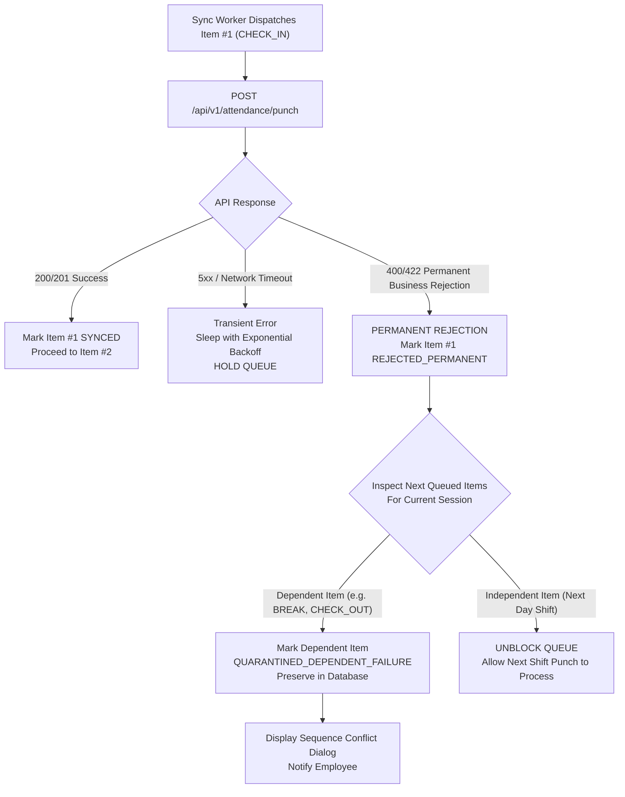
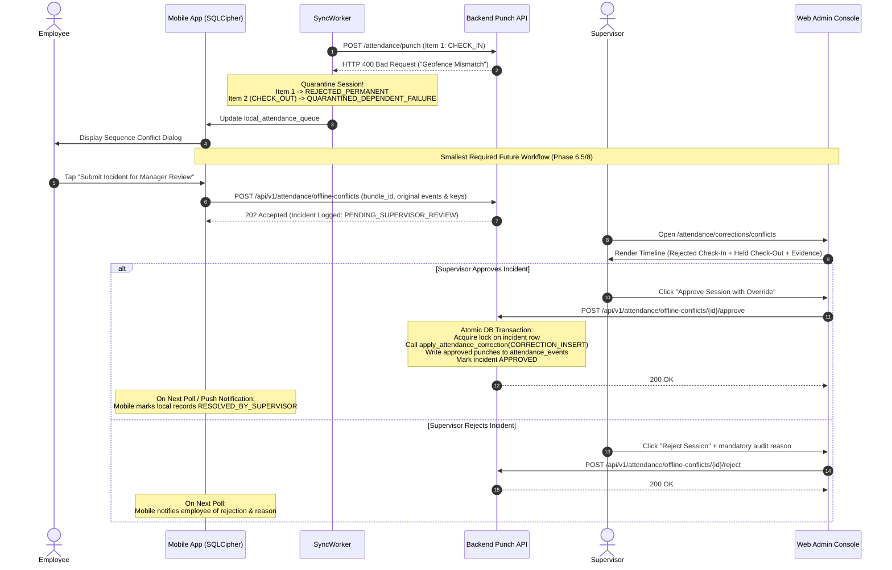

# UPOSTIT — Phase 6, Milestone 6.5 Technical Design Specification
## Encrypted Offline Attendance Queue & Synchronization Engine
### Final Architectural Specification, Trust Boundaries & Design Decisions

**Stage**: Stage B — Attendance Core  
**Document Version**: 2.1 (Final Architecture Clarifications)  
**Date**: November 16, 2026  
**Status**: APPROVED ARCHITECTURAL SPECIFICATION (Awaiting Implementation Authorization)  
**Target Module**: `apps/mobile/lib/features/sync/`  
**Parent Architecture**: [`docs/MOBILE_ATTENDANCE_ARCHITECTURE.md`](file:///Users/apple/Upostit/docs/MOBILE_ATTENDANCE_ARCHITECTURE.md)  
**Implementation Plan**: [`docs/PHASE_06_PLAN.md`](file:///Users/apple/Upostit/docs/PHASE_06_PLAN.md)  

---

## 1. Architectural Mission & Core Objectives

Enterprise field workers, shift workers, construction crews, and basement facility staff frequently operate in environments with intermittent, degraded, or zero internet connectivity. 

The primary mission of **Milestone 6.5** is to provide an **offline-first, zero-data-loss, cryptographically secured attendance queue** on employee mobile devices. When an employee logs an attendance action (`CHECK_IN`, `CHECK_OUT`, `BREAK_START`, `BREAK_END`), the mobile application must:
1. **Never Drop a Punch**: Atomically persist the punch locally in durable storage in under 100 milliseconds, even if airplane mode is active or the network drops mid-request.
2. **Preserve Exact Telemetry & Idempotency**: Generate the RFC4122 UUID v4 `idempotency_key` once at punch time, capture the exact immutable device UTC timestamp (`device_reported_at`), local timezone offset, and any available location (GPS) or network (Wi-Fi BSSID) evidence.
3. **Strict Zero-Trust Offline Model**: The mobile client **never** marks an offline punch as "Verified Attendance" on its own. The punch is rendered with high-visibility **Pending Synchronization** state until the server authoritative ledger processes and validates the event.
4. **Strict FIFO Synchronization**: Enforce sequential, in-order dispatch (`sequence_number ASC, device_reported_at ASC`), never skipping earlier pending punches to upload later ones.
5. **Secure Local Storage**: Encrypt all local database records using AES-256 with key material protected by platform hardware keystores (Android Keystore and iOS Keychain), completely segregated from authentication tokens.
6. **Multi-User & Logout Safety**: Ensure pending punches remain bound to the originating `(tenant_id, employee_id, user_id)`. Logging out displays high-visibility warnings and strictly **never** deletes un-synchronized attendance records.

---

## 2. Decision 1: Offline Timestamps & Server Clock-Drift Validation

### 2.1 The Problem
In standard online punching (Phase 5), the server enforces a strict clock-drift validation rule:
$$\left| T_{\text{server\_received}} - T_{\text{device\_reported}} \right| \le 300\text{ seconds}$$
If this threshold is exceeded, the event is flagged with `FLAG_SUSPICIOUS_CLOCK_DRIFT`. 

However, in legitimate offline scenarios, an employee may check in at 08:00 AM on a remote job site with zero cellular coverage and reconnect at 06:00 PM (10 hours later). If the 300-second rule were applied naively, every legitimate offline punch would be treated as suspicious fraud. Conversely, if the server blindly exempted any punch marked with a client-supplied flag like `is_offline: true`, a malicious user or modified client could forge backdated punches at will.

### 2.2 Dual Timestamp Invariant
The architecture enforces a strict dual-timestamp model:
1. `device_reported_at` (Immutable Client UTC): The exact UTC timestamp recorded by the mobile device at the millisecond the user pressed the punch button. This timestamp is persisted in the local encrypted database, signed with the initial idempotency hash, and **never recalculated, modified, or updated during subsequent sync attempts**.
2. `server_received_at` (Authoritative Server UTC): The server's clock timestamp at the exact moment the HTTP request reaches the FastAPI ingress handler. This timestamp is generated independently on the backend and cannot be influenced by the client.

### 2.3 Maximum Permitted Offline Sync Window
To bound historical ambiguity while accommodating long shifts and remote deployments:
- **Standard Sync Window**: The tenant policy defines `max_offline_sync_age_hours` (Default: **24 hours**; Admin configurable between **8 hours** and **72 hours**).
- **Grace Boundary for Weekends / Remote Transit**: Punches synchronized within 24 hours of creation are processed through the standard automated pipeline.
- **Window Exceeded Behavior ($> \text{max\_offline\_sync\_age\_hours}$)**:
  - The server **accepts** the event into the immutable ledger (`attendance_events`) to prevent data loss.
  - The server **does not** mark the presence status as automatically verified.
  - The event's `review_status` is set to **`PENDING_REVIEW`**, and the ledger records the flag **`FLAG_OFFLINE_WINDOW_EXCEEDED`**.
  - The day projection (`calculate_attendance_day`) marks the day as `PENDING_SUPERVISOR_APPROVAL`.
- **Absolute Hard Rejection Limit ($> 72\text{ hours}$)**: Punches submitted more than 72 hours after `device_reported_at` are rejected with HTTP 422 (`ERROR_OFFLINE_SYNC_EXPIRED`). The employee must submit an HR Missed Punch Correction Request with supervisor attestation.

### 2.4 Future-Dated Event Handling
- Any incoming punch where:
  $$T_{\text{device\_reported}} > T_{\text{server\_received}} + 60\text{ seconds}$$
  (allowing 60 seconds of allowable network latency and slight NTP clock skew) is classified as an integrity anomaly:
  - If $60\text{s} < \Delta T \le 300\text{s}$: Accepted into ledger, but flagged `FLAG_FUTURE_TIMESTAMP_DETECTED`, set to `review_status: PENDING_REVIEW`.
  - If $\Delta T > 300\text{s}$ (Device clock set $> 5\text{ minutes}$ into the future): **Strictly rejected with HTTP 422** (`ERROR_INVALID_FUTURE_TIMESTAMP`).

### 2.5 Server-Authoritative Distinction: Delayed Sync vs. Clock Manipulation
The server **never** trusts a client-provided boolean `is_offline`. Instead, the server uses a multi-factor heuristic pipeline:

| Verification Dimension | Legitimate Delayed Offline Punch | Suspected Clock Manipulation |
| :--- | :--- | :--- |
| **Ingestion Proximity (Burst Arrival)** | Offline punches arrive in a rapid sequential burst upon reconnection (e.g. Check-In from 08:00 and Check-Out from 17:00 arrive within 2 seconds of each other). | An isolated backdated punch arrives alone while the employee was actively syncing other events earlier that day. |
| **Monotonic Progression** | Monotonic boot uptime ticks forward in exact correspondence with wall-clock time between paired punches. | Monotonic elapsed time does not match wall-clock elapsed time ($\Delta T_{\text{wall}} \ne \Delta T_{\text{mono}}$). |
| **Shift Roster Conformance** | `device_reported_at` falls within the employee's assigned shift window and grace period. | `device_reported_at` falls suspiciously outside shift bounds or conflicts with an existing closed session. |
| **Hardware Evidence Freshness** | GPS reading timestamp and Wi-Fi observation timestamp match `device_reported_at` ($\pm 10\text{s}$). | GPS or Wi-Fi evidence timestamps diverge significantly from punch tap time. |

### 2.6 Server Evaluation & Review Status Matrix

| Ingestion Condition | Ledger Action | Resulting `review_status` | Applied Metadata Flags |
| :--- | :--- | :--- | :--- |
| $\Delta T \le 300\text{s}$, Online | Accepted | `NOT_REQUIRED` | `[]` |
| $300\text{s} < \Delta T \le 24\text{h}$, Monotonic Valid, Shift Match | Accepted | `NOT_REQUIRED` (or policy default) | `["FLAG_DELAYED_OFFLINE_SYNC"]` |
| $300\text{s} < \Delta T \le 24\text{h}$, Monotonic Discrepancy ($> 60\text{s}$) | Accepted | `PENDING_REVIEW` | `["FLAG_CLOCK_MANIPULATION_SUSPECTED"]` |
| $24\text{h} < \Delta T \le 72\text{h}$, Valid Evidence | Accepted | `PENDING_REVIEW` | `["FLAG_OFFLINE_WINDOW_EXCEEDED"]` |
| $\Delta T > 72\text{h}$ | **Rejected** (HTTP 422) | N/A | None (Recorded in Idempotency Error Log) |
| $60\text{s} < T_{\text{device}} - T_{\text{server}} \le 300\text{s}$ | Accepted | `PENDING_REVIEW` | `["FLAG_FUTURE_TIMESTAMP_DETECTED"]` |
| $T_{\text{device}} - T_{\text{server}} > 300\text{s}$ | **Rejected** (HTTP 422) | N/A | None (Recorded in Idempotency Error Log) |

---

## 3. Decision 2: Monotonic Clock Evidence & Threat Modeling Trust Boundaries

### 3.1 Trust Boundary & Threat Model

> [!IMPORTANT]
> **Explicit Trust Boundary**: All client-provided telemetry—including `device_reported_at`, `monotonic_uptime_ms`, `boot_session_id`, GPS location fixes, and Wi-Fi BSSID readings—is **untrusted client-reported evidence**. The backend cannot independently prove that these values are authentic.

1. **Risk Indicators, Not Cryptographic Proof**:
   - Monotonic uptime and boot session IDs are **telemetric risk indicators for anomaly detection**, not cryptographic proof or trusted server time.
   - The server independently records `server_received_at` upon arrival.
   - Suspicious combinations must result in rejection or review according to server policy.
   - **Client evidence alone can never override server-side attendance rules, geofence validations, workplace assignments, or user deactivations.**
2. **Platform Threat Limitations**:
   - **Rooted Android Devices**: Attackers using Magisk, Zygisk, or Xposed/LSPosed can hook `android.os.SystemClock.elapsedRealtime()` or mock `/proc/sys/kernel/random/boot_id`.
   - **Jailbroken iOS Devices**: Attackers using Frida, Substrate, or Substitute can swizzle `clock_gettime_nsec_np` or POSIX `sysctl`.
   - **Modified Clients**: Custom application binaries or repackaged APKs/IPAs can inject arbitrary timestamps and counters.
   - **Device Clock Manipulation**: Users can disable automatic network time and manually roll back system clocks.
3. **Defense-in-Depth Posture**:
   - Monotonic tracking catches naive manipulation (e.g. changing the settings clock while offline without kernel hooking).
   - In Phase 7 (Fraud Shield), hardware attestation (Google Play Integrity API and Apple DeviceCheck / App Attest) is layered to verify device and binary integrity.

### 3.2 Triple-Vector Hardware Evidence Model
Every punch captures:

```dart
class HardwareClockEvidence {
  final DateTime deviceReportedAtUtc;   // Wall-clock UTC timestamp
  final int timezoneOffsetMinutes;       // Device local timezone offset
  final int monotonicUptimeMs;          // Milliseconds since current boot session
  final String bootSessionId;           // Unique identifier of the current boot session
  final bool isRebootDetected;          // Flag indicating if device rebooted since last punch
}
```

### 3.3 Platform-Specific Monotonic Implementations

Because pure Dart does not expose OS boot session identifiers or kernel uptime, Milestone 6.5 utilizes a lightweight native platform channel:
`com.upostit.app/device_integrity`

#### Android Implementation (`android/app/src/main/kotlin/.../DeviceIntegrityPlugin.kt`):
- **Monotonic Uptime**: Uses `android.os.SystemClock.elapsedRealtime()` (which continues ticking while the CPU is in deep sleep/doze mode, unlike `uptimeMillis()`).
- **Boot Session Identity**: Reads `/proc/sys/kernel/random/boot_id` (a Linux kernel-generated UUID unique to the boot instance). Fallback if `/proc` is restricted: `(System.currentTimeMillis() - SystemClock.elapsedRealtime()).toString()`.

```kotlin
// Android Native Channel Implementation
val uptime = SystemClock.elapsedRealtime()
val bootId = try {
    File("/proc/sys/kernel/random/boot_id").readText().trim()
} catch (e: Exception) {
    (System.currentTimeMillis() - uptime).toString()
}
```

#### iOS Implementation (`ios/Runner/DeviceIntegrityPlugin.swift`):
- **Monotonic Uptime**: Uses `clock_gettime_nsec_np(CLOCK_MONOTONIC_RAW)` or `ProcessInfo.processInfo.systemUptime * 1000.0`.
- **Boot Session Identity**: Reads kernel boot time via POSIX `sysctl` with `CTL_KERN` and `KERN_BOOTTIME`:

```swift
// iOS Native Channel Implementation
var boottime = timeval()
var size = MemoryLayout<timeval>.stride
sysctlbyname("kern.boottime", &boottime, &size, nil, 0)
let bootSessionId = "\(boottime.tv_sec).\(boottime.tv_usec)"
let uptimeMs = Int64(ProcessInfo.processInfo.systemUptime * 1000.0)
```

### 3.4 Reboot Handling & In-Flight Comparison Logic
1. **Intra-Boot Verification (`bootSessionId_2 == bootSessionId_1`)**:
   - For consecutive punches occurring within the same boot session (e.g. Check-In at 09:00, Check-Out at 17:00):
     $$\Delta T_{\text{wall}} = T_{\text{checkout}} - T_{\text{checkin}}$$
     $$\Delta T_{\text{mono}} = M_{\text{checkout}} - M_{\text{checkin}}$$
   - **Validation Rule**:
     $$\left| \Delta T_{\text{wall}} - \Delta T_{\text{mono}} \right| \le 60\text{ seconds}$$
   - If $|\Delta T_{\text{wall}} - \Delta T_{\text{mono}}| > 60\text{ seconds}$, the device wall clock was intentionally altered while offline! The server flags `FLAG_CLOCK_MANIPULATION_SUSPECTED`.
2. **Inter-Boot Verification (`bootSessionId_2 != bootSessionId_1`)**:
   - If the employee reboots their device between Check-In and Check-Out:
     - The client flags `is_reboot_detected: true`.
     - Monotonic deltas cannot be directly subtracted because the counter was reset.
     - The server does **not** fail the punch. Instead, it notes the reboot in the audit trail and validates presence using shift schedule boundaries and supervisor review.

---

## 4. Decision 3: Offline Sequence Conflict Resolution Workflow

### 4.1 Inspection of Existing Correction Capabilities
An inspection of the backend implementation ([`services/api/attendance/correction_service.py`](file:///Users/apple/Upostit/services/api/attendance/correction_service.py#L50-L75)) reveals critical architectural boundaries:
1. **Employee Role Prohibited**: `_verify_actor_correction_permission` explicitly raises `HTTP 403 FORBIDDEN` for `role == "employee"`. Employees **cannot** directly call `POST /api/v1/attendance/corrections`.
2. **Single-Event Administrative Model**: The existing API is designed for managers/admins to perform single-event interventions (`CORRECTION_INSERT`, `CORRECTION_SUPERSEDE`, `CORRECTION_VOID`).
3. **No Target for Superseding**: An offline punch permanently rejected on initial sync (HTTP 400/422) was **never written to `attendance_events`**, so there is no `supersedes_event_id` to supersede.
4. **Conclusion**: The existing `/attendance/corrections` API **cannot directly ingest an unauthenticated employee offline conflict bundle**. A structured resolution workflow is required.

### 4.2 Sequence Dependency & Cascading Quarantine
Workforce attendance is fundamentally stateful:
$$\text{CHECK\_IN} \longrightarrow \text{BREAK\_START} \longrightarrow \text{BREAK\_END} \longrightarrow \text{CHECK\_OUT}$$
If an offline `CHECK_IN` is permanently rejected by the server:
- If the sync worker silently uploads the subsequent `CHECK_OUT`, the backend rejects it with *"No active check-in session found"* or creates an orphaned punch.
- If the sync worker blocks the queue indefinitely, the employee is permanently disabled from recording future attendance.



### 4.3 End-to-End Conflict Resolution Protocol



### 4.4 Conflict Bundle Structure & Evidence Retention
When an incident is bundled, the local database retains:
- `bundle_id`: Deterministic RFC4122 UUID v4 grouping the rejected session.
- `failed_event`: The primary rejected punch (`idempotency_key`, `event_type`, `device_reported_at`, coordinates, BSSID, `rejection_reason`).
- `dependent_events`: List of held punches in that work session.
- `telemetry_signatures`: Monotonic uptime and boot session IDs.

### 4.5 Prevention of Duplicate Submissions & Concurrent Decisions
1. **Duplicate Submissions**: The `bundle_id` carries a unique constraint on the backend (`attendance_conflict_incidents.bundle_id`). Submitting the same bundle twice returns the cached incident record.
2. **Concurrent Supervisor Decisions**: The backend approval/rejection endpoint acquires a pessimistic row lock (`SELECT ... FOR UPDATE`) on the conflict incident row. The first supervisor decision transitions status from `PENDING_SUPERVISOR_REVIEW` to `APPROVED` or `REJECTED`. Any simultaneous request by a second supervisor receives `HTTP 409 CONFLICT` (*"Conflict resolution already processed by another administrator"*).
3. **Idempotency Key Preservation**: When the supervisor approves the bundle, the backend inserts the punches into `attendance_events` using `source: "SUPERVISOR_CORRECTION"`, referencing the original `offline_idempotency_key` in the event metadata.

---

## 5. Decision 4: Encryption Strategy, Storage Architecture & Key Lifecycle

### 5.1 Explicit Strategy Selection

> [!IMPORTANT]
> **Primary Production Strategy**: **SQLCipher full-database page encryption** via `sqflite_sqlcipher: ^3.4.1` (AES-256-CBC, PBKDF2 256,000 iterations).  
> **Approved Production Alternative**: **Application-Level Envelope Encryption on standard `sqflite: ^2.4.1`** (AES-256-GCM authenticated encryption via pure Dart `cryptography` package).

- **Role of Envelope Encryption**: It is an **approved production alternative**, not merely a temporary scratchpad. If native C SQLCipher compilation or CocoaPods linking fails during CI/CD or platform verification on Android/iOS, envelope encryption delivers immediate production-grade data privacy without native toolchain blockers.
- **Unresolved Build Verification Disclosure**:
  - *Android*: `sqflite_sqlcipher` includes precompiled binaries, but runtime build verification against Android SDK 36, Java 25, and Gradle 9.3.1 has **not yet been executed** and remains an open acceptance verification in Milestone 6.5.A.
  - *iOS*: CocoaPods is currently uninstalled on this developer environment (`flutter doctor` reported `CocoaPods not installed`). Building iOS with `sqflite_sqlcipher` is **currently unverified and blocked until CocoaPods is installed** or Swift Package Manager is configured.

### 5.2 Comparative Security & Queryability Analysis

| Architectural Dimension | Full Database Page Encryption (SQLCipher) | Field-Level Envelope Encryption (standard `sqflite`) |
| :--- | :--- | :--- |
| **Encrypted Artifacts** | 100% of the SQLite file at rest (data pages, indexes, free pages, WAL file). | Sensitive field values are encrypted into an authenticated ciphertext blob. |
| **Visible Artifacts at Rest** | None. Database appears as pure high-entropy pseudorandom noise. | Structural metadata: table names, column names, `sequence_number`, `sync_status`. |
| **Queryable Columns** | **All columns** are indexed and queryable via SQL after applying `PRAGMA key`. | **Operational indexing columns only**: `(tenant_id, user_id, sync_status, sequence_number ASC, device_reported_at ASC)`. |
| **Encrypted Fields in Envelope** | N/A (all encrypted) | `latitude`, `longitude`, `accuracy_meters`, `wifi_bssid`, `wifi_ssid`, `metadata_json`, `last_error_message`. |
| **Native C Dependencies** | Heavy (OpenSSL / SQLCipher C compilation; requires CocoaPods on iOS). | **Zero native C code** (uses standard platform SQLite + pure Dart AES-256-GCM). |
| **Vulnerability to App Sandbox Compromise** | Protected unless decryption key is acquired from Keystore/Keychain. | Protected: sensitive location/network data is encrypted with Keystore/Keychain key. |

### 5.3 Encryption Mode Validation & Storage Metadata
The local database records its active encryption mode in table `local_storage_metadata`:
```sql
CREATE TABLE IF NOT EXISTS local_storage_metadata (
    key TEXT PRIMARY KEY,
    value TEXT NOT NULL
);
INSERT OR REPLACE INTO local_storage_metadata (key, value) 
VALUES ('encryption_engine', 'SQLCIPHER_PAGE_AES256'); -- or 'ENVELOPE_FIELD_AES256_GCM'
```
On database opening, the initialization routine verifies that the engine recorded matches the active driver. If a mismatch or unrecognized header is detected, initialization halts.

### 5.4 Fail-Closed Initialization Rule

> [!CAUTION]
> **Strict Prohibition against Plaintext Fallback**: If database encryption initialization fails for any reason (e.g. secure storage key missing, SQLCipher PRAGMA key rejected, Keystore `KeyPermanentlyInvalidatedException`), **the application MUST NEVER silently create, open, or fall back to an unencrypted plaintext database.**

- When an encryption failure occurs, the database factory throws a fatal `DatabaseEncryptionException`.
- Offline punch creation is halted immediately.
- The user is presented with a blocking error screen:
  > *"Security Initialization Failure: Offline attendance storage cannot be opened securely. Attendance cannot be recorded offline until resolved. Please restart the app or contact your company administrator."*

### 5.5 Key Generation, Secure Storage & Backup Exclusions
1. **Key Generation**: 32 cryptographically secure random bytes generated via `Random.secure()`, hex-encoded to a 64-character string.
2. **Platform Keystore Storage**:
   - **Android**: Android Keystore with `EncryptedSharedPreferences` (master key `AES256-GCM`).
   - **iOS**: iOS Keychain with `kSecAttrAccessibleAfterFirstUnlockThisDeviceOnly` (inaccessible when device is locked; strictly excluded from iCloud sync).
3. **Key Loss & Recovery**: If the device keystore is wiped, the database cannot be decrypted. Data cannot be salvaged from disk. The employee must resolve attendance through the HR correction protocol.
4. **OS Backup Exclusions**:
   - **iOS**: Directory flagged with `NSURLIsExcludedFromBackupKey = true`.
   - **Android**: Directory excluded via `res/xml/backup_rules.xml`.

---

## 6. Local Queue Relational Schema (`mobile_offline_ledger.db`)

```sql
CREATE TABLE IF NOT EXISTS local_attendance_queue (
    -- Unique Identifiers
    local_id TEXT PRIMARY KEY,                          -- Local client UUID v4
    idempotency_key TEXT NOT NULL UNIQUE,               -- Server idempotency UUID v4 (generated ONCE at punch time)
    
    -- Multi-Tenant & Identity Isolation
    tenant_id TEXT NOT NULL,                            -- Originating tenant UUID
    employee_id TEXT NOT NULL,                          -- Originating employee profile UUID
    user_id TEXT NOT NULL,                              -- Originating auth user UUID
    
    -- Attendance Core Attributes
    event_type TEXT NOT NULL,                           -- CHECK_IN, CHECK_OUT, BREAK_START, BREAK_END
    device_reported_at TEXT NOT NULL,                   -- ISO 8601 UTC timestamp of punch tap
    timezone_offset_minutes INTEGER NOT NULL,           -- Device UTC offset in minutes (e.g. +330)
    monotonic_boot_time_ms INTEGER NOT NULL,            -- Monotonic uptime milliseconds (clock manipulation check)
    boot_session_id TEXT NOT NULL,                      -- Boot session UUID or kernel boot timestamp
    is_reboot_detected INTEGER NOT NULL DEFAULT 0,      -- 1 if reboot occurred between session punches
    
    -- Location & Wi-Fi Evidence (Encrypted in Envelope mode; Cleartext in SQLCipher mode)
    location_id TEXT,                                   -- Assigned workplace location UUID
    latitude REAL,                                      -- GPS latitude (WGS84 decimal degrees)
    longitude REAL,                                     -- GPS longitude (WGS84 decimal degrees)
    accuracy_meters REAL,                               -- GPS horizontal accuracy in meters
    wifi_bssid TEXT,                                    -- Normalized Wi-Fi BSSID (XX:XX:XX:XX:XX:XX)
    wifi_ssid TEXT,                                     -- Wi-Fi network name (display/diagnostic only)
    wifi_signal_status TEXT NOT NULL,                   -- AVAILABLE, UNAVAILABLE, UNSUPPORTED, PERMISSION_DENIED
    encrypted_payload_blob TEXT,                        -- Authenticated ciphertext (used only in Envelope mode)
    
    -- Policy & Hardware Provenance
    applied_policy_version INTEGER NOT NULL,            -- Version of tenant policy active on client at punch time
    applied_policy_mode TEXT NOT NULL,                  -- MANUAL, GPS_ONLY, WIFI_ONLY, COMBINED
    device_id TEXT,                                     -- Hardware/OS installation identifier
    metadata_json TEXT NOT NULL DEFAULT '{}',           -- Arbitrary client diagnostics
    
    -- Queue Scheduling & State Machine
    sequence_number INTEGER NOT NULL,                   -- Monotonically increasing sequence per (tenant, user)
    sync_status TEXT NOT NULL,                          -- PENDING_SYNC, SYNCING, SYNCED, REJECTED_PERMANENT, QUARANTINED_DEPENDENT_FAILURE, FLAGGED_PENDING_REVIEW
    conflict_bundle_id TEXT,                            -- UUID v4 grouping quarantined session items
    retry_count INTEGER NOT NULL DEFAULT 0,             -- Exponential backoff retry counter
    last_attempted_at TEXT,                             -- Timestamp of most recent sync attempt
    last_error_message TEXT,                            -- Server or network error explanation
    last_error_status_code INTEGER,                     -- HTTP status code on failure (e.g. 500, 422)
    server_event_id TEXT,                               -- Server attendance_events.id returned on success
    
    -- Audit Timestamps
    created_at TEXT NOT NULL,                           -- Local record creation timestamp
    updated_at TEXT NOT NULL                            -- Local record modification timestamp
);

-- Indexes
CREATE UNIQUE INDEX IF NOT EXISTS uq_queue_idempotency_key ON local_attendance_queue (idempotency_key);
CREATE INDEX IF NOT EXISTS ix_queue_fifo ON local_attendance_queue (tenant_id, user_id, sync_status, sequence_number ASC, device_reported_at ASC);
CREATE INDEX IF NOT EXISTS ix_queue_status ON local_attendance_queue (sync_status);
CREATE INDEX IF NOT EXISTS ix_queue_history ON local_attendance_queue (tenant_id, user_id, device_reported_at DESC);
```

---

## 7. Sub-Milestone Execution Breakdown

| Sub-Milestone | Focus | Deliverables | Boundaries |
| :--- | :--- | :--- | :--- |
| **Milestone 6.5.A** | **Persistence & Queue DAO** | SQLCipher integration (with envelope fallback), `DatabaseKeyProvider`, `LocalQueueDao` with monotonic sequence, multi-tenant isolation, native channel `device_integrity` (boot ID + uptime), unit tests. | Mobile only; 0 backend changes |
| **Milestone 6.5.B** | **FIFO Sync Worker & Backoff** | `ConnectivityService`, `SyncWorker` with single-worker mutex, sequential dispatch, exponential backoff, dependent event quarantine (`QUARANTINED_DEPENDENT_FAILURE`), zombie lock clearance. | Mobile only; 0 backend changes |
| **Milestone 6.5.C** | **Offline UI & Logout Safety** | `OfflineStatusBanner`, `PendingSyncBadge`, `SyncStatusScreen`, sequence conflict dialog, `LogoutWarningDialog`, BLoC integration. | Mobile UI & BLoC |
| **Milestone 6.5.D** | **Chaos Simulation & Audit** | Airplane mode flap testing, crash recovery, clock manipulation tests, static analysis, formal audit report. | Mobile E2E verification |

---

## 8. Design Decision Records Summary

- **DDR-6.5-01: Dual-Timestamp Invariant & 24h Offline Window**: `device_reported_at` immutable; `server_received_at` authoritative receipt; 24h standard sync; 24–72h supervisor review; $>72\text{h}$ hard reject.
- **DDR-6.5-02: Trust Boundary & Triple-Vector Clock Evidence**: Client telemetry is untrusted risk indicators, not cryptographic proof. Native channel captures `boot_session_id` and monotonic uptime. Intra-boot drift $> 60\text{s}$ flagged as suspected clock tampering.
- **DDR-6.5-03: Offline Sequence Conflict Resolution Workflow**: Permanent rejection triggers `QUARANTINED_DEPENDENT_FAILURE` for dependent session events, unblocking subsequent shifts. Generates conflict bundle for supervisor review.
- **DDR-6.5-04: SQLCipher Primary with Approved Envelope Fallback**: SQLCipher full-page encryption preferred; envelope encryption approved alternative. Fail-closed: zero plaintext database fallback on encryption initialization error.
