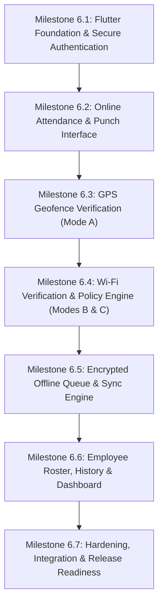

# PHASE 06 IMPLEMENTATION PLAN — Mobile Attendance Application
## Native Flutter App (Android & iOS) with GPS, Wi-Fi Verification & Offline Synchronization

**Stage**: Stage B — Attendance Core  
**Phase Name**: Phase 6 — Mobile Attendance Application  
**Status**: COMPLETE (Milestones 6.1 through 6.7 Complete & Validated)  
**Current Branch**: `phase-06`  
**Baseline Commit**: `a4dad73` (`phase-05-complete`)  
**Live Supabase Revision**: `c4d5e6f7a8b9 (head)`  
**Document Revision**: 2.9 (Phase 6 Final Security Hardening, Native Release Build & Validation Complete)  

---

## 1. Executive Summary & Scope Boundaries

Phase 6 delivers the production-ready **Flutter mobile application** for enterprise employees. Built upon the verified Phase 5 attendance engine, immutable event ledger, and shift versioning, Phase 6 empowers mobile workers to authenticate securely, view their shift assignments, log attendance punches with GPS and Wi-Fi verification evidence, and operate offline with durable local synchronization.

### 1.1 Phase 6 Core Deliverables
1. **Production Flutter Client Architecture**: Multi-platform (Android & iOS) app using Flutter 3.19+, Dart 3.3+, feature-first structure, BLoC state management, and Dio network client.
2. **Dedicated Mobile Token Strategy**: In-memory access token management, platform-secure storage via iOS Keychain / Android Keystore (`flutter_secure_storage`), silent token refresh with request queuing mutex, and online logout server session revocation—completely decoupled from browser cookies.
3. **Interactive Hero Punch Interface**: Live punch card for `CHECK_IN`, `CHECK_OUT`, `BREAK_START`, and `BREAK_END` with a live elapsed session timer, today's punch history, and clear visual labeling of pending synchronization vs server-verified attendance.
4. **Company-Configurable Verification Engine**:
   - **Mode A (GPS Only)**: Haversine client calculation + PostGIS server validation, horizontal accuracy filtering ($>100\text{m}$ rejected), and stale location rejection ($>30\text{s}$).
   - **Mode B (Wi-Fi Only)**: Verification of currently connected workplace access point BSSID against authorized location access points. Fail-closed policy (no silent success if verification is unavailable).
   - **Mode C (GPS + Wi-Fi Combined)**: Configurable dual-verification (strict AND or flexible OR with explicit administrator fallback).
5. **iOS Wi-Fi Compatibility Policy**: Explicit dependency on Apple's `Access Wi-Fi Information` entitlement and precise location permission, dynamic capability detection (`isWifiVerificationAvailable()`), admin-configured fallback only, user-friendly error banners, and mandatory real-device iOS testing.
6. **Encrypted Offline-First Durable Synchronization Queue**: Encrypted local SQLite storage (`sqflite` with SQLCipher), strict chronological FIFO dispatch, stable RFC4122 UUID v4 idempotency keys, original timestamp and UTC offset preservation, exponential backoff retry, and failure containment.
7. **Zero-Trust Offline Security & Logout Protection**:
   - The mobile client never decides its own final verification status; punches are labeled "Pending Synchronization" until server validation.
   - Logging out with pending offline punches prompts a prominent warning; pending punches are never silently deleted.
   - SQLite queue records are strictly bound to `(tenant_id, employee_id, user_id)`, preventing cross-employee or cross-tenant exposure on shared devices.
   - Sync automatically resumes when the original user logs back in; defined recovery workflow for deactivated accounts or lost devices.
8. **Employee Schedule & History Views**: Today's shift card with grace period guidelines, upcoming roster schedule, monthly presence calendar, and punch audit timeline with sync status indicators.

### 1.2 Strict Scope Exclusions (Roadmap Isolation)
In strict accordance with `PROJECT_CONTEXT.md` and the 22-phase specification:
- **Device Hardware Binding & Root/Jailbreak Detection** &rarr; *Phase 7* (Fraud Shield).
- **Selfie Capture & Facial Liveness Verification** &rarr; *Phase 7* (Biometric Liveness).
- **Mock-GPS Detection & Impossible Velocity Analysis** &rarr; *Phase 7* (Location Fraud Protection).
- **Employee-Submitted Correction Requests & Multi-Tier Approval Chains** &rarr; *Phase 8* (Approvals).
- **Leave Requests & Paid Leave Balances** &rarr; *Phase 9* (Leave Management).
- **Push Notifications via FCM / APNs** &rarr; *Phase 12* (Notifications & Alerts).

---

## 2. Milestone Execution Roadmap

Phase 6 is decomposed into **seven focused, reviewable, and testable milestones**:



---

## 3. Milestone Detailed Specifications

---

### Milestone 6.1 — Flutter Foundation, Design System & Secure Mobile Authentication

**Status**: ✅ COMPLETED (2026-11-04) — Report: [PHASE_06_MILESTONE_01_REPORT.md](phase-reports/PHASE_06_MILESTONE_01_REPORT.md)

#### 1. Objective
Establish the production Flutter architecture in `apps/mobile/`, configure Android and iOS native hosts, implement design system tokens, and deliver secure mobile authentication using in-memory access tokens, platform Keychain/Keystore refresh tokens, and concurrency-safe token refresh mutex.

#### 2. Scope
- Upgrade Flutter project configuration and register core packages in `pubspec.yaml` (`flutter_bloc`, `dio`, `flutter_secure_storage`, `go_router`, `google_fonts`).
- Material 3 theme configuration matching web dashboard styling (Inter typography, Slate/Indigo palette).
- Dedicated Mobile Token Strategy:
  - **Access Token**: Maintained in volatile memory (in-memory AuthState/Dio client). Never written to unencrypted disk.
  - **Refresh Token**: Stored exclusively in platform-secure storage (`flutter_secure_storage`):
    - iOS: Keychain with `kSecAttrAccessibleAfterFirstUnlockThisDeviceOnly`.
    - Android: Android Keystore with `EncryptedSharedPreferences` (AES-256 GCM).
  - Explicit architectural contrast with web HttpOnly cookies (mobile bypasses browser cookie jars to prevent cleartext file extraction and platform channel friction).
- Network Layer (`Dio`) with `AuthInterceptor`:
  - Injects `Authorization: Bearer <access_token>` on API requests.
  - Implements concurrency-safe **Refresh Mutex**: If multiple concurrent requests trigger HTTP 401, exactly one refresh request is sent to `POST /api/v1/auth/refresh`; other requests queue in memory and replay once the new token is available. Prevents false backend token reuse triggers.
- Online Logout Workflow:
  - Calls `POST /api/v1/auth/logout` with `{ "refresh_token": "..." }` when online to revoke session in the database before clearing local secure storage.
- Login screen with email/password validation, loading indicators, and error banners.
- Splash screen with authentication state hydration (silent refresh on app cold launch).

#### 3. Out-of-Scope
- Biometric unlock (Touch ID/Face ID/Fingerprint) &rarr; Phase 7.
- Social login (Google/Apple SSO) &rarr; Future enhancement.
- Push notification device token registration &rarr; Phase 12.

#### 4. Screens and User Journeys
- **Splash Screen**: Checks local secure storage. If valid refresh token exists, triggers silent refresh and routes to `TodayScreen`. Otherwise, routes to `LoginScreen`.
- **Login Screen**: Company work email and password inputs. Displays inline validation errors. On submit, calls `POST /api/v1/auth/login`. On success, stores tokens securely and navigates to the app shell.

#### 5. Flutter Modules and Expected Files
```text
apps/mobile/lib/
├── core/
│   ├── config/env_config.dart
│   ├── constants/colors.dart, typography.dart, spacing.dart
│   ├── network/api_client.dart, auth_interceptor.dart, error_handler.dart
│   ├── security/secure_storage_service.dart
│   └── theme/app_theme.dart
├── features/auth/
│   ├── data/models/auth_token_model.dart, user_model.dart
│   ├── data/datasources/auth_remote_datasource.dart
│   ├── data/repositories/auth_repository_impl.dart
│   ├── domain/repositories/auth_repository.dart
│   ├── domain/usecases/login_usecase.dart, refresh_token_usecase.dart, logout_usecase.dart
│   └── presentation/
│       ├── blocs/auth_bloc.dart, auth_event.dart, auth_state.dart
│       └── screens/login_screen.dart, splash_screen.dart
```

#### 6. Backend APIs Reused
- `POST /api/v1/auth/login`: Authenticate with work email & password. Returns `{access_token, refresh_token, token_type, expires_in}`.
- `POST /api/v1/auth/refresh`: Accepts `{refresh_token: "..."}` in request body, rotates tokens, and returns `{access_token, refresh_token}`.
- `POST /api/v1/auth/logout`: Revokes refresh token in database.
- `GET /api/v1/auth/me`: Fetches authenticated user and company profile.
- `GET /api/v1/employees/me`: Fetches employee record (ID, employment status, designation).

#### 7. New Backend APIs Potentially Required
- None. Existing Phase 2 & 3 authentication endpoints natively support request-body refresh tokens.

#### 8. Database Changes Potentially Required
- None.

#### 9. Permissions & Platform Dependencies
- *Android*: `INTERNET`, `ACCESS_NETWORK_STATE` in `AndroidManifest.xml`.
- *iOS*: Standard network access; minimum deployment target iOS 14.0. Keychain Sharing not required (single-app container).

#### 10. Security Requirements
- Zero tokens written to unencrypted `SharedPreferences` or local SQLite.
- Access tokens kept in memory; refresh tokens in hardware Keystore / Keychain.
- Concurrency mutex prevents token rotation race conditions on concurrent 401s.
- TLS 1.3 enforced for API communication; cleartext HTTP prohibited in release builds.

#### 11. Error Scenarios
- Invalid credentials (HTTP 401): Displays "Invalid email or password."
- Account deactivated (HTTP 403): Displays "Account has been deactivated. Please contact HR."
- Token reuse detected (HTTP 401 with reuse error): Revokes local session, clears storage, routes to login screen with notification.
- Network unreachable during login: Displays offline banner with retry button.

#### 12. Automated Tests
- Unit tests for `SecureStorageService` mock operations.
- Unit tests for `AuthInterceptor` concurrency mutex: simulate 5 parallel 401 requests, verify only 1 call to `POST /auth/refresh` occurs and all 5 requests retry successfully.
- BLoC tests for `AuthBloc` state transitions (`Unauthenticated`, `Authenticating`, `Authenticated`, `AuthError`).
- Widget test for `LoginScreen` form validation and submission.

#### 13. Manual Device Tests
- Cold launch app on Android emulator and iOS simulator: verify splash screen auto-navigation.
- Log in on physical Android device; terminate app and relaunch: verify session persists via silent refresh.
- Log out on iOS device while online: verify server session is revoked and Keychain items are cleared.

#### 14. Acceptance Criteria
- User can successfully log in with valid credentials.
- Access token is automatically refreshed upon expiration without interrupting user activity.
- Parallel requests do not cause token rotation collision.
- Zero credentials or tokens leaked in logs or unencrypted storage.

#### 15. Dependencies & Risks
- **Dependencies**: Baseline repo scaffolding (`phase-05-complete`).
- **Risks**: Network interceptor deadlock if refresh mutex is incorrectly implemented. Mitigated by strict timeout on refresh calls (10s max).

---

### Milestone 6.2 — Online Attendance and Punch Interface

#### 1. Objective
Deliver the primary mobile punch screen allowing employees to log real-time `CHECK_IN`, `CHECK_OUT`, `BREAK_START`, and `BREAK_END` punches with live elapsed timers, optimistic UI feedback, and immediate server confirmation.

#### 2. Scope
- Hero punch screen with circular touch-optimized action button.
- Context-aware state transitions (Not Punched In $\rightarrow$ Working $\rightarrow$ On Break $\rightarrow$ Shift Ended).
- Live elapsed session timer (HH:MM:SS) synchronized with server-reported check-in time.
- Secondary break controls (`Start Break`, `End Break`).
- Today's punch log timeline card showing all events recorded for the current calendar date.
- Client UUID v4 `idempotency_key` generation for each punch submission.
- Preservation of original device timestamp (`device_reported_at`) and UTC offset (`timezone_offset_minutes`).
- UI status demarcation: Clearly marks punches as "Confirmed" when server returns 201/200.

#### 3. Out-of-Scope
- Offline queueing & background retry &rarr; Milestone 6.5.
- GPS coordinate capture & geofencing &rarr; Milestone 6.3.
- Wi-Fi BSSID capture &rarr; Milestone 6.4.

#### 4. Screens and User Journeys
- **Today Attendance Screen**:
  - Displays greeting, date, and current attendance status badge (e.g. "WORKING", "ON BREAK").
  - Central dynamic button: Displays "CHECK IN" (Green) when outside work; "CHECK OUT" (Slate) when working.
  - Break button: "Start Break" (Amber) active during work; "Resume Work" active during break.
  - Live Timer: Counts up from `effective_at` of current session in real-time.
  - Recent Punches List: Compact card showing today's punch history.

#### 5. Flutter Modules and Expected Files
```text
apps/mobile/lib/features/attendance/
├── data/models/punch_request_model.dart, attendance_event_model.dart, attendance_day_model.dart
├── data/datasources/attendance_remote_datasource.dart
├── data/repositories/attendance_repository_impl.dart
├── domain/repositories/attendance_repository.dart
├── domain/usecases/record_punch_usecase.dart, get_today_attendance_usecase.dart
└── presentation/
    ├── blocs/attendance_bloc.dart, attendance_event.dart, attendance_state.dart
    ├── controllers/elapsed_timer_controller.dart
    ├── screens/today_punch_screen.dart
    └── widgets/hero_punch_button.dart, live_timer_display.dart, punch_history_list.dart
```

#### 6. Backend APIs Reused
- `POST /api/v1/attendance/punch`: Records punch event into the append-only ledger.
- `GET /api/v1/attendance/days/me?target_date=YYYY-MM-DD`: Fetches current day's calculated projection and active session intervals.
- `GET /api/v1/attendance/events/me`: Fetches raw punch events for today.

#### 7. New Backend APIs Potentially Required
- None. Existing Phase 5 attendance endpoints provide all required capabilities.

#### 8. Database Changes Potentially Required
- None.

#### 9. Permissions & Platform Dependencies
- Device hardware vibrator / haptic feedback (`HapticFeedback.mediumImpact()`).

#### 10. Security Requirements
- Client generates unique RFC4122 UUID v4 `idempotency_key` per punch attempt.
- `device_reported_at` formatted as strict ISO 8601 UTC timestamp.
- Client never asserts attendance status independently; displays server-confirmed status.

#### 11. Error Scenarios
- Double check-in attempt (HTTP 400): Displays "You are already checked in."
- Break end without break start (HTTP 400): Displays "No active break session found."
- Idempotency replay (HTTP 200 with `idempotent_replay: true`): Silently accepts and updates UI.

#### 12. Automated Tests
- BLoC unit tests for attendance status transitions.
- Timer unit tests validating accurate elapsed second calculations across timezone boundaries.
- Widget tests for button state changes (`CHECK_IN` $\rightarrow$ `WORKING` $\rightarrow$ `BREAK`).

#### 13. Manual Device Tests
- Complete full punch lifecycle on physical device: Check In $\rightarrow$ Start Break $\rightarrow$ End Break $\rightarrow$ Check Out.
- Verify live elapsed timer updates smoothly at 1-second intervals without stutter or memory leak.

#### 14. Acceptance Criteria
- Punches record successfully into the backend ledger within 2 seconds of tapping.
- Consecutive invalid punch actions are prevented by UI state and handled cleanly if rejected by server.
- Live timer survives screen rotation, tab switching, and app backgrounding.

#### 15. Dependencies & Risks
- **Dependencies**: Milestone 6.1 (Auth & Network client).
- **Risks**: Device clock skew causing negative elapsed timer. Mitigated by anchoring timer to server-confirmed punch time.

---

### Milestone 6.3 — GPS Geofence Verification (Mode A) & Company Policy Engine

**Status**: ✅ COMPLETED (2026-11-05) — Reports: [PHASE_06_MILESTONE_03A_REPORT.md](phase-reports/PHASE_06_MILESTONE_03A_REPORT.md), [PHASE_06_MILESTONE_03A_AUDIT_REPORT.md](phase-reports/PHASE_06_MILESTONE_03A_AUDIT_REPORT.md), [PHASE_06_MILESTONE_03B_REPORT.md](phase-reports/PHASE_06_MILESTONE_03B_REPORT.md)

#### 1. Objective
Deliver the mobile GPS geofence verification engine integrated with a server-authoritative **Company Attendance Policy Engine**. Enforce tenant-configurable presence rules (`MANUAL`, `GPS`, `WIFI`, `BIOMETRIC`, `COMBINED`) where GPS is strictly optional per organization policy, PostGIS `ST_DWithin` validates coordinates on ingest, and employees verify geofences exclusively against their own assigned workplaces.

#### 2. Scope
- **Central Attendance Policy Support**:
  - Support configurable tenant attendance verification modes: `MANUAL` (default, zero location requirement), `GPS_ONLY` (Mode A), `WIFI_ONLY` (Mode B), `COMBINED` (Mode C), and future `BIOMETRIC` (Phase 15) and `FACE_RECOGNITION` (Phase 7).
  - Mobile client dynamically queries `GET /api/v1/attendance/policy/me` to determine required verification evidence before presenting UI controls.
- **Backend Remediation Implementation**:
  - Extend `EmployeeWorkplaceResponse` (`GET /api/v1/employees/me/workplaces`) to include `latitude: Decimal | None`, `longitude: Decimal | None`, and `radius_meters: int | None` for active employee assignments.
  - Implement dedicated employee geofence probe `POST /api/v1/employees/me/workplaces/verify-coordinates` authorized by `Permission.RECORD_PUNCH` (validating employee assignment, date effectiveness, location status, and PostGIS `ST_DWithin`).
  - Enforce server-authoritative PostGIS `ST_DWithin` in `record_punch` when the active policy mandates GPS verification, recording spatial evidence in `AttendanceEvent.metadata_json` while preserving UUID v4 idempotency.
- **Mobile GPS Service (`features/location`)**:
  - Native location permissions workflow (`geolocator` package) handling foreground location permissions on Android (`ACCESS_FINE_LOCATION`) and iOS (`NSLocationWhenInUseUsageDescription`).
  - Permission primer modal explaining justification prior to triggering OS dialog.
  - Horizontal accuracy filtering ($>100\text{m}$ rejected) and stale fix rejection ($>30\text{s}$).
  - Client-side proximity calculation (Haversine distance) and visual geofence status card on the attendance home screen.
  - Integration with `CHECK_IN`, `CHECK_OUT`, `BREAK_START`, and `BREAK_END` punch flows.

#### 3. Out-of-Scope
- Wi-Fi BSSID capture & verification &rarr; Milestone 6.4.
- Offline encrypted SQLite queue & background sync &rarr; Milestone 6.5.
- Mock-location detection & OS hook prevention &rarr; Phase 7 (Fraud Shield).
- Continuous background GPS tracking & breadcrumbs &rarr; Explicitly excluded (privacy protection).

#### 4. Screens and User Journeys
- **Location Permission Primer Modal**: Transparent dialog explaining workplace presence verification before OS prompt.
- **Geofence Radar Widget on Today Attendance Screen**:
  - Displays assigned workplace name, GPS accuracy indicator, and proximity status.
  - Status badge: "Within Geofence (28m)" (Green) vs "Outside Geofence (180m)" (Amber warning).
  - Tapping opens workplace geofence radius preview.

#### 5. Flutter Modules and Expected Files
```text
apps/mobile/lib/features/location/
├── data/models/workplace_location_model.dart, geofence_verify_model.dart
├── data/datasources/location_device_datasource.dart, location_remote_datasource.dart
├── data/repositories/location_repository_impl.dart
├── domain/entities/user_location.dart, geofence_verification.dart
├── domain/repositories/location_repository.dart
├── domain/usecases/get_device_location_usecase.dart, verify_workplace_geofence_usecase.dart
└── presentation/
    ├── bloc/location_bloc.dart, location_event.dart, location_state.dart
    └── widgets/geofence_status_card.dart, location_permission_dialog.dart
```

#### 6. Backend APIs Reused & Remediated
- `GET /api/v1/attendance/policy/me`: Fetches active tenant attendance policy configuration.
- `GET /api/v1/employees/me/workplaces`: Fetches employee's active workplace assignments, including `latitude`, `longitude`, `radius_meters`.
- `POST /api/v1/employees/me/workplaces/verify-coordinates`: Dedicated employee-scoped PostGIS `ST_DWithin` probe guarded by `Permission.RECORD_PUNCH`.
- `POST /api/v1/attendance/punch`: Submits punch with `latitude`, `longitude`, `accuracy_meters`, and `location_id`, validated server-side by PostGIS against tenant policy.

#### 7. Database Changes Required
- Create `tenant_attendance_policies` table to persist company attendance verification rules per tenant with versioning, default `MANUAL`, RLS isolation, and JSONB policy configurations.

#### 8. Permissions & Platform Dependencies
- *Android*: `ACCESS_FINE_LOCATION`, `ACCESS_COARSE_LOCATION` in `AndroidManifest.xml`.
- *iOS*: `NSLocationWhenInUseUsageDescription` in `Info.plist`.
- Zero background location permissions.

#### 9. Security Requirements
- Request `WhenInUse` only; never request background `Always` permission.
- Server-side PostGIS `ST_DWithin` is authoritative; client-side distance is advisory only.
- Coordinates returned exclusively for employee's assigned active workplaces.
- Raw GPS history is never stored as breadcrumbs; location is recorded only at the exact instant of an attendance punch.

#### 10. Error Scenarios
- Location permission denied permanently: Prompts user to open system settings (`openAppSettings()`).
- Location services disabled at OS level: Prompts user to turn on GPS.
- Low accuracy ($>100\text{m}$): Displays "GPS accuracy too low ($\pm 140\text{m}$). Please step outside or near a window."
- Stale location ($>30\text{s}$ old): Displays "Acquiring fresh location..." and retries satellite fix.
- Punch outside geofence: Displays clear distance notice (e.g. "You are 145m outside the office perimeter") and blocks punch or flags for manager review per policy.

#### 11. Automated Tests
- Unit tests for Haversine distance calculations and edge cases.
- Unit tests for accuracy threshold filtering and stale timestamp filtering.
- BLoC tests for location permission states (`Granted`, `Denied`, `ServiceDisabled`, `InsideGeofence`, `OutsideGeofence`).
- Integration tests for employee workplace coordinates and PostGIS punch validation.

#### 12. Manual Device Tests
- Test inside geofence boundary on physical Android & iOS devices: verify green "Inside" status.
- Walk 200m outside geofence: verify amber "Outside" status and accurate distance display.
- Test with GPS disabled: verify graceful prompt to enable location.

#### 13. Acceptance Criteria
- Punch payload includes valid `latitude`, `longitude`, `accuracy_meters`, and `location_id` when required by tenant policy.
- Companies with `MANUAL` policy can punch without location coordinates or errors.
- Companies with `GPS_ONLY` policy reject or review out-of-geofence punches via PostGIS `ST_DWithin`.
- Rejects stale/cached coordinates older than 30 seconds or accuracy $> 100\text{m}$.

#### 15. Dependencies & Risks
- **Dependencies**: Milestone 6.2 (Punch screen).
- **Risks**: Tall buildings causing GPS multipath degradation. Mitigated by configurable accuracy threshold and UI retry button.

---

### Milestone 6.4 — Wi-Fi Verification & Company Policy Engine (Modes B & C)

**Status**: 🟡 IN PROGRESS (Milestone 6.4.A Architecture Planning Complete — Design Document: [PHASE_06_MILESTONE_04A_DESIGN.md](PHASE_06_MILESTONE_04A_DESIGN.md); Awaiting Approval to Implement)

#### Sub-Milestone Decomposition:
- **Milestone 6.4.A — Backend Wi-Fi Verification Engine & Admin-Configurable Fallback Architecture**: COMPLETED & VERIFIED. Covers `workplace_wifi_access_points` schema (`c4d5e6f7a8b9`), BSSID normalization, signal state differentiation (`MATCHED`, `MISMATCHED`, `UNAVAILABLE`, `UNSUPPORTED`, `STALE`), 4 fallback actions (`REJECT`, `GPS_FALLBACK`, `SUPERVISOR_REVIEW`, `MANUAL_FALLBACK`), and policy combination rules (`AND`, `OR`, `PRIMARY_WITH_FALLBACK`).
- **Milestone 6.4.B — Flutter Mobile Wi-Fi Inspection & Fallback Client Integration**: COMPLETED & VERIFIED. Implements `network_info_plus` connected AP inspection, Android location toggle check, iOS entitlement configuration, canonical BSSID normalization, policy-driven verification & fallback UI, and punch idempotency preservation.

#### 1. Objective
Implement connected workplace Wi-Fi verification via access point BSSID matching, establish the iOS Wi-Fi compatibility policy with dynamic availability detection, enforce fail-closed security, and build the administrator policy engine for Modes A, B, and C with explicitly configured fallbacks.

#### 2. Scope
- Wi-Fi inspection module (`network_info_plus`) to read the currently connected network's BSSID and SSID.
- Matching engine: Compares device BSSID against assigned location's `wifi_bssids` list (case-insensitive, normalized).
- iOS Wi-Fi Compatibility Policy Implementation:
  - Detect entitlement `com.apple.developer.networking.wifi-info` availability.
  - Detect Precise Location authorization on iOS 14+.
  - Implement `isWifiVerificationAvailable()` capability probe.
  - **Fail-Closed Policy**: If Wi-Fi verification is unavailable or unreadable, Mode B punches **never silently succeed**; attendance is blocked.
  - **Admin-Configured Fallback**: GPS fallback in Mode B or Mode C is allowed **only when explicitly configured by company administrator** (`allow_gps_fallback_if_wifi_unsupported: true`).
  - Clear user-facing error messages for all failure states.
- Company Verification Policy Engine:
  - **Mode A (GPS Only)**: Evaluates geofence only.
  - **Mode B (Wi-Fi Only)**: Evaluates connected BSSID only. Fails closed if Wi-Fi cannot be verified.
  - **Mode C (GPS + Wi-Fi Combined)**:
    - *Policy C1 (Strict AND)*: Requires both GPS within radius AND connected BSSID match.
    - *Policy C2 (Flexible Fallback)*: If primary signal is unavailable, accepts secondary signal **only if enabled in company policy**.
- Platform limitation handling: Identifies iOS prohibition against scanning nearby APs and Android requirement that Location Services be enabled to read BSSID.

#### 3. Out-of-Scope
- Active scanning of nearby disconnected Wi-Fi APs (prohibited by Apple; throttled by Google).
- Captive portal auto-login.

#### 4. Screens and User Journeys
- **Verification Mode Status Card**:
  - Displays required verification signals for current workplace (e.g. "Mode: GPS + Wi-Fi").
  - Shows real-time badge for each signal:
    - GPS: `Within Geofence (45m)` or `Out of Bounds`
    - Wi-Fi: `Connected: Corp_Office (BSSID Matched)` or `Disconnected / Unrecognized`
- **Fallback Alert Banner**: If primary signal fails but admin allows fallback, displays: "Workplace Wi-Fi unavailable. Falling back to GPS Geofence verification per company policy."
- **Verification Blocked Modal**: If verification fails and fallback is disabled, displays specific actionable reason.

#### 5. Flutter Modules and Expected Files
```text
apps/mobile/lib/features/wifi/
├── data/models/wifi_evidence_model.dart, verification_policy_model.dart
├── data/datasources/wifi_device_datasource.dart
├── data/repositories/wifi_repository_impl.dart
├── domain/repositories/wifi_repository.dart
├── domain/usecases/get_connected_wifi_usecase.dart, evaluate_policy_usecase.dart
└── presentation/
    ├── blocs/verification_policy_bloc.dart
    └── widgets/verification_signals_card.dart, wifi_status_indicator.dart, wifi_error_dialog.dart
```

#### 6. Backend APIs Reused
- `GET /api/v1/employees/me/workplaces`: Returns workplace location details and authorized `wifi_bssids`.
- `POST /api/v1/attendance/punch`: Punch metadata payload includes structured `verification_payload` (GPS + Wi-Fi signals + decision reason).

#### 7. New Backend APIs Potentially Required
- Ensure `EmployeeWorkplaceResponse` includes `wifi_bssids: list[str]` so mobile client can verify matching locally.

#### 8. Database Changes Potentially Required
- None. `locations.wifi_bssids` column already exists in Supabase schema.

#### 9. Permissions & Platform Dependencies
- *Android*: `ACCESS_FINE_LOCATION`, `ACCESS_WIFI_STATE`, `NEARBY_WIFI_DEVICES`.
- *iOS*: `Access WiFi Information` capability in Xcode (`com.apple.developer.networking.wifi-info`), `NSLocationWhenInUseUsageDescription`.

#### 10. Security Requirements
- BSSID comparisons are case-insensitive and stripped of delimiters (`:` and `-`).
- Never rely solely on SSID for security (SSIDs are strictly treated as cosmetic labels).
- Mode B must fail closed: zero silent passes when BSSID cannot be read.
- Signal separation: Both GPS and Wi-Fi evidence are recorded independently in the payload.

#### 11. Error Scenarios
- Wi-Fi toggled off: Displays "Please connect your device to the designated workplace Wi-Fi network before checking in."
- iOS Precise Location disabled: Displays "iOS requires Precise Location to verify your workplace Wi-Fi. Please enable in Settings."
- iOS Entitlement absent / unreadable BSSID (Fallback disabled): Displays "Unable to verify workplace Wi-Fi hardware address. Verification cannot be bypassed. Please contact your manager."
- BSSID Mismatch: Displays "Connected Wi-Fi ('{SSID}') does not match registered workplace access points."
- BSSID unreadable (Admin fallback enabled): Displays fallback notification and captures GPS.

#### 12. Automated Tests
- Unit tests for BSSID MAC address normalization and list matching.
- Unit tests for Mode C policy matrix (Strict AND vs Flexible Fallback).
- Unit tests for fail-closed behavior when BSSID is null/empty.
- BLoC tests for verification signal aggregation and error states.

#### 13. Manual Device Tests
- Connect to office Wi-Fi on physical iPhone & Android: verify green Wi-Fi checkmark.
- Turn off Wi-Fi on physical device: verify Mode B blocks punch; verify Mode C invokes GPS fallback only if admin enabled it.
- Connect to unauthorized mobile hotspot: verify rejection.
- Disable Precise Location in iOS Settings: verify prompt to enable Precise Location.

#### 14. Acceptance Criteria
- Punch records separate evidence for GPS and Wi-Fi in `metadata_json`.
- Strict mode blocks unauthorized punches; flexible fallback functions only when enabled by admin.
- Wi-Fi-only punches never silently pass when verification is unavailable.
- Platform restrictions handled gracefully without app crash.

#### 15. Dependencies & Risks
- **Dependencies**: Milestone 6.3 (Location module).
- **Risks**: iOS entitlement provisioning delays in Apple Developer Portal. Mitigated by explicit fallback configuration and clear user messaging.

---

### Milestone 6.5 — Encrypted Offline Queue & Synchronization Engine

*Detailed Specification*: [`docs/PHASE_06_MILESTONE_05_DESIGN.md`](file:///Users/apple/Upostit/docs/PHASE_06_MILESTONE_05_DESIGN.md)

#### Sub-Milestone Decomposition:
- **Milestone 6.5.A — SQLCipher Encrypted Persistence, Secure Key Management & Local Queue DAO**: [COMPLETED] Local SQLCipher database (`mobile_offline_ledger.db`) with envelope encryption fallback, Android Keystore & iOS Keychain hardware master key binding, native platform channel `com.upostit.app/device_integrity` capturing `boot_session_id` and monotonic uptime, `LocalQueueDao` with monotonic sequence, multi-tenant/multi-user isolation, and unit tests.
- **Milestone 6.5.B — Strict FIFO Synchronization Worker, Network Observer & Backoff Engine**: [COMPLETED] Connectivity listener (`connectivity_plus`), active backend reachability verification via socket/DNS probe, single-active-worker account mutex, sequential in-order dispatch (`sequence_number ASC`), exponential backoff (2s, 4s, 8s, up to 60s) with HTTP 429 `Retry-After` support, transient error recovery, crash recovery for zombie syncing items (>120s), session-aware dependent event quarantine (`QUARANTINED_DEPENDENT_FAILURE`) upon permanent rejection without quarantining independent future shifts, foreground app synchronization, and 215 passing tests.
- **Milestone 6.5.C — Offline UI Integration, Sync Drawer & Logout Safety Modal**: [COMPLETED] Sky-blue `OfflineStatusBanner`, `SyncQueueSummary` domain entity, `SyncBloc`, `SyncStatusScreen` at `/sync`, mutual exclusion manual "Sync Now" action, immutable timeline of queued records via `SyncEventTile`, `LogoutWarningDialog` with zero-silent-deletion guarantee, `AttendanceBloc` offline punch capture, and 240 passing tests.
- **Milestone 6.5.D — End-to-End Offline Simulation, Chaos/Crash Recovery & Security Audit**: [COMPLETED] Network flap and lost server response replay simulation, crash recovery for zombie sync states (>120s), phone reboot handling, session-aware quarantine verification, multi-tenant and account switching isolation, static security and database hygiene audit, `android:allowBackup="false"`, native APK `libsqlcipher.so` packaging verification, and 254 passing mobile tests (296 combined). Report: [PHASE_06_MILESTONE_05D_REPORT.md](phase-reports/PHASE_06_MILESTONE_05D_REPORT.md).

#### 1. Objective
Build an offline-first durable persistence engine using SQLCipher-encrypted SQLite (with approved envelope encryption fallback), strict chronological FIFO dispatch, stable RFC4122 UUID v4 idempotency keys, dual timestamp preservation (`device_reported_at` vs `server_received_at`), triple-vector hardware clock risk telemetry, server-authoritative status resolution, cascading sequence quarantine, and logout safety for pending punches.

#### 2. Scope
- Local encrypted SQLite database: SQLCipher (`sqflite_sqlcipher`) as preferred production strategy; pure Dart AES-256-GCM envelope encryption on standard `sqflite` as approved production alternative.
- Fail-Closed Initialization: Zero plaintext fallback if database encryption initialization fails.
- Hardware Key Binding: Cryptographic 256-bit key generated on first run and stored in iOS Keychain (`kSecAttrAccessibleAfterFirstUnlockThisDeviceOnly`) / Android Keystore.
- Complete separation of authentication tokens from offline attendance database.
- SQLite Schema:
  - Preserves `(tenant_id, employee_id, user_id)` to isolate records on shared devices.
  - Stores `idempotency_key` (UUID v4 generated once at punch time).
  - Preserves immutable `device_reported_at` (ISO 8601 UTC), `timezone_offset_minutes`, `monotonic_boot_time_ms`, `boot_session_id`, `conflict_bundle_id`, and `is_reboot_detected`.
  - Captures full location and Wi-Fi telemetry evidence.
- Offline Punch Capture:
  - When offline or during network timeouts, punch writes to SQLite with status `PENDING_SYNC`.
  - UI labels the punch as **Pending Synchronization** (never verified attendance).
- Connectivity Watcher (`connectivity_plus`) listening for network restoration.
- FIFO Synchronization Worker:
  - Dispatches pending events ordered by `sequence_number ASC, device_reported_at ASC`.
  - Replays stable `idempotency_key` and original `device_reported_at`.
  - Exponential backoff retry on transient network errors (2s, 4s, 8s, up to 60s).
  - Permanent business rejection quarantines poison pills (`REJECTED_PERMANENT`), sets dependent session events to `QUARANTINED_DEPENDENT_FAILURE`, and unblocks queue for future shifts.
- Offline Sequence Conflict Resolution Workflow:
  - Groups failed event and dependent session punches into an `OfflineSequenceConflictBundle`.
  - Notifies employee; forwards bundle to supervisor inbox for administrative approval via `apply_attendance_correction(CORRECTION_INSERT)` in Phase 8.
  - Prevents duplicate submissions and concurrent supervisor actions via unique bundle ID and row-level locking.
- Server-Authoritative Verification & Trust Boundary:
  - Client clock/uptime telemetry treated strictly as untrusted risk indicators, never cryptographic proof.
  - Dual-timestamp evaluation: standard acceptance up to 24 hours (`FLAG_DELAYED_OFFLINE_SYNC`), supervisor review for 24–72 hours (`FLAG_OFFLINE_WINDOW_EXCEEDED`), hard rejection beyond 72 hours.
  - Future timestamp filtering: $60\text{s} < \Delta T \le 300\text{s}$ flagged; $> 300\text{s}$ rejected.
  - Intra-boot monotonic drift validation ($> 60\text{s}$ flagged `FLAG_CLOCK_MANIPULATION_SUSPECTED`).
  - Server calculation engine independently determines final status (`PRESENT`, `LATE`, `FLAGGED`, `PENDING_REVIEW`, `REJECTED`).
  - Client updates local record with `server_presence_status`.
- Logout Safety & Shared Device Isolation:
  - Logout checks for unsynced punches for the current `(tenant_id, user_id)`.
  - Displays high-visibility warning dialog detailing pending punch count.
  - **Never silently deletes pending punches on logout.**
  - If a different user logs in, User A's pending punches remain dormant and isolated.
  - Sync automatically resumes when User A logs back in.
  - Deactivated accounts / lost devices follow defined recovery process.

#### 3. Out-of-Scope
- Two-way offline sync of other employees' records.
- Background silent location tracking while offline.

#### 4. Screens and User Journeys
- **Offline Mode Indicator**: Persistent sky-blue banner: "Offline Mode — Punches will be saved locally as Pending Synchronization."
- **Sync Drawer / Tab**:
  - Displays count of pending events (e.g. "2 Punches Pending Sync").
  - Shows list of pending punches with timestamps and captured evidence.
  - "Sync Now" button with progress spinner.
- **Logout Warning Modal**:
  - "You have {N} unsynced attendance punches. If you log out now, they will remain on this device but will not appear on your company timesheet until you log back in."

#### 5. Flutter Modules and Expected Files
```text
apps/mobile/lib/features/sync/
├── data/models/local_queue_item.dart
├── data/datasources/local_queue_database.dart
├── data/repositories/sync_repository_impl.dart
├── domain/repositories/sync_repository.dart
├── domain/usecases/enqueue_punch_usecase.dart, process_sync_queue_usecase.dart
└── presentation/
    ├── blocs/sync_bloc.dart, sync_event.dart, sync_state.dart
    ├── screens/sync_status_screen.dart
    └── widgets/offline_status_banner.dart, pending_sync_badge.dart, logout_warning_dialog.dart
```

#### 6. Backend APIs Reused
- `POST /api/v1/attendance/punch`: Ingests queued punches. Replays same `idempotency_key`.

#### 7. New Backend APIs Potentially Required
- None. Backend Phase 5 idempotency engine already handles asynchronous offline submissions seamlessly.

#### 8. Database Changes Potentially Required
- None.

#### 9. Permissions & Platform Dependencies
- *Android*: `RECEIVE_BOOT_COMPLETED` (for sync resumption after reboot).

#### 10. Security Requirements
- SQLite database encrypted using SQLCipher (AES-256).
- Encryption key stored in platform Keychain / Keystore.
- Client never marks punch as "Verified" locally; remains `PENDING_SYNC` until server response.
- Strict `(tenant_id, user_id)` isolation ensures multi-user safety on shared devices.
- Automatic pruning of synced events older than 30 days.

#### 11. Error Scenarios
- Server returns HTTP 400 (e.g. duplicate punch already synced): Marks local item `SYNCED`.
- Server returns HTTP 422 (validation error): Marks local item `REJECTED`, alerts employee.
- Server returns HTTP 403 (employee deactivated while offline): Marks local item `REJECTED_ACCOUNT_DEACTIVATED`, preserves record, alerts user.
- App terminated while syncing: SQLite transaction rolls back; item retried on next launch.

#### 12. Automated Tests
- SQLite DAO unit tests for queue insertion, FIFO querying, and status updates.
- Isolation tests: verify query with User A credentials cannot see User B queue items.
- Mock network tests verifying exponential backoff on 503 Service Unavailable.
- Conflict tests verifying idempotency key reuse on network timeout recovery.
- Server-authoritative status tests: verify local record updates from `PENDING_SYNC` to `PRESENT`/`LATE` based on server response.

#### 13. Manual Device Tests
- Enable Airplane Mode $\rightarrow$ Check In $\rightarrow$ Start Break $\rightarrow$ End Break $\rightarrow$ Check Out. Verify all 4 events queued locally with "Pending Synchronization" badge.
- Attempt logout with pending punches: verify warning dialog appears; confirm punches are not deleted.
- Log in with different account on same phone: verify pending punches are not synced or shown.
- Log back in with original account: verify queue drains in exact chronological sequence.
- Simulate clock tamper ($\pm 2$ hours): verify server flags `FLAG_SUSPICIOUS_CLOCK_DRIFT` and status is set to `PENDING_REVIEW`.

#### 14. Acceptance Criteria
- 100% zero data loss across app termination, device reboot, or extended offline periods.
- Preserves exact client punch timestamps and UTC offsets without server distortion.
- Server rejects duplicate punches safely via Phase 5 idempotency.
- Client strictly avoids asserting final attendance status independently.
- Pending punches survive logout without cross-user leakage.

#### 15. Dependencies & Risks
- **Dependencies**: Milestone 6.2 (Punch API), Milestone 6.3/6.4 (Verification signals).
- **Risks**: Device storage full. Mitigated by storing lightweight JSON payloads (< 2 KB per punch).

---

### Milestone 6.6 — Employee Mobile Dashboard, Shifts & History

#### 1. Objective
Provide employees with self-service transparency into their scheduled shift assignments, monthly attendance presence calendar, and daily work hour summaries, clearly distinguishing between pending synchronization events and server-verified attendance.

#### 2. Scope
- **Today Shift Card**: Displays scheduled shift start, end, grace window, and break duration.
- **Roster View**: Weekly calendar strip showing upcoming assigned shifts.
- **Monthly Attendance Calendar**: Color-coded date tiles indicating presence status (`PRESENT`, `LATE`, `HALF_DAY`, `ABSENT`, `WEEK_OFF`, `PENDING_REVIEW`, `PENDING_SYNC`).
- **Daily Timesheet Card**: Tapping a date expands gross work hours, break totals, net working minutes, lateness minutes, and overtime.
- **Punch Audit Stream Drawer**: Displays the raw, immutable chronological events that formed the day's calculation, with visual badges for sync status.

#### 3. Out-of-Scope
- Manager approval of timesheets &rarr; Phase 8.
- Payroll calculations & deductions &rarr; Phase 14.
- Submitting attendance correction requests &rarr; Phase 8.

#### 4. Screens and User Journeys
- **Schedule Tab**: Horizontal week selector. Shows assigned shifts, rest days, and shift timing details.
- **History Tab**: Interactive monthly calendar. Bottom sheet displays detailed daily projection for selected date, highlighting any pending sync events.

#### 5. Flutter Modules and Expected Files
```text
apps/mobile/lib/features/history/
├── data/models/attendance_day_dto.dart, punch_timeline_dto.dart
├── data/datasources/history_remote_datasource.dart
├── data/repositories/history_repository_impl.dart
├── domain/repositories/history_repository.dart
├── domain/usecases/get_monthly_history_usecase.dart, get_day_audit_stream_usecase.dart
└── presentation/
    ├── blocs/history_bloc.dart
    ├── screens/history_screen.dart, schedule_screen.dart
    └── widgets/attendance_calendar.dart, daily_timesheet_card.dart, audit_timeline_tile.dart
```

#### 6. Backend APIs Reused
- `GET /api/v1/attendance/shifts/assignments`: Employee's active and upcoming shift assignments.
- `GET /api/v1/attendance/days/me`: Monthly attendance days list with daily totals.
- `GET /api/v1/attendance/days/{id}/events`: Event ledger audit trail for the selected day.

#### 7. New Backend APIs Potentially Required
- None.

#### 8. Database Changes Potentially Required
- None.

#### 9. Permissions & Platform Dependencies
- Standard network access.

#### 10. Security Requirements
- Strict tenant and employee isolation: Endpoint `/attendance/days/me` guarantees employees cannot query peers' records.

#### 11. Error Scenarios
- No shift assigned on date: Displays "Unassigned Shift / Rest Day".
- Day in progress: Displays "IN PROGRESS — Session Ongoing".
- Pending offline punches exist for date: Displays "PENDING SYNC — Calculation will update upon reconnection".

#### 12. Automated Tests
- Unit tests parsing `attendance_days` JSON into Flutter domain models.
- Widget tests verifying calendar color badge mapping (`PRESENT` = Green, `LATE` = Amber, `ABSENT` = Red, `PENDING_SYNC` = Sky Blue).

#### 13. Manual Device Tests
- Verify monthly view matches web dashboard records for the same employee.
- Test pagination / month-switching across year boundary (Dec $\rightarrow$ Jan).

#### 14. Acceptance Criteria
- Daily summaries accurately reflect Phase 5 calculations (gross, breaks, net, late arrival).
- Audit drawer displays exact server received timestamps and verification statuses.
- Unsynced offline punches are clearly differentiated from server-verified records.

#### 15. Dependencies & Risks
- **Dependencies**: Milestone 6.1 (Auth), Milestone 6.2 (Attendance data).
- **Risks**: Rendering lag on calendars with 31 detailed items. Mitigated by `ListView.builder` virtualization.

---

### Milestone 6.7 — Security Hardening, Real-Device iOS Testing & Release Readiness

#### 1. Objective
Perform comprehensive end-to-end integration testing across physical Android and iOS hardware, audit battery consumption, verify offline edge cases and logout safety, mandate real-device iOS Wi-Fi entitlement testing, and configure release build artifacts.

#### 2. Scope
- **Physical Device Release Testing Requirement**:
  - Mandatory real-device testing on Android (API 29 to 34, Google Pixel & Samsung Galaxy) and iOS (iOS 15 to 18, physical iPhone).
  - **Mandatory iOS Wi-Fi Entitlement Gate**: Physical iPhone testing with active Apple Developer provisioning profile containing `com.apple.developer.networking.wifi-info` connected to an authorized office AP. Simulator testing is explicitly insufficient.
- **Edge Case Verification Suite**:
  - Punching across midnight on overnight shifts.
  - Device clock tampered by $\pm 2$ hours while offline (verifying server flags `FLAG_SUSPICIOUS_CLOCK_DRIFT` and sets `PENDING_REVIEW`).
  - Rapid double-tapping on punch button (debounce and idempotency verification).
  - Simultaneous 401 token refresh race: verify Dio mutex prevents backend reuse detection cascades.
  - Logout with pending offline punches: verify warning dialog, zero silent deletion, cross-account isolation on shared device, and sync resumption on re-login.
  - Low battery mode / aggressive OEM background execution.
- **Performance & Battery Audit**:
  - Verify zero continuous background GPS polling.
  - Verify battery drain $< 2\%$ over an 8-hour shift.
- **Build Configuration**:
  - Setup release signing profiles, ProGuard/R8 rules for Android, and Xcode archive schemes for iOS.

#### 3. Out-of-Scope
- App Store submission and Google Play Console deployment &rarr; Phase 22.

#### 4. Screens and User Journeys
- End-to-end validation across all app screens.

#### 5. Flutter Modules and Expected Files
```text
apps/mobile/
├── android/app/proguard-rules.pro
├── ios/Runner.xcodeproj/xcshareddata/xcschemes/
└── test_driver/integration_test.dart
```

#### 6. Backend APIs Reused
- All Phase 5 attendance, auth, location, and shift endpoints.

#### 7. New Backend APIs Potentially Required
- None.

#### 8. Database Changes Potentially Required
- None.

#### 9. Permissions & Platform Dependencies
- ProGuard rules ensuring serialization models (`json_serializable`) are not obfuscated.

#### 10. Security Requirements
- Verify release APK/AAB and iOS IPA contain zero debug symbols or hardcoded secrets.
- Verify SQLCipher encrypted database is unreadable without Keystore/Keychain key.
- Verify fail-closed behavior on iOS when Wi-Fi verification is unavailable.

#### 11. Error Scenarios
- Simulated network failure during multi-event synchronization batch: verifies partial commit recovery.
- Account deactivation while offline: verifies HTTP 403 handling and diagnostic export.

#### 12. Automated Tests
- Full Flutter integration test suite (`flutter test integration_test`).
- Golden UI snapshot tests for key screens across phone form factors.

#### 13. Manual Device Tests
- Test on physical Samsung, Google Pixel, and iPhone devices.
- Battery drain test: Verify battery usage $< 2\%$ over an 8-hour workday.
- Real-device Wi-Fi entitlement test on physical iPhone.
- Shared-device logout and multi-user login test.

#### 14. Acceptance Criteria
- 100% of automated unit, widget, and integration tests pass.
- Zero app crashes across 100 simulated offline-to-online cycles.
- Successful production release builds for Android APK/AAB and iOS Archive.
- Real-device iOS Wi-Fi verification validated with active entitlement.
- Zero silent deletion of pending offline punches on logout.

#### 15. Dependencies & Risks
- **Dependencies**: All prior milestones (6.1–6.6).
- **Risks**: OEM-specific background task killing (e.g. Xiaomi MIUI). Mitigated by triggering sync primarily upon app foregrounding.

---

## 4. Technical Architecture & Package Selection

To ensure enterprise stability and long-term maintainability, the mobile application selects only mature, battle-tested, and actively maintained packages from pub.dev:

| Category | Recommended Package | Version Range | Justification & Architectural Role |
| :--- | :--- | :---: | :--- |
| **State Management** | `flutter_bloc` | `^8.1.3` | Enforces predictable, unidirectional event-driven state machines; decoupled from UI lifecycle. |
| **Routing & Navigation** | `go_router` | `^14.0.0` | Declarative routing with deep linking support and route-level auth redirect guards. |
| **HTTP Networking** | `dio` | `^5.4.0` | Mature HTTP client supporting interceptors, request locks/mutex, and automatic retry. |
| **Secure Storage** | `flutter_secure_storage` | `^9.0.0` | Stores JWT refresh tokens in iOS Keychain and Android Keystore (EncryptedSharedPreferences). |
| **Local Persistence** | `sqflite` + `sqflite_sqlcipher` | `^2.3.0` | Relational SQLite database providing ACID transactions and AES-256 encryption at rest. |
| **Location Services** | `geolocator` | `^11.0.0` | Cross-platform GPS coordinate capture, accuracy filtering, and service status streams. |
| **Wi-Fi Inspection** | `network_info_plus` | `^5.0.0` | Reads currently connected Wi-Fi SSID and BSSID on supported platforms. |
| **Connectivity Watcher**| `connectivity_plus` | `^6.0.0` | Broadcast stream monitoring network transitions (cellular, Wi-Fi, offline) to trigger queue sync. |
| **Typography & Styling** | `google_fonts` | `^6.1.0` | Runtime Inter font loading matching web design system without licensing issues. |
| **UUID Generation** | `uuid` | `^4.3.3` | RFC4122 UUID v4 generation for offline event identifiers and idempotency keys. |

---

## 5. Phase Boundaries & Responsibilities

| Capability | Phase 5 Responsibility (Backend / Web) | Phase 6 Responsibility (Mobile) | Phase 7 Responsibility (Future) |
| :--- | :--- | :--- | :--- |
| **Event Ledger** | Append-only DB ledger, immutability trigger | Client-side punch emission, local queue | - |
| **Idempotency** | Permanent DB records, SHA-256 fingerprinting | Stable UUID `idempotency_key` per punch | - |
| **Calculation Engine** | Pure calculation engine (`calculate_attendance_day`) | Consumes calculated daily projections; client never decides status | - |
| **Location Verification** | PostGIS `ST_DWithin` geofence calculation | Client GPS capture, accuracy filtering, Haversine | Mock-GPS detection, velocity fraud |
| **Wi-Fi Verification** | Stores `locations.wifi_bssids` in DB | Inspects connected BSSID, Mode B/C policy, iOS entitlement handling | - |
| **Offline Durability** | Server clock drift detection ($>300\text{s}$), status assignment | Encrypted SQLCipher queue, FIFO dispatch, "Pending Sync" UI | Offline cryptographic tampering check |
| **Authentication** | HttpOnly cookies for web; JSON refresh endpoint for mobile | In-memory access token, Keychain/Keystore refresh token, mutex | Biometric unlock (FaceID/Fingerprint) |
| **Logout Safety** | Revokes token family in DB (`refresh_tokens`) | Warning modal, zero silent deletion, `(tenant, user)` row binding | Hardware device re-binding |
| **Biometrics** | - | - | Selfie capture, liveness, device binding |

---

## 6. Exit Checklist for Phase 6 Planning

- [x] Comprehensive mobile architecture document updated and refined (`docs/MOBILE_ATTENDANCE_ARCHITECTURE.md`).
- [x] Actionable implementation plan with 7 refined milestones updated (`docs/PHASE_06_PLAN.md`).
- [x] iOS Wi-Fi compatibility policy, entitlement requirements, fail-closed rule, and user-facing error messages defined.
- [x] Zero-trust offline attendance policy, UUID idempotency, "Pending Synchronization" UI labeling, and server-authoritative status rules specified.
- [x] Dedicated mobile authentication strategy (in-memory access tokens, Keychain/Keystore refresh tokens, concurrency mutex, online logout revocation) documented.
- [x] Logout safety rules (warning dialog, zero silent deletion, `(tenant, employee, user)` row binding, sync resumption, deactivated account recovery) defined.
- [x] Real-device iOS testing established as mandatory release requirement.
- [x] Master project context updated (`PROJECT_CONTEXT.md`).
- [x] Zero application code, migrations, dependencies, or Git commits made.
