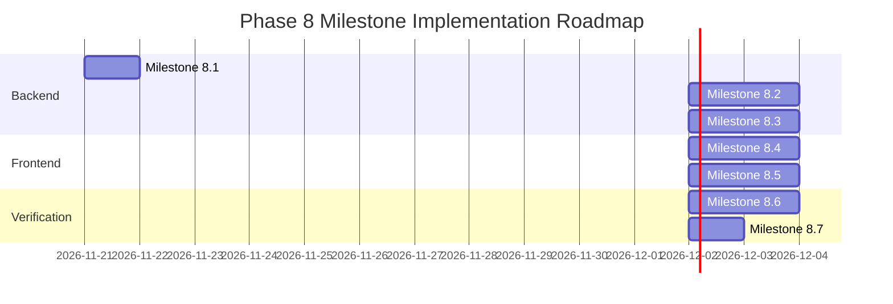

# UPOSTIT — Phase 8 Scope Assessment & Architectural Specification
## Offline Attendance Conflict Resolution & Supervisor Approvals

**Document Version:** 1.0.0  
**Phase:** 8 — Offline Attendance Conflict Resolution & Supervisor Approvals  
**Date:** 2026-11-20  
**Author:** UPOSTIT Engineering Architecture Team  
**Status:** PROPOSED & FULLY SPECIFIED (Awaiting Implementation Authorization)

---

## 1. Executive Summary & Original Roadmap Alignment

### 1.1 Original 22-Phase Roadmap Inspection & Terminology Analysis
An inspection of the original 22-phase roadmap across project reference files reveals the following:

- **Original Roadmap Entry (`PROJECT_CONTEXT.md` Section 3 & `docs/ARCHITECTURE.md` Section 4)**:
  - *Phase 8 Title*: **"Corrections and Reports"**
  - *Scope Definition*: *"Shift correction requests, approval hierarchy, aggregated dashboard reporting (`correction_requests`, `approvals`, `attendance_daily_summary`, `export_jobs`)"*.
  - *Focus*: Employee-submitted correction requests, multi-tier manager approval chains, timesheet adjustments, and async CSV/XLSX export workers.
- **Architectural Decision Mandate (DDR-6.5-03 in `docs/PHASE_06_MILESTONE_05_DESIGN.md` & `docs/MOBILE_ATTENDANCE_ARCHITECTURE.md`)**:
  - *Specific Need*: When mobile clients synchronize queued offline punches and an initial event (e.g. `CHECK_IN`) suffers a permanent rejection (`REJECTED_PERMANENT` via HTTP 400/422/403), subsequent dependent events in that session (`BREAK`, `CHECK_OUT`) cannot be ingested into the append-only ledger and are marked `QUARANTINED_DEPENDENT_FAILURE`.
  - *Approved Resolution*: Clients package the failed event and its dependent session events into an `OfflineSequenceConflictBundle`. Employees submit this bundle via a dedicated employee-authorized submission endpoint (`POST /api/v1/attendance/offline-conflicts/submit`) to an administrative review console (`/attendance/corrections/conflicts`) where supervisors can review forensic evidence and inject approved events into the ledger using `apply_attendance_correction(CORRECTION_INSERT)`.

### 1.2 Discrepancy Analysis & Reconciliation
| Aspect | Original 22-Phase Roadmap | Phase 6.5 / DDR-6.5-03 Mandate | Reconciled Phase 8 Scope |
|---|---|---|---|
| **Phase Title** | *Corrections and Reports* | *Offline Attendance Conflict Resolution Workflow* | **Offline Attendance Conflict Resolution & Supervisor Approvals** |
| **Core Workflow** | Administrative timesheet corrections & general manager approval hierarchy. | Operational resolution of quarantined offline multi-event session conflicts. | **Unified Approval Subsystem**: Focuses immediately on operational offline conflict resolution while building the foundational data structures (`attendance_conflict_incidents`) for employee-submitted requests. |
| **Submission Model** | Web-initiated timesheet adjustment forms. | Mobile-initiated multi-event offline conflict bundle with forensic sensor payloads. | **Mobile-First Forensic Conflict Submission**: Ingests `OfflineSequenceConflictBundle` with original device telemetry and idempotency references. |
| **Resolution Engine** | Generic timesheet override. | Transactional invocation of Phase 5 `apply_attendance_correction(CORRECTION_INSERT)`. | **Zero Duplication**: Leverages existing atomic Phase 5 correction engine directly without altering the immutable event ledger. |
| **Reporting / Exports** | Async CSV/XLSX export jobs (`export_jobs`, `attendance_daily_summary`). | N/A (deferred). | **Architectural Scoping**: The conflict resolution engine is the operational prerequisite for timesheet integrity. Async CSV/XLSX export workers (`export_jobs`) remain cataloged for downstream reporting (Milestone 8.8 or Phase 12) without diluting the critical offline conflict security barrier. |

---

## 2. Source Architectural Decisions & Precedents

Phase 8 builds upon four foundational architectural decisions established in Phases 5, 6, and 7:

1. **DDR-6.5-01: Dual-Timestamp Invariant & Server Authority**:
   - `device_reported_at` is client-generated, immutable forensic telemetry.
   - `server_received_at` is independently assigned upon arrival and represents authoritative server time.
   - Offline events are evaluated against the strict timestamp window: $\le 24\text{h}$ standard automated processing, $24\text{--}72\text{h}$ held for supervisor review, $> 72\text{h}$ rejected. Future timestamps $> 60\text{s}$ flagged, $> 300\text{s}$ rejected.
2. **DDR-6.5-02: Trust Boundary & Risk Indicators**:
   - Client hardware telemetry (boot ID, monotonic uptime, mock provider flags, coordinates) is untrusted forensic evidence.
   - Mobile claims never override server-side verification, geofences, or tenant boundaries.
3. **DDR-6.5-03: Offline Sequence Conflict Resolution Protocol**:
   - Permanent rejection of an offline `CHECK_IN` triggers `QUARANTINED_DEPENDENT_FAILURE` for dependent punches in the same session, preventing queue blockage for subsequent shifts.
   - The rejected punch and dependent events are bundled into an `OfflineSequenceConflictBundle`.
   - The existing administrative endpoint `POST /api/v1/attendance/corrections` requires `CORRECT_ATTENDANCE` (Admin/HR/Manager) and operates only on single existing ledger events; it cannot ingest employee-submitted multi-event offline bundles.
   - Phase 8 must introduce `POST /api/v1/attendance/offline-conflicts/submit` and supervisor console route `/attendance/corrections/conflicts`.
4. **Phase 5 Ledger Immutability & Compensating Corrections**:
   - `attendance_events` is strictly append-only.
   - Approved conflicts must never overwrite or delete historical rows; they inject compensating events with `source: CORRECTION` (or `ADMIN`) and `event_category: CORRECTION_INSERT`.

---

## 3. Inventory of Existing Reusable Services & Anti-Duplication Directives

The following existing services and components must be reused directly without modification or duplication:

```mermaid
flowchart TD
    subgraph Client ["Client (Mobile / Web)"]
        MB[Mobile Local Queue DAO]
        WB[Web Supervisor Console]
    end

    subgraph Phase8 ["Phase 8 Subsystem"]
        CS[Conflict Submission Engine]
        CR[Supervisor Review & Adjudication]
        ACI[(attendance_conflict_incidents)]
    end

    subgraph ExistingServices ["Existing Phase 5 Core Services (REUSE ONLY)"]
        AC["apply_attendance_correction(CORRECTION_INSERT)"]
        RD[recalculate_attendance_day]
        SD[determine_shift_date_for_punch]
        SV[resolve_employee_shift_version]
        EL[(attendance_events - Append Only)]
        AD[(attendance_days - Derived Projection)]
    end

    MB -->|POST /offline-conflicts/submit| CS
    CS -->|Store Incident| ACI
    WB -->|POST /offline-conflicts/{id}/decision| CR
    CR -->|Read / Lock Incident| ACI
    CR -->|Call Atomically per Event| AC
    AC -->|Append Compensating Event| EL
    AC -->|Recalculate Projections| RD
    RD -->|Update Projections| AD
```

### 3.1 Reusable Backend Components
1. **`apply_attendance_correction` ([services/api/attendance/correction_service.py](file:///Users/apple/Upostit/services/api/attendance/correction_service.py#L124-L375))**:
   - Executes atomic insertion of `AttendanceEvent` with `event_category=CORRECTION_INSERT`.
   - Enforces pessimistic employee row locking (`with_for_update()`).
   - Prevents duplicate insertions via `AttendanceIdempotencyRecord`.
   - Evaluates affected shift boundaries (including overnight shifts).
   - Atomically invokes `recalculate_attendance_day` for all affected calendar dates.
2. **`determine_shift_date_for_punch` & `resolve_employee_shift_version`**:
   - Resolves target calendar shift dates considering allowances and cross-day boundaries.
3. **`recalculate_attendance_day` ([services/api/attendance/service.py](file:///Users/apple/Upostit/services/api/attendance/service.py#L510))**:
   - Recalculates presence status, work duration, break duration, and lateness penalties.
4. **`has_permission` & RBAC Registry ([services/api/auth/permissions.py](file:///Users/apple/Upostit/services/api/auth/permissions.py))**:
   - Standard centralized role validation and reporting-line checks.

### 3.2 APIs That Must NOT Be Duplicated
- **`POST /api/v1/attendance/punch`**: Real-time punch ingestion. Must NOT be repurposed for offline conflict submissions.
- **`POST /api/v1/attendance/corrections`**: Administrative single-event correction endpoint. Remains strictly scoped to Admin/HR/Manager; must NOT be opened to employees.
- **`POST /api/v1/fraud/reviews`**: Biometric/GPS risk flag review queue. Must NOT be mixed with offline sequence conflict adjudication.

---

## 4. End-to-End Operational Workflow

The 13-step operational workflow for offline attendance conflict resolution is defined as follows:

```mermaid
sequenceDiagram
    autonumber
    actor Employee as Employee Mobile App
    participant Queue as Mobile LocalQueueDao
    participant Sync as SyncWorker
    participant API as Backend Conflict API
    actor Supervisor as Supervisor Web Console
    participant Engine as Phase 5 Correction Engine
    participant Ledger as Attendance Ledger & Days

    Note over Employee,Queue: 1. Offline Attendance Capture
    Employee->>Queue: Record CHECK_IN offline (Stored in SQLCipher)
    Employee->>Queue: Record BREAK / CHECK_OUT offline (Quarantined if parent fails)

    Note over Queue,Sync: 2. Synchronization & Failure
    Sync->>API: FIFO Sync: POST /attendance/punch (CHECK_IN)
    API-->>Sync: HTTP 422 (e.g. Geofence Failure / Stale Sync Window)
    Sync->>Queue: Mark CHECK_IN as REJECTED_PERMANENT
    Sync->>Queue: Mark dependent events as QUARANTINED_DEPENDENT_FAILURE

    Note over Employee,API: 3. Conflict Packaging & Submission
    Employee->>Queue: Trigger "Submit for Supervisor Review"
    Queue->>Employee: Package OfflineSequenceConflictBundle (UUIDs, timestamps, GPS)
    Employee->>API: POST /api/v1/attendance/offline-conflicts/submit
    API->>API: Validate Employee identity & idempotency; Store in attendance_conflict_incidents
    API-->>Employee: HTTP 201 Created (Incident PENDING_REVIEW)

    Note over Supervisor,Ledger: 4. Supervisor Review & Resolution
    Supervisor->>API: GET /api/v1/attendance/offline-conflicts (Direct Reports Queue)
    Supervisor->>API: POST /api/v1/attendance/offline-conflicts/{id}/decision (APPROVE / REJECT)
    alt Supervisor Approves with Override
        API->>Engine: Begin DB Transaction & Lock Employee Row
        loop For each event in bundle
            API->>Engine: apply_attendance_correction(CORRECTION_INSERT, event_payload)
            Engine->>Ledger: Append AttendanceEvent (source: CORRECTION, category: INSERT)
        end
        Engine->>Ledger: recalculate_attendance_day(affected_dates)
        API->>API: Mark Incident APPROVED with decision_reason
        API-->>Supervisor: HTTP 200 OK (Resolved)
    else Supervisor Rejects
        API->>API: Mark Incident REJECTED with mandatory reason
        API-->>Supervisor: HTTP 200 OK (Rejected)
    end

    Note over Employee,API: 5. Mobile Status Refresh
    Employee->>API: GET /api/v1/attendance/offline-conflicts/my
    API-->>Employee: Return Conflict Resolution Status (APPROVED / REJECTED)
    Employee->>Queue: Mark local queue items RESOLVED / ARCHIVED
```

---

## 5. Database Architecture Assessment & Schema Design

### 5.1 Proposed Table: `attendance_conflict_incidents`

```sql
CREATE TABLE attendance_conflict_incidents (
    id UUID PRIMARY KEY DEFAULT gen_random_uuid(),
    tenant_id UUID NOT NULL REFERENCES tenants(id) ON DELETE RESTRICT,
    employee_id UUID NOT NULL,
    user_id UUID NOT NULL,
    bundle_id VARCHAR(64) NOT NULL,
    session_id VARCHAR(64),
    
    -- Status and Review State
    status VARCHAR(32) NOT NULL DEFAULT 'PENDING_REVIEW',
    
    -- Forensic Payloads (Immutable Client Evidence)
    primary_rejected_event JSONB NOT NULL,
    dependent_events JSONB NOT NULL DEFAULT '[]'::jsonb,
    total_events_count INTEGER NOT NULL DEFAULT 1,
    
    -- Submission Context
    rejection_summary VARCHAR(255),
    employee_notes TEXT,
    submitted_at TIMESTAMPTZ NOT NULL DEFAULT clock_timestamp(),
    
    -- Adjudication Context
    assigned_reviewer_id UUID,
    decision VARCHAR(32),
    decision_reason TEXT,
    reviewer_user_id UUID,
    decided_at TIMESTAMPTZ,
    
    -- Resolution Audit References
    resolved_correction_event_ids JSONB NOT NULL DEFAULT '[]'::jsonb,
    metadata_json JSONB NOT NULL DEFAULT '{}'::jsonb,
    
    created_at TIMESTAMPTZ NOT NULL DEFAULT clock_timestamp(),
    updated_at TIMESTAMPTZ NOT NULL DEFAULT clock_timestamp(),

    -- Multi-Tenancy Composite Constraints
    CONSTRAINT uq_conflict_incidents_tenant_id UNIQUE (tenant_id, id),
    CONSTRAINT uq_conflict_incidents_tenant_bundle UNIQUE (tenant_id, bundle_id),
    CONSTRAINT fk_conflict_incidents_employee FOREIGN KEY (tenant_id, employee_id)
        REFERENCES employees(tenant_id, id) ON DELETE RESTRICT,
    CONSTRAINT fk_conflict_incidents_user FOREIGN KEY (tenant_id, user_id)
        REFERENCES users(tenant_id, id) ON DELETE RESTRICT,
    CONSTRAINT fk_conflict_incidents_assigned_reviewer FOREIGN KEY (tenant_id, assigned_reviewer_id)
        REFERENCES users(tenant_id, id) ON DELETE SET NULL,
    CONSTRAINT fk_conflict_incidents_reviewer FOREIGN KEY (tenant_id, reviewer_user_id)
        REFERENCES users(tenant_id, id) ON DELETE RESTRICT,

    -- Data Integrity Constraints
    CONSTRAINT chk_conflict_incidents_status 
        CHECK (status IN ('PENDING_REVIEW', 'APPROVED', 'REJECTED')),
    CONSTRAINT chk_conflict_incidents_decision 
        CHECK (decision IS NULL OR decision IN ('APPROVED', 'REJECTED')),
    CONSTRAINT chk_conflict_incidents_reason 
        CHECK (decision IS NULL OR length(trim(decision_reason)) >= 3)
);

-- Performance & Isolation Indexes
CREATE INDEX ix_conflict_incidents_tenant_status 
    ON attendance_conflict_incidents (tenant_id, status);
CREATE INDEX ix_conflict_incidents_tenant_employee 
    ON attendance_conflict_incidents (tenant_id, employee_id);
CREATE INDEX ix_conflict_incidents_tenant_submitted 
    ON attendance_conflict_incidents (tenant_id, submitted_at DESC);
CREATE INDEX ix_conflict_incidents_tenant_decided 
    ON attendance_conflict_incidents (tenant_id, decided_at DESC);

-- Enable & Force Row-Level Security
ALTER TABLE attendance_conflict_incidents ENABLE ROW LEVEL SECURITY;
ALTER TABLE attendance_conflict_incidents FORCE ROW LEVEL SECURITY;

CREATE POLICY tenant_isolation ON attendance_conflict_incidents
    USING (tenant_id = current_setting('app.tenant_id', true)::uuid)
    WITH CHECK (tenant_id = current_setting('app.tenant_id', true)::uuid);
```

---

## 6. API Contracts & Endpoint Specifications

### 6.1 Employee Conflict Submission Endpoint
- **Route**: `POST /api/v1/attendance/offline-conflicts/submit`
- **Authorization**: `EMPLOYEE`, `MANAGER`, `HR`, `ADMIN`, `OWNER` (Employee can only submit for their own authenticated employee ID).
- **Request Body (`OfflineConflictBundleSubmitRequest`)**:
  ```json
  {
    "bundle_id": "conflict_loc_101_1732060800000",
    "session_id": "sess_8941_20261120",
    "employee_notes": "Wi-Fi router was resetting during morning shift check-in; supervisor was present.",
    "primary_rejected_event": {
      "local_id": "loc_101",
      "idempotency_key": "3fa85f64-5717-4562-b3fc-2c963f66afa6",
      "event_type": "CHECK_IN",
      "device_reported_at": "2026-11-20T08:02:14Z",
      "latitude": 12.971598,
      "longitude": 77.594562,
      "accuracy_meters": 14.2,
      "device_id_hash": "e3b0c44298fc1c149afbf4c8996fb92427ae41e4649b934ca495991b7852b855",
      "device_model": "Pixel 8",
      "os_version": "Android 15",
      "is_mock_location": false,
      "server_rejection_code": 422,
      "server_rejection_reason": "Outside authorized workplace geofence radius"
    },
    "dependent_events": [
      {
        "local_id": "loc_102",
        "idempotency_key": "4fa85f64-5717-4562-b3fc-2c963f66afa7",
        "event_type": "CHECK_OUT",
        "device_reported_at": "2026-11-20T17:05:30Z",
        "latitude": 12.971610,
        "longitude": 77.594580,
        "accuracy_meters": 11.0,
        "device_id_hash": "e3b0c44298fc1c149afbf4c8996fb92427ae41e4649b934ca495991b7852b855",
        "device_model": "Pixel 8",
        "os_version": "Android 15",
        "is_mock_location": false
      }
    ]
  }
  ```
- **Responses**:
  - `HTTP 201 Created`: Incident successfully ingested and queued.
  - `HTTP 200 OK`: Idempotent replay of previously submitted bundle with matching fingerprint.
  - `HTTP 409 Conflict`: Bundle ID reused with mismatched payload.
  - `HTTP 403 Forbidden`: Authenticated user does not match target employee.

### 6.2 Supervisor Conflict Queue Listing Endpoint
- **Route**: `GET /api/v1/attendance/offline-conflicts`
- **Authorization**: `OWNER`, `ADMIN`, `HR`, `MANAGER` (Managers automatically filtered to direct reports).
- **Query Parameters**:
  - `status`: `PENDING_REVIEW` | `APPROVED` | `REJECTED` (default: `PENDING_REVIEW`)
  - `employee_id`: UUID (optional filter)
  - `start_date`: ISO Date (optional)
  - `end_date`: ISO Date (optional)
  - `limit`: int (1–100, default 50)
  - `cursor`: string (pagination cursor)
- **Response (`AttendanceConflictListResponse`)**:
  List of summarized conflict incidents with employee name, department, punch timestamps, rejection reasons, and review status.

### 6.3 Conflict Detail Endpoint
- **Route**: `GET /api/v1/attendance/offline-conflicts/{incident_id}`
- **Authorization**: `OWNER`, `ADMIN`, `HR`, `MANAGER` (reporting-line scoped), or the submitting `EMPLOYEE`.
- **Response**: Full forensic breakdown including primary rejected punch, dependent events, coordinates, device fingerprint, and decision audit trail.

### 6.4 Supervisor Adjudication Endpoint
- **Route**: `POST /api/v1/attendance/offline-conflicts/{incident_id}/decision`
- **Authorization**: `OWNER`, `ADMIN`, `HR`, `MANAGER` (Managers restricted strictly to direct reports; anti-self-approval rule enforced).
- **Request Body (`AttendanceConflictDecisionRequest`)**:
  ```json
  {
    "action": "APPROVE",
    "reason": "Verified on-site physical presence with facilities log; Wi-Fi AP was under maintenance.",
    "override_location_id": "3fa85f64-5717-4562-b3fc-2c963f66afa6"
  }
  ```
- **Responses**:
  - `HTTP 200 OK`: Incident adjudicated successfully; returns resolution details, created event IDs, and recalculated attendance summary.
  - `HTTP 409 Conflict`: Concurrent decision race condition (already adjudicated).
  - `HTTP 422 Unprocessable Content`: Reason length < 3 non-whitespace characters.
  - `HTTP 403 Forbidden`: Manager attempting to review an employee outside their reporting hierarchy or attempting self-approval.

---

## 7. Authorization Matrix & Access Boundaries

| Role | Submit Own Conflict | View Own Conflict | View Tenant Conflicts | View Direct Report Conflicts | Adjudicate Direct Reports | Adjudicate Any Tenant Conflict | Self-Adjudication |
|---|:---:|:---:|:---:|:---:|:---:|:---:|:---:|
| **EMPLOYEE** | ✅ | ✅ | ❌ | ❌ | ❌ | ❌ | ❌ |
| **MANAGER** | ✅ | ✅ | ❌ | ✅ | ✅ | ❌ | ❌ (Strict 403) |
| **HR** | ✅ | ✅ | ✅ | ✅ | ✅ | ✅ | ❌ (Strict 403) |
| **ADMIN** | ✅ | ✅ | ✅ | ✅ | ✅ | ✅ | ❌ (Strict 403) |
| **OWNER** | ✅ | ✅ | ✅ | ✅ | ✅ | ✅ | ❌ (Strict 403) |

---

## 8. Supervisor Approval Engine & Atomic Transaction Orchestration

The supervisor approval flow executes inside a single PostgreSQL database transaction:

```python
async def adjudicate_conflict_incident(
    session: AsyncSession,
    tenant_id: uuid.UUID,
    incident_id: uuid.UUID,
    reviewer_user_id: uuid.UUID,
    reviewer_role: str,
    payload: AttendanceConflictDecisionRequest,
) -> AttendanceConflictIncidentResponse:
    # 1. Pessimistic Lock on Conflict Incident
    incident_stmt = (
        select(AttendanceConflictIncident)
        .where(
            AttendanceConflictIncident.tenant_id == tenant_id,
            AttendanceConflictIncident.id == incident_id,
        )
        .with_for_update()
    )
    incident = (await session.execute(incident_stmt)).scalar_one_or_none()
    if not incident:
        raise HTTPException(status_code=404, detail="Conflict incident not found.")
    
    # 2. Race Condition Check
    if incident.status != "PENDING_REVIEW":
        raise HTTPException(
            status_code=409, 
            detail=f"Conflict incident has already been resolved ({incident.status})."
        )
    
    # 3. RBAC & Manager Scoping & Anti-Self-Approval
    await _verify_reviewer_permission(
        session, tenant_id, reviewer_user_id, reviewer_role, incident.employee_id
    )

    # 4. Handle Rejection
    if payload.action == "REJECT":
        incident.status = "REJECTED"
        incident.decision = "REJECTED"
        incident.decision_reason = payload.reason.strip()
        incident.reviewer_user_id = reviewer_user_id
        incident.decided_at = datetime.now(UTC)
        await session.flush()
        return AttendanceConflictIncidentResponse.model_validate(incident)

    # 5. Handle Approval (Atomic Injection into Ledger)
    resolved_event_ids: list[uuid.UUID] = []
    all_events_to_insert = [incident.primary_rejected_event, *incident.dependent_events]
    
    for event_data in all_events_to_insert:
        corr_req = AttendanceCorrectionCreateRequest(
            employee_id=incident.employee_id,
            correction_type=AttendanceCorrectionType.CORRECTION_INSERT,
            event_type=event_data["event_type"],
            effective_at=datetime.fromisoformat(event_data["device_reported_at"]),
            correction_reason=f"Offline Conflict Approval: {payload.reason.strip()}",
            idempotency_key=f"conflict_appr_{incident.bundle_id}_{event_data['idempotency_key']}",
            location_id=payload.override_location_id or event_data.get("location_id"),
            metadata={
                "conflict_incident_id": str(incident.id),
                "bundle_id": incident.bundle_id,
                "original_offline_idempotency_key": event_data["idempotency_key"],
                "original_device_id_hash": event_data.get("device_id_hash"),
                "source": "OFFLINE_CONFLICT_RESOLUTION",
            },
        )
        
        # Invoke Phase 5 Correction Engine
        corr_res = await apply_attendance_correction(
            session=session,
            tenant_id=tenant_id,
            actor_user_id=reviewer_user_id,
            actor_role=reviewer_role,
            payload=corr_req,
        )
        resolved_event_ids.append(corr_res.correction_event.id)

    # 6. Finalize Incident State
    incident.status = "APPROVED"
    incident.decision = "APPROVED"
    incident.decision_reason = payload.reason.strip()
    incident.reviewer_user_id = reviewer_user_id
    incident.decided_at = datetime.now(UTC)
    incident.resolved_correction_event_ids = [str(eid) for eid in resolved_event_ids]
    await session.flush()

    return AttendanceConflictIncidentResponse.model_validate(incident)
```

---

## 9. Mobile (Flutter) and Web (Next.js) Integration Requirements

### 9.1 Mobile Application (Flutter)
1. **Bundle Extraction (`LocalQueueDao`)**:
   - Query `local_attendance_queue` for records where `conflict_bundle_id IS NOT NULL` and `sync_status IN ('REJECTED_PERMANENT', 'QUARANTINED_DEPENDENT_FAILURE')`.
   - Package records into `OfflineSequenceConflictBundle` preserving original client timestamps, coordinates, and device hashes.
2. **Conflict Submission Remote Data Source & BLoC**:
   - `AttendanceRemoteDataSource.submitOfflineConflictBundle(bundle)`.
   - `SyncBloc` event `SubmitConflictBundleRequested(bundleId)`.
3. **UI Enhancements (`SyncStatusScreen`)**:
   - Group quarantined and rejected punches into a distinct **"Session Conflict"** banner.
   - Display a primary CTA: **"Submit Conflict to Supervisor"**.
   - Show submission status badge (`PENDING_REVIEW`, `APPROVED`, `REJECTED`).
   - Automatically mark resolved items when the supervisor approves.

### 9.2 Web Application (Next.js)
1. **Supervisor Route (`/attendance/corrections/conflicts`)**:
   - Integrated tab inside the Attendance console: `[ Attendance Records | Manual Corrections | Offline Conflicts ]`.
2. **Incident Details & Chronological Timeline**:
   - Visual timeline displaying the failed `CHECK_IN` (with error message) and succeeding quarantined punches (`BREAK`, `CHECK_OUT`).
   - Forensic detail panel: GPS coordinates with map preview, device model, clock offset.
3. **Adjudication Actions**:
   - Action buttons: **"Approve with Override"** and **"Reject Conflict"**.
   - Modal requiring mandatory justification (minimum 3 non-whitespace characters) and optional workplace location override.
   - Immediate optimistic UI update with toast notification.

---

## 10. Milestone Breakdown & Implementation Plan



### Milestone 8.1 — Database Architecture, Data Models & Alembic Migration
- **Objective**: Create `attendance_conflict_incidents` table with composite constraints, RLS policies, and indexes.
- **Backend Changes**:
  - Migration: `e7f8a9b0c1d2_phase_08_attendance_conflicts.py`.
  - SQLAlchemy model: `AttendanceConflictIncident` in `services/api/attendance/models.py`.
- **Acceptance Criteria**: RLS tests pass; composite foreign keys validated; Alembic forward and backward migration passes.

### Milestone 8.2 — Backend Conflict Submission Engine & Employee APIs
- **Objective**: Implement `POST /offline-conflicts/submit` and `GET /offline-conflicts/my` with payload fingerprinting and idempotency.
- **Backend Changes**:
  - Schemas in `services/api/attendance/schemas.py`.
  - Service functions in `services/api/attendance/conflict_service.py`.
  - Route handlers in `services/api/attendance/routes.py`.
- **Acceptance Criteria**: Employees can submit only their own conflicts; duplicate submissions return cached replay; mismatched payloads return HTTP 409.

### Milestone 8.3 — Supervisor Adjudication Workflow & Atomic Correction Integration
- **Objective**: Implement `POST /offline-conflicts/{id}/decision` and `GET /offline-conflicts` with row-level locking and atomic Phase 5 correction integration.
- **Backend Changes**:
  - Adjudication logic in `services/api/attendance/conflict_service.py`.
  - Reuse `apply_attendance_correction(CORRECTION_INSERT)` and `recalculate_attendance_day`.
  - Role scoping: Managers limited strictly to direct reports; anti-self-approval enforced.
- **Acceptance Criteria**: Approving a bundle injects all events atomically and recalculates shifts; rejecting leaves ledger untouched; concurrent decisions serialize cleanly.

### Milestone 8.4 — Flutter Mobile Conflict Bundling & Submission
- **Objective**: Implement conflict bundle builder, remote API client, submission BLoC, and UI in `SyncStatusScreen`.
- **Mobile Changes**:
  - `LocalQueueDao.getConflictBundle(bundleId)`.
  - `AttendanceRemoteDataSource.submitConflictBundle(...)`.
  - `SyncBloc` conflict submission handling.
  - Conflict resolution UI cards in `SyncStatusScreen`.
- **Acceptance Criteria**: Flutter unit and widget tests pass; quarantined events transition to submitted state; offline queue unblocks cleanly.

### Milestone 8.5 — Next.js Web Supervisor Console
- **Objective**: Build supervisor console tab at `/attendance/corrections/conflicts` with timeline and adjudication modal.
- **Web Changes**:
  - Route: `apps/web/src/app/attendance/page.tsx` tab integration or `/attendance/corrections/conflicts`.
  - Components: `ConflictQueueTable.tsx`, `ConflictTimelineDrawer.tsx`, `ConflictAdjudicationModal.tsx`.
- **Acceptance Criteria**: Supervisors can filter, inspect forensic telemetry, approve with override, and reject with mandatory reason.

### Milestone 8.6 — End-to-End Integration, Chaos & Synchronization Simulation
- **Objective**: Full lifecycle simulation from mobile offline failure to supervisor approval and timesheet recalculation.
- **Test Scenarios**:
  - Mobile records offline punches -> sync fails with 422 -> bundle packaged -> submitted to backend -> supervisor approves -> ledger updated -> daily projection updated -> mobile reflects resolution.
- **Acceptance Criteria**: 100% automated pass rate across all simulation scenarios.

### Milestone 8.7 — Security Audit, Penetration Testing & Phase 8 Completion
- **Objective**: Comprehensive security audit, RBAC boundary verification, cross-tenant isolation testing, and APK builds.
- **Acceptance Criteria**: Zero high/medium security vulnerabilities; `flutter analyze` clean; `ruff check` clean; debug/release APKs built successfully; final completion report authored.

---

## 11. Security Threat Model & Failure Case Matrix

| ID | Threat / Failure Case | Attack Vector / Trigger | Mitigation & System Behavior |
|---|---|---|---|
| **SEC-8-01** | Duplicate Bundle Submission | Network retry or malicious replay of identical `bundle_id`. | Idempotent response replay if payload hash matches; HTTP 409 Conflict if payload diverges. |
| **SEC-8-02** | Payload Tampering on Retry | Attacker modifies timestamps or coordinates while reusing `bundle_id`. | SHA-256 fingerprint divergence check returns HTTP 409 Conflict. |
| **SEC-8-03** | Cross-Tenant Leakage | Attacker provides Tenant B ID in body while authenticated as Tenant A. | `tenant_id` forced strictly from JWT access token; DB RLS blocks cross-tenant reads/writes. |
| **SEC-8-04** | Employee Submitting for Peer | Employee A sets `employee_id` of Employee B in conflict submission. | Server verifies `ctx.employee.id == payload.employee_id`; rejects with HTTP 403 Forbidden. |
| **SEC-8-05** | Unauthorized Manager Decision | Manager attempts to adjudicate conflict for an employee outside their reporting line. | `_verify_reviewer_permission` checks `reporting_manager_id == mgr_emp_id`; rejects with HTTP 403 Forbidden. |
| **SEC-8-06** | Self-Adjudication Attempt | Manager or HR user submits a conflict for their own punches and attempts to approve it. | Anti-self-approval rule (`reviewer_employee_id == target_employee_id`) returns HTTP 403 Forbidden. |
| **SEC-8-07** | Concurrent Supervisor Race | Two supervisors attempt to approve/reject the same conflict simultaneously. | Row-level locking `with_for_update()` serializes execution; second transaction encounters resolved state and returns HTTP 409 Conflict. |
| **SEC-8-08** | Approval Transaction Failure | DB error or constraint violation during `apply_attendance_correction`. | Entire PostgreSQL transaction rolls back; incident remains in `PENDING_REVIEW`; zero ledger contamination. |
| **SEC-8-09** | Rejection After Approval | Attacker attempts to reject a conflict that has already been approved. | Strict state machine: transitions from `APPROVED` or `REJECTED` are prohibited (HTTP 409 Conflict). |
| **SEC-8-10** | Partial Session Approval | Supervisor attempts to approve only `CHECK_IN` while leaving dependent `CHECK_OUT` orphaned. | Atomically evaluates session bundle; unapproved punches remain marked `REJECTED`; projection engine handles incomplete shifts cleanly. |
| **SEC-8-11** | Account Switching on Device | Employee logs out while conflict bundle is queued locally. | Local queue strictly partitioned by `(tenant_id, user_id)`; logging out preserves records without cross-account leakage. |
| **SEC-8-12** | Lost Response After Submission | Network drops after backend commits incident. | Mobile retries with identical `bundle_id`; backend returns cached `HTTP 200/201` response. |
| **SEC-8-13** | Projection Calculation Failure | Error during `recalculate_attendance_day`. | Transaction aborts and rolls back completely; attendance ledger remains consistent. |
| **SEC-8-14** | Blank Decision Reason | Supervisor supplies whitespace-only string (`"   "`). | Validator checks `len(reason.strip()) >= 3`; rejects with HTTP 422 Unprocessable Content. |

---

## 12. Test Strategy & Acceptance Criteria

### 12.1 Backend Testing (`pytest`)
- **Unit Tests**:
  - `test_conflict_submission_idempotency`: Validates bundle fingerprinting and conflict replay.
  - `test_manager_reporting_line_scoping`: Asserts managers can only view/decide for direct reports.
  - `test_anti_self_approval`: Asserts managers/HR cannot adjudicate their own conflicts.
  - `test_atomic_approval_ledger_insertion`: Verifies `AttendanceEvent` insertion and `AttendanceDay` recalculation.
- **Integration Tests**:
  - Multi-tenant isolation tests asserting Tenant A cannot access Tenant B incidents.
  - Row locking concurrency tests with simulated parallel threads.

### 12.2 Mobile Testing (`flutter test`)
- **DAO Tests**: Querying and packaging quarantined events into `OfflineSequenceConflictBundle`.
- **BLoC Tests**: `SyncBloc` handling of `SubmitConflictBundleRequested` and state transitions.
- **Widget Tests**: Rendering conflict resolution banners, CTAs, and status indicators in `SyncStatusScreen`.

### 12.3 Web Testing
- Next.js component tests for `ConflictTimelineDrawer` and `ConflictAdjudicationModal`.

---

## 13. Scope Boundaries & Explicit Non-Goals

1. **NO Changes to Ledger Immutability**: `attendance_events` remains strictly append-only.
2. **NO Modification of Phase 5 Correction Core**: `apply_attendance_correction` is reused as a black box.
3. **NO Modification of Phase 7 Fraud Telemetry**: Mobile telemetry gathering and fraud rule evaluation remain authoritative and intact.
4. **NO Premature Phase 9 Leave/Overtime Logic**: Overtime and leave balancing remain deferred to Phase 9.
5. **NO Production Code Changes in this Assessment**: This document represents discovery, planning, and architectural specification only.

---
*End of Phase 8 Scope Assessment Specification.*

