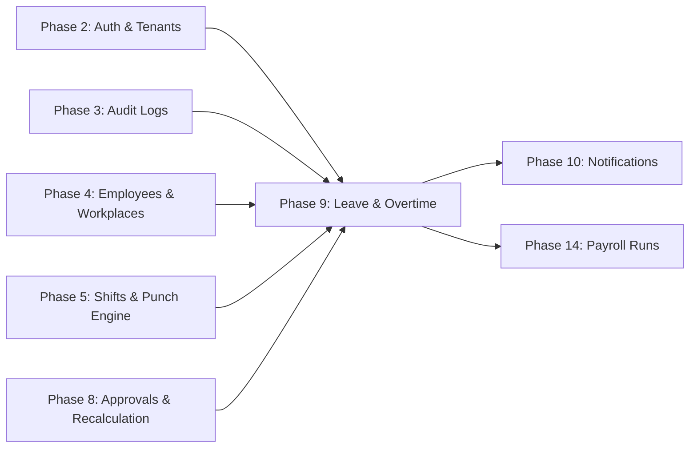
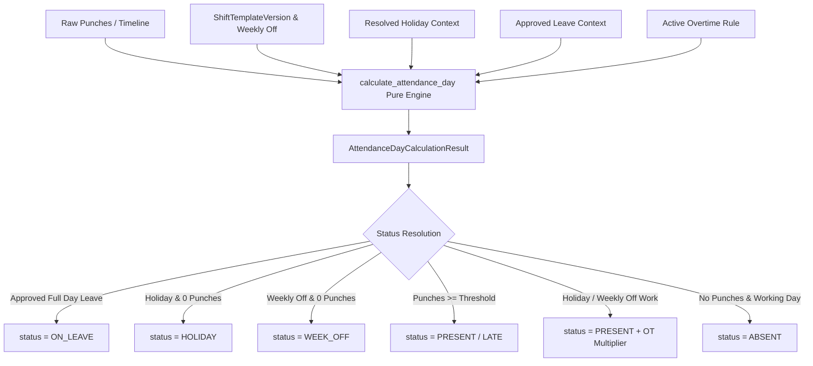
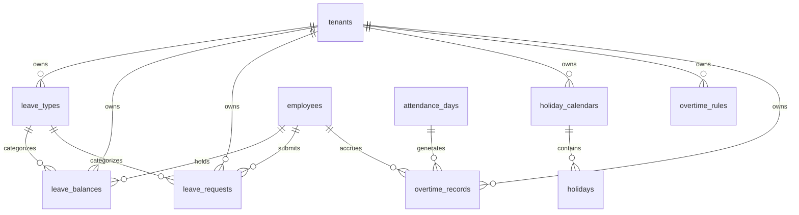
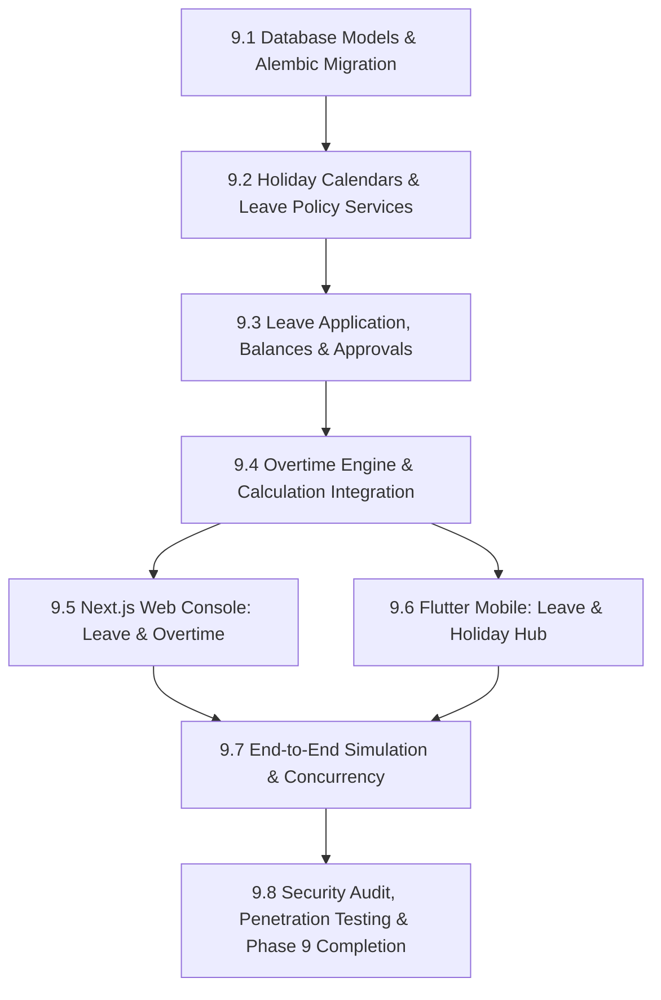

# UPOSTIT — Phase 9 Scope Assessment & Architectural Specification
## Leave, Holidays and Overtime Multipliers

**Document Version:** 1.0.0  
**Phase:** 9 — Leave, Holidays and Overtime Multipliers  
**Date:** November 20, 2026  
**Author:** UPOSTIT Engineering Architecture Team  
**Status:** PROPOSED & FULLY SPECIFIED (Assessment Only — Awaiting Implementation Authorization)

---

## 1. Executive Summary & Authoritative Roadmap Alignment

### 1.1 Original 22-Phase Roadmap Inspection
An inspection of authoritative project reference files (`PROJECT_CONTEXT.md` Section 3 and `docs/ARCHITECTURE.md` Section 4) defines Phase 9 as follows:

- **Phase Title**: **Phase 9: Leave and Overtime**
- **Cataloged Entities**: `leave_types`, `leave_balances`, `leave_requests`, `holiday_calendars`, `overtime_rules`
- **Scope Definition**: *"Time-off entitlement balances, holiday schedules, overtime multiplier rules."*
- **Core Domain Mission**:
  1. Define organizational time-off structures: leave categories, paid/unpaid rules, accrual balances, and carry-forward limits.
  2. Provide structured leave request lifecycles: employee submission, manager direct-report approvals, balance reservations, and cancellation workflows.
  3. Establish authoritative annual holiday calendars with location- and department-specific overrides.
  4. Formulate overtime multiplier rules (e.g. 1.5x workday, 2.0x weekend/holiday) and integrate them deterministically into daily attendance calculations.
  5. Provide seamless cross-platform user interfaces across Next.js Web (HR setup & supervisor adjudication) and Flutter Mobile (leave balances, leave requests, and holiday calendars).

### 1.2 Upstream & Downstream Dependencies


- **Upstream Foundations (Reused Directly)**:
  - *Phase 2*: Multi-tenant context (`tenant_id`), authenticated user sessions, role-based access control (`UserRole`).
  - *Phase 3*: Immutable write audit trails (`AuditLogService`), tenant settings.
  - *Phase 4*: Employee directory (`employees`), workplace locations (`locations`), reporting hierarchy (`reporting_manager_id`).
  - *Phase 5*: Pure calculation engine (`services/api/attendance/engine.py`), derived daily projections (`attendance_days`), shift templates and versioning (`ShiftTemplateVersion`).
  - *Phase 8*: Pessimistic row locking (`with_for_update()`), anti-self-approval rule, direct-report manager scoping, daily projection recalculation pipeline (`recalculate_attendance_day()`).
- **Downstream Boundaries (Explicitly Deferred)**:
  - *Phase 10 (Notifications)*: Automated email, SMS, and FCM push notifications upon leave approval/rejection. (In Phase 9, notification hooks are stubbed or recorded in audit logs without outbound push infrastructure).
  - *Phase 14 (Payroll)*: Salary deductions for Loss of Pay (LOP), monetized overtime disbursements, and payslip generation. (In Phase 9, overtime minutes and multipliers are calculated and approved for ledger tracking; financial monetary calculations belong to Phase 14).

---

## 2. Domain Requirements & Architectural Directives

### 2.1 Leave Management Subsystem
1. **Leave Types (`leave_types`)**:
   - Tenant-configurable time-off categories (e.g., Casual Leave `CL`, Sick Leave `SL`, Annual/Privilege Leave `AL`, Loss of Pay `LOP`, Compensatory Off `COMP_OFF`).
   - Attributes: `is_paid`, `requires_approval`, `allow_half_day`, `max_consecutive_days`, `carry_forward_limit`, `is_active`.
2. **Leave Balances & Accrual (`leave_balances`)**:
   - Scoped per tenant, employee, leave type, and fiscal year.
   - Tracks: `annual_allocation`, `carried_forward`, `accrued`, `used`, `pending_approval`.
   - Invariant: $\text{Available Balance} = \text{allocation} + \text{carried} + \text{accrued} - \text{used} - \text{pending}$.
   - Submitting a leave request immediately reserves balance (`pending_approval += total_days`).
   - Approval transitions `pending_approval` to `used`.
   - Rejection or cancellation releases `pending_approval` back to available balance.
3. **Leave Requests & Workflow (`leave_requests`)**:
   - Employee-initiated applications for single-day, multi-day, or half-day periods (`FIRST_HALF`, `SECOND_HALF`).
   - State machine: `PENDING_APPROVAL` $\to$ `APPROVED` | `REJECTED` | `CANCELLED`.
   - Anti-Self-Approval: Managers/Admins cannot approve their own leave applications.
   - Concurrency Safety: Row-level lock on `leave_balances` during application and decision.

### 2.2 Holiday Management Subsystem
1. **Holiday Calendars (`holiday_calendars`) & Holidays (`holidays`)**:
   - Annual schedules configured per fiscal/calendar year.
   - Scoping: Tenant-wide default calendar with optional location-specific overrides (e.g., regional state holidays for a branch) or department overrides.
   - Holiday Types: `PUBLIC` (statutory), `COMPANY` (observed), `OPTIONAL` / `RESTRICTED` (floating holiday).
2. **Holiday Resolution Protocol**:
   - Given an `employee_id` and a target date:
     1. Check if employee's primary workplace location has a specific holiday calendar.
     2. Fallback to tenant default holiday calendar.
     3. Evaluate if target date is an active holiday for the employee.

### 2.3 Overtime Rules & Multiplier Subsystem
1. **Overtime Policy Definition (`overtime_rules`)**:
   - `min_overtime_threshold_minutes`: Minimum extra minutes worked before overtime begins accruing (e.g., 30 minutes grace before OT counts).
   - `max_daily_overtime_minutes` & `max_weekly_overtime_minutes`: Statutory caps on allowable overtime.
   - Multipliers:
     - `workday_multiplier`: Standard multiplier on regular workdays (e.g., $1.5\times$).
     - `weekend_multiplier`: Multiplier for scheduled weekly off days (e.g., $2.0\times$).
     - `holiday_multiplier`: Multiplier for public/company holidays (e.g., $2.0\times$).
   - `requires_manager_approval`: Boolean toggle determining whether overtime requires manual supervisor adjudication or is auto-approved upon day calculation.
2. **Overtime Ledger Records (`overtime_records`)**:
   - Captures calculated daily overtime: `raw_overtime_minutes`, `approved_overtime_minutes`, `multiplier`, `payable_overtime_minutes`, `overtime_type` (`WORKDAY`, `WEEK_OFF`, `HOLIDAY`).
   - Status: `AUTO_APPROVED`, `PENDING_APPROVAL`, `APPROVED`, `REJECTED`.

---

## 3. Integration with Attendance Architecture

### 3.1 Immutable Ledger Invariant
> [!IMPORTANT]
> The raw punch ledger (`attendance_events`) is strictly append-only. Leave applications, holidays, and overtime rules **NEVER** insert fake punch events into `attendance_events`.

### 3.2 Pure Calculation Engine Integration (`calculate_attendance_day`)
The pure functional attendance engine in `services/api/attendance/engine.py` is extended to accept resolved leave, holiday, and overtime contextual parameters:



### 3.3 Daily Projections Table Interaction (`attendance_days`)
- Existing column `status` supports: `'PRESENT'`, `'LATE'`, `'HALF_DAY'`, `'ABSENT'`, `'INCOMPLETE'`, `'WEEK_OFF'`, `'ON_LEAVE'`, `'HOLIDAY'`, `'PENDING_REVIEW'`.
- Existing column `overtime_minutes` stores the effective overtime minutes.
- `metadata_json` stores detailed leave and overtime breakdown:
  ```json
  {
    "leave_request_id": "uuid",
    "leave_type_code": "CL",
    "holiday_name": "Independence Day",
    "overtime": {
      "raw_minutes": 120,
      "multiplier": 2.0,
      "payable_minutes": 240,
      "overtime_type": "HOLIDAY",
      "approval_status": "PENDING_APPROVAL"
    }
  }
  ```

---

## 4. Proposed Database Schema & Relationships

### 4.1 Schema Overview (Alembic Head: `e7f8a9b0c1d2`)



### 4.2 Proposed Tables Specification

#### 1. `leave_types`
- `id`: UUID (PK)
- `tenant_id`: UUID (FK `tenants.id` ON DELETE CASCADE, Indexed)
- `code`: VARCHAR(20) NOT NULL (e.g., 'CL', 'SL', 'AL', 'LOP')
- `name`: VARCHAR(100) NOT NULL
- `description`: TEXT NULL
- `is_paid`: BOOLEAN NOT NULL DEFAULT TRUE
- `requires_approval`: BOOLEAN NOT NULL DEFAULT TRUE
- `allow_half_day`: BOOLEAN NOT NULL DEFAULT TRUE
- `max_consecutive_days`: INTEGER NULL
- `carry_forward_limit`: NUMERIC(4,1) NOT NULL DEFAULT 0.0
- `is_active`: BOOLEAN NOT NULL DEFAULT TRUE
- `created_at`, `updated_at`: TIMESTAMPTZ NOT NULL
- *Constraints*: `UNIQUE(tenant_id, code)`

#### 2. `leave_balances`
- `id`: UUID (PK)
- `tenant_id`: UUID (FK `tenants.id` ON DELETE CASCADE, Indexed)
- `employee_id`: UUID (Indexed)
- `leave_type_id`: UUID (FK `leave_types.id` ON DELETE RESTRICT, Indexed)
- `year`: INTEGER NOT NULL
- `annual_allocation`: NUMERIC(5,2) NOT NULL DEFAULT 0.0
- `carried_forward`: NUMERIC(5,2) NOT NULL DEFAULT 0.0
- `accrued`: NUMERIC(5,2) NOT NULL DEFAULT 0.0
- `used`: NUMERIC(5,2) NOT NULL DEFAULT 0.0
- `pending_approval`: NUMERIC(5,2) NOT NULL DEFAULT 0.0
- `created_at`, `updated_at`: TIMESTAMPTZ NOT NULL
- *Constraints*:
  - Composite FK: `FOREIGN KEY (tenant_id, employee_id) REFERENCES employees(tenant_id, id) ON DELETE CASCADE`
  - `UNIQUE(tenant_id, employee_id, leave_type_id, year)`
  - Check constraint: `used >= 0 AND pending_approval >= 0`

#### 3. `leave_requests`
- `id`: UUID (PK)
- `tenant_id`: UUID (FK `tenants.id` ON DELETE CASCADE, Indexed)
- `employee_id`: UUID (Indexed)
- `leave_type_id`: UUID (FK `leave_types.id` ON DELETE RESTRICT, Indexed)
- `start_date`: DATE NOT NULL
- `end_date`: DATE NOT NULL
- `is_half_day`: BOOLEAN NOT NULL DEFAULT FALSE
- `half_day_period`: VARCHAR(20) NULL CHECK (`half_day_period IN ('FIRST_HALF', 'SECOND_HALF')`)
- `total_days`: NUMERIC(4,2) NOT NULL CHECK (`total_days > 0`)
- `reason`: TEXT NOT NULL
- `status`: VARCHAR(30) NOT NULL DEFAULT 'PENDING_APPROVAL' CHECK (`status IN ('PENDING_APPROVAL', 'APPROVED', 'REJECTED', 'CANCELLED')`)
- `reviewer_user_id`: UUID NULL (FK `users.id` ON DELETE SET NULL)
- `reviewer_notes`: TEXT NULL
- `decided_at`: TIMESTAMPTZ NULL
- `created_at`, `updated_at`: TIMESTAMPTZ NOT NULL
- *Constraints*:
  - Composite FK: `FOREIGN KEY (tenant_id, employee_id) REFERENCES employees(tenant_id, id) ON DELETE CASCADE`
  - Check constraint: `end_date >= start_date`

#### 4. `holiday_calendars` & `holidays`
- `holiday_calendars`:
  - `id`: UUID (PK), `tenant_id`: UUID (FK `tenants.id` ON DELETE CASCADE)
  - `year`: INTEGER NOT NULL
  - `name`: VARCHAR(100) NOT NULL
  - `location_id`: UUID NULL (FK `locations.id` ON DELETE SET NULL)
  - `department_id`: UUID NULL (FK `departments.id` ON DELETE SET NULL)
  - `is_default`: BOOLEAN NOT NULL DEFAULT FALSE
- `holidays`:
  - `id`: UUID (PK), `tenant_id`: UUID (FK `tenants.id` ON DELETE CASCADE)
  - `calendar_id`: UUID (FK `holiday_calendars.id` ON DELETE CASCADE, Indexed)
  - `holiday_date`: DATE NOT NULL
  - `name`: VARCHAR(100) NOT NULL
  - `holiday_type`: VARCHAR(30) NOT NULL DEFAULT 'PUBLIC' CHECK (`holiday_type IN ('PUBLIC', 'COMPANY', 'OPTIONAL')`)
  - `is_optional`: BOOLEAN NOT NULL DEFAULT FALSE
  - *Constraints*: `UNIQUE(tenant_id, calendar_id, holiday_date)`

#### 5. `overtime_rules` & `overtime_records`
- `overtime_rules`:
  - `id`: UUID (PK), `tenant_id`: UUID (FK `tenants.id` ON DELETE CASCADE)
  - `name`: VARCHAR(100) NOT NULL
  - `min_overtime_threshold_minutes`: INTEGER NOT NULL DEFAULT 30
  - `max_daily_overtime_minutes`: INTEGER NULL DEFAULT 240
  - `max_weekly_overtime_minutes`: INTEGER NULL DEFAULT 720
  - `workday_multiplier`: NUMERIC(3,2) NOT NULL DEFAULT 1.50
  - `weekend_multiplier`: NUMERIC(3,2) NOT NULL DEFAULT 2.00
  - `holiday_multiplier`: NUMERIC(3,2) NOT NULL DEFAULT 2.00
  - `requires_manager_approval`: BOOLEAN NOT NULL DEFAULT TRUE
  - `is_active`: BOOLEAN NOT NULL DEFAULT TRUE
- `overtime_records`:
  - `id`: UUID (PK), `tenant_id`: UUID (FK `tenants.id` ON DELETE CASCADE)
  - `employee_id`: UUID (Indexed)
  - `attendance_day_id`: UUID (FK `attendance_days.id` ON DELETE CASCADE, Indexed)
  - `attendance_date`: DATE NOT NULL
  - `raw_overtime_minutes`: INTEGER NOT NULL
  - `approved_overtime_minutes`: INTEGER NOT NULL
  - `multiplier`: NUMERIC(3,2) NOT NULL DEFAULT 1.00
  - `payable_overtime_minutes`: INTEGER NOT NULL
  - `overtime_type`: VARCHAR(20) NOT NULL CHECK (`overtime_type IN ('WORKDAY', 'WEEK_OFF', 'HOLIDAY')`)
  - `status`: VARCHAR(30) NOT NULL DEFAULT 'PENDING_APPROVAL' CHECK (`status IN ('AUTO_APPROVED', 'PENDING_APPROVAL', 'APPROVED', 'REJECTED')`)
  - `reviewer_user_id`: UUID NULL (FK `users.id` ON DELETE SET NULL)
  - `reviewer_notes`: TEXT NULL
  - `decided_at`: TIMESTAMPTZ NULL
  - *Constraints*: `UNIQUE(tenant_id, employee_id, attendance_date)`

---

## 5. Cross-Platform Work Breakdown

In accordance with project architecture principles, features will be delivered in coordinated full-stack vertical slices:

| Architectural Tier | Scope & Responsibilities |
|---|---|
| **FastAPI Backend (`services/api/`)** | - Alembic migration, models, and RLS policies.<br>- `leave_service.py`: Types, balances, applications, balance hold/release, manager adjudication.<br>- `holiday_service.py`: Calendar overrides, holiday matching.<br>- `overtime_service.py`: Rules evaluation, multiplier application, adjudication.<br>- `engine.py` & `service.py`: Recalculation pipeline integration. |
| **Next.js Web (`apps/web/`)** | - Route: `/leave` (Employee self-service balances & request modal).<br>- Route: `/leave/approvals` (Supervisor direct-report adjudication queue).<br>- Route: `/organization/leave-types` & `/organization/holidays` (HR policy configuration).<br>- Route: `/attendance/overtime` (Supervisor overtime approval queue). |
| **Flutter Mobile (`apps/mobile/`)** | - Feature: `lib/features/leave/`<br>- Presentation: Leave balance cards (CL, SL, AL, etc.).<br>- Screen: `ApplyLeaveScreen` with date range, half-day toggle, leave type selector, reason input.<br>- Screen: `LeaveHistoryScreen` with status badges (`PENDING`, `APPROVED`, `REJECTED`).<br>- Screen: `HolidayCalendarScreen` displaying statutory and company holidays.<br>- Widget: Daily overtime summary on `AttendanceHomeScreen`. |

---

## 6. Phase 9 Milestone Implementation Plan

The proposed milestone plan breaks Phase 9 into 8 discrete, verifiable milestones:



### Milestone 9.1: Database Architecture, Models & Alembic Migration
- **Objective**: Create the complete Phase 9 database schema, relationships, composite tenant foreign keys, check constraints, indexes, and RLS policies.
- **Backend & Database**:
  - Models in `services/api/leave/models.py` and `services/api/holidays/models.py`.
  - Migration script upgrading from `e7f8a9b0c1d2`.
  - Row Level Security (RLS) policies for tenant isolation.
- **Verification**: Model unit tests, migration upgrade/downgrade validation.

### Milestone 9.2: Holiday Calendars & Leave Type Configuration
- **Objective**: Build backend administration services and APIs for leave types, annual holiday calendars, and employee holiday resolution.
- **Backend**:
  - `holiday_service.py` with hierarchical resolution (Location $\to$ Tenant Default).
  - `leave_type_service.py` with default seed categories (`CL`, `SL`, `AL`, `LOP`).
  - Endpoints: `GET/POST /api/v1/leaves/types`, `GET/POST /api/v1/holidays/calendars`, `GET /api/v1/holidays/my`.
- **Verification**: Service contract tests, location-override holiday resolution tests.

### Milestone 9.3: Leave Application, Balance Tracking & Supervisor Adjudication
- **Objective**: Build employee leave submission, balance reservation, concurrency-safe deduction, and manager direct-report adjudication.
- **Backend**:
  - `leave_service.py` with `submit_leave_request()`, `cancel_leave_request()`, `adjudicate_leave_request()`.
  - Atomic balance updates with `with_for_update()` row locking.
  - Scoping: Employee self-ownership, manager direct reports, anti-self-approval rule.
  - Endpoints: `POST /api/v1/leaves/requests`, `GET /api/v1/leaves/balances/my`, `GET /api/v1/leaves/requests/supervisor-queue`, `POST /api/v1/leaves/requests/{id}/decision`.
- **Verification**: Balance exhaustion rejection, concurrent double-application prevention, anti-self-approval tests.

### Milestone 9.4: Overtime Rules Engine & Attendance Calculation Integration
- **Objective**: Integrate leave, holidays, and overtime multipliers directly into pure `calculate_attendance_day()` and `recalculate_attendance_day()`.
- **Backend**:
  - Update `services/api/attendance/engine.py` to evaluate approved leaves (`ON_LEAVE`), holidays (`HOLIDAY`), and overtime multipliers ($1.5\times$, $2.0\times$).
  - `overtime_service.py` with supervisor overtime approval queue (`POST /api/v1/overtime/{id}/decision`).
  - Automatic invocation of `recalculate_attendance_day()` upon leave approval or cancellation.
- **Verification**: Deterministic calculations for holiday work, overnight overtime, weekend multipliers, and timesheet recalculation.

### Milestone 9.5: Next.js Web Console — Leave & Overtime Administration
- **Objective**: Implement supervisor review queues, HR policy settings, and team calendars in the Next.js web application.
- **Web**:
  - Routes: `/leave/requests`, `/leave/approvals`, `/leave/types`, `/holidays`, `/attendance/overtime`.
  - Components: Leave request modal, supervisor decision modal, holiday table, overtime adjudication table.
  - API Client: Type-safe methods in `apps/web/src/lib/api.ts`.
- **Verification**: Web unit tests, form validation, ESLint clean, Next.js build clean.

### Milestone 9.6: Flutter Mobile — Leave Application, Balances & Holiday Hub
- **Objective**: Build mobile employee leave hub for checking balances, requesting leave, tracking approval status, and viewing holiday schedules.
- **Mobile**:
  - Feature: `apps/mobile/lib/features/leave/`.
  - Screens: `LeaveDashboardScreen`, `ApplyLeaveScreen`, `LeaveHistoryScreen`, `HolidayCalendarScreen`.
  - BLoC: `LeaveBloc` with offline caching and state preservation.
- **Verification**: Widget tests, BLoC unit tests, `flutter analyze` clean, Android APK assembly.

### Milestone 9.7: End-to-End Integration, Chaos & Concurrency Simulation
- **Objective**: Validate complete end-to-end user journeys across Flutter mobile, FastAPI backend, PostgreSQL, and Next.js web.
- **Simulations**:
  - Full leave journey: Mobile apply $\to$ balance reserved $\to$ supervisor approves on web $\to$ day status recalculates to `ON_LEAVE` $\to$ mobile reflects approved.
  - Holiday work overtime journey: Employee punches on public holiday $\to$ engine applies $2.0\times$ multiplier $\to$ supervisor approves overtime $\to$ daily projection reflects payable overtime.
  - Chaos scenarios: Network disconnect during leave apply, concurrent leave applications exhausting balance, concurrent supervisor decisions, cancellation after approval.
- **Verification**: Multi-platform automated simulation test suites.

### Milestone 9.8: Security Audit, Penetration Testing & Phase 9 Completion
- **Objective**: Perform exhaustive security audit, anti-tampering verification, RLS inspection, and prepare final Phase 9 completion documentation.
- **Audits**:
  - Cross-tenant IDOR, manager scoping bypasses, anti-self-approval rule, negative balance race conditions, mobile secure storage.
  - Android debug and release APK packaging.
  - Roadmap reconciliation and master completion report.

---

## 7. Requirement Traceability Matrix

| Original Phase 9 Requirement | Architectural Entity / Mechanism | Target Milestone | Acceptance Criteria |
|---|---|:---:|---|
| **Leave Types & Policies** | `leave_types` table & service | **Milestone 9.1 & 9.2** | Configurable paid/unpaid, half-day toggles, carry-forward limits. |
| **Holiday Calendars** | `holiday_calendars` & `holidays` tables | **Milestone 9.1 & 9.2** | Annual schedules, location/department override hierarchy. |
| **Leave Balances & Accrual** | `leave_balances` table & row locking | **Milestone 9.1 & 9.3** | Guaranteed non-negative balances, atomic reservation on request. |
| **Leave Requests & Workflow** | `leave_requests` table & state machine | **Milestone 9.3** | Full-day and half-day applications, supervisor approval/rejection. |
| **Manager Approval Hierarchy** | `reporting_manager_id` scoping | **Milestone 9.3 & 9.5** | Managers can only adjudicate direct reports; anti-self-approval enforced. |
| **Overtime Rules & Multipliers** | `overtime_rules` & `overtime_records` | **Milestone 9.1 & 9.4** | Multipliers for workday ($1.5\times$), weekend ($2.0\times$), holiday ($2.0\times$). |
| **Attendance Calculation Integration** | `calculate_attendance_day()` engine | **Milestone 9.4** | Sets `ON_LEAVE`, `HOLIDAY`, `WEEK_OFF`; integrates OT minutes. |
| **Web HR & Supervisor Console** | Next.js routes under `/leave` & `/holidays` | **Milestone 9.5** | Policy setup, supervisor review queues, team calendars. |
| **Mobile Employee Leave Hub** | Flutter `features/leave` package | **Milestone 9.6** | Balance display cards, date picker application, holiday calendar view. |
| **End-to-End Simulation** | Cross-platform simulation tests | **Milestone 9.7** | 100% automated pass across all user flows and chaos scenarios. |
| **Security Audit & Completion** | Formal audit & penetration assessment | **Milestone 9.8** | Zero high/critical vulnerabilities, clean static analysis, APK verified. |

---

## 8. Git Working-Tree Verification & Next Steps

- **Current Git Branch**: `phase-06`
- **Assessment Status**: Fully specified and documented in `docs/PHASE_09_SCOPE_ASSESSMENT.md`.
- **Implementation Status**: **Zero** production code, database schema, or migration changes made during this assessment.
- **Awaiting User Action**: Review and approve the Phase 9 architecture assessment and authorization to proceed with **Milestone 9.1: Database Architecture, Models & Alembic Migration**.

