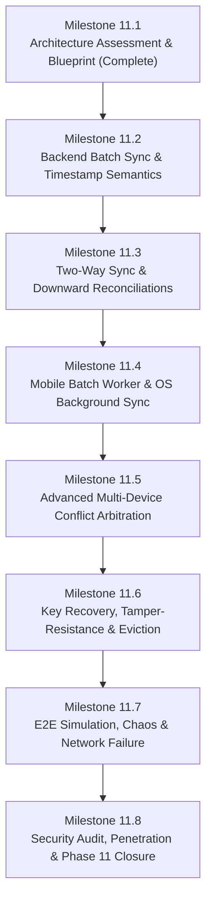

# UPOSTIT — Phase 11 Implementation Plan
## Offline-First Sync Engine & Advanced Conflict Resolution

**Document Version:** 1.0.0  
**Phase:** Phase 11 — Offline-First Sync Engine & Advanced Conflict Resolution  
**Date:** November 22, 2026  
**Repository:** `/Users/apple/Upostit`  
**Current Git Branch:** `phase-06`  
**Status:** PROPOSED & FULLY SPECIFIED (Awaiting Implementation Authorization)

---

## 1. Executive Summary & Roadmap Alignment

Phase 11 delivers a resilient, high-performance, two-way **Offline-First Synchronization Engine** and **Advanced Conflict Resolution Architecture** across the UPOSTIT platform.

### 1.1 Original Roadmap Reconciliation
- **Original High-Level Plan (`PROJECT_CONTEXT.md` & `docs/ARCHITECTURE.md`)**:
  - Phase 11 was initially titled "Plans and Billing".
- **Current Operational Sequencing**:
  - Field readiness, multi-location basements/rural sites, and multi-device operational testing require an enterprise-grade offline synchronization engine before monetization and billing.
  - Phase 11 is formally designated as **Offline-First Sync Engine & Advanced Conflict Resolution**.
  - Commercial billing, subscriptions, and payment webhooks will execute immediately following Phase 11 closure.

### 1.2 Inventory of Existing Components: Reuse vs Hardening vs Extension vs Replacement

| Component | Origin | Treatment | Architectural Rationale |
| :--- | :--- | :--- | :--- |
| `LocalQueueDatabase` & SQLCipher | Phase 6 | **Reuse & Harden** | Page-level AES-256 encryption is proven; harden key invalidation recovery and add schema versioning for downward sync cache. |
| `DatabaseKeyProvider` | Phase 6 | **Reuse & Harden** | Keychain/Keystore key storage is secure; add graceful user re-auth flow on hardware key wipe. |
| `SqfliteLocalQueueDao` | Phase 6 | **Reuse & Extend** | Retain monotonic sequencing, capacity limits, and session quarantine; extend with batch update methods and downward cache tables. |
| `NetworkConnectivityServiceImpl` | Phase 6 | **Reuse** | Dual-layer connectivity monitoring (OS state + socket DNS validation) is verified and robust. |
| Sequential 1-by-1 Sync Dispatch | Phase 6 | **Replace** | Replace sequential single-punch HTTP dispatch with atomic batch ingestion (`POST /attendance/sync/batch`). |
| `record_punch` Timestamp Logic | Phase 5 | **Harden** | Correct `effective_at` to use corroborated `device_reported_at` for legitimate offline sync within allowable windows. |
| `submit_offline_conflict_bundle` | Phase 8 | **Reuse** | Ingestion of `OfflineSequenceConflictBundle` with SHA-256 canonical fingerprinting is 100% compliant. |
| `adjudicate_conflict_incident` | Phase 8 | **Reuse & Extend** | Supervisor adjudication and atomic `apply_attendance_correction` is robust; extend with multi-device conflict indicators. |

---

## 2. Milestone Breakdown

---

### Milestone 11.1 — Architecture Assessment, Gap Analysis & Implementation Blueprint
- **Objective**: Conduct a comprehensive architecture assessment of the existing offline-first synchronization infrastructure, identify reliability and security gaps, and author the Phase 11 scope assessment and milestone blueprint.
- **Scope**:
  - Inspect existing mobile SQLCipher database, local queue DAO, sync worker, connectivity service, and conflict bundles.
  - Inspect backend punch ingestion, timestamp drift validation, idempotency registry, and supervisor conflict adjudication.
  - Reconcile roadmap discrepancy between original Phase 11 catalog and operational Phase 11 sync engine.
  - Document all 19 required architectural assessment sections.
- **Files/Modules Affected**:
  - `docs/PHASE_11_SCOPE_ASSESSMENT.md` (Created)
  - `docs/PHASE_11_PLAN.md` (Created)
- **Dependencies**: Completed Phase 10 monorepo baseline.
- **Database Impact**: None.
- **API Impact**: None (assessment only).
- **Test Requirements**: Run read-only baseline tests to confirm zero regressions (833 backend, 132 web, 412 mobile tests passing).
- **Acceptance Criteria**: Both architectural documents delivered, comprehensive gap analysis documented, 0 commits, 0 pushes.

---

### Milestone 11.2 — Backend Batch Sync Protocol & Timestamp Semantic Hardening
- **Objective**: Implement a high-throughput, atomic server-side batch synchronization API (`POST /api/v1/attendance/sync/batch`) and correct `effective_at` calculation semantics for verified offline punches.
- **Scope**:
  - Develop `POST /api/v1/attendance/sync/batch` accepting up to 50 ordered punches per batch.
  - Process items with transactional row-level employee locking (`with_for_update`).
  - Return per-item receipts (`ACCEPTED`, `DUPLICATE`, `REQUIRES_REVIEW`, `REJECTED`, `CONFLICT`, `RETRYABLE`) with corresponding `server_event_id` and error diagnostics.
  - Correct timestamp semantic in `services/api/attendance/service.py`: when `is_offline_sync=True` and past offline drift is within allowable bounds, assign `effective_at = device_reported_at` to guarantee accurate shift matching and work duration calculation.
  - Future timestamps within the 60s–300s warning window preserve `device_reported_at` intact for auditability, assign `effective_at = server_received_at` to prevent premature future working duration or shift distortion until reviewed, and attach `review_status = "PENDING_REVIEW"` along with `FLAG_FUTURE_TIMESTAMP_DETECTED` and clock drift telemetry.
  - **Strict Break-End Invariant**: Never fabricate a `BREAK_END` ledger event or invent a break-end timestamp. If an employee checks out while on break, preserve the original open break, mark the check-out punch as `REQUIRES_REVIEW` with `UNCLOSED_BREAK_ON_CHECKOUT`, and keep the append-only ledger strictly immutable.
  - **Role Scoping**: Enforce established RBAC model — `OWNER`, `ADMIN`, `HR` tenant-wide; `MANAGER` scoped strictly to self and verified direct reports (`reporting_manager_id`); `EMPLOYEE` scoped strictly to own attendance.
- **Files/Modules Affected**:
  - `services/api/attendance/routes.py`
  - `services/api/attendance/sync_service.py` (New module)
  - `services/api/attendance/schemas.py`
  - `services/api/attendance/service.py`
- **Dependencies**: Milestone 11.1.
- **Database Impact**: None (reuses `attendance_events` and `attendance_idempotency_records`).
- **API Impact**:
  - New Endpoint: `POST /api/v1/attendance/sync/batch`.
  - Hardened Behavior: `POST /api/v1/attendance/punch`.
- **Test Requirements**:
  - Unit and integration tests in `tests/test_phase11_sync_batch_api.py` (25 tests covering all 20 required scenarios, manager direct-report checks, unclosed break checkout, and warning window timestamp safety).
  - Regression verification of `test_phase5_punch_ledger.py`, `test_phase7_gps_spoofing_and_velocity.py`, `test_phase8_conflict_submission_api.py`, and `test_phase10_milestone8_security_audit.py`.
- **Acceptance Criteria**:
  - Batches of up to 50 punches ingested with savepoint isolation and partial batch success.
  - Offline punches placed in the correct historical shift with accurate work duration.
  - No synthetic `BREAK_END` events fabricated; open breaks preserved with supervisor review flags.
  - Manager direct-report authorization strictly enforced (403 on non-direct reports).
  - 100% test pass rate across backend (858 tests), web (132 tests), and mobile (412 tests) — 1,402 passing tests total.

---

### Milestone 11.3 — Two-Way Synchronization & Downward Reconciliations
- **Objective**: Implement downward synchronization allowing mobile clients to pull verified attendance day summaries, approved supervisor conflict decisions, and administrative timesheet corrections into local storage.
### Milestone 11.3 — Downward Delta Sync Protocol: Reference Data & Shift Rosters (COMPLETED & VERIFIED)
- **Objective**: Implement reliable server-to-mobile synchronization of reference data, shift rosters, workplace geofences, leave balances, organizational attendance policies, and reporting hierarchies.
- **Scope**:
  - Develop cursor-based downward sync endpoint: `GET /api/v1/attendance/sync/pull`.
  - Query parameters: `since=<ISO8601>` (or checkpoint revision), `limit=50`.
  - Returns modified `attendance_days`, resolved `attendance_conflict_incidents`, and updated shift assignments.
  - Implement mobile downward reconciliation repository to update local SQLite records (updating `QUARANTINED` items to `RESOLVED_BY_SUPERVISOR`).
  - Pydantic v2 schemas for full and delta sync (`SyncDeltaResponse`, `SyncEmployeePayload`, `SyncShiftPayload`, `SyncWorkplacePayload`, `SyncHolidayPayload`, `SyncLeaveTypePayload`, `SyncLeaveBalancePayload`, `SyncLeaveRequestPayload`, `SyncAttendancePolicyPayload`, `SyncDirectReportPayload`, `SyncTombstonePayload`).
  - Cryptographic HMAC-SHA256 tamper-resistant cursor engine (`generate_sync_cursor`, `decode_and_verify_sync_cursor`).
  - Endpoints: `GET /api/v1/sync/delta` and alias `GET /api/v1/attendance/sync/delta` protected by `Permission.VIEW_OWN_PROFILE`.
  - SQLite schema upgrade from v1 to v2 with 10 versioned cache tables (`sync_state`, `cached_employee`, `cached_shifts`, `cached_workplaces`, `cached_holidays`, `cached_leave_types`, `cached_leave_balances`, `cached_leave_requests`, `cached_attendance_policy`, `cached_direct_reports`).
  - Strict preservation of pending offline attendance queue (`local_attendance_queue`) during migrations and cache purges.
  - Mobile `DownwardSyncDao` with atomic transactions, tombstone deletions, and crash-safe cursor advancement.
  - Mobile `DownwardSyncCoordinator` with concurrency mutex, pagination loop, self-healing cursor reset on HTTP 400, and offline check.
- **Files/Modules Affected**:
  - `services/api/attendance/downward_sync_schemas.py`
  - `services/api/attendance/downward_sync_service.py`
  - `services/api/attendance/sync_routes.py`
  - `services/api/attendance/routes.py`
  - `services/api/attendance/sync_service.py`
  - `apps/mobile/lib/features/sync/data/datasources/sqflite_local_queue_dao.dart`
  - `apps/mobile/lib/features/sync/domain/repositories/local_queue_dao.dart`
  - `services/api/main.py`
  - `apps/mobile/lib/core/network/api_endpoints.dart`
  - `apps/mobile/lib/features/sync/data/datasources/local_queue_database.dart`
  - `apps/mobile/lib/features/sync/data/models/sync_delta_model.dart`
  - `apps/mobile/lib/features/sync/data/datasources/downward_sync_dao.dart`
  - `apps/mobile/lib/features/sync/data/datasources/downward_sync_remote_data_source.dart`
  - `apps/mobile/lib/features/sync/data/services/downward_sync_coordinator.dart`
- **Dependencies**: Milestone 11.2.
- **Database Impact**: Add `local_attendance_days_cache` table to SQLite local queue database.
- **Database Impact**: Upgraded mobile SQLite `databaseVersion` from 1 to 2; added 10 cache tables. (Backend database schema unchanged).
- **API Impact**:
  - New Endpoint: `GET /api/v1/attendance/sync/pull`.
  - New Endpoints: `GET /api/v1/sync/delta` and `GET /api/v1/attendance/sync/delta`.
- **Test Requirements**:
  - Backend tests in `tests/test_phase11_sync_pull_api.py`.
  - Mobile DAO tests in `apps/mobile/test/features/sync/data/datasources/downward_sync_test.dart`.
  - 21 backend integration & acceptance audit tests in `tests/test_phase11_downward_sync_api.py`.
  - 15 mobile tests in `apps/mobile/test/features/sync/data/datasources/downward_sync_dao_test.dart` and `apps/mobile/test/features/sync/data/services/downward_sync_coordinator_test.dart`.
- **Acceptance Criteria**:
  - Mobile receives resolved conflict statuses and updates UI without manual app restart.
  - Delta queries return only changed records since cursor timestamp using composite keyset pagination v2.
  - Mobile receives and caches shifts, workplaces, holidays, leaves, policy, and direct reports without requiring app re-install.
  - Strict HMAC tamper resistance with key rotation fallback and automatic self-healing on invalid cursors.
  - Offline punch queue (`local_attendance_queue`) preserved intact across all sync and migration operations.
  - 100% test pass rate across backend (879 tests), web (132 tests), and mobile (427 tests) — 1,438 passing tests total.
  - Milestone report: `docs/phase-reports/PHASE_11_MILESTONE_03_REPORT.md`.

---

### Milestone 11.4 — Mobile Batch Sync Worker & Resilient Sync Engine (Complete)
- **Objective**: Upgrade mobile `SyncWorkerImpl` to use batch ingestion and integrate unified synchronization orchestration, monotonic stale-response protection, and background scheduling to flush queued punches and refresh reference data.
- **Scope**:
  - Centralized bidirectional synchronization via `UnifiedSyncCoordinator` with 11 distinct operational phases.
  - Upgraded `SyncWorkerImpl` to package pending FIFO events into batches and dispatch via `syncBatch` (`POST /api/v1/attendance/sync/batch`).
  - Implemented monotonic stale-response protection in `SqfliteDownwardSyncDao` (`isIncomingStale`, `isTombstoneStale`) ensuring older policies (v5 cannot overwrite v6) and stale entities cannot overwrite fresh local state.
  - Implemented native Android WorkManager and iOS BGTaskScheduler background scheduling via `workmanager: ^0.10.10`, `DefaultBackgroundSyncScheduler`, and `Info.plist` permitted identifiers with synchronous mutex locks and network reachability constraints.
  - Updated `SyncBloc`, `SyncState`, `OfflineStatusBanner`, and `SyncStatusScreen` with operational phase tracking, last sync timestamps, and retry statuses without PII leakage.
  - Enforced strict queue preservation: never deletes un-synced, pending, or permanently rejected punches.
- **Files/Modules Affected**:
  - `apps/mobile/lib/features/sync/data/models/batch_sync_models.dart`
  - `apps/mobile/lib/features/attendance/data/datasources/attendance_remote_data_source.dart`
  - `apps/mobile/lib/features/sync/data/services/sync_worker_impl.dart`
  - `apps/mobile/lib/features/sync/data/services/unified_sync_coordinator.dart`
  - `apps/mobile/lib/features/sync/data/services/background_sync_scheduler.dart`
  - `apps/mobile/lib/features/sync/data/datasources/downward_sync_dao.dart`
  - `apps/mobile/lib/features/sync/presentation/bloc/sync_bloc.dart`
  - `apps/mobile/lib/features/sync/presentation/bloc/sync_state.dart`
  - `apps/mobile/lib/features/sync/presentation/bloc/sync_event.dart`
  - `apps/mobile/lib/features/sync/presentation/widgets/offline_status_banner.dart`
  - `apps/mobile/lib/features/sync/presentation/screens/sync_status_screen.dart`
  - `apps/mobile/lib/main.dart`
  - `apps/mobile/ios/Runner/Info.plist`
  - `apps/mobile/pubspec.yaml`
- **Dependencies**: Milestones 11.2 and 11.3.
- **Database Impact**: None (utilizes existing tables in `LocalQueueDatabase` v2).
- **API Impact**: Mobile uses `POST /api/v1/attendance/sync/batch` for upward punches and `GET /api/v1/sync/delta` for downward delta sync.
- **Test Results**:
  - 17 dedicated Phase 11.4 integration tests in `test/features/sync/phase11_4_enhanced_offline_sync_test.dart` (100% pass).
  - 154 feature sync tests in `test/features/sync/` (100% pass).
  - 444 total mobile tests in `test/` (100% pass).
  - Flutter analyze: No issues found!
  - Milestone report: `docs/phase-reports/PHASE_11_MILESTONE_04_REPORT.md`.
- **Status**: **ACCEPTED, REMEDIATED & FULLY VERIFIED**

---

### Milestone 11.5 — Advanced Multi-Device Conflict Arbitration & Session Reconciliation
- **Objective**: Build intelligent arbitration for concurrent attendance sessions across multiple devices, distinguishing benign duplicates from legitimate conflicts and preventing data loss.
- **Scope**:
  - Track per-device sequence numbers (`device_id` + `sequence_number`) on backend.
  - Implement chronological session arbitration: if an earlier offline punch from Device A arrives after an online punch from Device B, automatically reconcile the session timeline.
  - Add multi-device conflict indicators and forensic audit metadata in the Next.js supervisor console (`/attendance/corrections/conflicts`).
- **Files/Modules Affected**:
  - `services/api/attendance/service.py`
  - `services/api/attendance/conflict_service.py`
  - `apps/web/src/app/attendance/corrections/conflicts/page.tsx`
  - `apps/web/src/lib/api.ts`
- **Dependencies**: Milestones 11.2–11.4.
- **Database Impact**: None (reuses existing metadata JSON and event columns).
- **API Impact**: Supervisor conflict details include multi-device discrepancy flags.
- **Test Requirements**:
  - Backend multi-device simulation in `tests/test_phase11_multi_device_arbitration.py`.
  - Web console UI tests in `apps/web/src/lib/conflict-multi-device.test.ts`.
- **Acceptance Criteria**:
  - Earlier offline punches from a second device are safely reconciled without rejecting valid attendance history.
  - Web console highlights multi-device overlaps clearly to supervisors.

---

### Milestone 11.6 — Offline Data Security, Key Lifecycle Recovery & Local Queue Eviction
- **Objective**: Harden local SQLCipher encryption against hardware Keystore invalidation, implement scheduled eviction of aged synced events, and audit tamper-resistance.
- **Scope**:
  - Implement graceful recovery in `DatabaseKeyProvider` and `LocalQueueDatabase` if platform Keystore invalidates the database key (e.g., passcode reset).
  - Add scheduled queue maintenance service: automatically purge `synced` records older than 30 days (`deleteSyncedEventsOlderThan`).
  - Verify fail-closed behavior: ensure plaintext database is never created under any error condition.
- **Files/Modules Affected**:
  - `apps/mobile/lib/features/sync/data/datasources/database_key_provider.dart`
  - `apps/mobile/lib/features/sync/data/datasources/local_queue_database.dart`
  - `apps/mobile/lib/features/sync/data/datasources/sqflite_local_queue_dao.dart`
  - `apps/mobile/lib/features/sync/presentation/widgets/logout_warning_dialog.dart`
- **Dependencies**: Milestone 11.4.
- **Database Impact**: None.
- **API Impact**: None.
- **Test Requirements**:
  - Security audit tests in `apps/mobile/test/features/sync/simulation/database_security_and_encryption_audit_test.dart`.
  - Queue eviction tests in `apps/mobile/test/features/sync/data/datasources/queue_eviction_test.dart`.
- **Acceptance Criteria**:
  - Keystore invalidation produces user-actionable recovery dialog rather than fatal crash.
  - Local database size is bounded by automatic 30-day eviction.

---

### Milestone 11.7 — End-to-End Simulation, Chaos Testing & Multi-Tenant Validation
- **Objective**: Execute exhaustive automated end-to-end simulations, network chaos injections, and cross-tenant penetration testing across the Phase 11 offline synchronization engine.
- **Scope**:
  - Test complex lifecycle journeys: offline capture -> mid-sync disconnect -> partial batch retry -> supervisor adjudication -> downward pull reconciliation.
  - Test chaos failure modes: dropped ACKs, database deadlock retries, extreme clock tampering, poison-pill payloads, and rapid Wi-Fi toggling.
  - Verify tenant isolation: ensure batch sync and downward pull strictly isolate tenant and user data under PostgreSQL RLS.
- **Files/Modules Affected**:
  - `tests/test_phase11_e2e_chaos_and_simulation.py` (New test file)
  - `apps/web/src/lib/sync-e2e-simulation.test.ts` (New test file)
  - `apps/mobile/test/features/sync/simulation/phase11_e2e_sync_simulation_test.dart` (New test file)
- **Dependencies**: Milestones 11.2–11.6.
- **Database Impact**: None.
- **API Impact**: None.
- **Test Requirements**:
  - Minimum 25 new backend simulation tests.
  - Minimum 10 new web simulation tests.
  - Minimum 20 new mobile simulation tests.
- **Acceptance Criteria**:
  - 100% pass rate across all chaos scenarios.
  - Zero cross-tenant data leakage or orphan outbox/queue records.

---

### Milestone 11.8 — Security Audit, Penetration Testing & Formal Phase 11 Closure
- **Objective**: Conduct a comprehensive security audit of all new sync endpoints, execute automated penetration tests, verify monorepo regressions, compile the Phase 11 report, and formally close Phase 11.
- **Scope**:
  - Penetration testing: authentication bypass, cross-tenant batch injection, replay attacks, oversized batch DoS, and SQLCipher key tampering.
  - Dependency and linting audit (`npm audit`, `pip list`, `flutter analyze`).
  - Full monorepo regression test run across backend, web, and mobile suites.
  - Update `PROJECT_CONTEXT.md` and publish `docs/phase-reports/PHASE_11_MILESTONE_08_SECURITY_AUDIT_REPORT.md`.
- **Files/Modules Affected**:
  - `tests/test_phase11_security_audit.py`
  - `apps/web/src/lib/sync-security-audit.test.ts`
  - `docs/phase-reports/PHASE_11_MILESTONE_08_SECURITY_AUDIT_REPORT.md`
  - `PROJECT_CONTEXT.md`
- **Dependencies**: Milestones 11.1–11.7.
- **Database Impact**: None.
- **API Impact**: None.
- **Test Requirements**:
  - Monorepo regression suite: all tests passing 100%.
- **Acceptance Criteria**:
  - Zero critical/high vulnerabilities.
  - Monorepo tests clean and green.
  - Phase 11 formally closed under Outcome B (or Outcome A if live infrastructure is configured).

---

## 3. Future Roadmap Visibility: Automatic Geofence Breaks

The future roadmap feature **Automatic Geofence Breaks** must remain prominent and actively prepared for:

### Feature Requirements:
1. **Automated Break Triggering**:
   - Confirmed departure from an assigned workplace geofence automatically transitions attendance state to `BREAK_START`.
   - Confirmed return to the workplace geofence automatically transitions attendance state to `BREAK_END` and resumes work duration.
2. **Interval Calculation**:
   - Total break duration is calculated from completed intervals between departure and return.
3. **Background OS Geofencing**:
   - Uses native Android Geofencing API and iOS Region Monitoring (`CoreLocation.CLCircularRegion`) to monitor workplace boundaries with minimal battery consumption.
4. **Offline Resilience & Debouncing**:
   - Offline boundary crossings are captured locally in SQLCipher with `metadata: { "trigger": "GEOFENCE_AUTO_BREAK" }`.
   - High-frequency GPS drift near the boundary is debounced (e.g., requiring 90s dwell time outside geofence before initiating break).
5. **Configurable Tenant Policy**:
   - Organization-level toggle (`auto_breaks_enabled: true/false`, default `true`).
   - Tenant-level configurable dwell time and grace radius.

*Notice: This feature is cataloged for subsequent dedicated implementation following the core offline sync engine hardening in Phase 11.*

