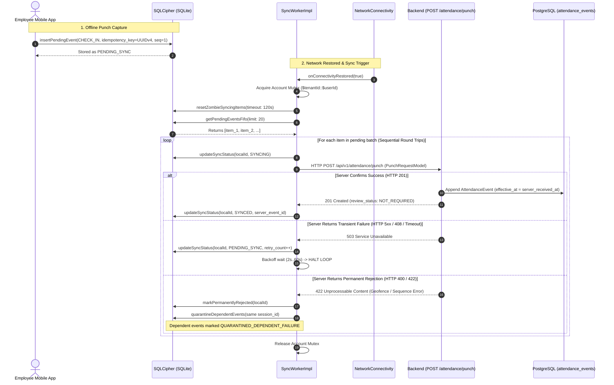
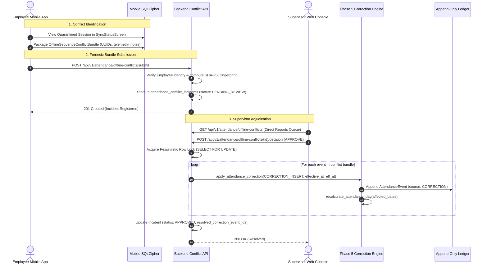
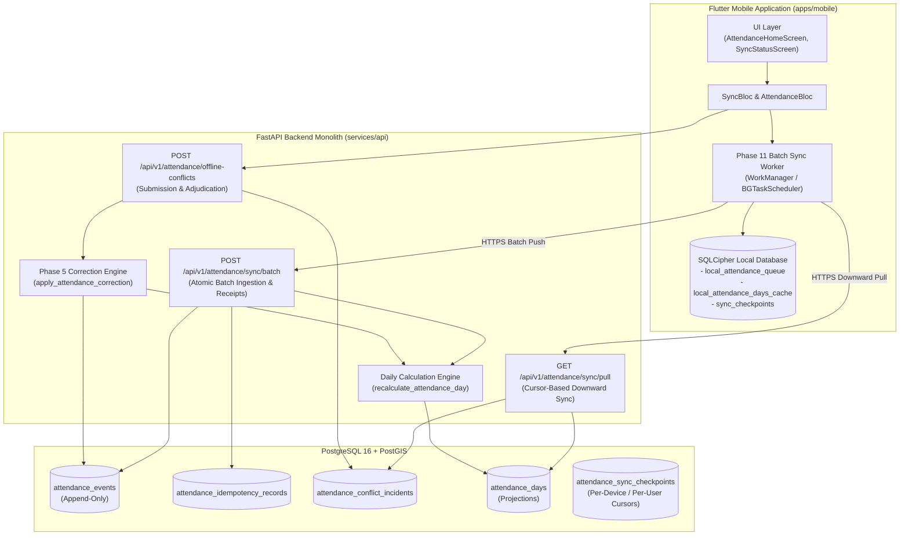

# UPOSTIT — Phase 11 Architecture Assessment & Implementation Blueprint
## Offline-First Sync Engine & Advanced Conflict Resolution

**Document Version:** 1.0.0  
**Phase:** Phase 11 — Offline-First Sync Engine & Advanced Conflict Resolution  
**Date:** November 22, 2026  
**Repository:** `/Users/apple/Upostit`  
**Current Git Branch:** `phase-06`  
**Status:** PROPOSED & FULLY ASSESSED (Awaiting Implementation Authorization)

---

## 1. Executive Summary & Original Roadmap Reconciliation

### 1.1 Original 22-Phase Roadmap Inspection & Terminology Discrepancy
A rigorous inspection of the original 22-phase roadmap across project reference files (`PROJECT_CONTEXT.md` Section 5.4, line 208, and `docs/ARCHITECTURE.md` Section 4, line 125) reveals an explicit terminology discrepancy:

- **Original Roadmap Catalog**:
  - *Phase 6*: **"Mobile Check-in"** (*Flutter geofence check, offline queue, retry jitter*).
  - *Phase 8*: **"Corrections and Reports"** / **"Offline Attendance Conflict Resolution & Supervisor Approvals"** (*quarantined conflict bundles, supervisor console*).
  - *Phase 11*: **"Plans and Billing"** (*Subscription tiers, feature gating, Stripe/Razorpay webhooks*).
- **Current Operational Reality & Phase 10.8 Handover**:
  - The Phase 10.8 Security Audit & Formal Phase 10 Closure Report explicitly defined the next phase as:
    `Phase 11 (Offline-First Sync Engine & Advanced Conflict Resolution)`.
  - While Phase 6 built the foundational mobile offline queue (`SqfliteLocalQueueDao`, `LocalQueueDatabase`, `SyncWorkerImpl`) and Phase 8 implemented supervisor conflict adjudication (`POST /attendance/offline-conflicts/submit`, `attendance_conflict_incidents`), real-world operational testing, multi-device usage, and field resilience requirements revealed that a comprehensive, enterprise-grade, two-way offline synchronization engine is mandatory before commercial monetization and billing.

### 1.2 Authoritative Reconciliation Decision
To preserve strict roadmap integrity without silently redefining the architecture:
1. **Scope Classification**: Phase 11 is formally designated as **Offline-First Sync Engine & Advanced Conflict Resolution**.
2. **Roadmap Re-sequencing**: Subscription Plans, Billing, Invoicing, and Payment Gateway Webhooks (formerly labeled Phase 11 in early planning) are sequenced to follow immediately after Phase 11 completion, as robust attendance ledger and synchronization integrity is the critical prerequisite for billable seat counts and payroll derivation.
3. **Component Disposition**: Existing Phase 6 and Phase 8 synchronization components are not scrapped or rewritten; they are categorized for **Reuse**, **Hardening**, **Extension**, or **Replacement** as detailed below.

---

## 2. Current Architecture Overview

UPOSTIT's attendance tracking operates across a three-tier architecture:
1. **Client Tier (Flutter Mobile & Next.js Web)**:
   - **Flutter Mobile (`apps/mobile`)**: Native Dart client for shift workers. Contains encrypted local database (SQLCipher AES-256), sequential queue DAO, connectivity monitor, in-memory sync worker mutex, and reactive BLoC state management (`AttendanceBloc`, `SyncBloc`).
   - **Next.js 14 Web Console (`apps/web`)**: Administrative dashboard for HR and supervisors to view employee attendance days, audit logs, and adjudicate quarantined offline conflict incidents (`/attendance/corrections/conflicts`).
2. **Backend API Tier (`services/api`)**:
   - Modular FastAPI monolith running on Python 3.12/3.13.
   - Central Attendance Policy Engine (`tenant_attendance_policies`).
   - Append-only attendance ledger (`attendance_events`).
   - Server-side idempotency registry (`attendance_idempotency_records`).
   - Offline conflict submission and supervisor adjudication service (`services/api/attendance/conflict_service.py`).
   - Atomic attendance day projection and recalculation engine (`calculate_attendance_day`, `recalculate_attendance_day`).
3. **Persistence & Infrastructure Tier**:
   - Supabase PostgreSQL 16 with PostGIS spatial extension.
   - PostgreSQL Row-Level Security (`FORCE ROW LEVEL SECURITY`) with per-transaction tenant context (`app.tenant_id`).
   - Redis for caching, rate limiting, and Celery worker brokers.

---

## 3. Existing Components & Current Responsibilities

| Subsystem | Component / File | Current Responsibility | Phase 11 Architectural Treatment |
| :--- | :--- | :--- | :--- |
| **Mobile Storage** | `LocalQueueDatabase`<br>`(apps/mobile/lib/features/sync/data/datasources/local_queue_database.dart)` | Manages SQLCipher encrypted SQLite database (`upostit_offline_queue.db`). Verifies `SQLCIPHER_PAGE_AES256` metadata. Fail-closed on missing key. | **REUSE & HARDEN**: Add migration framework for downward cache tables and cursor tracking. |
| **Mobile Storage** | `DatabaseKeyProvider`<br>`(database_key_provider.dart)` | Manages 256-bit cryptographic keys via `FlutterSecureStorage` (iOS Keychain / Android Keystore). | **REUSE & HARDEN**: Add Keystore invalidation / rekeying recovery protocol. |
| **Mobile Queue DAO** | `SqfliteLocalQueueDao`<br>`(sqflite_local_queue_dao.dart)` | Enforces 500-event capacity limit, calculates monotonic sequence numbers, inserts pending punches, queries FIFO queue, cascades session quarantines. | **REUSE & EXTEND**: Extend to support batch item status updates and downward sync entity storage. |
| **Mobile Network** | `NetworkConnectivityServiceImpl`<br>`(network_connectivity_service_impl.dart)` | Monitors network state using `connectivity_plus` with socket DNS validation to confirm true Internet reachability. | **REUSE**: Proven reliable in Phase 6 simulations. |
| **Mobile Sync Worker**| `SyncWorkerImpl`<br>`(sync_worker_impl.dart)` | In-memory account mutex (`$tenantId::$userId`), 120s zombie reset, sequential FIFO punch replay, exponential backoff (2s–60s), error classification. | **EXTEND & REPLACE DISPATCH**: Replace sequential one-by-one HTTP dispatch with atomic/chunked batch sync. |
| **Mobile UI** | `SyncStatusScreen`, `SyncBloc`<br>`(apps/mobile/lib/features/sync/presentation/)` | Renders sync queue counts (Pending, Syncing, Synced, Quarantined, Flagged), manual sync trigger, and conflict submission dialogs. | **REUSE & EXTEND**: Add background sync status indicator and downward pull refresh. |
| **Backend Punch API**| `record_punch`<br>`(services/api/attendance/service.py)` | Ingests presence punches. Checks employee lock, idempotency key, tenant policy, timestamp drift, fraud shield, and state machine transitions. | **REUSE & HARDEN**: Correct `effective_at` timestamp semantic for legitimate delayed offline sync. |
| **Backend Conflict** | `submit_offline_conflict_bundle`<br>`(services/api/attendance/conflict_service.py)` | Ingests `OfflineSequenceConflictBundle`, validates caller ownership, computes SHA-256 fingerprint, persists to `attendance_conflict_incidents`. | **REUSE**: 100% compliant with Phase 8 specs. |
| **Backend Adjudicate**| `adjudicate_conflict_incident`<br>`(services/api/attendance/conflict_service.py)` | Supervisor decision (APPROVE/REJECT). On APPROVE, atomically calls `apply_attendance_correction` for each bundled event, recalculating attendance days. | **REUSE**: High-durability atomic transaction handling. |
| **Web Console** | `apps/web/src/app/attendance/corrections/conflicts/page.tsx` | Supervisor conflict review queue, incident detail modal with forensic telemetry visualizer, APPROVE/REJECT forms. | **REUSE & EXTEND**: Add multi-device conflict indicators and batch approval. |

---

## 4. Current Operational Sequences

### 4.1 Current Offline Synchronization Sequence (One-by-One HTTP)



### 4.2 Current Conflict Resolution & Supervisor Adjudication Sequence



---

## 5. Identified Architectural & Operational Gaps

### Gap 1: Absence of a Server-Side Batch Synchronization Endpoint
- **Current Behavior**: `SyncWorkerImpl` processes queued offline punches sequentially, sending **one HTTP POST request per punch** to `POST /api/v1/attendance/punch`.
- **Operational Defect**:
  - An employee offline for 3 days generates 12–15 punches. Replaying these requires 12–15 separate TLS handshakes, HTTP request/response roundtrips, database transactions, and lock acquisitions.
  - Cellular radio stays energized continuously, draining battery.
  - High risk of network disconnect midway through the sequence, leaving the queue partially synchronized.
  - Server cannot evaluate the entire batch sequence atomically or offer batch receipts.

### Gap 2: Timestamp Semantic Discrepancy (`effective_at` vs `device_reported_at`)
- **Current Behavior**: In `services/api/attendance/service.py` line 1005:
  `server_received_at = datetime.now(UTC)`  
  `effective_at = server_received_at`
- **Operational Defect**:
  - When an employee punches offline at 09:00:00 (recorded in `device_reported_at`) and syncs at 17:00:00, `effective_at` is stamped as 17:00:00.
  - The shift matching algorithm (`determine_shift_date_for_punch`) and daily duration engine (`calculate_attendance_day`) query `effective_at`.
  - As a result, the employee's check-in is placed at 5:00 PM instead of 9:00 AM, causing the system to calculate 0 minutes of work or incorrectly mark the employee absent/late!
  - **Required Correction**: For valid offline queued events within allowable windows, `effective_at` must reflect the corroborated `device_reported_at`.

### Gap 3: Missing Downward Synchronization (One-Way Sync Only)
- **Current Behavior**: Mobile pushes events UP. Mobile **never pulls down** verified attendance states, approved conflict resolutions, supervisor corrections, or recalculated day projections.
- **Operational Defect**:
  - Once an event is marked `REJECTED_PERMANENT` or `QUARANTINED_DEPENDENT_FAILURE` in local SQLite, it remains in that status forever on the mobile UI, even after a supervisor approves the conflict!
  - Mobile has no local cache of server-authoritative daily records or shift changes, forcing constant live API calls to `/attendance/days/me`.

### Gap 4: Missing OS-Level Native Background Synchronization
- **Current Behavior**: `SyncWorkerImpl` runs only in the foreground or when the Flutter app process is alive.
- **Operational Defect**:
  - If a worker punches offline, closes/swipes away the mobile application, and later enters Wi-Fi/cellular coverage, synchronization **does not occur**.
  - Punches stay stranded on device until the worker manually opens the app.
  - Requires integration with Android `WorkManager` and iOS `BGTaskScheduler` to flush the offline queue in the background upon connectivity restoration.

### Gap 5: Incomplete Multi-Device Conflict Arbitration
- **Current Behavior**: If an employee logs into Device A and Device B:
  - If Device A records a punch offline while Device B records a punch online, Device A's sync attempt hits a state machine violation (e.g. HTTP 400 "already checked in").
  - The failure is treated as a generic permanent domain error and quarantined for supervisor review.
- **Operational Defect**:
  - Lacks cross-device causality tracking (no device revision vector or session generation counter).
  - Benign duplicate submissions across devices trigger unnecessary supervisor overhead.

### Gap 6: Unmanaged Queue Storage Growth & Synced Event Eviction
- **Current Behavior**: `deleteSyncedEventsOlderThan({required Duration age})` exists in `SqfliteLocalQueueDao` but is never invoked automatically on an operational schedule.
- **Operational Defect**:
  - Synced punch records and obsolete metadata accumulate in local SQLite over months of usage, expanding storage footprint and slowing query performance.

### Gap 7: SQLCipher Key Lifecycle & Keystore Invalidation Handling
- **Current Behavior**: If Android Keystore or iOS Keychain invalidates the stored encryption key (e.g. user resets device lock screen passcode), `LocalQueueDatabase` fails closed with `DatabaseEncryptionException`.
- **Operational Defect**:
  - The application enters a hard crash/blocked state with no user-facing recovery workflow, re-authentication prompt, or graceful data recovery option.

---

## 6. Failure Scenarios & Analysis

| Scenario # | Failure Description | Current Behavior | Target Resilient Behavior |
| :--- | :--- | :--- | :--- |
| **F-01** | **Lost Response (ACK)**: Server ingests punch and commits transaction, but network drops before client receives HTTP 201. | Client retries on reconnect; server matches `idempotency_key` in `attendance_idempotency_records` and returns cached response with `idempotent_replay: true`. | **Preserved & Hardened**: Fully verified; ensure batch sync supports identical per-item cached replays. |
| **F-02** | **Mid-Batch Disconnect**: Mobile syncs 5 events; network drops during event 3. | Events 1 and 2 are `synced`; event 3 stays in `syncing` until 120s zombie reset returns it to `pendingSync`; events 4 and 5 remain `pendingSync`. | **Addressed via Batch Sync**: Batch response provides atomic array of item receipts; client updates statuses in a single local transaction. |
| **F-03** | **Application Force-Kill**: OS terminates app while worker is in `SYNCING` state. | On next boot, `resetZombieSyncingItems(120s)` resets items older than 120s back to `pendingSync`. | **Preserved**: Worker automatically recovers stranded records without data loss. |
| **F-04** | **Extreme Clock Drift / Device Tampering**: User manipulates system clock backwards by 2 hours. | Mobile records `monotonic_boot_time_ms` and `boot_session_id`. Server flags intra-boot drift $> 60\text{s}$ as `FLAG_CLOCK_MANIPULATION_SUSPECTED` and marks `PENDING_REVIEW`. | **Preserved**: Dual timestamp invariant prevents fraudulent time fabrication. |
| **F-05** | **Account Deactivation While Offline**: Employee is terminated; attempts to sync queued offline punches. | Backend returns HTTP 401/403 with deactivated message; client classifies error, leaves items pending, triggers logout. | **Preserved**: Offline events are preserved for legal/payroll audit, but caller session is terminated. |

---

## 7. Security & Data Protection Review

1. **At-Rest Encryption**:
   - `LocalQueueDatabase` enforces SQLCipher page-level AES-256 encryption.
   - Database key is generated with 256 bits of cryptographically secure randomness and stored exclusively in platform secure hardware (`kSecAttrAccessibleAfterFirstUnlockThisDeviceOnly` on iOS, `EncryptedSharedPreferences` on Android).
   - Strict fail-closed policy: the database is never created or opened in plaintext.
2. **Multi-Tenant Row-Level Security (RLS)**:
   - Every SQLite table partitions records by `tenant_id` and `user_id`.
   - Backend APIs enforce `tenant_id` scoping via PostgreSQL RLS policies (`current_setting('app.tenant_id', true)::uuid`).
   - Background workers and sync tasks explicitly invoke `await set_tenant_context(session, str(tenant_id))`.
3. **Forensic Telemetry Protection**:
   - Device tokens are stored as SHA-256 hashes.
   - Fraud risk scores, internal GPS mock flags, and supervisor notes are sanitized and redacted from employee-facing APIs (`/offline-conflicts/my`).
4. **Offline Queue Tamper-Resistance**:
   - Modifying local SQLite without the cryptographic key is prevented by SQLCipher.
   - Modifying local sequence numbers is detected by server sequence monotonicity checks.
   - Resubmitting altered conflict bundles is detected by canonical SHA-256 bundle fingerprinting (`compute_conflict_bundle_fingerprint`).

---

## 8. Multi-Device Synchronization Strategy

### 8.1 Multi-Device Threat Model
When an employee uses multiple devices (e.g., Device 1 phone, Device 2 tablet, or corporate kiosk):
- Device A records `CHECK_IN` offline at 08:55 AM.
- Device B records `CHECK_IN` online at 09:05 AM.
- Device A reconnects at 10:00 AM and attempts to sync its 08:55 AM `CHECK_IN`.

### 8.2 Proposed Multi-Device Arbitration Rules
1. **Per-Device Sequence Isolation**:
   - Monotonic sequence numbers in SQLite are scoped per device and per user (`sequence_number` + `device_id`).
   - Server tracks `last_device_sequence` per device to detect dropped or replayed events from that specific device.
2. **Chronological Precedence with Retroactive Shift Reconciliation**:
   - When Device A's earlier `CHECK_IN` (08:55 AM) arrives after Device B's `CHECK_IN` (09:05 AM):
     - The server recognizes that Device A's punch occurred earlier chronologically.
     - Device B's punch is flagged as a duplicate/redundant check-in within the same session.
     - The recalculation engine retroactively re-derives the attendance day using the authoritative earlier start time.
3. **Session Affinity & Device Binding**:
   - If a tenant policy enables strict device binding, punches from non-approved devices receive `FLAG_UNREGISTERED_DEVICE` and require supervisor approval.
   - Check-out on Device B for a session started on Device A is permitted (supporting lost/dead phone scenarios), provided the transition is valid and location verification succeeds.

---

## 9. Idempotency & Deduplication Strategy

### 9.1 Client-Side Idempotency
- Every punch created on mobile receives a UUID v4 `idempotency_key` at the moment of capture in SQLite.
- `idempotency_key` is **immutable** across all retries, network reconnects, app restarts, and sync worker sweeps.

### 9.2 Server-Side Idempotency (`attendance_idempotency_records`)
- Enforces unique constraint: `(tenant_id, idempotency_key) UNIQUE`.
- Calculates deterministic request payload fingerprint (`compute_request_fingerprint`).
- **State Machine**:
  - `IN_PROGRESS`: Holds a 15-minute lease lock. Concurrent identical requests receive HTTP 409 Conflict.
  - `COMPLETED`: Stores `response_payload`. Replays return cached `PunchResponse` with `idempotent_replay: true` and HTTP 200/201.
  - `FAILED`: Allows clean retry after transient worker failure.
  - Mismatched fingerprint with reused key returns HTTP 422 Unprocessable Content.

### 9.3 Conflict Bundle Deduplication
- Employee conflict submissions use `compute_conflict_bundle_fingerprint` to hash `(tenant_id, employee_id, bundle_id, primary_event, dependent_events)`.
- Replays return HTTP 200 with `idempotent_replay: true`. Tampered bundles with reused `bundle_id` return HTTP 409 Conflict.

---

## 10. Event Ordering & Consistency Strategy

1. **Client Monotonic Ordering**:
   - Events on a single device are inserted with strictly increasing `sequence_number`.
   - `SyncWorkerImpl` queries `getPendingEventsFifo` ordered by `sequence_number ASC, device_reported_at ASC`.
2. **Server Ingestion Authority**:
   - The server processes events in FIFO sequence order.
   - `effective_at` determines chronological placement in the shift ledger.
   - `server_received_at` provides immutable audit evidence of when the server learned of the event.
3. **Cascading Session Quarantine**:
   - If an event in a session permanently fails, dependent events in the **same session** (`session_id`) are quarantined (`QUARANTINED_DEPENDENT_FAILURE`) to preserve sequence sanity.
   - Subsequent independent sessions (e.g. next day's shift) are **not blocked** and sync normally.

---

## 11. Proposed Phase 11 Target Architecture



---

## 12. Database Changes (Assessment & Justification)

### 12.1 PostgreSQL Changes (Minimal & Safe)
- **New Table: `attendance_sync_checkpoints`** (Optional / Conditional):
  - Purpose: Tracks the latest downward sync cursor (timestamp or integer revision) per `(tenant_id, user_id, device_id)` to enable high-efficiency delta sync for `/sync/pull`.
  - Schema:
    - `id UUID PRIMARY KEY`
    - `tenant_id UUID NOT NULL REFERENCES tenants(id)`
    - `user_id UUID NOT NULL REFERENCES users(id)`
    - `device_id VARCHAR(128) NOT NULL`
    - `last_synced_at TIMESTAMPTZ NOT NULL`
    - `last_event_revision BIGINT NOT NULL DEFAULT 0`
    - `created_at / updated_at TIMESTAMPTZ NOT NULL`
  - *Alternative*: If adding a table is deferred, `/sync/pull` can use client-supplied cursor query parameters (`?since=ISO8601`) directly against `attendance_days.updated_at` and `attendance_conflict_incidents.updated_at` without schema migration.

### 12.2 SQLite / SQLCipher Local Schema Changes
- **Table: `local_attendance_days_cache`**:
  - Stores cached daily summaries (`attendance_date`, `status`, `total_work_minutes`, `review_status`) pulled down from server for offline display.
- **Table: `sync_metadata`**:
  - Stores `last_downward_sync_at`, `sync_cursor`, and `last_purged_at`.

---

## 13. API Changes (Assessment & Specification)

### 13.1 `POST /api/v1/attendance/sync/batch` (New Batch Push Endpoint)
- **Purpose**: Ingests up to 50 queued punches in a single HTTP request.
- **Request Body**:
  ```json
  {
    "device_id": "device_uuid_string",
    "batch_id": "batch_uuid_string",
    "items": [
      {
        "local_id": "loc_1",
        "idempotency_key": "uuid_1",
        "event_type": "CHECK_IN",
        "device_reported_at": "2026-11-22T08:30:00Z",
        "latitude": 37.7749,
        "longitude": -122.4194,
        "accuracy_meters": 12.5,
        "wifi_bssid": "00:14:22:01:23:45",
        "metadata": { "offline_queued": true, "offline_sequence_number": 1 }
      }
    ]
  }
  ```
- **Response (200 OK)**:
  ```json
  {
    "batch_id": "batch_uuid_string",
    "processed_count": 1,
    "results": [
      {
        "local_id": "loc_1",
        "idempotency_key": "uuid_1",
        "status": "ACCEPTED",
        "server_event_id": "server_event_uuid",
        "review_status": "NOT_REQUIRED",
        "idempotent_replay": false
      }
    ]
  }
  ```

### 13.2 `GET /api/v1/attendance/sync/pull` (New Downward Pull Endpoint)
- **Purpose**: Pulls resolved conflict decisions, supervisor corrections, and daily attendance records since a specified cursor.
- **Query Params**: `since=2026-11-20T00:00:00Z&limit=50`
- **Response (200 OK)**: Returns updated `attendance_days` and resolved `conflict_incidents` allowing mobile SQLite to update its local state.

### 13.3 `POST /api/v1/attendance/punch` (Behavioral Hardening)
- **Correction**: In `record_punch`, when `is_offline_sync` is True and timestamp passes verification ($\le 24\text{h}$ or $\le 72\text{h}$), set `effective_at = device_reported_at` rather than `server_received_at`.

---

## 14. Flutter Mobile Changes

1. **`SyncWorkerImpl` Refactor**:
   - Implement `synchronizeBatchQueue()` utilizing `POST /attendance/sync/batch`.
   - Implement downward pull synchronization in `pullServerReconciliations()`.
2. **Native OS Background Synchronization**:
   - Android: Integrate `workmanager` plugin or custom platform channel to trigger `SyncWorker` on network restore.
   - iOS: Configure `BGTaskScheduler` background processing task.
3. **Local Queue Maintenance**:
   - Add scheduled eviction service calling `deleteSyncedEventsOlderThan(age: 30 days)`.
4. **Key Invalidation Recovery UI**:
   - Catch `DatabaseEncryptionException` gracefully, prompting user with re-authentication or support recovery options instead of crashing.

---

## 15. Next.js Web Console Changes

1. **Conflict Review Console (`/attendance/corrections/conflicts`)**:
   - Add multi-device conflict indicator badge (e.g. "Device Conflict: Punch overlaps with existing session from Device B").
   - Support batch supervisor approvals for bulk conflict incidents.
   - Enhance forensic timeline comparison view showing device-reported vs server-received timestamps.

---

## 16. Backend API Changes

1. **`services/api/attendance/sync_service.py`**:
   - New dedicated service module for batch punch ingestion and downward reconciliation.
2. **`services/api/attendance/service.py`**:
   - Fix `effective_at` calculation for legitimate delayed offline punches.
3. **`services/api/attendance/routes.py`**:
   - Register `POST /attendance/sync/batch` and `GET /attendance/sync/pull`.

---

## 17. Testing Strategy

1. **Monorepo Baseline Protection**:
   - Ensure zero regressions across existing 833 backend tests, 132 web tests, and 412 mobile tests (1,377 total).
2. **New Dedicated Test Suites**:
   - *Backend*: `tests/test_phase11_sync_batch_api.py` (batch ingestion, partial failure, duplicate replay).
   - *Backend*: `tests/test_phase11_effective_at_semantics.py` (verifying accurate work duration derivation for offline punches).
   - *Mobile*: `apps/mobile/test/features/sync/data/services/batch_sync_worker_test.dart`.
   - *Mobile*: `apps/mobile/test/features/sync/simulation/multi_device_arbitration_test.dart`.
   - *Web*: `apps/web/src/lib/sync-batch-admin.test.ts`.

---

## 18. Deployment Considerations

1. **Backward Compatibility**:
   - `POST /api/v1/attendance/punch` remains fully active and supported for older mobile app builds.
   - New mobile builds transparently negotiate batch sync if supported, falling back to single-punch sync if needed.
2. **Redis Rate Limiting**:
   - Configure separate sliding-window rate limit for `POST /attendance/sync/batch` (e.g., 60 batches/min per employee) to accommodate network reconnection bursts.

---

## 19. Risks & Future Required Feature Integration

### 19.1 Future Required Feature: Automatic Geofence Breaks
- **Roadmap Requirement**:
  - Workplace geofence exit automatically initiates a break.
  - Workplace geofence entry automatically ends break and resumes work.
  - Organization-level toggle (`auto_breaks_enabled: true/false`).
  - GPS drift filtering and rapid boundary debounce.
- **Phase 11 Architectural Compatibility**:
  - The offline queue schema and batch sync engine designed in Phase 11 must cleanly accept rapid automated break transitions with `metadata: { "trigger": "GEOFENCE_AUTO_BREAK" }`.
  - Phase 11 lays the durable transport groundwork; the background geofencing engine will be activated in a subsequent dedicated milestone.

### 19.2 Risk Management Matrix

| Risk | Impact | Likelihood | Mitigation Strategy |
| :--- | :--- | :--- | :--- |
| **R-01: Clock Skew on Offline Punches** | Medium | Medium | Monotonic clock corroboration (`monotonic_boot_time_ms`), 60s intra-boot drift threshold, and supervisor review flags. |
| **R-02: Partial Batch Database Contention** | High | Low | Pessimistic employee row locking (`with_for_update`) held for the duration of the batch, with short transaction lifespan. |
| **R-03: iOS BGTaskScheduler Delays** | Low | High | iOS limits background task execution frequency; app will perform immediate sync on foregrounding as fallback. |

