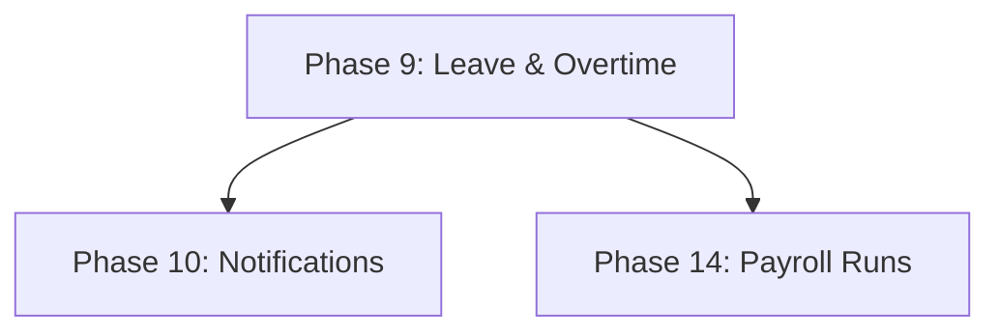

# PHASE_10_SCOPE_VERIFICATION_REPORT.md
# Phase 10 Roadmap Verification & Scope Authorization Assessment

**Date:** November 21, 2026  
**Repository:** `/Users/apple/Upostit`  
**Current Branch:** `phase-06`  
**Status:** Verification Complete — Awaiting Product-Owner Authorization  

---

## Executive Summary

Prior to initiating Phase 10 implementation, a rigorous investigation was conducted across all authoritative project documentation, database schemas, roadmap definitions, and historical phase reports to resolve a documented scope discrepancy:

- **Earlier Architecture & Roadmap:** Defines **Phase 10: Notifications (Outbound Alerts)**.
- **Phase 9.8 Milestone Report:** Mentions **Phase 10: Payroll Integration & Time Card Exports**.

### Key Finding
**The authoritative 22-phase roadmap definitively assigns Phase 10 to "Notifications (Outbound Alerts)".**

The phrase *"Payroll Integration & Time Card Exports"* in the conclusion of `docs/phase-reports/PHASE_09_MILESTONE_08_REPORT.md` and `PROJECT_CONTEXT.md` was an isolated clerical error authored during the Phase 9 closure writeup. In the authoritative 22-phase roadmap, **Payroll is scheduled for Phase 14**, while **Asynchronous Time Card / Daily Summary Exports belong to Phase 12 (Admin & Reporting)**. No Architecture Decision Record (ADR) or project-owner approval ever authorized altering the phase sequence.

---

## 1. Authoritative Roadmap Sources

The canonical phase sequence is established and reinforced across multiple foundational documents:

### 1.1 `PROJECT_CONTEXT.md` (Single Source of Truth)
Section 5.4 (*"Planned for Future Phases"*), lines 198–214:
- **Phase 10:** **Notifications** (*Push alerts via FCM/APNs, email, SMS, Celery retries*).
- **Phase 11:** **Plans and Billing** (*Subscription tiers, feature gating, Stripe/Razorpay webhooks*).
- **Phase 12:** **Admin & Onboarding** (*Setup wizard, super-admin console, support impersonation, API keys*).
- **Phase 13:** **Load Test & Launch Prep** (*k6 load testing, PgBouncer, Sentry, restore drills*).
- **Phase 14:** **Payroll** (*Salary structures, statutory tax configs, PDF payslips*).
- **Phase 15:** **Face & Devices** (*Biometric hardware credentials, HMAC signing, face templates*).
- **Phase 16:** **CCTV Edge Pilot** (*Edge gateway, OpenCV/GStreamer, local buffer, RTSP*).
- **Phases 17–22:** *Presence challenges, BLE/NFC touchpoints, ML anomaly detection, SSO/SCIM, enterprise HRIS integrations, and multi-region HA.*

### 1.2 `docs/ARCHITECTURE.md`
Section 4 (*"Database Schema Roadmap by Phase"*), lines 124–127:
- **Phase 10:** Tables `notification_templates`, `notification_preferences`, `notifications` — *Multi-channel alert dispatching, quiet hours, audit delivery log.*
- **Phase 11:** Tables `plans`, `plan_features`, `subscriptions`, `usage_counters`, `invoices`, `payment_events` — *Stripe/Razorpay billing, subscription state machine, automated entitlement gating.*
- **Phase 12:** Tables `api_keys`, `webhooks`, `webhook_deliveries`, `support_sessions`, `data_requests` — *Developer API access and external webhook subscriptions.*
- **Phase 14:** Tables `salary_structures`, `pay_components`, `pay_periods`, `payroll_runs`, `payroll_items`, `payslips` — *Configurable payroll rules, locked pay runs, PDF payslips.*

### 1.3 `docs/PHASE_09_SCOPE_ASSESSMENT.md`
Section 1.2 (*Phase Dependency Graph*) and Section 1.3 (*Boundary with Other Phases*):

- *"Phase 10 (Notifications): Automated email, SMS, and FCM push notifications upon leave approval/rejection. (In Phase 9, notification hooks are stubbed or recorded in audit logs without outbound push infrastructure)."*
- *"Phase 14 (Payroll): Salary deductions for Loss of Pay (LOP), monetized overtime disbursements, and payslip generation. (In Phase 9, overtime minutes and multipliers are calculated and approved for ledger tracking; financial monetary calculations belong to Phase 14)."*

### 1.4 `docs/PHASE_08_SCOPE_ASSESSMENT.md` & `docs/phase-reports/PHASE_08_MILESTONE_07_REPORT.md`
- Table 1 & Section 1.2: Asynchronous CSV/XLSX export workers (`export_jobs`) and multi-employee aggregated summary cubes (`attendance_daily_summary`) were explicitly scoped for **Phase 12 (Admin & Reporting)** so as not to dilute the attendance ledger and conflict resolution security boundary.

---

## 2. Investigation of the Scope Discrepancy

| Document | Statement | Analysis |
| :--- | :--- | :--- |
| `PROJECT_CONTEXT.md` Section 5.4 (Line 207) | `Phase 10: Notifications (Push alerts via FCM/APNs, email, SMS, Celery retries)` | **Authoritative original roadmap** |
| `docs/ARCHITECTURE.md` Section 4 (Line 124) | `Phase 10: notification_templates, notification_preferences, notifications` | **Authoritative data model roadmap** |
| `docs/PHASE_09_SCOPE_ASSESSMENT.md` Section 1.3 | `Phase 10 (Notifications): Automated email, SMS, and FCM push...` | **Authoritative phase dependency spec** |
| `docs/phase-reports/PHASE_09_MILESTONE_08_REPORT.md` Section 7 | `Phase 10: Payroll Integration & Time Card Exports` | **Clerical error** introduced at commit `a3879fb` during Phase 9.8 report drafting |
| `PROJECT_CONTEXT.md` Section 12 Item 4 | `Next Phase (Phase 10 — Payroll Integration & Time Card Exports)` | **Clerical copy-paste** from Phase 9.8 report conclusion |

### Root Cause Analysis
1. During the completion of Phase 9.8, the engineer authoring the milestone report summarized downstream dependencies by noting that leave balances and overtime calculations feed into payroll and time cards.
2. In doing so, they conflated the immediate subsequent phase (**Phase 10: Notifications**) with downstream **Phase 14 (Payroll)** and **Phase 12 (Time Card Exports)**.
3. Git history confirms that prior to commit `a3879fb`, the phrase *"Payroll Integration & Time Card Exports"* did not exist anywhere in the repository.
4. No Architecture Decision Record (ADR) was submitted or approved to reorder the roadmap.
5. `PROJECT_CONTEXT.md` Section 12 Item 4 has been corrected to restore alignment with Section 5.4 and `docs/ARCHITECTURE.md`.

---

## 3. Exact Original Phase 10 Scope: Notifications & Outbound Alerts

### 3.1 Phase Title & Objectives
- **Phase Number:** Phase 10
- **Official Title:** **Notifications (Outbound Alerts)**
- **Primary Objective:** Build an enterprise-grade, tenant-isolated, multi-channel outbound notification engine that delivers real-time push notifications, transactional emails, and SMS alerts for operational workforce events with user preferences, quiet hours enforcement, template rendering, and resilient background delivery via Celery.

### 3.2 Key Capabilities & Functional Requirements
1. **Multi-Channel Dispatch Engine:**
   - **Mobile Push Notifications:** Google Firebase Cloud Messaging (FCM) for Android and Apple Push Notification service (APNs).
   - **Transactional Email:** SMTP / API adapter (e.g. AWS SES, Resend, or SendGrid) for invitation, activation, summary, and adjudication notifications.
   - **SMS / WhatsApp Alerts:** Gateway adapter for critical shift changes, urgent fraud alerts, or geo-compliance violations.
2. **Template Management:**
   - System and tenant-level customizable notification templates (`notification_templates`).
   - Dynamic parameter substitution (e.g., `{{employee_name}}`, `{{leave_type}}`, `{{start_date}}`, `{{decision}}`).
   - Multi-language localization support.
3. **Preferences & Quiet Hours:**
   - Per-tenant global defaults and per-user notification preferences (`notification_preferences`).
   - Opt-in/opt-out toggles per channel (Push, Email, SMS) and per category (Attendance, Leave, Shifts, Security/Fraud).
   - Quiet hours enforcement (delaying non-critical notifications outside configurable working hours).
4. **Asynchronous Background Processing & Retries:**
   - Celery worker tasks for reliable asynchronous delivery with exponential backoff and jitter.
   - Provider failover handling and status tracking (`PENDING`, `SENT`, `DELIVERED`, `FAILED`, `SUPPRESSED`).
5. **Security, Privacy & Audit Trail:**
   - Strict tenant isolation enforced by PostgreSQL Row-Level Security (RLS) on all notification tables.
   - Audit delivery log (`notifications`) recording dispatch timestamps, provider message IDs, delivery status, and failure reasons without logging sensitive PII or credentials.

### 3.3 Core Database Entities (Approved in `docs/ARCHITECTURE.md`)
- `notification_templates`: Tenant-scoped templates with slug, channel, subject template, body template, and variable metadata.
- `notification_preferences`: User and employee delivery channel preferences, quiet hours windows, and category toggles.
- `notifications`: Dispatch logs containing recipient, channel, template reference, rendered payload, delivery status, provider message ID, retry count, and error diagnostics.
- `device_push_tokens`: Registration table linking bound mobile devices to FCM/APNs registration tokens for push delivery.

### 3.4 Integration Points with Existing Phases
- **Phase 4 (Invitations):** Transition employee invitation delivery from mock status to live email dispatch.
- **Phase 7 (Fraud Shield):** Instant push/email alerts to HR/Supervisors when high-risk fraud flags (impossible travel, mock GPS) are detected.
- **Phase 8 (Attendance Conflicts):** Real-time push notification to supervisor when offline conflicts are submitted, and to employee upon supervisor adjudication.
- **Phase 9 (Leave & Overtime):** Automated notification to supervisor upon leave request submission; instant push/email to employee upon leave approval, rejection, or cancellation.

---

## 4. Repository Implementation Status Inventory

A comprehensive inspection of the current repository on branch `phase-06` reveals:

| Subsystem | Component / Area | Status | Notes |
| :--- | :--- | :--- | :--- |
| **Backend Models** | `notification_templates`, `notification_preferences`, `notifications` | **Unimplemented** | No models exist in `services/api/`. |
| **Database Migrations** | Alembic versions | **Unimplemented** | Migrations end at Phase 9 (`f2a3b4c5d6e7` and `a4b5c6d7e8f9`). |
| **Backend Services** | Notification dispatcher, FCM/Email adapters | **Unimplemented** | No notification service package exists. |
| **Celery Tasks** | Background dispatch & retry tasks | **Unimplemented** | Only bulk import and nightly reconciliation exist in `services/workers/tasks.py`. |
| **Web Console** | Notification settings, template editor, user inbox | **Unimplemented** | No notification pages exist in `apps/web/src/app/`. |
| **Flutter Mobile** | Push token registration, in-app notification inbox | **Unimplemented** | `pubspec.yaml` lacks FCM/APNs plugins; no notification screens exist. |
| **Domain Event Hooks** | Leave and conflict event triggers | **Partial / Stubbed** | Phase 8 & 9 services record audit logs with comments indicating notification handoff is deferred to Phase 10. |
| **Payroll Functionality** | Salary structures, payslips, deductions | **Unimplemented** | Correctly scheduled for Phase 14; 0 code exists. |
| **Time Card Exports** | Async CSV/XLSX export jobs (`export_jobs`) | **Unimplemented** | Correctly scheduled for Phase 12; 0 code exists. |

---

## 5. Dependencies and Prerequisites

1. **Phase 1–9 Completion:**
   - Monorepo automated test suite: 1,135 tests passing (100% pass rate: 655 Backend, 376 Flutter, 104 Web).
   - Working tree clean on branch `phase-06` (synchronized with `main`).
2. **Infrastructure Requirements:**
   - **Redis 7+:** Running as Celery broker for asynchronous dispatch tasks.
   - **PostgreSQL 16:** Target for Alembic migration creating Phase 10 tables with RLS.
   - **External Credentials:**
     - Firebase Project credentials / service account JSON (for FCM push).
     - Transactional Email credentials (SMTP host/port/auth or API key).
     - SMS Gateway API key (Twilio / AWS SNS / MessageBird) or mock driver for non-production environments.

---

## 6. Proposed Phase 10 Milestone Breakdown

Strictly following the approved architecture and the patterns established in Phases 1–9:

- **Milestone 10.1 — Database Architecture, Models & Alembic Migration:**
  Create `notification_templates`, `notification_preferences`, `device_push_tokens`, and `notifications` tables with composite foreign keys, tenant RLS policies, and Alembic migration.
- **Milestone 10.2 — Outbound Dispatch Engine & Provider Adapters:**
  Implement modular provider interfaces with adapters for FCM (Push), SMTP/Email, and SMS; configure mock drivers for local/CI test environments with zero external network dependency.
- **Milestone 10.3 — Asynchronous Celery Workers & Retry Pipeline:**
  Implement Celery background tasks for queued dispatch, exponential backoff retries, dead-letter recording, and quiet-hours schedule delay.
- **Milestone 10.4 — Domain Event Triggers & Integration:**
  Connect notification dispatches to Phase 8 conflict submissions/decisions, Phase 9 leave submissions/approvals/rejections, and Phase 7 fraud alerts.
- **Milestone 10.5 — Next.js Web Console Notification Management:**
  Build administrative UI for tenant template customization, channel configuration, and user-level preference management.
- **Milestone 10.6 — Flutter Mobile Push Token Registration & In-App Alert Center:**
  Integrate FCM token lifecycle, background message handlers, local notification display, and notification history screen.
- **Milestone 10.7 — End-to-End Cross-Platform Simulation & Delivery Verification:**
  Comprehensive cross-platform simulation verifying multi-channel event triggering, retry resilience, and quiet-hours compliance.
- **Milestone 10.8 — Security Audit, Template Injection Defense & Phase 10 Closure:**
  Audit for template injection (XSS/HTML injection), PII protection in delivery logs, tenant leakage in tokens, and formal phase sign-off.

---

## 7. Explicit Exclusions for Phase 10

To prevent scope creep and maintain strict architectural boundaries:
- **NO Payroll Calculations, Salary Structures, or Payslip PDFs:** Strictly assigned to **Phase 14**.
- **NO Subscription Billing or Dunning Notifications:** Strictly assigned to **Phase 11 (Plans & Billing)**.
- **NO Async CSV/XLSX Export Reporting Jobs (`export_jobs`):** Strictly assigned to **Phase 12 (Admin & Reporting)**.
- **NO Random Mid-Shift Presence Challenge Push Alerts:** Strictly assigned to **Phase 17**.

---

## 8. Questions Requiring Product-Owner Authorization

Before implementing Milestone 10.1, product-owner decisions are requested on:

1. **Confirmation of Phase 10 Scope:**
   Do you confirm that Phase 10 is **Notifications (Outbound Alerts)** per the original 22-phase roadmap, and that Payroll remains in Phase 14?
2. **Push Notification Strategy:**
   Should mobile push notifications standardize on **Firebase Cloud Messaging (FCM)** for both Android and iOS, or is direct APNs configuration required for iOS?
3. **Email Provider Preference:**
   Should the primary production email adapter be standard **SMTP**, or a managed transactional API provider (AWS SES, Resend, or SendGrid)?
4. **SMS / WhatsApp Scope:**
   Is SMS / WhatsApp gateway dispatch required for the MVP of Phase 10, or should the SMS adapter be implemented with a functional mock driver for local/test environments?

---

*Report prepared in accordance with Section 7 strict restrictions: zero code implemented, zero migrations run, zero commits pushed, awaiting explicit user authorization.*

